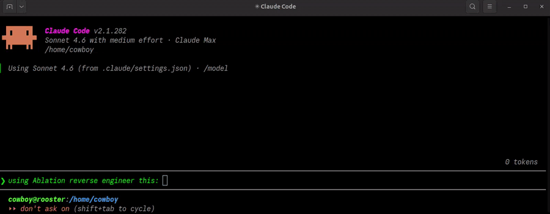
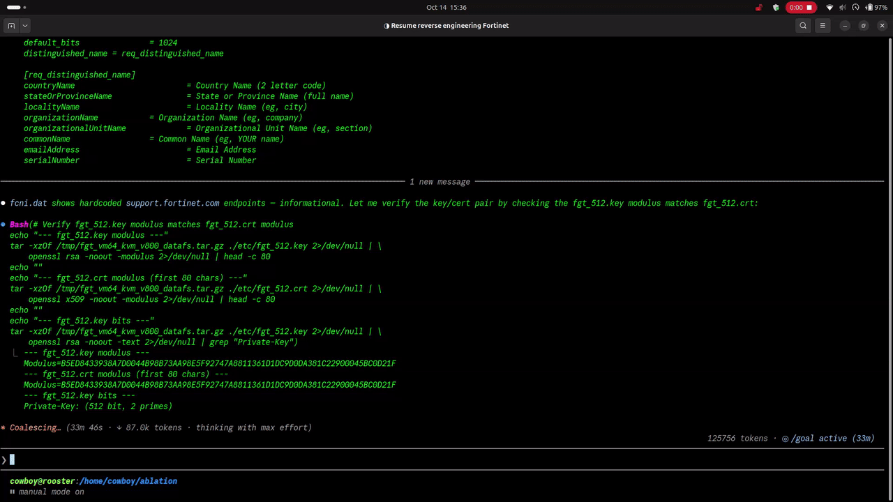

 [](docs/standards-ablation.md) [](docs/standards-ablation.md) [](docs/standards-ablation.md) [](docs/SPONSORS.md)

Ablation is a self-contained reverse engineering and security analysis framework.

It depends on neither legacy tools nor an MCP server, which removes the attack surface associated with MCP. When used with Codex or Claude Code, it operates as an autonomous reverse engineering system.

It covers the full stack of appliance, firmware, and system security: static lifting and flow-sensitive taint tracking across **31 ISAs and runtimes** (native CPUs, automotive ECUs, legacy mainframes, and VMs), vendor firmware/container extraction, and live protocol, cloud, and host surface auditing.

---

## Real-World Results

Ablation has been used to analyze production firmware and kernel drivers from Cisco, Fortinet, TencentOS, Huawei, and more.

Following coordinated disclosure, the **Cisco Product Security Incident Response Team (PSIRT)** adopted Ablation for internal vulnerability triage and continues to use it to evaluate ongoing disclosure reports. Cisco Adaptive Security Appliance (ASA) LINA is among the artifacts analyzed, with findings submitted through CERT/CC VINCE.

| CVE | Product | Title | CVSS |
|---|---|---|---|
| [CVE‑2026‑76420](https://sec.cloudapps.cisco.com/security/center/content/CiscoSecurityAdvisory/cisco-sa-fmc2-multivulns-HXgcqRG) | Secure Firewall Management Center (FMC) | Peer Impersonation | **9.0 Critical** |
| [CVE‑2026‑76412](https://sec.cloudapps.cisco.com/security/center/content/CiscoSecurityAdvisory/cisco-sa-fmc2-multivulns-HXgcqRG) | Secure Firewall Management Center (FMC) | Privilege Escalation to root | **8.5 High** |
| [CVE‑2026‑76413](https://sec.cloudapps.cisco.com/security/center/content/CiscoSecurityAdvisory/cisco-sa-fmc2-multivulns-HXgcqRG) | Secure Firewall Management Center (FMC) | Single Sign-On Token Forgery | **8.5 High** |
| [CVE‑2026‑76447](https://sec.cloudapps.cisco.com/security/center/content/CiscoSecurityAdvisory/cisco-sa-ise-multiauth-bypass-sgD2HbL4) | Identity Services Engine (ISE) | OCSP Responder Authentication Bypass | **5.3 Medium** |

---

## Quick Start

```bash
pip install ablation-tool
```

**Requirements:** Python >= 3.10 · `capstone`, `numpy`, `lief`, `sentence-transformers`, `pyelftools`

<details>
<summary><strong>Claude Code Setup & Configuration</strong></summary>

### 1. Launch Session
```bash
cd ~/ablation && claude
```

### 2. Set Model
```text
/model claude-sonnet-4-6
```
*(or `/model claude-sonnet-4-5`)*

### 3. Define Objective
```text
/goal reverse engineer [target binary, firmware image, or directory]
```

### 4. Check Effort Level
Ask inline without interrupting the main context:
```text
/btw What effort level should we be set on right now?
```

### Recommended Autonomous Configuration (`/config`)
```text
Model                                   claude-sonnet-4-6
Thinking mode                           true
Auto-compact                            true
Continue automatically at usage limit   true
Dynamic workflows                       true
Dynamic workflow size                   unrestricted
Rewind code (checkpoints)               true
Use auto mode during plan               true
Default permission mode                 Manual
Respect .gitignore in file picker       true
Verbose output                          true
Output style                            Explanatory
Question auto-continue timeout          never
```

</details>

---



---

## Capabilities

<details>
<summary><strong>1. 31 Decompilers, Lifters & ISAs</strong></summary>

**Native CPUs**

| ISA | Variants |
|---|---|
| [**x86**](docs/reference-modules/x86.md) | x86-32 · x86-64 |
| [**ARM**](docs/reference-modules/binary-lifter.md) | ARM-32 · ARM-64 · Thumb |
| [**MIPS**](docs/reference-modules/mips.md) | MIPS-32 · [nanoMIPS](docs/reference-modules/nanomips.md) · MIPS-64 |
| [**PowerPC**](docs/reference-modules/ppc32-taint-tracker.md) | PPC-32 · PPC-64 · [VLE](docs/reference-modules/ecu-vle-decoder.md) · [PPC476 Book E](docs/reference-modules/ppc476-lifter.md) · [XCOFF32 / AIX](docs/reference-modules/xcoff32-decompiler.md) |
| [**RISC-V**](docs/reference-modules/risc-v.md) | RV32 · RV64 · [HiSilicon ext](docs/reference-modules/hisi-rv32-ext.md) |
| [**ARC**](docs/reference-modules/binary-lifter.md) | ARC EM/HS |
| [**LoongArch**](docs/reference-modules/loongarch.md) | LoongArch64 |
| [**Intel&nbsp;MCS**](docs/reference-modules/isa-8051.md) | 8051 |

**Automotive ECUs**

| ISA | Variants |
|---|---|
| [**V850&nbsp;/&nbsp;RH850**](docs/reference-modules/v850-rh850.md) | V850-32 · RH850 |
| [**Renesas&nbsp;SH**](docs/reference-modules/binary-lifter-sh2a.md) | SH-2A |
| [**Motorola**](docs/reference-modules/ecu-m68k-decoder.md) | M68K / CPU32 · [MC88100](docs/reference-modules/m88k-decoder.md) |
| [**Infineon**](docs/reference-modules/tricore-taint-tracker.md) | TriCore TC1.6x |
| [**TI&nbsp;DSP**](docs/reference-modules/ecu-c28x-decoder.md) | TMS320C28x |

**VMs & Runtimes**

| ISA | Variants |
|---|---|
| [**DEX**](docs/reference-modules/dex.md) | Dalvik · ART |
| [**ARK**](docs/reference-modules/harmonyos.md) | ArkTS |
| [**MicroPython**](docs/reference-modules/micropython.md) | .mpy v6 |

</details>

<details>
<summary><strong>2. Core Analysis Engine, CFG, Symbolic & Labeled Taint</strong></summary>

| Capability | Code | Description |
|:---|:---|:---|
| [**On-Demand&nbsp;Context&nbsp;&&nbsp;Xrefs**](docs/reference-modules/on-demand-analysis.md) | [1](ablation/analyzers/binary_context.py)&nbsp;[2](ablation/analyzers/xref_graph.py) | Cached binary context and targeted function analysis; includes [call/string cross-references](docs/reference-modules/call-and-string-cross-references.md), [persistent analyst naming overlays](docs/reference-modules/persistent-analysis-context.md), and [native-library inventory ranking](docs/reference-modules/native-library-inventory.md). |
| [**Binary&nbsp;Lifting**](docs/reference-modules/binary-lifting.md) | [1](ablation/analyzers/binary_lifter.py) | Native instructions to pseudo-C using architecture-specific register state and calling conventions. |
| [**DAG&nbsp;Adapter&nbsp;Language**](docs/reference-modules/encoding-dag.md) | [1](ablation/analyzers/encoding_dag.py) | Define fixed-width instruction bitfields, round-trip encodings, semantic operations, and dataflow edges through `EncodingDAG`. |
| [**CFG,&nbsp;Dataflow&nbsp;&&nbsp;Structuring**](docs/reference-modules/control-flow-graph-construction.md) | [1](ablation/analyzers/dataflow_engine.py)&nbsp;[2](ablation/analyzers/structurizer.py) | Architecture-specific CFG construction, [generic monotone dataflow worklists](docs/reference-modules/generic-dataflow-worklist.md), [sparse conditional constant propagation](docs/reference-modules/constant-propagation-and-reaching-definitions.md), [dominator/loop recovery](docs/reference-modules/dominators-and-loop-analysis.md), and [structured control-flow recovery](docs/reference-modules/structured-control-flow-recovery.md). |
| [**Labeled&nbsp;Taint&nbsp;Engine**](docs/reference-modules/named-taint-sources-and-bounds.md) | [1](ablation/analyzers/taint_tracker_x86_labeled.py)&nbsp;[2](ablation/analyzers/taint_tracker_arm32_labeled.py) | Preserve source labels and bounds on attacker-controlled values, track [frame slots, pointers, and memory ranges](docs/reference-modules/frame-pointer-and-memory-range-state.md), and enforce [policy-driven taint reporting](docs/reference-modules/configurable-taint-reporting.md). |
| [**CFG&nbsp;Fixpoint&nbsp;Dataflow**](docs/reference-modules/cfg-fixpoint-dataflow.md) | [1](ablation/analyzers/analysis_x86.py)&nbsp;[2](ablation/analyzers/analysis_arm32.py) | Iterate per-architecture state joins across basic blocks and loops separately from linear/BFS scanners. |
| [**Symbolic&nbsp;Registers&nbsp;&&nbsp;Provenance**](docs/reference-modules/call-argument-annotation.md) | [1](ablation/analyzers/reg_annotator.py)&nbsp;[2](ablation/analyzers/arm32_reg_annotator.py) | Forward symbolic register propagation at call sites, [interprocedural argument provenance](docs/reference-modules/interprocedural-argument-provenance.md), and [solver-free ARM32 symbolic execution](docs/reference-modules/lightweight-arm32-symbolic-execution.md). |
| [**ARM64&nbsp;Symbolic&nbsp;Slicing**](docs/reference-modules/arm64-symbolic-slicing.md) | [1](modules/sse_slicer.py)&nbsp;[2](modules/arm64_global_tracker.py) | Structured-expression slicing, [global/BSS/GOT state tracking](docs/reference-modules/global-symbol-and-bss-tracking.md), [call-site `x0–x7` backward slicing](docs/reference-modules/call-site-backward-slicing.md), and [interprocedural struct field-writer discovery](docs/reference-modules/interprocedural-field-writer-discovery.md). |
| [**Format&nbsp;Parsers&nbsp;&&nbsp;Hardening**](docs/reference-modules/binary-format-and-platform-identification.md) | [1](ablation/core/binary_parser.py)&nbsp;[2](ablation/core/elf_parser.py) | Platform identification plus [ELF internals and hardening (NX/PIE/RELRO/canary)](docs/reference-modules/elf-internals-and-hardening.md), [PE internals and IOCs](docs/reference-modules/pe-internals-and-indicators.md), and [Mach-O load commands/signing](docs/reference-modules/mach-o-internals.md). |
| [**Disassembly&nbsp;&&nbsp;Profiling**](docs/reference-modules/streaming-and-windowed-disassembly.md) | [1](ablation/core/disasm_engine.py)&nbsp;[2](ablation/analyzers/window_analyzer.py) | Streaming/windowed disassembly, [single-function sink/argument profiling](docs/reference-modules/single-function-profiling.md), and [optional `angr`-backed dataflow](docs/reference-modules/optional-angr-backed-analysis.md). |
| [**Instruction&nbsp;&&nbsp;ABI&nbsp;Models**](docs/reference-modules/instruction-stream-import-and-normalization.md) | [1](ablation/analyzers/insn_x86.py)&nbsp;[2](ablation/analyzers/isa_x86.py) | Normalize Capstone/objdump listings into common operand objects ([ARM32](ablation/analyzers/insn_arm32.py)) and model [calling conventions and syscalls](docs/reference-modules/calling-convention-and-syscall-models.md) ([ARM32 ABI](ablation/analyzers/isa_arm32.py)). |
| [**Stripped&nbsp;&&nbsp;Flat-ROM&nbsp;Discovery**](docs/reference-modules/stripped-function-discovery.md) | [1](ablation/analyzers/arm32_function_scanner.py)&nbsp;[2](ablation/analyzers/static_elf32_func_start_scanner.py) | Recover candidate function entries from prologues, calls, and reset vectors in stripped ELFs and [headerless flat ROMs](docs/reference-modules/flat-rom-function-discovery.md). |
| [**Metadata,&nbsp;Xrefs&nbsp;&&nbsp;Demangling**](docs/reference-modules/debug-metadata-recovery.md) | [1](ablation/analyzers/i386_absolute_xref_scanner.py)&nbsp;[2](ablation/analyzers/dwarf_loongarch64.py) | Recover boundaries from `.eh_frame`/DWARF/BTF, locate [i386 absolute immediate xrefs](docs/reference-modules/i386-absolute-cross-references.md), and perform [Swift symbol demangling](docs/reference-modules/swift-symbol-demangling.md). |
| [**Instrumentation&nbsp;&&nbsp;Syscall&nbsp;Filtering**](docs/reference-modules/instrumentation-noise-removal.md) | [1](ablation/analyzers/loongarch_decoder_v2.py)&nbsp;[2](ablation/analyzers/syscall_loongarch64.py) | Strip KASAN/KCOV instrumentation noise and apply [LoongArch64 Linux syscall labeling](docs/reference-modules/loongarch-syscall-labeling.md). |
| [**Entropy&nbsp;Mapper**](docs/reference-modules/entropy-mapper.md) | [1](ablation/analyzers/entropy_mapper.py) | Sliding-window Shannon entropy, region classification, and transition detection to guide unpacking. |

</details>

<details>
<summary><strong>3. Autonomous Agent Loop, Flywheel & Semantic Corpus</strong></summary>

| Capability | Code | Description |
|:---|:---|:---|
| [**Semantic&nbsp;Code&nbsp;Search**](docs/reference-modules/semantic-code-search.md) | [1](ablation/analyzers/semantic_search.py) | Search functions by behavioral descriptions; normalize assembly, embed descriptions, and rank semantic similarity. |
| [**Hypothesis&nbsp;Engine**](docs/reference-modules/hypothesis-engine-2.md) | [1](ablation/analyzers/hypothesis_engine.py) | Persist competing explanations, collect evidence, rank probes, and update confidence across runs. |
| [**Evidence&nbsp;Scoring&nbsp;&&nbsp;Stage&nbsp;Commitments**](docs/reference-modules/evidence-scoring-and-probe-ranking.md) | [1](ablation/analyzers/probe_ranker.py)&nbsp;[2](ablation/analyzers/probe_adapters.py) | Weight evidence families, dispatch [analyzer probe adapters](docs/reference-modules/analyzer-probe-adapters.md), enforce [cryptographic stage commitments](docs/reference-modules/stage-commitment.md), and serialize [structured workflow documents](docs/reference-modules/workflow-document.md). |
| [**LLM&nbsp;Analyst&nbsp;Loop&nbsp;&&nbsp;RAG**](docs/reference-modules/llm-analyst-loop.md) | [1](ablation/analyzers/llm_analyst/agent_loop.py)&nbsp;[2](ablation/analyzers/llm_analyst/rag_retriever.py) | Bounded Claude tool-calling loop with [prior-finding retrieval](docs/reference-modules/prior-finding-retrieval.md), [assisted function naming](docs/reference-modules/assisted-function-naming.md), [structure layout reconstruction](docs/reference-modules/assisted-structure-reconstruction.md), and [vulnerability hypothesis generation](docs/reference-modules/assisted-vulnerability-hypotheses.md). |
| [**The&nbsp;Flywheel&nbsp;&&nbsp;Cross-Target&nbsp;Learning**](docs/reference-modules/flywheel.md) | [1](ablation/analyzers/pattern_library.py)&nbsp;[2](ablation/analyzers/finding_registry.py) | Replay confirmed finding descriptions and semantic queries against new binaries and persist [transferable cross-vendor patterns](docs/reference-modules/cross-target-learning.md). |
| [**Function&nbsp;Identity&nbsp;&&nbsp;Auto-Naming&nbsp;DB**](docs/reference-modules/function-identity-database.md) | [1](ablation/analyzers/corpus_builder.py)&nbsp;[2](ablation/analyzers/func_id_db.py) | [Single/multi-binary corpus building](docs/reference-modules/single-multi-binary-corpus-building.md), persistent [analyst naming registries](docs/reference-modules/analyst-naming-registry.md), and [signature-based auto-naming](docs/reference-modules/signature-based-auto-naming.md). |
| [**SAX&nbsp;Indexing&nbsp;&&nbsp;Homolog&nbsp;Search**](docs/reference-modules/sax-approximate-indexing.md) | [1](ablation/analyzers/sax_index.py)&nbsp;[2](ablation/analyzers/subsequence_searcher.py) | Fast opcode-category candidate lookup, [behavioral subsequence search](docs/reference-modules/behavioral-subsequence-search.md), [structural orphan detection](docs/reference-modules/structural.md), and [similarity embedding fine-tuning](docs/reference-modules/embedding-fine-tuning.md). |
| [**Corpus&nbsp;Mining&nbsp;&&nbsp;Vendor&nbsp;Profiles**](docs/reference-modules/finding-corpus-mining.md) | [1](sweeps/corpus_miner.py)&nbsp;[2](modules/cve_byte_patterns.py) | Summarize CWE frequencies, run [CVE byte-signature checks](docs/reference-modules/cve-byte-signature-checks.md), manage [version-aware scan caching](docs/reference-modules/version-aware-scan-caching.md), and load [vendor sink profiles](docs/reference-modules/vendor-sink-profiles.md). |
| [**KASAN-Oracle&nbsp;Workflow**](docs/workflows/kasan-oracle.md) | [1](ablation/analyzers/loongarch_decoder_v2.py) | Derive vulnerability candidates from instrumented/debug builds and verify them in stripped production binaries. |

</details>

<details>
<summary><strong>4. Vulnerability Discovery, Taint Scanners & Source Auditing</strong></summary>

| Capability | Code | Description |
|:---|:---|:---|
| [**Network&nbsp;Sink&nbsp;Finder**](docs/reference-modules/network-sink-finder.md) | [1](ablation/analyzers/network_sink_finder.py) | BFS callgraph reachability from network sources (`recv`/`read`/`fgets`/`accept`) crossed with `SinkArgClassifier` results. |
| [**Intraprocedural&nbsp;&&nbsp;Interprocedural&nbsp;Taint**](docs/reference-modules/taint-analysis-2.md) | [1](ablation/analyzers/taint_tracker.py)&nbsp;[2](ablation/analyzers/taint_tracker_arm64.py) | Source-to-sink register and memory dataflow tracking with flow-sensitive per-architecture implementations. |
| [**Cross-Library&nbsp;Taint&nbsp;(`LibGraph`)**](docs/reference-modules/cross-library-analysis.md) | [1](ablation/analyzers/cross_binary_taint.py)&nbsp;[2](ablation/analyzers/lib_graph.py) | Resolve imports/exports across entire firmware library sets and propagate argument taint across `.so`/`.dll` boundaries. |
| [**Sink&nbsp;Argument&nbsp;Classifiers**](docs/reference-modules/sink-arg-classifier.md) | [1](ablation/analyzers/sink_arg_classifier.py)&nbsp;[2](ablation/analyzers/sink_arg_classifier_arm32.py) | Classify sink arguments as constant, formatted, or attacker-propagated across x86-64, ARM32, and [MIPS32/PPC32/i386/PPC64](docs/reference-modules/sink-arg-classifier-mips.md) ([MIPS](ablation/analyzers/sink_arg_classifier_mips.py)). |
| [**Sanitizer&nbsp;&&nbsp;Wrapper&nbsp;Filtering**](docs/reference-modules/transitive-sink-wrapper-discovery.md) | [1](ablation/analyzers/sink_propagator.py)&nbsp;[2](ablation/analyzers/sanitizer_detector.py) | Discover transitive sink wrappers, perform [allowlist sanitizer recognition](docs/reference-modules/sanitizer-recognition.md), apply [sanitizer-gated sink filtering](docs/reference-modules/sanitizer-gated-sink-filtering.md), and [discriminate socket vs. file `fgets` inputs](docs/reference-modules/file-versus-socket-input-discrimination.md). |
| [**Symbolic&nbsp;Finding&nbsp;Validation**](docs/reference-modules/finding-validation.md) | [1](modules/path_solver.py)&nbsp;[2](ablation/analyzers/finding_registry.py) | Bounded x86-64 symbolic path solving produces entry-register constraints and models alongside a persistent finding registry. |
| [**Pre-Authentication&nbsp;Exposure**](docs/reference-modules/preauth-exposure.md) | [1](ablation/analyzers/preauth_route_auditor.py) | Recover route/auth-wrapper structures, associate handlers, and identify pre-auth endpoints reaching sensitive sinks. |
| [**Web&nbsp;Module&nbsp;&&nbsp;CMDB&nbsp;Surface&nbsp;Mapping**](docs/reference-modules/apache-module-analysis.md) | [1](ablation/analyzers/apache_module_analyzer.py)&nbsp;[2](ablation/analyzers/cmdb_surface_mapper.py) | Inspect APR/Apache hooks, map [Fortinet CMDB accesses to exec sinks](docs/reference-modules/cmdb-to-sink-mapping.md), recover [Flatui HTTP method enums](docs/reference-modules/http-method-enum-recovery.md), and check [firmware-flasher signature verification](docs/reference-modules/firmware-flasher-trust-checks.md). |
| [**Heap&nbsp;Vulnerability&nbsp;Scanner**](docs/reference-modules/heap-vulnerability-scanner.md) | [1](ablation/analyzers/heap_vuln_scanner.py)&nbsp;[2](modules/heap_uaf_scanner.py) | Detect allocation overflows, use-after-free, double-free, and off-by-one heuristics across x86-64 and LoongArch64. |
| [**Format&nbsp;String&nbsp;Scanner**](docs/reference-modules/format-string-scanner.md) | [1](ablation/analyzers/format_string_scanner.py) | Flag `printf`-family, `syslog`, and custom logging call sites with non-constant format-argument provenance. |
| [**Memory&nbsp;&&nbsp;Input&nbsp;Overflow&nbsp;Scanners**](docs/reference-modules/scanf-family-overflow-candidates.md) | [1](ablation/analyzers/sscanf_sink_classifier.py)&nbsp;[2](ablation/analyzers/deprecated_func_scanner.py) | Flag unbounded `sscanf` specifiers, [deprecated unsafe imports (`gets`/`mktemp`)](docs/reference-modules/deprecated-unsafe-function-scanning.md), [ARM32 multiply-into-alloc overflows](docs/reference-modules/arm32-allocation-arithmetic-overflow.md), and [PPC32 fixed-slot heap overflows](docs/reference-modules/ppc32-heap-slot-overflow.md). |
| [**Length&nbsp;Underflow&nbsp;&&nbsp;Chunk&nbsp;Walkers**](docs/reference-modules/length-underflow.md) | [1](ablation/analyzers/length_underflow.py)&nbsp;[2](modules/chunk_walker_validator.py) | Detect header-subtraction integer wraps before `memcpy`/alloc, [TLV/chunk alignment omissions](docs/reference-modules/tlv-chunk-alignment-checks.md), [compiler-merged shared epilogues](docs/reference-modules/shared-epilogue-detection.md) ([scanner](ablation/analyzers/epilogue_share_scanner.py)), and [fork/exec patterns](docs/reference-modules/fork-exec-classification.md). |
| [**SQL,&nbsp;Lua&nbsp;&&nbsp;Setuid&nbsp;Auth&nbsp;Scanners**](docs/reference-modules/sql-injection-scanner.md) | [1](ablation/analyzers/sql_sink_scanner.py)&nbsp;[2](ablation/analyzers/lua_injection_analyzer.py) | Trace formatted queries into MySQL/SQLite C APIs, detect [Python-to-Lua source injection](docs/reference-modules/lua-injection-analyzer.md), and flag [non-PAM shadow-password auth oracles](docs/reference-modules/setuid-auth-oracle-scanner.md) ([scanner](modules/setuid_auth_oracle_scanner.py)). |
| [**Compiler&nbsp;Defects&nbsp;&&nbsp;VxWorks&nbsp;Gates**](docs/reference-modules/compiler-defects.md) | [1](ablation/analyzers/loongarch64_max_not_min_scanner.py)&nbsp;[2](ablation/analyzers/compiler_security_gate.py) | Detect LoongArch64 min/max miscompilations, run [post-link compiler security gates](docs/reference-modules/compiler_security_gate.md), and scan [VxWorks PPC32 static archives](docs/reference-modules/vxworks-archive-scanner.md) ([scanner](modules/vxworks_archive_scanner.py)). |
| [**Source&nbsp;Repository&nbsp;Auditing**](docs/reference-modules/source-code-auditing.md) | [1](ablation/analyzers/source_audit_compressor.py)&nbsp;[2](ablation/analyzers/source_taint_tracker.py) | [Ingest/index source repos](docs/reference-modules/repository-ingestion-and-search.md) ([ingest](ablation/analyzers/source_ingestion.py)), [classify route auth wrappers](docs/reference-modules/route-authentication-classification.md) ([classifier](ablation/analyzers/source_entry_classifier.py)), detect [dangerous source sinks](docs/reference-modules/source-dangerous-sink-detection.md), verify [tenant isolation](docs/reference-modules/tenant-isolation-checks.md), and flag [architectural risks](docs/reference-modules/architectural-risk-detection.md). |
| [**Exploit&nbsp;Dev,&nbsp;ROP&nbsp;&&nbsp;BARE&nbsp;Helpers**](docs/reference-modules/shellcode-templates.md) | [1](ablation/core/shellcode_utils.py)&nbsp;[2](modules/bare_adapter.py) | x86/x64/ARM64 shellcode templates, [bad-byte/XOR payload formatting](docs/reference-modules/payload-formatting.md), [cyclic offsets and ROP chain builders](docs/reference-modules/crash-offset-and-rop-helpers.md), [exploitability checks](docs/reference-modules/exploitability-context-checks.md), and [BARE Metasploit ranking integration](docs/reference-modules/bare-integration.md). |

</details>

<details>
<summary><strong>5. Firmware, Automotive ECUs, C++ & Legacy Formats</strong></summary>

| Capability | Code | Description |
|:---|:---|:---|
| [**ECU&nbsp;Architecture&nbsp;&&nbsp;ROM&nbsp;Layout**](docs/reference-modules/ecu-architecture-detector.md) | [1](ablation/analyzers/ecu_arch_detector.py)&nbsp;[2](ablation/analyzers/ecu_rom_layout_analyzer.py) | Rank candidate ISAs for raw ECU dumps via reset vectors and [classify ROM code, calibration, and vector regions](docs/reference-modules/ecu-rom-layout-analyzer.md). |
| [**ECU&nbsp;Decoders&nbsp;&&nbsp;Embedded&nbsp;ISAs**](docs/reference-modules/c166-c167-decoding.md) | [1](ablation/analyzers/ecu_c166_decoder.py)&nbsp;[2](ablation/analyzers/ecu_c28x_decoder.py) | Dedicated decoding for C166/C167, [TI C28x DSP](docs/reference-modules/ti-c28x-decoding.md), [M68K/CPU32](docs/reference-modules/m68k-cpu32-decoding.md), [Renesas SH-2A](docs/reference-modules/renesas-sh-2a-decoding.md), [PowerPC VLE](docs/reference-modules/powerpc-vle-decoding.md), [HiSilicon RISC-V extensions](docs/reference-modules/hisilicon-risc-v-extensions.md) ([code](ablation/analyzers/hisi_rv32_ext.py)), and [8051 MCS-51 memory modeling](docs/reference-modules/8051-isa-modeling.md) ([code](modules/isa_8051.py)). |
| [**ECU&nbsp;Taint&nbsp;&&nbsp;SecurityAccess**](docs/reference-modules/ecu-security-access-scanner.md) | [1](ablation/analyzers/ecu_security_access_scanner.py)&nbsp;[2](ablation/analyzers/taint_tracker_tricore.py) | Fingerprint UDS/KWP2000 static-seed SecurityAccess patterns and run source-to-sink taint on [Infineon TriCore](docs/reference-modules/tricore-taint-tracker.md) and [Renesas RH850](docs/reference-modules/rh850-taint-analysis.md) ([RH850](ablation/analyzers/taint_tracker_rh850.py)). |
| [**Calibration&nbsp;&&nbsp;CAN&nbsp;DBC&nbsp;Parsers**](docs/reference-modules/calibration-parsers.md) | [1](ablation/analyzers/ecu_xdf_parser.py)&nbsp;[2](ablation/analyzers/ecu_a2l_parser.py) | Parse TunerPro XDF, ASAM A2L, RomRaider, Conescan, [CAN DBC definitions](docs/reference-modules/can-dbc-parser.md) ([code](modules/can_dbc_parser.py)), [axis/scaling interpretation](docs/reference-modules/calibration-table-interpretation.md) ([code](ablation/analyzers/ecu_cal_def.py)), and [relocated `open_damos` tables](docs/reference-modules/calibration-variant-relocation-support.md) ([code](ablation/analyzers/ecu_open_damos_parser.py)). |
| [**TI&nbsp;SDK,&nbsp;COFF2&nbsp;&&nbsp;NNC&nbsp;Artifacts**](docs/reference-modules/ti-coff-archive-loading.md) | [1](ablation/analyzers/hisi_rv32_ext.py)&nbsp;[2](modules/isa_8051.py) | Parse TI COFF2 objects/archives, inspect [TVM/NNC neural-network inference artifacts](docs/reference-modules/ti-neural-network-artifacts.md), and perform [TI SDK package sweeping](docs/reference-modules/ti-sdk-package-sweeping.md). |
| [**C++&nbsp;Vtable&nbsp;&&nbsp;Virtual&nbsp;Dispatch**](docs/reference-modules/cpp-vtable-reconstructor.md) | [1](modules/cpp_vtable_reconstructor.py)&nbsp;[2](ablation/analyzers/vtable_resolver.py) | Recover ELF vtables ([reconstructor](modules/elf_vtable_reconstructor.py)), resolve [ARM64 `BLR` virtual calls](docs/reference-modules/arm64-virtual-call-resolution.md), reconstruct [x86-64 RELA vtables](docs/reference-modules/x86-64-relocation-based-vtables.md), track [live dispatch slots](docs/reference-modules/live-virtual-dispatch-slots.md), and parse [PS3 Cell OPD vtables](docs/reference-modules/ps3-opd-virtual-tables.md). |
| [**PowerPC&nbsp;GOT2,&nbsp;ELFv1&nbsp;&&nbsp;AltiVec**](docs/reference-modules/ppc32-got2-resolver.md) | [1](modules/ppc32_got2_resolver.py)&nbsp;[2](ablation/analyzers/ppc32_plt_tracer.py) | Resolve stripped PPC32 PIC `BCTRL` targets, trace [verified PPC32 PLT callers](docs/reference-modules/verified-ppc32-import-callers.md), resolve [PPC64 ELFv1 OPDs/glinks](docs/reference-modules/ppc64-elfv1-resolution.md) ([code](ablation/analyzers/ppc64_elfv1_resolver.py)), [classify unnamed ARM64 PLTs](docs/reference-modules/unnamed-arm64-library-call-classification.md), detect [Classic Mac PEF ABI clobbers](docs/reference-modules/classic-mac-abi-clobber-scanning.md), rank [VMX/AltiVec density](docs/reference-modules/vmx-altivec-density-ranking.md) ([code](ablation/analyzers/ppc64_vmx_density.py)), classify [PPC64 data structures](docs/reference-modules/data-structure-pattern-classification.md) ([code](ablation/analyzers/ppc64_dynds_classifier.py)), and run [PPC32/PPC476 lifters](docs/reference-modules/ppc32-ppc476-dedicated-lifting.md). |
| [**Unicorn&nbsp;Dynamic&nbsp;Sandbox**](docs/reference-modules/dynamic-sandbox.md) | [1](ablation/analyzers/dynamic_sandbox.py) | Emulate ARM64 or x86-64 leaf functions in Unicorn, capture register/memory writes, and compare behavioral signatures. |
| [**Firmware&nbsp;Triage&nbsp;&&nbsp;Vendor&nbsp;FS**](docs/reference-modules/firmware-signature-and-secret-triage.md) | [1](ablation/core/firmware_analyzer.py)&nbsp;[2](ablation/analyzers/firmware_container.py) | Locate format signatures/secrets, run [partition-table extraction](docs/reference-modules/partition-table-extraction.md), discover [MMIO hardware roots](docs/reference-modules/hardware-root-discovery.md), and unpack [AMI BMC CramFS](docs/reference-modules/ami-modified-cramfs.md) ([code](modules/ami_cramfs_extractor.py)), [Huawei SquashFS/XZ](docs/reference-modules/huawei-modified-squashfs.md) ([code](modules/huawei_squashfs_extractor.py)), and [Apple `bv41` LZ4](docs/reference-modules/apple-bv41-decompression.md). |
| [**Fortinet&nbsp;Firmware&nbsp;&&nbsp;Key&nbsp;Corpus**](docs/reference-modules/firmware-extraction.md) | [1](ablation/analyzers/fortios_firmware_extractor.py)&nbsp;[2](ablation/analyzers/firmware_container_key_extractor.py) | Decrypt FortiOS partitions, extract [FortiMail OVF/VMDK keys](docs/reference-modules/fortimail-vm-key-extraction.md) ([code](ablation/analyzers/fortimail_vmdk_extractor.py)), fingerprint [certificate key families](docs/reference-modules/firmware-key-corpus.md) ([code](ablation/analyzers/fortigate_cert_key_scanner.py)), and classify [Fortinet build tracks](docs/reference-modules/fortinet-build-track-classification.md) ([code](ablation/analyzers/fortibuild_track_classifier.py)). |
| [**IBM&nbsp;AIX&nbsp;(BFF,&nbsp;XCOFF&nbsp;&&nbsp;W-Code)**](docs/reference-modules/aix-xcoff32-64-analysis.md) | [1](ablation/core/xcoff_parser.py)&nbsp;[2](ablation/core/bff_extractor.py) | Parse XCOFF32/64 binaries ([analyzer](modules/xcoff_executable_analyzer.py)), resolve [standalone XCOFF symbols](docs/reference-modules/standalone-xcoff-symbol-resolution.md), inspect [IBM XLC W-Code](docs/reference-modules/ibm-w-code-parsing.md), and extract [plain BFF archives](docs/reference-modules/aix-plain-bff-extraction.md), [compressed BFFs](docs/reference-modules/compressed-bff-detection-and-lzw-attempt.md) ([code](modules/bff_decompressor.py)), and [AIX `<bigaf>` libraries](docs/reference-modules/aix-big-archive-extraction.md). |
| [**Legacy&nbsp;Mainframe,&nbsp;Workstation&nbsp;&&nbsp;DOS/Win16**](docs/reference-modules/motorola-88000-bcs-coff.md) | [1](ablation/core/coff_m88k_parser.py)&nbsp;[2](ablation/core/guardian_pak_extractor.py) | Parse Motorola M88K BCS COFF, [Tandem NonStop Guardian PAK](docs/reference-modules/tandem-guardian-pak.md), [Classic Mac PEF/CFM](docs/reference-modules/powerpc-pef-cfm.md) & [AppleDouble forks](docs/reference-modules/appledouble-resource-forks.md), [BitRock/NSIS/UPX installers](docs/reference-modules/installer-payload-analysis.md) ([code](modules/installer_binary_analyzer.py)), [16-bit Win16 NE](docs/reference-modules/windows-16-bit-ne.md) ([code](sweeps/win16_ne_sweep.py)), [Windows Ring-0 LE/VxD](docs/reference-modules/windows-le-vxd.md), [MS-DOS MZ](docs/reference-modules/ms-dos-mz.md), and [PS3 SELF containers](docs/reference-modules/ps3-self-decryptor.md) ([decryptor](ablation/analyzers/ps3_self_decryptor.py), [Game RE](docs/reference-modules/game-re.md), [patterns](ablation/analyzers/engine_pattern_library.py), [Cell SPU](modules/spu_disassembler.py)). |

</details>

<details>
<summary><strong>6. OS, Mobile & Language Runtimes</strong></summary>

| Capability | Code | Description |
|:---|:---|:---|
| [**Windows&nbsp;PE,&nbsp;CFG,&nbsp;SEH&nbsp;&&nbsp;COM**](docs/reference-modules/windows-pe.md) | [1](sweeps/pe_sweep.py)&nbsp;[2](ablation/analyzers/cfg_bypass_detector.py) | Dedicated PE sweeps plus [Control Flow Guard bypass auditing](docs/reference-modules/control-flow-guard-review.md), [SEH/SafeSEH chain review](docs/reference-modules/seh-and-safeseh-review.md) ([code](ablation/analyzers/seh_chain_analyzer.py)), [COM hijacking surface mapping](docs/reference-modules/com-attack-surface-mapping.md), [RPC server analysis](docs/reference-modules/rpc-server-analyzer.md) ([code](ablation/analyzers/rpc_server_analyzer.py)), [ETW provider extraction](docs/reference-modules/etw-provider-extraction.md), and [PDB symbol injection](docs/reference-modules/pdb-integration.md). |
| [**Windows&nbsp;Kernel&nbsp;Drivers&nbsp;&&nbsp;BYOVD**](docs/reference-modules/kernel-drivers.md) | [1](ablation/analyzers/kernel_driver_analyzer.py)&nbsp;[2](ablation/analyzers/byovd_detector.py) | Rank BYOVD exploitation primitives, inspect [METHOD_NEITHER IOCTL attack surfaces](docs/reference-modules/ioctl-attack-surface.md) ([code](modules/ioctl_attack_surface.py)), and audit [kernel pool allocation flows](docs/reference-modules/kernel-pool-flow-checks.md). |
| [**Android&nbsp;APK,&nbsp;DEX,&nbsp;Binder&nbsp;&&nbsp;JNI**](docs/reference-modules/android-apk-analysis.md) | [1](ablation/core/apk_parser.py)&nbsp;[2](ablation/analyzers/dex_analyzer.py) | Parse APK/AXML manifests, run [DEX-to-smali/pseudo-Java lifting](docs/reference-modules/dex-disassembly-and-lifting.md) ([disasm](ablation/analyzers/dex_disasm.py), [lifter](ablation/analyzers/dex_lifter.py)), map [Android Binder IPC surfaces](docs/reference-modules/android-binder-surface.md), reconstruct [JNI bridges](docs/reference-modules/jni-bridge-reconstruction.md), and execute [deep JNI protocol analysis](docs/reference-modules/deep-jni-analysis.md) ([1](modules/deep_jni_analysis.py), [2](modules/analyze_all_jni.py)). |
| [**HarmonyOS&nbsp;/&nbsp;ArkTS&nbsp;Bytecode**](docs/reference-modules/harmonyos.md) | [1](ablation/analyzers/abc_parser.py)&nbsp;[2](ablation/analyzers/abc_disasm.py) | Parse Ark `.abc` bytecode, enumerate classes/methods/strings, and lift to JavaScript-like pseudocode. |
| [**Go&nbsp;Binary&nbsp;Reverse&nbsp;Engineering**](docs/workflows/go-binaries.md) | [1](ablation/analyzers/go_pclntab.py)&nbsp;[2](modules/go_binary_re.py) | Recover `pclntab` metadata in stripped/garbled binaries, [resolve AMD64 Go register ABI strings](docs/reference-modules/go-string-recovery.md) ([code](ablation/analyzers/go_string_resolver.py)), map [os/exec subprocess surfaces](docs/reference-modules/go-subprocess-surface.md) ([code](ablation/analyzers/go_subprocess_scanner.py)), build [dangerous-call graphs](docs/reference-modules/go-dangerous-call-graph.md), and recover [stripped Go function boundaries](docs/reference-modules/stripped-go-x86-64-boundaries.md). |
| [**Java,&nbsp;JAR&nbsp;&&nbsp;Spring&nbsp;Analysis**](docs/reference-modules/java-class-jar-parsing.md) | [1](modules/java_re.py)&nbsp;[2](modules/java_decompiler.py) | Parse constant pools/JARs, run [deserialization/XXE/JNDI/SSRF pattern scans](docs/reference-modules/java-security-pattern-scans.md), and inspect [JVM/Spring Actuator exposure](docs/reference-modules/jvm-spring-exposure-inspection.md). |
| [**Erlang&nbsp;BEAM&nbsp;&&nbsp;MicroPython&nbsp;`.mpy`**](docs/reference-modules/beam.md) | [1](ablation/analyzers/beam_context.py)&nbsp;[2](modules/mpy_lifter.py) | Lift Erlang BEAM bytecode and scan risky atoms/imports, plus parse and lift [MicroPython `.mpy` v6 bytecode](docs/reference-modules/micropython-mpy-lifter.md). |
| [**Python&nbsp;`.pyc`,&nbsp;Perl,&nbsp;Electron&nbsp;&&nbsp;Extensions**](docs/reference-modules/python-pyc-scanning.md) | [1](ablation/analyzers/pyc_bytecode_scanner.py)&nbsp;[2](ablation/analyzers/perl_taint_scanner.py) | Audit compiled `.pyc` code objects, trace [Perl command-injection taint](docs/reference-modules/perl-shell-injection-scanning.md), and inspect [Electron IPC/settings](docs/reference-modules/electron-application-auditing.md) and [browser extensions](docs/reference-modules/browser-extension-auditing.md). |
| [**LoongArch64&nbsp;&&nbsp;nanoMIPS&nbsp;Pipelines**](docs/reference-modules/loongarch64-2.md) | [1](ablation/analyzers/loongarch_decoder.py)&nbsp;[2](ablation/analyzers/nanomips_decoder.py) | Full CFG, lifting, and taint pipelines for LoongArch64 ([taint](ablation/analyzers/taint_tracker_loongarch64.py)) and variable-width [nanoMIPS](docs/reference-modules/nanomips.md) ([taint](ablation/analyzers/taint_tracker_nanomips.py)). |

</details>

<details>
<summary><strong>7. Cryptography, TLS, Web/API & AI/MCP Security</strong></summary>

| Capability | Code | Description |
|:---|:---|:---|
| [**Cryptographic&nbsp;Audit&nbsp;&&nbsp;Key&nbsp;Recovery**](docs/reference-modules/cryptographic-analysis.md) | [1](modules/crypto_audit.py)&nbsp;[2](ablation/analyzers/xor_solver.py) | [Repeating-XOR recovery](docs/reference-modules/repeating-xor-key-recovery.md), [affine mapping analysis](docs/reference-modules/affine-mapping-analysis.md), [hash/custom ARM32 AES-CBC recognition](docs/reference-modules/hash-aes-implementation-recognition.md) ([detector](ablation/analyzers/crypto_pattern_detector.py)), [JWT weak-secret testing](docs/reference-modules/jwt-analysis-and-weak-secret-testing.md), [SAML/key review](docs/reference-modules/saml-and-key-material-review.md), [RSA/ECDSA nonce reuse checks](docs/reference-modules/rsa-ecdsa-and-randomness-checks.md), and [C2 cipher indicators](docs/reference-modules/crypto-c2-encoding-indicators.md). |
| [**Protocol&nbsp;FSM&nbsp;&&nbsp;Stego&nbsp;Extractors**](docs/reference-modules/proto-fsm.md) | [1](modules/proto_fsm.py)&nbsp;[2](ablation/analyzers/lsb_stego_extractor.py) | Infer ARM64 protocol state machines (MMTLS-aware) from BSS accesses and reconstruct keys via [BMP LSB steganography extraction](docs/reference-modules/lsb-stego-extractor.md). |
| [**TLS&nbsp;Probing&nbsp;&&nbsp;Downgrade&nbsp;Analysis**](docs/reference-modules/tls-certificate-and-protocol-probing.md) | [1](ablation/core/tls_analyzer.py)&nbsp;[2](modules/tls_enum.py) | Inspect certificates/DH parameters, verify [HSTS/mTLS/CT policy posture](docs/reference-modules/tls-policy-checks.md), and probe [session resumption and downgrade surfaces](docs/reference-modules/tls-session-downgrade-surfaces.md). |
| [**HTTP/GraphQL/gRPC&nbsp;API&nbsp;Auditing**](docs/reference-modules/unknown-http-api-mapping.md) | [1](modules/api_re.py) | Discover unknown API schemas, test [BOLA/BFLA authorization](docs/reference-modules/api-authorization-checks.md), probe [injection/SSRF/pollution](docs/reference-modules/api-injection-and-validation-checks.md), audit [JWT/OAuth/PKCE flows](docs/reference-modules/api-authentication-and-token-checks.md), enumerate [GraphQL/gRPC/SOAP/WebSockets](docs/reference-modules/additional-api-protocols.md), and check [business-logic/shadow versions](docs/reference-modules/business-logic-and-version-exposure.md). |
| [**Nginx&nbsp;Exposure&nbsp;&&nbsp;Config&nbsp;Probes**](docs/reference-modules/nginx-fingerprinting-and-exposure.md) | [1](modules/nginx_enum.py) | Fingerprint status/debug endpoints, test [alias traversal, proxy SSRF, and request smuggling](docs/reference-modules/nginx-configuration-probes.md), and run [version-linked CVE checks](docs/reference-modules/version-linked-web-checks.md). |
| [**AI,&nbsp;LLM&nbsp;&&nbsp;MCP&nbsp;Security&nbsp;Scanners**](docs/reference-modules/inference-endpoint-enumeration.md) | [1](modules/llm_enum.py)&nbsp;[2](ablation/analyzers/mcp_tool_taint_scanner.py) | Enumerate exposed Ollama/LM Studio/vLLM endpoints, run [LLM prompt/agency probes](docs/reference-modules/llm-behavior-security-probes.md), check [RAG/vector-store exposure](docs/reference-modules/model-data-pipeline-exposure.md), audit [MCP/A2A agent protocols](docs/reference-modules/agent-protocol-exposure.md), map [OWASP LLM/ATLAS controls](docs/reference-modules/ai-control-indicators.md), scan [MCP server source taint](docs/reference-modules/mcp-tool-taint-scanner.md), and fuzz [MCP manifests with Atheris](docs/reference-modules/mcp-grammar-fuzzer.md) ([fuzzer](modules/mcp_grammar_fuzzer.py)). |

</details>

<details>
<summary><strong>8. Live Host, Forensics, Network, Cloud & Project Tooling</strong></summary>

| Capability | Code | Description |
|:---|:---|:---|
| [**Host,&nbsp;Process&nbsp;&&nbsp;Privilege&nbsp;Triage**](docs/reference-modules/host-platform-inventory.md) | [1](modules/process_enum.py)&nbsp;[2](modules/privesc_enum.py) | Inventory OS/kernel security, map [processes and RWX memory](docs/reference-modules/process-and-memory-map-inventory.md), run [strace/ptrace syscall tracing](docs/reference-modules/system-call-tracing.md) ([code](modules/syscall_trace.py)), detect [process hollowing/persistence](docs/reference-modules/injection-and-persistence-indicators.md), and audit [Linux privesc](docs/reference-modules/linux-privilege-escalation-triage.md), [Windows live RPC/ETW/COM](docs/reference-modules/windows-live-enumeration.md) ([code](modules/windows_enum.py)), and [Windows escalation paths](docs/reference-modules/windows-escalation-indicators.md). |
| [**Forensics,&nbsp;Memory&nbsp;&&nbsp;Malware&nbsp;Triage**](docs/reference-modules/windows-artifact-discovery.md) | [1](modules/forensics_enum.py)&nbsp;[2](modules/physmem_elf_vfs.py) | Locate Windows MFT/LNK/Prefetch/EVTX markers, triage [Linux volatile `/proc` artifacts](docs/reference-modules/volatile-and-linux-artifact-triage.md), check [timestomping/log anomalies](docs/reference-modules/timestamp-log-anomaly-checks.md), match [rootkit/bootkit](docs/reference-modules/rootkit-bootkit-indicators.md), [malware behavior](docs/reference-modules/malware-behavior-indicators.md), and [anti-analysis indicators](docs/reference-modules/packing-and-anti-analysis-indicators.md), triage [Office/PDF markers](docs/reference-modules/office-pdf-triage.md), carve [ELFs from physical memory dumps](docs/reference-modules/elf-recovery-from-physical-memory-dumps.md), inspect [MP4/MKV/AVI containers](docs/reference-modules/video-container-forensics.md) ([code](modules/video_container.py)), extract [IOCs](docs/reference-modules/ioc-candidate-extraction.md), and apply [MITRE ATT&CK labels](docs/reference-modules/attandck-labeling.md) ([tagger](ablation/core/attck_tagger.py)). |
| [**Network,&nbsp;PCAP&nbsp;&&nbsp;ICS/OT&nbsp;Discovery**](docs/reference-modules/local-network-inventory.md) | [1](modules/network_analyze.py)&nbsp;[2](modules/net_sniffer.py) | Enumerate interfaces/ports, perform [raw packet capture](docs/reference-modules/raw-packet-capture.md) and [PCAP inspection](docs/reference-modules/pcap-inspection.md), run [host/service discovery](docs/reference-modules/host-service-discovery.md) and [web-path enumeration](docs/reference-modules/web-path-enumeration.md), and probe [Modbus/MQTT/CoAP/SNMP](docs/reference-modules/industrial-iot-probes.md), [BACnet/EtherNet/IP](docs/reference-modules/additional-industrial-debug-probes.md), [internal routes/subnets](docs/reference-modules/internal-network-reconnaissance.md) ([code](modules/lateral_movement.py)), [exposed credentials/keys](docs/reference-modules/credential-token-key-discovery.md), [SMB/WinRM/AD surfaces](docs/reference-modules/remote-management-and-identity-probes.md), [auth helpers](docs/reference-modules/credential-testing-helpers.md), and [C2/exfil patterns](docs/reference-modules/c2-exfiltration-indicators.md). |
| [**Cisco&nbsp;Appliance&nbsp;&&nbsp;Data&nbsp;Center&nbsp;Fabrics**](docs/reference-modules/ios-ios-xe-appliance-enumeration.md) | [1](modules/ios_enum.py)&nbsp;[2](modules/nxos_enum.py) | Audit IOS/IOS-XE configurations and [Type-7/SNMP secrets](docs/reference-modules/appliance-configuration-secret-helpers.md), enumerate [NX-OS/ACI/APIC fabrics](docs/reference-modules/nx-os-aci-apic-fabric-enumeration.md), [VXLAN/DCNM](docs/reference-modules/vxlan-dcnm-exposure.md), [SD-WAN/Meraki](docs/reference-modules/sd-wan-meraki-management-probes.md), [HyperFlex/UCS/Intersight](docs/reference-modules/hyperflex-ucs-intersight.md) ([code](modules/hyperflex_enum.py)), and [Nexus Dashboard](docs/reference-modules/nexus-dashboard.md) ([code](modules/nexus_dashboard_enum.py)). |
| [**Containers,&nbsp;Kubernetes&nbsp;&&nbsp;Cloud&nbsp;Services**](docs/reference-modules/docker-inventory-and-posture.md) | [1](modules/docker_enum.py)&nbsp;[2](modules/k8s_enum.py) | Audit Docker posture, [container escape surfaces](docs/reference-modules/container-isolation-escape-surface.md), [K8s inventory](docs/reference-modules/kubernetes-inventory.md), [RBAC/identity](docs/reference-modules/kubernetes-identity-and-rbac.md), [network/pod policies](docs/reference-modules/kubernetes-policy-posture.md), and [etcd/kubelet exposure](docs/reference-modules/cluster-management-exposure.md); plus probe [Kafka/Flink/RabbitMQ](docs/reference-modules/messaging-streaming-enumeration.md) ([code](modules/streaming_enum.py), [helpers](docs/reference-modules/streaming-operational-helpers.md)), [Redis/ES/MinIO](docs/reference-modules/database-storage-exposure.md), [Prometheus/Grafana/Jaeger](docs/reference-modules/observability-exposure.md), [vCenter/Rancher/Consul/Argo](docs/reference-modules/orchestration-management-exposure.md), [CI/CD pipelines](docs/reference-modules/ci-cd-and-artifact-services.md), [Vault/Boundary](docs/reference-modules/secrets-access-infrastructure.md), and [DNS posture](docs/reference-modules/dns-service-posture.md). |
| [**VoIP&nbsp;&&nbsp;Real-Time&nbsp;Communications**](docs/reference-modules/sip-service-and-extension-discovery.md) | [1](modules/sip_enum.py) | Enumerate SIP extensions, inspect [SDP/RTP/SRTP/WebRTC signaling posture](docs/reference-modules/media-and-signaling-posture.md), probe [H.323/SCCP/MGCP gateways](docs/reference-modules/legacy-voice-protocols.md), and check [voice abuse/DTMF indicators](docs/reference-modules/voice-abuse-indicators.md). |
| [**Diffing,&nbsp;FORGE&nbsp;Quality&nbsp;Gates&nbsp;&&nbsp;Exports**](docs/workflows/cross-version.md) | [1](ablation/analyzers/version_delta.py)&nbsp;[2](ablation/analyzers/forge.py) | Behavioral version diffing ([DTW matcher](ablation/analyzers/dtw_matcher.py)), [Linux kernel subsystem classification](docs/reference-modules/kernel-module-subsystem-classifier.md) ([code](ablation/analyzers/kernel_module_subsystem_classifier.py)), [FORGE self-auditing module gates](docs/reference-modules/forge.md), [85% taint coverage gate](docs/reference-modules/coverage-gate.md) ([config](pyproject.toml), [CI](.github/workflows/ci.yml)), [YARA generation](docs/reference-modules/yara-generator.md) ([code](ablation/core/yara_generator.py)), [JSON/SARIF 2.1.0 export](docs/reference-modules/json-and-sarif-export.md) ([JSON](ablation/export/json_export.py), [SARIF](ablation/export/sarif.py)), [Markdown reports](docs/reference-modules/markdown-research-reports.md), [Binary Ninja plugin](docs/reference-modules/binary-ninja-plugin.md), [terminal UI](docs/reference-modules/terminal-presentation.md), [prose linting](docs/reference-modules/documentation-prose-checks.md), [multi-phase directory sweeps](docs/reference-modules/generic-vulnerability-profile-sweeps.md) ([base](sweeps/base_sweep.py), [Fortinet](docs/reference-modules/fortinet-multi-phase-directory-sweeps.md), [code](sweeps/fortinet_sweep.py), [seeds](docs/reference-modules/bundled-finding-signature-seeds.md)), and [SBOM/supply-chain automation](docs/reference-modules/dependency-and-supply-chain-tooling.md) ([audit](scripts/audit-deps.sh), [lockfile](scripts/generate-lockfile.sh), [CI](docs/reference-modules/ci-and-release-automation.md)). |

</details>

---

## Project Background & Governance

<details>
<summary><strong>Demonstrations</strong></summary>

### Ablation in Action


### How to Use Ablation


### Learn as You RE



</details>

<details>
<summary><strong>Standards (NIST SP 800-218 · CISA Secure by Design · MIL-HDBK-115C)</strong></summary>

**[NIST SP 800-218](https://csrc.nist.gov/pubs/sp/800/218/final)**

This defines how software should be built, organized around four practice areas: preparing the development environment, protecting the codebase from unauthorized changes, writing software with security built into every layer, and responding when vulnerabilities surface after release.

What this means for Ablation in practice is a mandatory ten-section security audit on every module before it touches the repository. The audit covers input validation, memory handling, integer safety, error handling, concurrency, dependency security, injection prevention, secrets handling, logging, and residual risks. No module is committed without passing it.

Taint trackers, which are the modules that matter most if they get something wrong, carry an additional requirement: 85% statement coverage enforced by a hard gate in the test suite, verified against byte-exact synthetic instruction sequences that test ABI register behavior, not just whether the code runs without crashing. Dependencies are pinned with exact hashes and scanned weekly for known CVEs.

**[CISA Secure by Design](https://www.cisa.gov/securebydesign)**

CISA asks software manufacturers to commit to three things: take ownership of the security outcomes of the people who rely on the software, be transparent about its limitations, and treat security as a requirement rather than a recommendation.

For a RE framework, taking ownership of security outcomes has a specific meaning. A taint tracker that misses a vulnerability does not just produce a wrong answer—it produces a result someone may act on as evidence the binary is clean. That is why a false negative in any Ablation taint tracker is classified as a CRITICAL defect.

Every tracker ships with a documented known-anomalies file describing the exact conditions under which it can produce false negatives, so a researcher knows when to apply manual verification on top of the automated result. The precommit gate is not advisory. No code enters the repository without passing it.

**[MIL-HDBK-115C](https://www.nsa.gov)**

The US Department of Defense handbook for reverse engineering methodology defines four phases:

* **Phase 1:** Every engagement starts with a session file recording the target description, artifact hash, tool selection, and documentation plan before any analysis runs. The rule that semantic search runs before manual disassembly maps to the following phase.
* **Phase 2:** Requires characterizing a binary at the function level before doing detailed trace work. The `DynamicSandbox` covers the following.
* **Phase 3:** The structured retrospective written at the close of every completed project maps to the final phase.
* **Phase 4:** The standards document tracks 29 specific requirements drawn from all three frameworks. All 29 are met.

</details>

<details>
<summary><strong>Acknowledgments</strong></summary>

The code couldn't exist without their ideas. Though no code was written by these authors, doctors, and engineers, their work has direct influence on the production of code that makes Ablation what it is.

**Research Papers**

| Title | Authors |
|---|---|
| [Reverse Compilation Techniques](https://scholar.google.com/citations?view_op=view_citation&hl=en&user=iseZ69MAAAAJ&citation_for_view=iseZ69MAAAAJ:u-x6o8ySG0sC) · [Specifying the Semantics of Machine Instructions](https://ieeexplore.ieee.org/document/693702) · [UQBT: Adaptable Binary Translation at Low Cost](https://ieeexplore.ieee.org/document/825697) · [Machine-Adaptable Dynamic Binary Translation](https://dl.acm.org/doi/10.1145/351397.351414) | [Dr. Cristina Cifuentes](https://scholar.google.com/citations?hl=en&user=iseZ69MAAAAJ) |
| [Design of a Retargetable Decompiler for a Static Platform-Independent Malware Analysis](https://www.researchgate.net/publication/220849941_Design_of_a_Retargetable_Decompiler_for_a_Static_Platform-Independent_Malware_Analysis) | [Petr Zemek](https://github.com/s3rvac), Lukáš Ďurfina, Jakub Křoustek, Dušan Kolář, Tomas Hruska, Karel Masařík, Alexander Meduna |
| [Finding Taint-Style Vulnerabilities in Linux-based Embedded Firmware with SSE-based Alias Analysis](https://arxiv.org/abs/2109.12209) | Cheng, Zheng, Liu, Guan, Liu, Li, Zhu, Ye, Sun |
| [iResolveX: Multi-Layered Indirect Call Resolution via Static Reasoning and Learning-Augmented Refinement](https://arxiv.org/abs/2601.17888) | Monika Santra, Bokai Zhang, Mark Lim, [Vishnu Asutosh Dasu](https://github.com/vdasu), Dongrui Zeng, [Gang Tan](https://github.com/gangtan) |
| [Extracting Protocol Format as State Machine via Controlled Static Loop Analysis](https://arxiv.org/abs/2305.13483) | [Qingkai Shi](https://github.com/qingkaishi), Xiangzhe Xu, Xiangyu Zhang |
| [NEMETYL: Message Type Identification of Binary Network Protocols using Continuous Segment Similarity](https://arxiv.org/abs/2002.03391) | [Stephan Kleber](https://github.com/vs-uulm), Rens Wouter van der Heijden, [Frank Kargl](https://github.com/fkargl) |
| [Imperfect Forward Secrecy: How Diffie-Hellman Fails in Practice](https://dl.acm.org/doi/10.1145/2810103.2813707) | [David Adrian](https://github.com/dadrian), Karthikeyan Bhargavan, [Zakir Durumeric](https://github.com/zakird), Pierrick Gaudry, Matthew Green, [J. Alex Halderman](https://github.com/jhalderm), [Nadia Heninger](https://github.com/factorable), Drew Springall, Emmanuel Thomé, [Luke Valenta](https://github.com/lukevalenta) |
| [Nonce-Disrespecting Adversaries: Practical Forgery Attacks on GCM in TLS](https://www.usenix.org/conference/woot16/workshop-program/presentation/bock) | [Hanno Böck](https://github.com/hannob), [Aaron Zauner](https://github.com/azet), Sean Devlin, [Juraj Somorovsky](https://github.com/jurajsomorovsky), [Philipp Jovanovic](https://github.com/Daeinar) |
| [Whitening Sentence Representations for Better Semantics and Faster Retrieval](https://arxiv.org/abs/2103.15316) | [Jianlin Su](https://github.com/bojone), [Jiarun Cao](https://github.com/jiaruncao), Weijie Liu, Yangyiwen Ou |
| [Constant Propagation with Conditional Branches](https://dl.acm.org/doi/abs/10.1145/103135.103136) | Mark N. Wegman, F. Kenneth Zadeck |
| [A Simple, Fast Dominance Algorithm](https://www.cs.princeton.edu/techreports/2005/737.pdf) | Cooper, Harvey, Kennedy |
| [libdft: Practical Dynamic Data Flow Tracking for Commodity Systems](https://dl.acm.org/doi/10.1145/2151024.2151042) | [Vasileios P. Kemerlis](https://github.com/vkemerlis), [Georgios Portokalidis](https://github.com/portokalidis), [Kangkook Jee](https://github.com/jikk), Angelos D. Keromytis |

**Books** supplied by [www.oreilly.com](https://www.oreilly.com) | [github.com/oreillymedia](https://github.com/oreillymedia)

| Title | Authors |
|---|---|
| The Art of Software Security Assessment | [Mark Dowd](https://github.com/mdowd79), John McDonald, [Justin Schuh](https://github.com/jschuh) |
| Practical Binary Analysis | [Dennis Andriesse](https://github.com/dennisaa) |
| Practical Malware Analysis | Michael Sikorski, Andrew Honig |
| Practical Reverse Engineering | Bruce Dang, Alexandre Gazet, [Elias Bachaalany](https://github.com/0xeb) |
| Hacking: The Art of Exploitation (2e) | Jon Erickson |
| Learning Linux Binary Analysis | [Ryan O'Neill](https://github.com/elfmaster) |
| Windows Internals Part 1 & 2 | [Pavel Yosifovich](https://github.com/zodiacon), [Mark Russinovich](https://github.com/markrussinovich), David Solomon, [Alex Ionescu](https://github.com/ionescu007), [Andrea Allievi](https://github.com/AaLl86) |
| Rootkits: Subverting the Windows Kernel | Greg Hoglund, Jamie Butler |
| Advanced Compiler Design and Implementation | Steven Muchnick |
| Engineering a Compiler | Keith Cooper, Linda Torczon |
| Practical IoT Hacking | [Fotios Chantzis](https://github.com/ithilgore), Ioannis Stais, Paulino Calderon, Evangelos Deirmentzoglou, Beau Woods |
| Inside the Android OS: Building, Customizing, Managing and Operating Android System Services | [G. Blake Meike](https://github.com/bmeike) |
| Malware Analysis and Detection Engineering | [Abhijit Mohanta](https://github.com/amohanta), Anoop Saldanha |
| Evasive Malware | [Kyle Cucci](https://github.com/d4rksystem) |
| Hacking Cryptography | [Kamran Khan](https://github.com/krkhan), [Bill Cox](https://github.com/waywardgeek) |
| Real-World Cryptography | David Wong |

**Honorable Mention**

[Microsoft Excel (Data Analysis ToolPak)](https://support.microsoft.com/en-us/office/use-the-analysis-toolpak-to-perform-complex-data-analysis-6c67ccf0-f4a9-487c-8dec-bdb5a2cefab6) — When analyzing closed infrastructure or securing black-box systems, this exact process is called timing analysis or telemetry reverse engineering. Without source code, the Data Analysis ToolPak mathematically deconstructs how an application works on the backend by strictly observing its inputs and outputs.

</details>

<details>
<summary><strong>Responsible Use & Contact</strong></summary>

**Responsible Use:** Ablation is built for authorized security research. Use it only against systems you own or have explicit written permission to test. Running it against systems without authorization violates computer fraud laws in most jurisdictions. The author is not responsible for misuse.

**Contact:** Feel free to contact me if you have any questions, ideas, complaints, or bugs:
* 📧 ablation@nuclide-research.com
* 𝕏 [@showxlate](https://x.com/showxlate)

</details>
