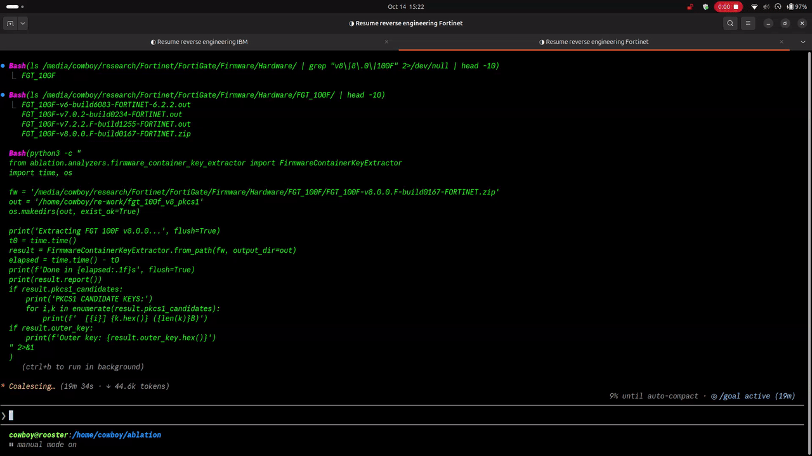
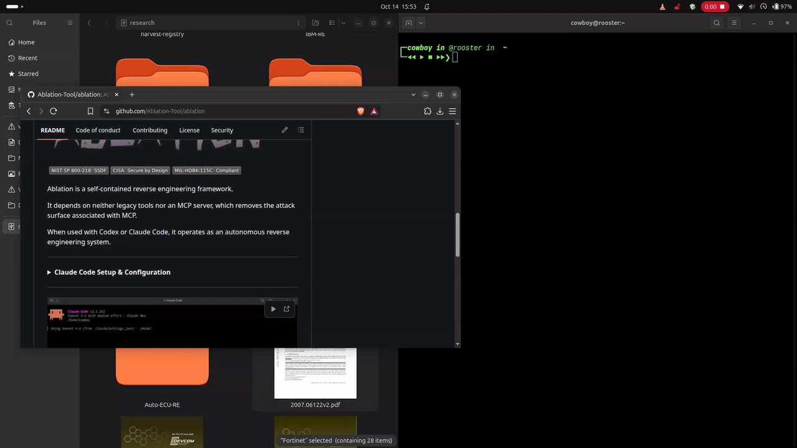

 [](docs/standards-ablation.md) [](docs/standards-ablation.md) [](docs/standards-ablation.md)

Ablation is an AI-assisted reverse engineering (AIARE) framework.

---


## Capabilities

<details>
<summary>Decompilers, Disassemblers & Analyzers</summary>

**Native CPUs**

| ISA | Variants |
|---|---|
| [**x86**](docs/reference-modules/x86.md) | x86-32 · x86-64 |
| [**ARM**](docs/reference-modules/binary-lifter.md) | ARM-32 · ARM-64 · Thumb |
| [**MIPS**](docs/reference-modules/mips.md) | MIPS-32 · [nanoMIPS](docs/reference-modules/nanomips.md) · MIPS-64 |
| [**PowerPC**](docs/reference-modules/ppc32-taint-tracker.md) | PPC-32 · PPC-64 · [VLE](docs/reference-modules/ecu-vle-decoder.md) · [PPC476 Book E](docs/reference-modules/ppc476-lifter.md) · [XCOFF32 / AIX](docs/reference-modules/xcoff32-decompiler.md) |
| [**RISC-V**](docs/reference-modules/risc-v.md) | RV32 · RV64 · [HiSilicon ext](docs/reference-modules/hisi-rv32-ext.md) |
| [**ARC**](docs/reference-modules/binary-lifter.md) | ARC EM · ARC HS |
| [**LoongArch**](docs/reference-modules/loongarch.md) | LoongArch64 · [KASAN/KCOV V2](docs/reference-modules/loongarch64-v2.md) |
| [**Alpha AXP**](docs/reference-modules/taint-tracker-alpha.md) | Alpha 21064 · 21164 · 21264 · ECOFF · ELF |
| [**Intel MCS**](docs/reference-modules/isa-8051.md) | 8051 / MCS-51 · CC254x |
| [**Xilinx**](docs/reference-modules/microblaze-decoder.md) | MicroBlaze · [Versal PDI/CDO](docs/reference-modules/versal-pdi.md) |

**Automotive ECUs**

| ISA | Variants |
|---|---|
| [**V850 / RH850**](docs/reference-modules/v850-rh850.md) | V850-32 · RH850 |
| [**Renesas SH**](docs/reference-modules/binary-lifter-sh2a.md) | SH-2A |
| [**Motorola**](docs/reference-modules/ecu-m68k-decoder.md) | M68K / CPU32 · [MC88100](docs/reference-modules/m88k-decoder.md) |
| [**Infineon**](docs/reference-modules/tricore-taint-tracker.md) | TriCore TC1.6x |
| [**TI DSP**](docs/reference-modules/ecu-c28x-decoder.md) | TMS320C28x |
| [**Infineon C166**](docs/reference-modules/c166-c167-decoding.md) | C166 · C167 |

**VMs & Runtimes**

| ISA | Variants |
|---|---|
| [**DEX**](docs/reference-modules/dex.md) | Dalvik · ART |
| [**ARK**](docs/reference-modules/harmonyos.md) | ArkTS |
| [**MicroPython**](docs/reference-modules/micropython.md) | .mpy v6 |
| [**BEAM**](docs/reference-modules/beam.md) | Erlang BEAM bytecode |
| [**Java**](docs/reference-modules/java-class-jar-parsing.md) | .class · JAR |
| [**Python**](docs/reference-modules/python-pyc-scanning.md) | .pyc (3.8–3.12) |

</details>

<details>
<summary>Core Engine</summary>

| Capability | Code | Description |
|:---|:---|:---|
| [**AI Knowledge-Graph Analysis**](docs/reference-modules/knowledge-graph.md) | [1](ablation/analyzers/knowledge_graph.py)&nbsp;[2](sweeps/build_ablation_graph.py) | Combines knowledge graphs with agent-driven retrieval to explore relationships and iteratively refine binary analysis. |
| [**Analysis Context & Caching**](docs/reference-modules/on-demand-analysis.md) | [1](ablation/analyzers/binary_context.py)&nbsp;[2](ablation/analyzers/xref_graph.py) | Reuses analysis results and session state across runs to avoid redundant processing. |
| [**Intermediate Representation**](docs/reference-modules/binary-lifting.md) | [1](ablation/analyzers/binary_lifter.py) | Lifts machine code from supported architectures into a shared IR for dataflow analysis, taint tracking, symbolic execution, and decompilation. |
| [**Architecture Definition Language**](docs/reference-modules/encoding-dag.md) | [1](ablation/analyzers/encoding_dag.py) | Describes ISA encodings and semantics as reusable graphs, allowing new architectures without changing the core analysis engines. |
| [**Control & Data-Flow Analysis**](docs/reference-modules/control-flow-graph-construction.md) | [1](ablation/analyzers/dataflow_engine.py)&nbsp;[2](ablation/analyzers/structurizer.py) | Builds control-flow graphs, propagates dataflow facts, and recovers high-level control structures from branch instructions. |
| [**Static Single Assignment**](docs/reference-modules/ssa.md) | [1](ablation/analyzers/ssa.py)&nbsp;[2](ablation/analyzers/ir.py) | Models register definitions with SSA and unifies architecture-specific instructions for type recovery, struct analysis, and pseudo-C generation. |
| [**Expression Analysis**](docs/reference-modules/expr-lifter.md) | [1](ablation/analyzers/expr_lifter.py) | Converts instructions into typed expressions and merges equivalent computations to reduce redundant taint findings. |
| [**Register & Argument Tracking**](docs/reference-modules/call-argument-annotation.md) | [1](ablation/analyzers/reg_annotator.py)&nbsp;[2](ablation/analyzers/arm32_reg_annotator.py) | Tracks symbolic register values across calls and traces sink arguments to network input, file reads, or prior return values. |
| [**ARM64 Data-Flow Slicing**](docs/reference-modules/arm64-symbolic-slicing.md) | [1](modules/sse_slicer.py)&nbsp;[2](modules/arm64_global_tracker.py) | Traces ARM64 store addresses backward to identify exact and possible writes to targeted globals and structure fields. |
| [**Function Prioritization**](docs/reference-modules/single-function-profiling.md) | [1](ablation/analyzers/func_profiler.py)&nbsp;[2](ablation/analyzers/func_reachability.py) | Profiles function calls and filters findings in functions without runtime call or pointer references. |
| [**Binary Parsing & Hardening**](docs/reference-modules/binary-format-and-platform-identification.md) | [1](ablation/core/binary_parser.py)&nbsp;[2](ablation/core/elf_parser.py) | Parses ELF, PE, and Mach-O metadata and inspects ELF hardening, including NX, PIE, RELRO, and stack canaries. |
| [**Disassembly & Code Profiling**](docs/reference-modules/streaming-and-windowed-disassembly.md) | [1](ablation/core/disasm_engine.py)&nbsp;[2](ablation/analyzers/window_analyzer.py) | Provides Capstone disassembly with memory-efficient streaming, targeted windows, and optional Angr-backed dataflow analysis. |
| [**Architecture & ABI Models**](docs/reference-modules/isa-models.md) | [1](ablation/analyzers/insn_x86.py)&nbsp;[2](ablation/analyzers/isa_x86.py) | Normalizes x86 instructions and models register aliases, calling conventions, and Linux syscalls in 32-bit and 64-bit modes. |
| [**Function Discovery**](docs/reference-modules/stripped-function-discovery.md) | [1](ablation/analyzers/arm32_function_scanner.py)&nbsp;[2](ablation/analyzers/static_elf32_func_start_scanner.py) | Recovers function entry points from stripped binaries and flat ROMs using prologues, calls, reset vectors, and alignment patterns. |
| [**Debug Metadata & Symbol Recovery**](docs/reference-modules/debug-metadata-recovery.md) | [1](ablation/analyzers/i386_absolute_xref_scanner.py)&nbsp;[2](ablation/analyzers/dwarf_loongarch64.py) | Recovers ELF function addresses and names from unwind metadata, DWARF, and BTF, plus i386 string cross-references. |
| [**Packed & Encrypted Region Detection**](docs/reference-modules/entropy-mapper.md) | [1](ablation/analyzers/entropy_mapper.py) | Locates compressed, encrypted, and packed regions using sliding-window Shannon entropy analysis. |
| [**Dynamic Function Emulation**](docs/reference-modules/dynamic-sandbox.md) | [1](ablation/analyzers/dynamic_sandbox.py) | Emulates ARM64 and x86-64 leaf functions to corroborate static findings with observed register and memory writes. |
| [**Cryptographic Analysis**](docs/reference-modules/cryptographic-analysis.md) | [1](modules/crypto_audit.py)&nbsp;[2](ablation/analyzers/xor_solver.py) | Detects cipher implementations, recovers XOR and affine keys, and tests JWT secrets and RSA/ECDSA nonce reuse. |

</details>

<details>
<summary>ReAct (Reasoning + Acting)</summary>

| Capability | Code | Description |
|:---|:---|:---|
| [**AI-Guided Analysis**](docs/reference-modules/llm-analyst-loop.md) | [1](ablation/analyzers/llm_analyst/agent_loop.py)&nbsp;[2](ablation/analyzers/llm_analyst/rag_retriever.py) | Pre-fetches function context and prior results for single-call LLM naming, role analysis, and patch hypotheses. |
| [**Semantic Code Search**](docs/reference-modules/semantic-code-search.md) | [1](ablation/analyzers/semantic_search.py) | Ranks functions by natural-language queries using fast vector embeddings, helping analysts locate relevant code before manual disassembly. |
| [**Vulnerability Hypothesis Tracking**](docs/reference-modules/hypothesis-engine-2.md) | [1](ablation/analyzers/hypothesis_engine.py) | Ranks competing vulnerability hypotheses as evidence accumulates and preserves investigation state across sessions. |
| [**Evidence Scoring & Validation**](docs/reference-modules/evidence-scoring-and-probe-ranking.md) | [1](ablation/analyzers/probe_ranker.py)&nbsp;[2](ablation/analyzers/probe_adapters.py) | Ranks probes by expected information gain and executes approved adapters to gather evidence for competing hypotheses. |
| [**Cross-Target Learning**](docs/reference-modules/flywheel.md) | [1](ablation/analyzers/pattern_library.py)&nbsp;[2](ablation/analyzers/finding_registry.py) | Reuses productive findings, queries, and vendor-specific sink patterns across related targets while discarding unproductive patterns. |
| [**Function Identification & Naming**](docs/reference-modules/function-identity-database.md) | [1](ablation/analyzers/corpus_builder.py)&nbsp;[2](ablation/analyzers/func_id_db.py) | Automatically names known functions using FLIRT-style signatures and preserves analyst-assigned names across binary versions. |
| [**Approximate Function Matching**](docs/reference-modules/sax-approximate-indexing.md) | [1](ablation/analyzers/sax_index.py)&nbsp;[2](ablation/analyzers/subsequence_searcher.py) | Indexes opcode-category sequences for fast approximate matching and DTW-based similar-function search. |
| [**Vulnerability Pattern Mining**](docs/reference-modules/corpus-mining-cve-patterns.md) | [1](sweeps/corpus_miner.py)&nbsp;[2](modules/cve_byte_patterns.py) | Mines prior findings for CWE trends and scans binaries for registered CVE-specific byte patterns. |
| [**KASAN Finding Validation**](docs/workflows/kasan-oracle.md) | [1](ablation/analyzers/loongarch_decoder_v2.py) | Verifies KASAN candidates in stripped production binaries, confirming 11 of 14 candidates in TencentOS kernel 6.6.119. |

</details>

<details>
<summary>Security Research</summary>

| Capability | Code | Description |
|:---|:---|:---|
| [**Data-Flow Taint Analysis**](docs/reference-modules/taint-analysis.md) | [1](ablation/analyzers/taint_tracker.py)&nbsp;[2](ablation/analyzers/taint_tracker_arm64.py) | Traces attacker-controlled data with function-level analysis on x86-64 and intra- or interprocedural analysis on ARM64. |
| [**Dangerous Call Classification**](docs/reference-modules/sink-arg-classifier.md) | [1](ablation/analyzers/sink_arg_classifier.py)&nbsp;[2](ablation/analyzers/sink_arg_classifier_arm32.py)&nbsp;[3](ablation/analyzers/sink_arg_classifier_loongarch64.py) | Classifies sink arguments on x86-64, ARM32, and LoongArch64 and filters constant-format calls before taint analysis. |
| [**Input Validation & Call Wrappers**](docs/reference-modules/transitive-sink-wrapper-discovery.md) | [1](ablation/analyzers/sink_propagator.py)&nbsp;[2](ablation/analyzers/sanitizer_detector.py) | Discovers transitive sink wrappers and profiles sanitization coverage to refine vulnerability triage. |
| [**Network Attack-Surface Detection**](docs/reference-modules/network-sink-finder.md) | [1](ablation/analyzers/network_sink_finder.py) | Prioritizes propagated-argument sinks in functions reachable from network input, excluding unreachable candidates from taint analysis. |
| [**Exploit Path Validation**](docs/reference-modules/finding-validation.md) | [1](modules/path_solver.py)&nbsp;[2](ablation/analyzers/finding_registry.py) | Checks path feasibility with bounded Z3 solving and stores reviewed findings for later analysis and export. |
| [**Format-String Vulnerabilities**](docs/reference-modules/format-string-scanner.md) | [1](ablation/analyzers/format_string_scanner.py) | Finds non-constant format arguments in logging calls and includes provenance traces for assessing attacker control. |
| [**Heap Memory Vulnerabilities**](docs/reference-modules/heap-vulnerability-scanner.md) | [1](ablation/analyzers/heap_vuln_scanner.py)&nbsp;[2](modules/heap_uaf_scanner.py) | Detects allocation overflows, use-after-free, double-free, and off-by-one patterns on x86-64 and LoongArch64. |
| [**Parser Length & Bounds Checks**](docs/reference-modules/length-underflow.md) | [1](ablation/analyzers/length_underflow.py)&nbsp;[2](modules/chunk_walker_validator.py) | Detects length-subtraction underflows and validates TLV chunk bounds in protocol parser loops. |
| [**Unsafe Input & Function Checks**](docs/reference-modules/scanf-family-overflow-candidates.md) | [1](ablation/analyzers/sscanf_sink_classifier.py)&nbsp;[2](ablation/analyzers/deprecated_func_scanner.py) | Classifies risky `sscanf` call sites and flags deprecated or unsafe imported functions. |
| [**Unauthenticated Attack Surface**](docs/reference-modules/preauth-exposure.md) | [1](ablation/analyzers/preauth_route_auditor.py) | Maps unauthenticated routes and their reachable sinks by reconstructing dispatch and authentication wrappers from binaries. |
| [**Web & Fortinet Attack Surfaces**](docs/reference-modules/apache-module-analysis.md) | [1](ablation/analyzers/apache_module_analyzer.py)&nbsp;[2](ablation/analyzers/cmdb_surface_mapper.py) | Reconstructs Apache handler chains and maps Fortinet CMDB operations to command-execution sinks. |
| [**SQL & Lua Injection Analysis**](docs/reference-modules/sql-injection-scanner.md) | [1](ablation/analyzers/sql_sink_scanner.py)&nbsp;[2](ablation/analyzers/lua_injection_analyzer.py) | Classifies SQL query provenance in binaries and traces request input to Lua evaluation in source trees. |
| [**Compiler Defects & Hardening**](docs/reference-modules/compiler-defects.md) | [1](ablation/analyzers/loongarch64_max_not_min_scanner.py)&nbsp;[2](ablation/analyzers/compiler_security_gate.py) | Detects LoongArch64 min/max miscompilations and missing or inconsistent binary hardening. |
| [**Windows Driver Vulnerabilities**](docs/reference-modules/kernel-drivers.md) | [1](ablation/analyzers/kernel_driver_analyzer.py)&nbsp;[2](ablation/analyzers/byovd_detector.py) | Ranks BYOVD primitives by impact and identifies METHOD_NEITHER IOCTL handlers that expose raw user-space pointers. |
| [**Source Code Security Analysis**](docs/reference-modules/source-code-auditing.md) | [1](ablation/analyzers/source_audit_compressor.py)&nbsp;[2](ablation/analyzers/source_taint_tracker.py) | Profiles source files and traces dangerous sinks back to request-input sources across repository call graphs. |
| [**Exploit Development & Scoring**](docs/reference-modules/shellcode-templates.md) | [1](ablation/core/shellcode_utils.py)&nbsp;[2](modules/bare_adapter.py) | Builds encoded shellcode and ROP chains, calculates cyclic offsets, and scores findings with BARE for Metasploit modules. |

</details>

<details>
<summary>Firmware Analysis</summary>

| Capability | Code | Description |
|:---|:---|:---|
| [**Fortinet Firmware Analysis**](docs/reference-modules/firmware-extraction.md) | [1](ablation/analyzers/fortios_firmware_extractor.py)&nbsp;[2](ablation/analyzers/firmware_container_key_extractor.py) | Recovers FortiOS partition keys and extracts firmware containers into analyzable ELF and filesystem images. |
| [**Firmware Extraction & Triage**](docs/reference-modules/firmware-signature-and-secret-triage.md) | [1](ablation/core/firmware_analyzer.py)&nbsp;[2](ablation/analyzers/firmware_container.py) | Scans firmware signatures, strings, and entropy and extracts partitions from supported vendor containers. |
| [**IBM AIX Binary Analysis**](docs/reference-modules/aix-xcoff32-64-analysis.md) | [1](ablation/core/xcoff_parser.py)&nbsp;[2](ablation/core/bff_extractor.py) | Parses XCOFF32/64 sections and symbols and extracts BFF package archives without the AIX toolchain. |
| [**ECU Architecture Detection**](docs/reference-modules/ecu-architecture-detector.md) | [1](ablation/analyzers/ecu_arch_detector.py)&nbsp;[2](ablation/analyzers/ecu_rom_layout_analyzer.py) | Identifies raw-ROM architectures and classifies code, calibration data, and interrupt-vector regions before disassembly. |
| [**Embedded Architecture Decoding**](docs/reference-modules/c166-c167-decoding.md) | [1](ablation/analyzers/ecu_c166_decoder.py)&nbsp;[2](ablation/analyzers/ecu_c28x_decoder.py) | Decodes C166/C167 and TI C28x instructions and recovers function starts from ECU firmware. |
| [**ECU Security Analysis**](docs/reference-modules/ecu-security-access-scanner.md) | [1](ablation/analyzers/ecu_security_access_scanner.py)&nbsp;[2](ablation/analyzers/taint_tracker_tricore.py) | Detects predictable UDS and KWP2000 seeds and traces diagnostic input to memory writes on TriCore. |
| [**Calibration & CAN Analysis**](docs/reference-modules/calibration-parsers.md) | [1](ablation/analyzers/ecu_xdf_parser.py)&nbsp;[2](ablation/analyzers/ecu_a2l_parser.py)&nbsp;[3](modules/can_dbc_parser.py) | Parses ECU calibration definitions and maps CAN frames to named signals using DBC layouts and scaling metadata. |
| [**Texas Instruments & ML Firmware**](docs/reference-modules/texas-instruments-firmware.md) | [1](ablation/analyzers/ti_coff_loader.py)&nbsp;[2](ablation/analyzers/ti_nnc_scanner.py) | Parses TI COFF2 symbols and detects embedded NNC/TVM models, weak normalization symbols, and NPU usage risks. |
| [**Legacy Binary Formats**](docs/reference-modules/motorola-88000-bcs-coff.md) | [1](ablation/core/coff_m88k_parser.py)&nbsp;[2](ablation/core/guardian_pak_extractor.py) | Parses Motorola M88K COFF binaries and extracts files from Tandem NonStop Guardian PAK archives. |

</details>

<details>
<summary>Multi-Architecture Analysis Matrix</summary>

| Capability | Code | Description |
|:---|:---|:---|
| [**Android App Analysis**](docs/reference-modules/android-apk-analysis.md) | [1](ablation/core/apk_parser.py)&nbsp;[2](ablation/analyzers/dex_analyzer.py) | Parses APK manifests and DEX metadata and audits exported components, secrets, dangerous APIs, and native interfaces. |
| [**HarmonyOS App Analysis**](docs/reference-modules/harmonyos.md) | [1](ablation/analyzers/abc_parser.py)&nbsp;[2](ablation/analyzers/abc_disasm.py)&nbsp;[3](ablation/analyzers/abc_decompiler.py) | Reconstructs ArkTS modules as JavaScript-like pseudocode and surfaces embedded API keys and endpoint URLs. |
| [**Go Binary Analysis**](docs/workflows/go-binaries.md) | [1](ablation/analyzers/go_pclntab.py)&nbsp;[2](modules/go_binary_re.py) | Recovers Go function names from pclntab metadata and reconstructs command handlers and message framing in supported binaries. |
| [**Java & Spring Analysis**](docs/reference-modules/java-class-jar-parsing.md) | [1](modules/java_re.py)&nbsp;[2](modules/java_decompiler.py) | Parses Java artifacts and detects deserialization gadgets, XXE, JNDI injection, and exposed Spring Actuator endpoints. |
| [**Erlang & MicroPython Analysis**](docs/reference-modules/beam.md) | [1](ablation/analyzers/beam_context.py)&nbsp;[2](modules/mpy_lifter.py) | Lifts BEAM and MicroPython bytecode to pseudocode and flags dynamic execution and controlled hardware or network operations. |
| [**Python, Perl & Electron Analysis**](docs/reference-modules/python-pyc-scanning.md) | [1](ablation/analyzers/pyc_bytecode_scanner.py)&nbsp;[2](ablation/analyzers/perl_taint_scanner.py)&nbsp;[3](ablation/analyzers/electron_security_scanner.py) | Audits Python bytecode, traces Perl input into backticks, and detects insecure Electron windows, IPC, and renderer boundaries. |
| [**Browser Extension Security**](docs/reference-modules/browser-extension-auditing.md) | [1](ablation/analyzers/browser_extension_auditor.py) | Detects externally connectable extensions whose privileged message handlers process web requests without verifying sender identity. |
| [**LoongArch & nanoMIPS Analysis**](docs/reference-modules/loongarch64-2.md) | [1](ablation/analyzers/loongarch_decoder.py)&nbsp;[2](ablation/analyzers/nanomips_decoder.py)&nbsp;[3](ablation/analyzers/sink_arg_classifier_loongarch64.py) | Provides architecture-specific decoding, lifting, taint analysis, and sink classification for LoongArch64 and variable-width nanoMIPS. |
| [**C++ Call Recovery**](docs/reference-modules/cpp-vtable-reconstructor.md) | [1](modules/cpp_vtable_reconstructor.py)&nbsp;[2](ablation/analyzers/vtable_resolver.py) | Reconstructs C++ class hierarchies and resolves ARM64 and x86-64 virtual calls for accurate call graphs. |
| [**PowerPC Call Recovery**](docs/reference-modules/ppc32-got2-resolver.md) | [1](modules/ppc32_got2_resolver.py)&nbsp;[2](ablation/analyzers/ppc32_plt_tracer.py)&nbsp;[3](ablation/analyzers/ppc64_vmx_density.py) | Resolves PowerPC indirect calls and ELFv1 trampolines and uses AltiVec density to identify signal-processing routines. |
| [**Windows Binary Analysis**](docs/reference-modules/windows-pe.md) | [1](sweeps/pe_sweep.py)&nbsp;[2](ablation/analyzers/cfg_bypass_detector.py)&nbsp;[3](ablation/analyzers/seh_chain_analyzer.py)&nbsp;[4](ablation/analyzers/com_attack_surface_mapper.py)&nbsp;[5](ablation/analyzers/etw_provider_extractor.py)&nbsp;[6](ablation/analyzers/rpc_server_analyzer.py) | Detects Windows CFG bypasses, exposed SEH handlers, and COM hijacks while extracting ETW providers and RPC interfaces. |

</details>

<details>
<summary>Protocol Analysis</summary>

| Capability | Code | Description |
|:---|:---|:---|
| [**Protocol & Steganography Analysis**](docs/reference-modules/proto-fsm.md) | [1](modules/proto_fsm.py)&nbsp;[2](ablation/analyzers/lsb_stego_extractor.py) | Reconstructs ARM64 protocol state machines and extracts cryptographic material hidden in firmware bitmap pixels. |
| [**TLS Security Analysis**](docs/reference-modules/tls-certificate-and-protocol-probing.md) | [1](ablation/core/tls_analyzer.py)&nbsp;[2](modules/tls_enum.py) | Audits TLS certificates, key exchanges, transport protections, and session-resumption downgrade paths. |
| [**API Security Testing**](docs/reference-modules/unknown-http-api-mapping.md) | [1](modules/api_re.py) | Discovers undocumented APIs and tests major web transports for authorization, injection, SSRF, JWT, and OAuth weaknesses. |
| [**Nginx Security Testing**](docs/reference-modules/nginx-fingerprinting-and-exposure.md) | [1](modules/nginx_enum.py) | Fingerprints Nginx and probes for exposed status endpoints, alias traversal, proxy SSRF, and request smuggling. |
| [**AI & Agent Security**](docs/reference-modules/inference-endpoint-enumeration.md) | [1](modules/llm_enum.py)&nbsp;[2](ablation/analyzers/mcp_tool_taint_scanner.py) | Audits AI endpoints, MCP tool flows, RAG stores, and agent-to-agent trust chains for injection and data exposure. |

</details>

<details>
<summary>Live Ecosystems</summary>

| Capability | Code | Description |
|:---|:---|:---|
| [**Host & Privilege Assessment**](docs/reference-modules/host-platform-inventory.md) | [1](modules/process_enum.py)&nbsp;[2](modules/privesc_enum.py) | Inventories hosts, detects process injection, traces syscalls, and identifies privilege-escalation misconfigurations. |
| [**Forensics & Malware Analysis**](docs/reference-modules/windows-artifact-discovery.md) | [1](modules/forensics_enum.py)&nbsp;[2](modules/physmem_elf_vfs.py) | Collects Windows and Linux forensic artifacts, detects timestomping and rootkits, and recovers ELF binaries from memory. |
| [**Network & Industrial Protocols**](docs/reference-modules/local-network-inventory.md) | [1](modules/network_analyze.py)&nbsp;[2](modules/net_sniffer.py) | Discovers services and ICS/OT protocols, extracts exposed PCAP credentials, and flags C2 or lateral-movement patterns. |
| [**Cisco Infrastructure Assessment**](docs/reference-modules/ios-ios-xe-appliance-enumeration.md) | [1](modules/ios_enum.py)&nbsp;[2](modules/nxos_enum.py) | Audits Cisco appliance and data-center configurations, recovers weak credentials, and maps trust and lateral-movement paths. |
| [**Container & Kubernetes Security**](docs/reference-modules/docker-inventory-and-posture.md) | [1](modules/docker_enum.py)&nbsp;[2](modules/k8s_enum.py) | Assesses container privilege, isolation, secret exposure, RBAC, and cloud-metadata risks. |
| [**VoIP Security Assessment**](docs/reference-modules/sip-service-and-extension-discovery.md) | [1](modules/sip_enum.py) | Enumerates VoIP services and gateways and detects unencrypted media, weak SIP registration, and toll-fraud exposure. |

</details>

<details>
<summary>DocIN (Documentation + Integrity)</summary>

| Capability | Code | Description |
|:---|:---|:---|
| [**Binary Diffing & Patch Tracking**](docs/workflows/cross-version.md) | [1](ablation/analyzers/version_delta.py) | Matches functions across binary versions and reports instruction, callee, and string changes for patch review. |
| [**Sequence-Based Function Matching**](docs/reference-modules/dtw-matrix-profile-similarity.md) | [1](ablation/analyzers/dtw_matcher.py)&nbsp;[2](ablation/analyzers/matrix_profile_diff.py) | Matches homologous functions with DTW and localizes patched instruction windows using matrix-profile distances. |
| [**Structural Function Matching**](docs/reference-modules/structural.md) | [1](modules/structural_sim.py) | Matches functions across architectures and optimized builds by comparing control-flow topology instead of instruction sequences. |
| [**Module Security Quality Gate**](docs/reference-modules/forge.md) | [1](ablation/analyzers/forge.py) | Blocks commits with critical or high findings from cached ten-section security audits of Ablation modules. |
| [**Finding Export & Reporting**](docs/reference-modules/yara-json-sarif-export.md) | [1](ablation/core/yara_generator.py)&nbsp;[2](ablation/export/json_export.py)&nbsp;[3](ablation/export/sarif.py) | Exports findings as replayable YARA rules, SARIF 2.1.0, and JSON for analysis and reporting workflows. |
| [**Automated Vulnerability Sweeps**](docs/reference-modules/multi-phase-vulnerability-sweeps.md) | [1](sweeps/base_sweep.py)&nbsp;[2](sweeps/fortinet_sweep.py) | Runs resumable pre-filtering, sink classification, and taint phases, including eight Fortinet vulnerability profiles. |
| [**Game Engine Analysis**](docs/reference-modules/engine-pattern-library.md) | [1](ablation/analyzers/engine_pattern_library.py) | Identifies game engines and engine-specific RCE surfaces in stripped binaries using extensible signature and vtable patterns. |
| [**Threat Classification**](docs/reference-modules/attandck-labeling.md) | [1](ablation/core/attck_tagger.py) | Labels findings with MITRE ATT&CK technique and tactic IDs for export and reporting. |
| [**Software Composition & Supply Chain**](docs/reference-modules/dependency-and-supply-chain-tooling.md) | [1](modules/sbom_extractor.py)&nbsp;[2](modules/third_party_library_identifier.py) | Extracts library versions and provenance into SBOM-ready component records for supply-chain review. |
| [**Binary Ninja Plugin**](docs/reference-modules/binary-ninja-plugin.md) | [1](ablation/integrations/binja_plugin.py) | Annotates Binary Ninja with cached function names, taint findings, and session verdicts at instruction level. |

</details>

<details>
<summary>Rubric Library</summary>

| Capability | Description |
|:---|:---|
| [**Index**](docs/prompts/analysis-rubric.md) | A structured collection of named, versionable LLM "behavior specifications" that you can apply to different tasks to get consistent, high-quality analyses on demand. |

</details>


## Setup & About

<details>
<summary>Install</summary>

```bash
pip install ablation-tool
```

**Requirements:** Python >= 3.10 · `capstone>=4,<5` · `numpy` · `lief` · `fastembed` · `sentence-transformers` · `pyelftools`

</details>


<details>
<summary>Acknowledgments</summary>

The code couldn't exist without their ideas. Though no code was written by these authors, doctors, and engineers, their work has direct influence on the production of code that makes Ablation what it is.

**Research Papers**

| Title | Authors |
|---|---|
| [Reverse Compilation Techniques](https://scholar.google.com/citations?view_op=view_citation&hl=en&user=iseZ69MAAAAJ&citation_for_view=iseZ69MAAAAJ:u-x6o8ySG0sC) · [Specifying the Semantics of Machine Instructions](https://ieeexplore.ieee.org/document/693702) · [UQBT: Adaptable Binary Translation at Low Cost](https://ieeexplore.ieee.org/document/825697) · [Machine-Adaptable Dynamic Binary Translation](https://dl.acm.org/doi/10.1145/351397.351414) | [Dr. Cristina Cifuentes](https://scholar.google.com/citations?hl=en&user=iseZ69MAAAAJ) |
| [Design of a Retargetable Decompiler for a Static Platform-Independent Malware Analysis](https://www.researchgate.net/publication/220849941_Design_of_a_Retargetable_Decompiler_for_a_Static_Platform-Independent_Malware_Analysis) | Petr Zemek, Lukáš Ďurfina, Jakub Křoustek, Dušan Kolář, Tomas Hruska, Karel Masařík, Alexander Meduna |
| [Finding Taint-Style Vulnerabilities in Linux-based Embedded Firmware with SSE-based Alias Analysis](https://arxiv.org/abs/2109.12209) | Cheng, Zheng, Liu, Guan, Liu, Li, Zhu, Ye, Sun |
| [iResolveX: Multi-Layered Indirect Call Resolution via Static Reasoning and Learning-Augmented Refinement](https://arxiv.org/abs/2601.17888) | Monika Santra, Bokai Zhang, Mark Lim, [Vishnu Asutosh Dasu](https://github.com/vdasu), Dongrui Zeng, [Gang Tan](https://github.com/gangtan) |
| [Extracting Protocol Format as State Machine via Controlled Static Loop Analysis](https://arxiv.org/abs/2305.13483) | [Qingkai Shi](https://github.com/qingkaishi), Xiangzhe Xu, Xiangyu Zhang |
| [NEMETYL: Message Type Identification of Binary Network Protocols using Continuous Segment Similarity](https://arxiv.org/abs/2002.03391) | [Stephan Kleber](https://github.com/vs-uulm), Rens Wouter van der Heijden, [Frank Kargl](https://github.com/fkargl) |
| [Imperfect Forward Secrecy: How Diffie-Hellman Fails in Practice](https://dl.acm.org/doi/10.1145/2810103.2813707) | [David Adrian](https://github.com/dadrian), Karthikeyan Bhargavan, [Zakir Durumeric](https://github.com/zakird), Pierrick Gaudry, Matthew Green, [J. Alex Halderman](https://github.com/jhalderm), [Nadia Heninger](https://github.com/factorable), Drew Springall, Emmanuel Thomé, [Luke Valenta](https://github.com/lukevalenta) |
| [Nonce-Disrespecting Adversaries: Practical Forgery Attacks on GCM in TLS](https://www.usenix.org/conference/woot16/workshop-program/presentation/bock) | [Hanno Böck](https://github.com/hannob), [Aaron Zauner](https://github.com/azet), Sean Devlin, [Juraj Somorovsky](https://github.com/jurajsomorovsky), [Philipp Jovanovic](https://github.com/Daeinar) |
| [Whitening Sentence Representations for Better Semantics and Faster Retrieval](https://arxiv.org/abs/2103.15316) | [Jianlin Su](https://github.com/bojone), [Jiarun Cao](https://github.com/jiaruncao), Weijie Liu, Yangyiwen Ou |
| [Constant Propagation with Conditional Branches](https://dl.acm.org/doi/abs/10.1145/103135.103136) | Mark N. Wegman, F. Kenneth Zadeck |
| [A Simple, Fast Dominance Algorithm](https://www.cs.princeton.edu/techreports/2005/737.pdf) | Cooper, Harvey, Kennedy |
| [libdft: Practical Dynamic Data Flow Tracking for Commodity Systems](https://dl.acm.org/doi/10.1145/2151024.2151042) | [Vasileios P. Kemerlis](https://github.com/vkemerlis), [Georgios Portokalidis](https://github.com/portokalidis), [Kangkook Jee](https://github.com/jikk), Angelos D. Keromytis |

**Books** supplied by [www.oreilly.com](https://www.oreilly.com) | [github.com/oreillymedia](https://github.com/oreillymedia)

| Title | Authors |
|---|---|
| The Art of Software Security Assessment | [Mark Dowd](https://github.com/mdowd79), John McDonald, [Justin Schuh](https://github.com/jschuh) |
| Practical Binary Analysis | [Dennis Andriesse](https://github.com/dennisaa) |
| Practical Malware Analysis | Michael Sikorski, Andrew Honig |
| Practical Reverse Engineering | Bruce Dang, Alexandre Gazet, [Elias Bachaalany](https://github.com/0xeb) |
| Hacking: The Art of Exploitation (2e) | Jon Erickson |
| Learning Linux Binary Analysis | [Ryan O'Neill](https://github.com/elfmaster) |
| Windows Internals Part 1 & 2 | [Pavel Yosifovich](https://github.com/zodiacon), [Mark Russinovich](https://github.com/markrussinovich), David Solomon, [Alex Ionescu](https://github.com/ionescu007), [Andrea Allievi](https://github.com/AaLl86) |
| Rootkits: Subverting the Windows Kernel | Greg Hoglund, Jamie Butler |
| Advanced Compiler Design and Implementation | Steven Muchnick |
| Engineering a Compiler | Keith Cooper, Linda Torczon |
| Practical IoT Hacking | [Fotios Chantzis](https://github.com/ithilgore), Ioannis Stais, Paulino Calderon, Evangelos Deirmentzoglou, Beau Woods |
| Inside the Android OS: Building, Customizing, Managing and Operating Android System Services | [G. Blake Meike](https://github.com/bmeike) |
| Malware Analysis and Detection Engineering | [Abhijit Mohanta](https://github.com/amohanta), Anoop Saldanha |
| Evasive Malware | [Kyle Cucci](https://github.com/d4rksystem) |
| Hacking Cryptography | [Kamran Khan](https://github.com/krkhan), [Bill Cox](https://github.com/waywardgeek) |
| Real-World Cryptography | David Wong |
| Agentic GraphRAG | [Anthony Alcaraz](https://github.com/anthonyalcaraz), [Sam Julien](https://github.com/samjulien) |

**Honorable Mention**

[Microsoft Excel (Data Analysis ToolPak)](https://support.microsoft.com/en-us/office/use-the-analysis-toolpak-to-perform-complex-data-analysis-6c67ccf0-f4a9-487c-8dec-bdb5a2cefab6). When analyzing closed infrastructure or securing black-box systems, this exact process is called timing analysis or telemetry reverse engineering. Without source code, the Data Analysis ToolPak mathematically deconstructs how an application works on the backend by strictly observing its inputs and outputs.

</details>

<details>
<summary>Real-World Results</summary>

Ablation has been used to analyze production firmware and kernel drivers from Cisco, IBM, TencentOS, Huawei, Fortinet, and more.

Following coordinated disclosure, the **Cisco Product Security Incident Response Team (PSIRT)** adopted Ablation for internal vulnerability triage and continues to use it to evaluate ongoing disclosure reports. Cisco Adaptive Security Appliance (ASA) LINA is among the artifacts analyzed, with findings submitted through CERT/CC VINCE.

| CVE | Product | Title | CVSS |
|---|---|---|---|
| [CVE‑2026‑76420](https://sec.cloudapps.cisco.com/security/center/content/CiscoSecurityAdvisory/cisco-sa-fmc2-multivulns-HXgcqRG) | Secure Firewall Management Center (FMC) | Peer Impersonation | **9.0 Critical** |
| [CVE‑2026‑76412](https://sec.cloudapps.cisco.com/security/center/content/CiscoSecurityAdvisory/cisco-sa-fmc2-multivulns-HXgcqRG) | Secure Firewall Management Center (FMC) | Privilege Escalation to root | **8.5 High** |
| [CVE‑2026‑76413](https://sec.cloudapps.cisco.com/security/center/content/CiscoSecurityAdvisory/cisco-sa-fmc2-multivulns-HXgcqRG) | Secure Firewall Management Center (FMC) | Single Sign-On Token Forgery | **8.5 High** |
| [CVE‑2026‑76447](https://sec.cloudapps.cisco.com/security/center/content/CiscoSecurityAdvisory/cisco-sa-ise-multiauth-bypass-sgD2HbL4) | Identity Services Engine (ISE) | OCSP Responder Authentication Bypass | **5.3 Medium** |

</details>

<details>
<summary>Demonstrations</summary>

### Ablation in Action



### How to Use Ablation



### Learn as You RE


</details>

<details>
<summary>Code Standards</summary>

**[NIST SP 800-218](https://csrc.nist.gov/pubs/sp/800/218/final)**

This defines how software should be built, organized around four practice areas: preparing the development environment, protecting the codebase from unauthorized changes, writing software with security built into every layer, and responding when vulnerabilities surface after release.

What this means for Ablation in practice is a mandatory ten-section security audit on every module before it touches the repository. The audit covers input validation, memory handling, integer safety, error handling, concurrency, dependency security, injection prevention, secrets handling, logging, and residual risks. No module is committed without passing it.

Taint trackers, which are the modules that matter most if they get something wrong, carry an additional requirement: 85% statement coverage enforced by a hard gate in the test suite, verified against byte-exact synthetic instruction sequences that test ABI register behavior, not just whether the code runs without crashing. Dependencies are pinned with exact hashes and scanned weekly for known CVEs.

**[CISA Secure by Design](https://www.cisa.gov/securebydesign)**

CISA asks software manufacturers to commit to three things: take ownership of the security outcomes of the people who rely on the software, be transparent about its limitations, and treat security as a requirement rather than a recommendation.

For a RE framework, taking ownership of security outcomes has a specific meaning. A taint tracker that misses a vulnerability does not just produce a wrong answer. It produces a result someone may act on as evidence the binary is clean. That is why a false negative in any Ablation taint tracker is classified as a CRITICAL defect.

Every tracker ships with a documented known-anomalies file describing the exact conditions under which it can produce false negatives, so a researcher knows when to apply manual verification on top of the automated result. The precommit gate is not advisory. No code enters the repository without passing it.

**[MIL-HDBK-115C](https://www.nsa.gov)**

The US Department of Defense handbook for reverse engineering methodology defines four phases:

* **Phase 1:** Every engagement starts with a session file recording the target description, artifact hash, tool selection, and documentation plan before any analysis runs. The rule that semantic search runs before manual disassembly maps to the following phase.
* **Phase 2:** Requires characterizing a binary at the function level before doing detailed trace work. The `DynamicSandbox` covers the following.
* **Phase 3:** The structured retrospective written at the close of every completed project maps to the final phase.
* **Phase 4:** The standards document tracks 29 specific requirements drawn from all three frameworks. All 29 are met.

</details>

<details>
<summary>Responsible Use & Contact</summary>

**Responsible Use:** Ablation is built for authorized security research. Use it only against systems you own or have explicit written permission to test. Running it against systems without authorization violates computer fraud laws in most jurisdictions. The author is not responsible for misuse.

**Contact:** Feel free to contact me if you have any questions, ideas, complaints, or bugs:
* 📧 ablation@nuclide-research.com
* 𝕏 [@showxlate](https://x.com/showxlate)

</details>
