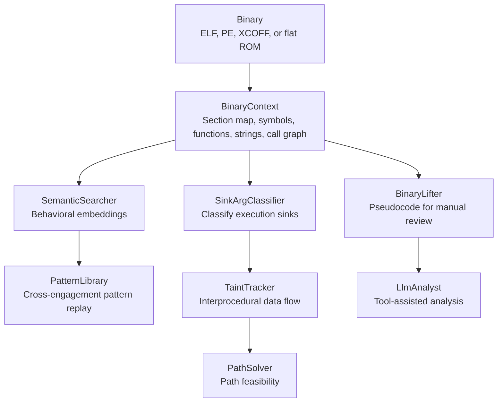

# Architecture

How Ablation is structured and why.

---

## Data flow

A complete analysis session shares one binary context across several analysis paths:



`BinaryContext` supplies the shared parsed state. Semantic search supports candidate discovery,
sink classification and taint analysis follow attacker-controlled data, and lifting supports
manual review. Path solving and pattern replay add feasibility evidence and prior knowledge to
those analysis paths.

---

## Module organization

```
ablation/
  core/          # Low-level parsers and platform detection. Not for direct use.
  analyzers/     # All analysis tools — the RE surface. Everything imports from here.
  profiles/      # Vendor-specific YAML: sink lists, safe patterns, ECU sinks.
sweeps/          # Standalone sweep scripts; each is a thin driver over analyzers/.
docs/            # This directory.
tests/           # Test suite.
```

`ablation/core/` handles: ELF/PE/XCOFF section parsing, Capstone initialization, ISA-specific decoder dispatch, render output. It is not part of the public API.

`ablation/analyzers/` is the stable public surface. Every tool has a `from_path()` or `from_context()` classmethod entry point.

---

## Design decisions

### Static analysis only

Ablation does not emulate or execute code. All analysis is static: CFG construction, taint propagation, and path feasibility. Dynamic sandbox support (`DynamicSandbox` via Unicorn) exists for leaf function fingerprinting but is not part of the primary analysis chain.

**Why:** Firmware targets are often bare-metal or cross-architecture. Dynamic analysis requires a running environment; static analysis requires only the binary.

### No Ghidra

Ablation does not call Ghidra, use its decompiler output, or depend on it being installed.

**Why:** Ghidra decompiler output is not machine-readable in a stable, version-independent way. Ablation's taint tracker needs to operate on structured IR, not text. Ghidra also adds a heavy runtime dependency that breaks automation in CI and firmware extraction pipelines.

### BinaryContext as the session anchor

Every tool takes a `BinaryContext` rather than a raw binary path. This enforces a single parse: PLT symbols, function starts, and call edges are computed once and shared.

**Why:** On a 50 MB stripped ARM64 binary, building the call graph takes ~8 seconds. Rebuilding it per-tool in a multi-tool session is prohibitive. The SHA-256-keyed JSON cache means the second session takes under 200 ms.

### NativeVal register state machines

Each ISA backend tracks a `NativeVal` slot per register. `NativeVal` carries: `ctype`, `expr`, `is_ptr`, `tainted`, `uses`. State machines are seeded from calling convention argument registers, return register and propagated across the CFG.

**Why:** Typed register state enables three things: (1) emitting readable C expressions rather than raw operand strings; (2) propagating taint through register moves without explicit data-flow graphs; (3) annotating the BinaryLifter output with taint marks at the specific register where user input enters.

### Taint before lift

The TaintTracker runs before BinaryLifter. Taint findings are then passed to `BinaryLifter.with_taint()`, which annotates the lifted output.

**Why:** Taint analysis operates on the full CFG interprocedurally. Lifting is per-function and expensive. Running taint first narrows the set of functions worth lifting.

### FORGE gate on every new module

Every new `ablation/analyzers/*.py` file must pass `FORGE.audit_module()` before commit. The gate performs a 10-section security audit and blocks on any HIGH or CRITICAL finding.

**Why:** Ablation analyzes untrusted binary inputs. Path traversal in an extractor, integer overflow in a parser, or shell injection in a scan path are real risks given the input surface.

---

## ISA backend tiers

| Tier | ISAs | What's included |
|---|---|---|
| Full | ARM64, x86-64 | Real CFG + NativeVal state machine + taint annotations |
| Structural | ARM32, Thumb, MIPS32/64, nanoMIPS, PPC32/64, RISC-V 32/64, x86-32, LoongArch64, SH-2A | `_walk_ablation_cfg` BFS + calling convention seeds; calls/branches resolved; other insns as `// comments` |
| Structural + Structurizer | SH-2A (via BinaryLifter), ECU ISAs | Structural output passed through dominator-based structured control-flow pass; emits if/while/for |
| Tool-dependent | ARC EM/HS, V850/RH850 | Requires GNU cross-toolchain in PATH |
| Module summary | BEAM | BeamContext module-level summary; no VA space |

See [Decompiler and IR Lifter Concepts](concepts-decompiler.md) for a full explanation of the lifter vs. decompiler distinction and the pipeline cut line.
