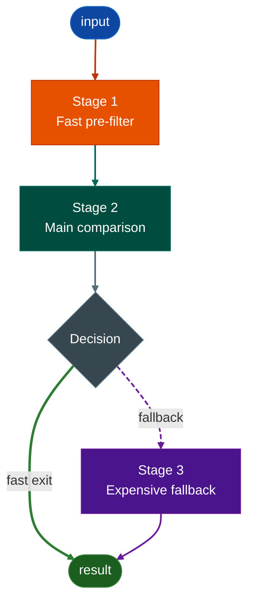
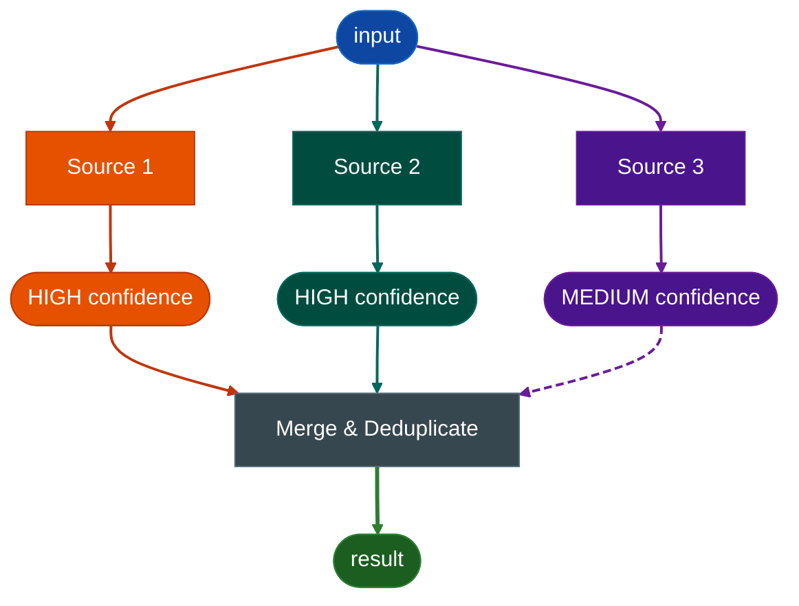

# Ablation Mermaid Diagram Template

Copy the classDef block into every new diagram. Do not invent new colors — pick from the six semantic roles below.

---

## Color palette

| Role | Use for | Fill | Stroke |
|:---|:---|:---|:---|
| `input` | Entry node — binary path, VA, query | `#0d47a1` | `#1565c0` |
| `primary` | First stage, fast path, highest-confidence source | `#e65100` | `#bf360c` |
| `secondary` | Second stage, main comparison work | `#004d40` | `#00695c` |
| `tertiary` | Third stage, expensive or last-resort path | `#4a148c` | `#6a1b9a` |
| `neutral` | Decision diamond, merge, aggregation step | `#37474f` | `#546e7a` |
| `output` | Final result node | `#1b5e20` | `#2e7d32` |

---

## Node shape conventions

| Shape | Syntax | Use for |
|:---|:---|:---|
| Stadium / pill | `(["text"])` | Entry and exit nodes |
| Rectangle | `["text"]` | Process or action step |
| Diamond | `{"text"}` | Decision or branch |

---

## Arrow style conventions

| Style | linkStyle | Use for |
|:---|:---|:---|
| Solid 2px | `stroke-width:2px` | Normal flow between stages |
| Solid 3px | `stroke-width:3px` | Primary exit, fast happy path |
| Dashed `6 3` | `stroke-dasharray:6 3` | Expensive path, MEDIUM confidence, fallback |

Arrow color follows the destination node's stroke color so the path stays color-continuous from source to result.

---

## classDef block — copy into every diagram

```
    classDef input    fill:#0d47a1,stroke:#1565c0,color:#fff
    classDef primary  fill:#e65100,stroke:#bf360c,color:#fff
    classDef secondary fill:#004d40,stroke:#00695c,color:#fff
    classDef tertiary fill:#4a148c,stroke:#6a1b9a,color:#fff
    classDef neutral  fill:#37474f,stroke:#546e7a,color:#fff
    classDef output   fill:#1b5e20,stroke:#2e7d32,color:#fff
```

---

## Minimal working example

Three-stage pipeline with a decision branch. Copy and replace the node labels.



---

## Fan-out pattern

Multiple sources feeding a single merge. Each source gets its own role color. Confidence labels go in separate colored nodes between the source and the merge step rather than as text inside the merge node.



---

## Rules

- **One classDef block per diagram.** Do not split it across comments or omit classes you are not using — keeping the full block means any node role can be added later without touching the palette.
- **linkStyle indices are zero-based and order-sensitive.** Count every `-->` in declaration order. A reordered edge breaks every linkStyle below it.
- **No em dashes in node labels or edge labels.** Use `·` (middle dot U+00B7) as a separator inside labels. Use plain English on edge labels with no punctuation beyond a comma.
- **Do not add new color hex values.** If a seventh role is genuinely needed, add it to this template first so all diagrams stay consistent.
