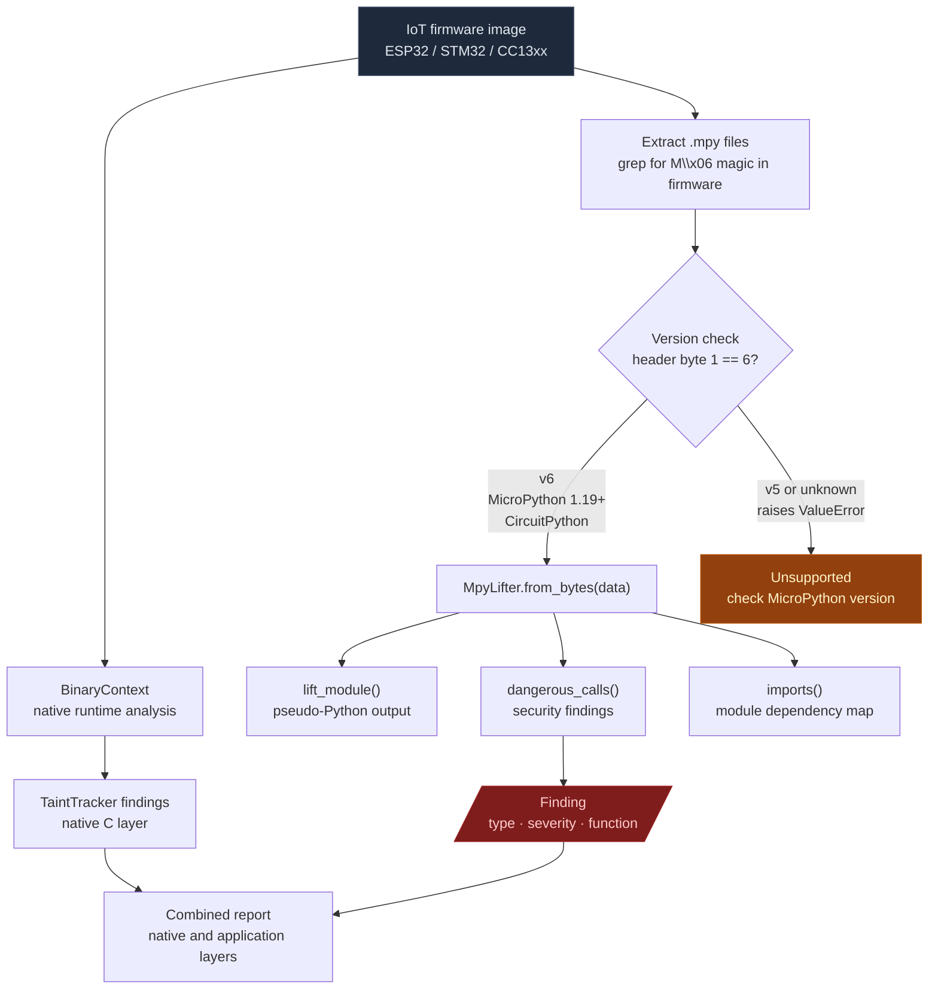

# MicroPython .mpy Bytecode Lifter

Zero-dependency lifter for compiled MicroPython `.mpy` v6 files. Decodes bytecode to readable pseudo-Python and scans for dangerous call patterns. Supports MicroPython 1.19–1.23+ and CircuitPython (both use the same v6 format).

---

## What this is

MicroPython compiles Python source to `.mpy` bytecode files for deployment on microcontrollers. IoT firmware images on ESP32, STM32, and CC13xx targets embed `.mpy` modules alongside the native C runtime. The application logic — network clients, protocol parsers, command handlers — lives in those `.mpy` files, not in the native binary.

Standard RE tools stop at the native ELF or flat ROM. The MicroPython runtime executing inside it is opaque to Capstone and BinaryContext, so an analysis of the native binary describes how the device starts, not what it does. `MpyLifter` covers the application layer so both halves of the firmware are visible.

---

## Where it's used

- **ESP32 firmware** — application modules embedded in the MicroPython partition
- **STM32 firmware** — `.mpy` files stored in internal flash alongside the native runtime
- **TI CC13xx / CC26xx** — MicroPython IoT devices with embedded bytecode modules
- **CircuitPython devices** — every precompiled library uses the identical v6 format
- Any IoT firmware image where `binwalk` or a grep for `M\x06` reveals embedded `.mpy` sections

---

## Pipeline



---

## Safe usage

**Extract before lifting.** `.mpy` files are embedded inside firmware images. Search the raw image for the magic bytes `0x4D 0x06` (`M\x06`) to locate them before passing to `MpyLifter`. A wrong offset produces a `ValueError` or a corrupted lift.

**Check the version byte.** `MpyLifter` only handles v6. Read `data[1]` before constructing — if it is not `0x06`, the file is v5 (MicroPython 1.12–1.18) and raises `ValueError`. Do not pass v5 files and interpret the error as a finding.

**Run both layers.** Memory corruption lives in the native C runtime. The attack surface — socket opens, command parsing, eval calls — lives in the `.mpy` layer. Run `TaintTracker` on the native binary and `MpyLifter` on the embedded modules. A `dangerous_calls()` finding is only exploitable if the native layer exposes the input.

**Check for native/viper code objects.** If `dangerous_calls()` returns nothing but the module does network IO, run `lift_module()` and look for `# <native/viper code: not lifted>` sections. Those code objects run as compiled C and are invisible to this lifter. Analyze them with `BinaryContext` against the native runtime instead.

**Verify the finding function name.** `dangerous_calls()` reports the code object name where the pattern appears. `<module>` means the pattern is at module scope, not inside a function. Module-scope `import socket` fires at import time, so it is always reachable.

---

## Why this exists

Three things made MicroPython firmware analysis blind before this module:

**1. Ablation could disassemble the native binary that boots the device, but not the application layer running on top of it.**
ESP32, STM32, and CC13xx firmware images embed `.mpy` precompiled modules alongside the native ELF or flat ROM. `BinaryContext`, `TaintTracker`, and `SemanticSearcher` all operate on native machine code. A device that boots a MicroPython app has its entire application logic in `.mpy` files that no existing Ablation tool could read.

**2. Identifying dangerous imports and exec/eval calls required either source access or manual hex reading.**
A `.mpy` file stores qstr (interned string) references for every name in the module. Finding `import socket`, `eval(...)`, or `machine.mem32[...]` required either the original `.py` source or manually decoding the bytecode hex. `MpyLifter.dangerous_calls()` scans the decoded instruction stream directly and reports findings in the same format as other Ablation scanners.

**3. CircuitPython's 600-board ecosystem had no RE entry point.**
CircuitPython is a downstream fork of MicroPython and shares the identical `.mpy` v6 format. Every CircuitPython device running a precompiled library was opaque. The same lifter covers both ecosystems without modification.

---

## Format notes

`.mpy` v6 structure:
```
Header (4 bytes): 'M' | version | feature_flags | small_int_bits
Global qstr table: vuint count, then (vuint-encoded-len + UTF-8 bytes) per entry
Global obj table:  vuint count, then typed constant objects per entry
Root code object:  recursive (kind+length vuint | bytecode | optional children)
```

Each bytecode code object begins with a **prelude** before the instruction stream. The prelude encodes six fields (n_state, n_exc_stack, scope_flags, n_pos_args, n_kwonly_args, n_def_pos_args) using an interleaved bit-column format (`xSSSSEAA [xFSSKAED]...`), followed by variable-info and cell-info byte counts. `MpyLifter` decodes the prelude using the exact `MP_BC_PRELUDE_SIG_DECODE_INTO` and `MP_BC_PRELUDE_SIZE_DECODE_INTO` logic from `py/bc.h`.

---

## Quick start

```python
from ablation.analyzers.mpy_lifter import MpyLifter

lifter = MpyLifter.from_path('network_client.mpy')

# All imported module names
print(lifter.imports())
# ['network', 'socket', 'ussl']

# Security findings
findings = lifter.dangerous_calls()
print(MpyLifter.report(findings))
# Type                   Sev    Function                     Detail
# --------------------------------------------------------------------------------
# DANGEROUS_IMPORT       MEDIUM <module>                     network
# DANGEROUS_IMPORT       MEDIUM <module>                     socket
# DANGEROUS_IMPORT       MEDIUM <module>                     ussl
# DANGEROUS_ATTR         HIGH   connect                      system

# Full pseudo-Python lift
print(lifter.lift_module())
```

---

## API reference

### Construction

```python
MpyLifter.from_path(path: str) -> MpyLifter
MpyLifter.from_bytes(data: bytes) -> MpyLifter
```

Both raise `ValueError` for non-.mpy data or unsupported version.

### `lift_module() -> str`

Lifts the full module to pseudo-Python. Stack-based simulation: tracks the value stack and emits `name = expr`, `return expr`, `import name`, and `def name(...):` lines. Child code objects (nested functions, lambdas) are lifted recursively and indented.

### `imports() -> list[str]`

Returns every module name that appears as an `IMPORT_NAME` operand in any code object. Does not deduplicate across imports of the same module in multiple functions.

### `dangerous_calls() -> list[dict]`

Scans all code objects for three pattern classes:

| Pattern class | Trigger | Default severity |
|---|---|---|
| `DANGEROUS_IMPORT` | `import socket/network/ussl/os/uos/machine/uctypes/io/uio/asyncio/...` | HIGH for os/uos/machine/uctypes; MEDIUM otherwise |
| `DANGEROUS_CALL` | `LOAD_NAME`/`LOAD_GLOBAL` of `exec`/`eval`/`compile`/`open`/`__import__` | HIGH |
| `DANGEROUS_ATTR` | `LOAD_ATTR` of `system`/`popen`/`execv`/`execve`/`spawn`/`mem32`/`mem16`/`mem8` | HIGH |

Each finding dict: `{type, detail, offset, function, severity}`.

### `MpyLifter.report(findings) -> str`

Formats findings as an ASCII table. Returns `'No dangerous patterns found.'` when the list is empty.

---

## Known limitations

- **Static qstrs**: Built-in MicroPython qstrs (stored as odd-valued indices) are reported as `<qstr:N>` rather than resolved to names. Security-relevant names (exec, eval, socket, etc.) are always dynamic qstrs and are resolved correctly.
- **Local variable names**: Lifted pseudo-Python uses `_v0`, `_v1`, ... for locals instead of original names. The variable name table in the prelude is skipped, not decoded.
- **Native/viper code objects**: Code objects of kind 1 (native) or 2 (viper) emit `# <native/viper code: not lifted>`. Only kind 0 (bytecode) is lifted.
- **v5 format**: Not supported. MicroPython 1.12–1.18 use v5. Raise `ValueError`.
