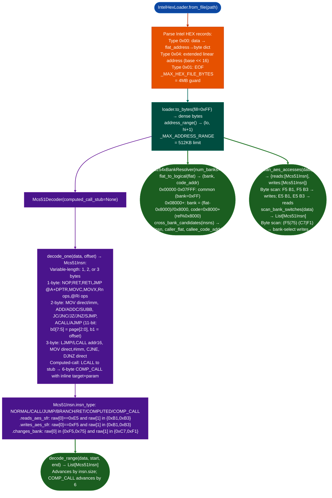

# 8051 ISA Modeling

Model Intel MCS-51 / Enhanced 8051 (CC254x) instruction semantics, memory spaces, SFR layout, computed-call idiom, bank-aware address resolution, and AES co-processor access patterns: enabling static analysis of TI BLE-stack firmware without a symbol table.

---

## Why this exists

1. **The MCS-51 architecture has dual data spaces that are invisible from opcode bytes alone: taint analysis must track which access mode was used.** Direct addressing to `0x80–0xFF` reads from the SFR space; indirect `@Ri` on the same range reads upper IRAM. `MOVC A,@A+DPTR` reads from CODE space; `MOVX A,@DPTR` reads from XDATA. A taint propagation engine that treats all memory accesses as equivalent will produce incorrect results on 8051 firmware, it will mark SFR reads as IRAM reads and miss AES co-processor interactions.

2. **TI BLE-Stack 1.5.2.0 CC2540/CC2541 uses a compiler-generated computed-call idiom that produces non-instruction bytes in the code stream.** `LCALL <stub>; <addr_hi>; <addr_lo>; <param>` is the function-pointer call pattern: the LCALL target (`computed_call_stub`) reads its own return address from the stack and dispatches to the `addr_hi << 8 | addr_lo` address with `param` in the accumulator. The 3 bytes following the LCALL are not instructions: they are inline data. A decoder that does not know `computed_call_stub` will attempt to decode them as instructions and produce incorrect offsets for everything downstream.

3. **CC254x BLE security analysis targets the AES co-processor and flash bank-select SFRs specifically.** The AES co-processor is at SFR `0xB1` ENCDI/ENCDO and `0xB3` (ENCCS): a `MOV 0xB3,A` write triggers the AES engine. Flash banking is controlled by `FMAP` (`0xF1`) and `MEMCTR` (`0xC7`). `scan_aes_accesses()` and `scan_bank_switches()` perform fast byte-pattern scans for `F5 B1`, `F5 B3`, `E5 B1`, `E5 B3` patterns and `F5/75 + FMAP/MEMCTR` patterns respectively: finding all AES and bank-switch sites without decoding the full binary.

---

## How it works



### Memory space summary

| Space | Access | Address range | Security relevance |
|---|---|---|---|
| CODE | `MOVC A,@A+DPTR/PC` | 0x0000–0xFFFF | Read-only after flash; COMP_CALL targets |
| IRAM | Direct / `@Ri` indirect | 0x00–0xFF (8-bit) | Stack, registers; `0x80–0xFF` = SFR direct mode only |
| XDATA | `MOVX A,@DPTR` | 0x0000–0xFFFF | Data; peripheral MMIO at high addresses |
| SFR | Direct address `0x80–0xFF` | 0x80–0xFF | AES (0xB1/0xB3), bank (0xC7/0xF1), UART, timers |
| BIT | Bit instructions | Overlaps IRAM 0x20–0x2F + SFRs | Status flags, port bits |

---

## Usage

```python
import sys
sys.path.insert(0, '/home/cowboy/ablation/modules')
from isa_8051 import (
    IntelHexLoader, Mcs51Decoder, InsnType,
    Cc254xBankResolver, scan_aes_accesses, scan_bank_switches,
    CC254X_SFR, sfr_name,
)

# Load firmware from Intel HEX
loader = IntelHexLoader.from_file('/fw/ble/cc2541_stack.hex')
lo, hi = loader.address_range()
print(f"Address range: 0x{lo:05X}–0x{hi:05X} ({hi-lo:,} bytes)")
data = loader.to_bytes()

# Decode a function with computed-call support
COMPUTED_CALL_STUB = 0x0210  # from prior TI BLE-Stack RE session
decoder = Mcs51Decoder(computed_call_stub=COMPUTED_CALL_STUB)
insns = decoder.decode_range(data, start=0x1234, end=0x1290)
for insn in insns:
    print(insn)

# Identify cross-bank calls (require runtime bank-selection awareness)
resolver = Cc254xBankResolver(num_banks=4)
cross_bank = resolver.cross_bank_candidates(insns)
for insn, caller_flat, callee_addr in cross_bank:
    bank, _ = resolver.flat_to_logical(caller_flat)
    print(f"  Cross-bank LCALL @ flat 0x{caller_flat:05X} → 0x{callee_addr:04X}")

# AES co-processor access scan (fast byte-pattern scan, no full decode needed)
aes = scan_aes_accesses(data, decoder)
print(f"\nAES SFR reads:  {len(aes['reads'])}")
print(f"AES SFR writes: {len(aes['writes'])}")
for insn in aes['writes'][:5]:
    print(f"  {insn}")

# Bank-switch sites
bank_switches = scan_bank_switches(data, decoder)
print(f"\nBank-select writes: {len(bank_switches)}")
for insn in bank_switches[:5]:
    print(f"  {insn}  ({sfr_name(insn.raw[1])})")

# Decode single instruction
insn = decoder.decode_one(data, 0x1234)
print(f"\n{insn}")
print(f"  type={insn.insn_type.value}  size={insn.size}")
print(f"  is_call={insn.is_call}  reads_aes={insn.reads_aes_sfr}  changes_bank={insn.changes_bank}")
```

---

## Example output

```
Address range: 0x00000–0x27FFF (163,840 bytes)

0x01234: 12 02 10    LCALL 0x0210
0x0123A: 12 45 67    CALL* 0x4567 param=0x09    ← COMP_CALL detected (6 bytes)
0x01240: E5 B3       MOV A,ENCCS                 ← AES SFR read
0x01242: F5 B1       MOV ENCDI,A                 ← AES SFR write
0x01250: 75 F1 02    MOV FMAP,#0x02              ← bank switch to bank 2

Cross-bank LCALL @ flat 0x01234 → 0x8210
  (caller in common area, callee in banked window)

AES SFR reads:  14
AES SFR writes: 18

Bank-select writes: 6
  0x01250: 75 F1 02    MOV FMAP,#0x02  (FMAP)
  0x02430: 75 C7 03    MOV MEMCTR,#0x03  (MEMCTR)
```

---

## False positives

**`scan_aes_accesses()` matches `F5 B1` / `E5 B1` byte pairs that fall mid-instruction.** The byte-pattern scan does not verify that the `F5` or `E5` byte is at an instruction boundary, it finds any occurrence of the two-byte pattern. A 3-byte instruction like `MOV DPTR,#0xF5B1` opcode `0x90, 0xF5, 0xB1` would produce a false match if scanned at offset 1. The density of false positives is low (AES SFRs at `0xB1/0xB3` are not common immediate values) but non-zero. Confirm each hit by decoding the instruction at the reported offset and verifying `insn.raw[0] in 0xE5, 0xF5`.

**`COMP_CALL` detection fires on any LCALL to `computed_call_stub`: including tail calls and error stubs.** Not every LCALL to the stub address is a computed function-pointer call. Some stubs perform fixed actions error handlers, initialization routines that happen to share the same dispatch mechanism. Verify `COMP_CALL` findings by confirming the inline target address resolves to a valid function start: i.e., `flat_to_logicalresolver.logical_to_flat(bank, real_target)` produces an offset that begins with a recognizable prologue pattern.

**`Cc254xBankResolver` assumes `num_banks=4` (CC2540): CC2541 has 8 banks.** The default constructor uses 4 banks. A CC2541 image (256KB) analyzed with `num_banks=4` will produce incorrect `flat_to_logical()` results for flat offsets above `0x27FFF`. Set `num_banks=8` for CC2541 images.

---

## Pipeline position

**Before this module:** Obtain the firmware as an Intel HEX file from the vendor SDK or from a device dump. Confirm the CC254x variant (CC2540 vs CC2541 = 128KB vs 256KB flash) before setting `num_banks`. Identify the `computed_call_stub` VA from a prior RE session or by locating `LCALL` clusters with 3 non-instruction bytes following them.

**After this module:** Feed `Mcs51Decoder.decode_range()` output into a custom CFG builder to identify function boundaries and call graph edges. Cross-bank call sites require `Cc254xBankResolver.flat_to_logical()` to resolve the actual bank-relative target. AES and bank-switch sites are the primary taint sources for BLE crypto key handling analysis.

---

## Reading findings

| Field | Content |
|:---|:---|
| `insn.insn_type` | `COMP_CALL`: TI computed-call idiom detected; `CALL`: standard LCALL/ACALL |
| `insn.reads_aes_sfr` | True: this instruction reads from the AES co-processor (`ENCDI` or `ENCCS`) |
| `insn.writes_aes_sfr` | True: this instruction triggers the AES engine (write to `ENCCS` = start operation) |
| `insn.changes_bank` | True: this instruction changes the active flash bank (write to `FMAP` or `MEMCTR`) |
| `scan_aes_accesses()` | `reads` / `writes` lists: all AES SFR access sites in the binary |
| `cross_bank_candidates()` | Calls from common area to banked window: require bank context tracking |

---

## See also

- [HiSi RV32 Extension](hisi-rv32-ext.md): companion ISA model for HiSilicon RISC-V cores (also in `ablation/analyzers/`)
- [ARM Symbolic Analysis](arm-symbolic-analysis.md): symbolic execution for ARM binaries; same architectural role for 32-bit targets
- [Taint Analysis](taint-analysis.md): trace AES key material from SFR reads through the BLE stack
