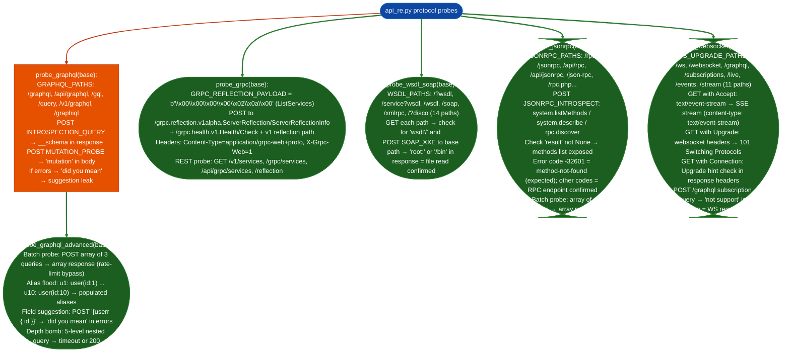

# Additional API Protocols

Enumerate and attack GraphQL, gRPC, SOAP/WSDL, JSON-RPC, and WebSocket interfaces: running introspection queries, server reflection, WSDL retrieval, method listing, and WebSocket upgrade detection against non-REST API surfaces that standard HTTP scanning tools do not cover.

---

## Why this exists

1. **GraphQL introspection exposes the entire schema in a single unauthenticated query: types, fields, queries, mutations, and relationships.** A single `POST /graphql` with the `__schema` introspection query returns every type and field name the API exposes. When introspection is disabled, field suggestion errors (`"Did you mean X?"`) leak individual field names through typo probes. When batching is enabled, an array of introspection queries bypasses per-query rate limits and processes the full schema enumeration as a single API call.

2. **gRPC server reflection is the HTTP/2 equivalent of WSDL, and it is commonly left enabled in development deployments.** A gRPC server with reflection enabled responds to a `ListServices` request with every registered service and method definition, including method parameter and return types. Many gRPC services also expose an HTTP/1.1 REST gateway with service listing endpoints `/v1/services`, `/grpc/services`: accessible without gRPC client tooling. `probe_grpc()` detects both surfaces via `GRPC_REFLECTION_PAYLOAD` and REST path probing.

3. **SOAP/WSDL endpoints carry XXE injection risk that pure JSON APIs do not.** A WSDL file retrieval confirms the full operation set; the follow-on XXE probe (`SOAP_XXE` payload with `<!ENTITY xxe SYSTEM "file:///etc/passwd">`) confirms whether the XML parser resolves external entities. An affirmative response containing `root:` or `/bin` is file read from the server filesystem: a direct path to credential extraction.

---

## How it works



### Protocol findings severity

| Protocol | Finding | Severity |
|---|---|---|
| GraphQL | `__schema` introspection returns types | HIGH |
| GraphQL | Batch array processing accepted | HIGH |
| GraphQL | Alias enumeration resolves user records | HIGH |
| GraphQL | Field suggestion leak | MEDIUM |
| gRPC | `GRPC_DETECTED`: reflection endpoint 200 | HIGH |
| gRPC | REST gateway service listing | MEDIUM |
| SOAP | WSDL retrieved with operation list | MEDIUM |
| SOAP | XXE `root:` in response | CRITICAL |
| JSON-RPC | `system.listMethods` returns method list | HIGH |
| JSON-RPC | Batch array response accepted | MEDIUM |
| WebSocket | 101 Upgrade accepted | INFO |
| SSE | `text/event-stream` returned | MEDIUM |

---

## Usage

```python
from modules.api_re import (
    probe_graphql,
    probe_graphql_advanced,
    probe_grpc,
    probe_wsdl_soap,
    probe_jsonrpc,
    probe_websocket,
)

base = 'https://target.internal:8443'

# GraphQL — introspection + advanced attacks
gql_findings = probe_graphql(base)
gql_advanced = probe_graphql_advanced(base)

for f in gql_findings:
    if f.get('types'):
        print(f"[GRAPHQL_INTROSPECTION] {f['path']}: {len(f['types'])} types exposed")
        print(f"  Types: {', '.join(t for t in f['types'] if t and not t.startswith('__'))[:6]}")

for f in gql_advanced:
    if f.get('type') == 'graphql_batching':
        print(f"[GQL_BATCH] {f['path']}: {f['results']} queries processed as batch")
    elif f.get('type') == 'graphql_alias_enum':
        print(f"[GQL_ALIAS_ENUM] {f['path']}: {len(f['resolved'])} user records enumerated")
    elif f.get('type') == 'graphql_field_suggestion':
        print(f"[GQL_SUGGESTION] {f['path']}: {f['suggestions'][:5]}")

# gRPC
grpc_findings = probe_grpc(base)
for f in grpc_findings:
    print(f"[GRPC_{f['type'].upper()}] {f['path']} status={f.get('status')}")

# SOAP/WSDL
soap_findings = probe_wsdl_soap(base)
for f in soap_findings:
    if f.get('type') == 'soap_xxe_file_read':
        print(f"[SOAP_XXE_CONFIRMED] File read via XXE: {f['content'][:200]}")
    elif f.get('type') == 'wsdl_found':
        print(f"[WSDL] {f['path']}: operations={f['operations'][:5]}")

# JSON-RPC
rpc_findings = probe_jsonrpc(base)
for f in rpc_findings:
    if f.get('type') == 'jsonrpc_methods_exposed':
        print(f"[JSONRPC_METHODS] {f['path']}: {f['methods'][:10]}")

# WebSocket / SSE
ws_findings = probe_websocket(base)
for f in ws_findings:
    print(f"[WS_{f['type'].upper()}] {f['path']}")

# Full pipeline — all protocol probes run as phases in run_re()
from modules.api_re import run_re
results = run_re('https://target.internal:8443')
print(f"Total findings: {sum(len(v) for v in results.values() if isinstance(v, list))}")
```

---

## Example output

```
[GRAPHQL_INTROSPECTION] /graphql: 14 types exposed
  Types: User, Post, Comment, Query, Mutation, AuthToken

[GQL_BATCH] /api/graphql: 3 queries processed as batch
[GQL_ALIAS_ENUM] /graphql: 7/10 user records enumerated
[GQL_SUGGESTION] /api/graphql: ['username', 'userId', 'userGroup']

[GRPC_GRPC_ENDPOINT] /grpc.reflection.v1alpha.ServerReflection/ServerReflectionInfo status=200
[GRPC_GRPC_REST_GATEWAY] /v1/services  body={"services":["auth.AuthService","user.UserService"]}

[WSDL] /?wsdl: operations=['Login', 'GetUserProfile', 'UpdatePassword', 'DeleteAccount']
[SOAP_XXE_CONFIRMED] File read via XXE: root:x:0:0:root:/root:/bin/bash
daemon:x:1:1:daemon:/usr/sbin:/usr/sbin/nologin...

[JSONRPC_METHODS] /api/rpc: ['system.listMethods', 'user.login', 'user.getProfile', 'admin.listUsers']

[WS_WEBSOCKET_UPGRADE] /ws
[WS_SSE_STREAM] /events  content=data: {"type":"heartbeat","ts":1729158000}
```

---

## False positives

**GraphQL introspection `__schema` present in error body.** Some API gateways return a 200 with an error body that includes `"__schema"` as a string literal in an error message: for example, `"introspection query contains __schema which is disabled"`. The detection checks `"__schema" in str(data)`, this matches the error message, not the schema. Before reporting, confirm `data.get("data", {}).get("__schema")` is not None.

**SOAP XXE response contains `root:` from non-filesystem source.** Some APIs echo back user input in error messages or include example file content in WSDL descriptions. An XXE response with `root:` in a WSDL comment or in an echoed request element is not a file read. Confirm the XXE is exploitable by checking whether the response content matches the format of `/etc/passwd` (colon-separated fields with `/bin/bash` or similar) rather than just containing the string `root:`.

**JSON-RPC error code `-32601` Method Not Found does not confirm a JSON-RPC endpoint.** The detection ignores `-32601` responses intentionally, it is the standard response when a JSON-RPC server receives a valid request for a non-existent method, but many non-JSON-RPC APIs also return `{"error": {"code": -32601}}` from generic error handlers. The endpoint is confirmed only when `result` is non-null or when a non-`-32601` error code is returned.

---

## Pipeline position

**Before this module:** Run basic HTTP enumeration via `probe_api_surface()` first to confirm the service is reachable and to identify content-type hints `application/grpc`, `text/xml`, `application/json-rpc` that indicate which protocol probes are relevant. SOAP and gRPC are rarely present on modern services; use content-type hints to prioritize before running all four protocol probes.

**After this module:** For WSDL findings: import the discovered operations into `APIEndpointRegistry` and run `probe_injection_checks()` against each SOAP operation parameter. For GraphQL introspection findings: run `probe_graphql_advanced()` to test batching and alias enumeration before reporting schema exposure: the advanced attacks often reveal higher-severity impacts than schema disclosure alone.

---

## Reading findings

| Finding type | Meaning |
|:---|:---|
| `graphql_batching` | Array of queries processed as one request: rate limit bypass path |
| `graphql_alias_enum` | User records enumerated via alias flooding: BOLA via GraphQL |
| `graphql_field_suggestion` | Field names leaked via suggestion errors: introspection bypass |
| `soap_xxe_file_read` | XML external entity resolved from filesystem: check `content` for `/etc/passwd` |
| `grpc_endpoint` | gRPC-Web reflection endpoint responded: service listing possible |
| `jsonrpc_methods_exposed` | `system.listMethods` returned method list: enumerate all methods |
| `websocket_upgrade` | 101 Switching Protocols accepted: send `graphql-transport-ws` messages |
| `sse_stream` | Server-Sent Events stream detected: monitor for sensitive event data |

---

## See also

- [API Authentication and Token Checks](api-authentication-and-token-checks.md): JWT/OAuth2 checks applied after protocol enumeration identifies the auth layer
- [API Injection and Validation Checks](api-injection-and-validation-checks.md): parameter injection against discovered SOAP/RPC endpoints
- [API Reverse Engineering](api-re.md): full 15-phase HTTP RE workflow that calls these protocol probes as sub-phases
