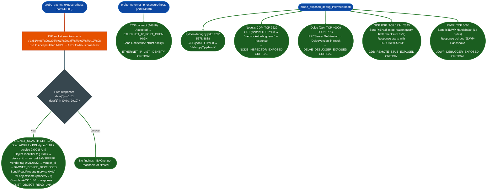

# Additional Industrial and Debug Probes

Probe BACnet building automation controllers, EtherNet/IP industrial PLCs, and exposed debugger interfaces: sending unauthenticated I-Am/ListIdentity/handshake requests to confirm whether industrial control systems or runtime debuggers are reachable from untrusted network segments.

---

## Why this exists

1. **BACnet and EtherNet/IP have no native authentication: any host that reaches the port has full read/write access to the physical system.** BACnet UDP/47808 carries no authentication mechanism in the base specification ASHRAE 135. A Who-Is broadcast to an exposed BACnet controller returns an I-Am response disclosing device ID and vendor; a follow-on ReadProperty request reads object names, schedule configurations, and control point values without credentials. EtherNet/IP TCP/44818 returns full device identity: vendor, product code, serial number, firmware revision: in response to a ListIdentity request sent before any session establishment. Both protocols are designed for trusted OT networks; exposure to IT or internet-facing segments is unconditional CRITICAL severity under ICS security frameworks IEC 62443, NIST SP 800-82.

2. **Exposed debugger interfaces are unauthenticated remote code execution by design.** Python `debugpy` (DAP), Node.js inspector (Chrome DevTools Protocol), Delve Go JSON-RPC, GDB Remote Serial Protocol stubs, and Java JDWP are all designed with the assumption that network access equals trust. None have authentication mechanisms. Each grants the connected client capabilities equivalent to having the process under a debugger: arbitrary code execution, memory read/write, environment variable access, and full process control. A single TCP connection confirmation to port 5678 (debugpy), 9229 Node CDP, 40000 (Delve), 1234/2345 (GDB RSP), or 5005 (JDWP) with a valid handshake is sufficient to confirm CRITICAL RCE.

3. **Industrial and debug exposure findings are operationally distinct from web API findings: they require raw TCP/UDP socket probes, not HTTP.** Standard port scanning confirms the port is open; these probes confirm the service is the expected protocol and responds to control-plane requests. A TCP 44818 open does not confirm EtherNet/IP: `probe_ethernet_ip_exposure()` sends a ListIdentity encapsulation header and parses the response to confirm the device returns identity data.

---

## How it works



### Protocol/port reference

| Protocol | Default port | Transport | Finding title | Severity |
|---|---|---|---|---|
| BACnet/IP | 47808 | UDP | `BACNET_UNAUTH` | CRITICAL |
| BACnet device ID | 47808 | UDP | `BACNET_DEVICE_DISCLOSED` | CRITICAL |
| BACnet ReadProperty | 47808 | UDP | `BACNET_OBJECT_READ_UNAUTH` | CRITICAL |
| EtherNet/IP port open | 44818 | TCP | `ETHERNET_IP_PORT_OPEN` | HIGH |
| EtherNet/IP ListIdentity | 44818 | TCP | `ETHERNET_IP_LIST_IDENTITY` | CRITICAL |
| Python debugpy/pdb | 5678, 8888 | TCP | `PYTHON_DEBUGGER_EXPOSED` | CRITICAL |
| Node.js CDP | 9229 | TCP | `NODE_INSPECTOR_EXPOSED` | CRITICAL |
| Delve (Go) | 40000 | TCP | `DELVE_DEBUGGER_EXPOSED` | CRITICAL |
| GDB Remote Serial Protocol | 1234, 2345 | TCP | `GDB_REMOTE_STUB_EXPOSED` | CRITICAL |
| Java JDWP | 5005 | TCP | `JDWP_DEBUGGER_EXPOSED` | CRITICAL |

---

## Usage

```python
from modules.syscall_trace import (
    probe_bacnet_exposure,
    probe_ethernet_ip_exposure,
    probe_exposed_debug_interface,
)

target = '10.10.50.100'

# BACnet building automation controller
bacnet_findings = probe_bacnet_exposure(target, port=47808, timeout=5.0)
for f in bacnet_findings:
    print(f"[{f['severity']}] {f['title']}")
    print(f"  {f['detail'][:120]}")

# EtherNet/IP PLC
eip_findings = probe_ethernet_ip_exposure(target, port=44818, timeout=5.0)
for f in eip_findings:
    print(f"[{f['severity']}] {f['title']}: {f['detail'][:100]}")

# Debugger interfaces — probes all five protocols in one call
debug_findings = probe_exposed_debug_interface(target, timeout=5.0)
for f in debug_findings:
    print(f"[{f['severity']}] {f['title']} @ {f['host']}:{f['port']}")
    print(f"  {f['detail'][:150]}")

# Batch sweep across an IP range
import ipaddress
results = {}
for ip in ipaddress.IPv4Network('10.10.50.0/24').hosts():
    host = str(ip)
    bacnet = probe_bacnet_exposure(host, timeout=2.0)
    eip    = probe_ethernet_ip_exposure(host, timeout=2.0)
    debug  = probe_exposed_debug_interface(host, timeout=2.0)
    all_f = bacnet + eip + debug
    if all_f:
        results[host] = all_f
        print(f"{host}: {len(all_f)} findings — {[f['title'] for f in all_f]}")

print(f"\nHosts with findings: {len(results)}/{len(list(ipaddress.IPv4Network('10.10.50.0/24').hosts()))}")
```

---

## Example output

```
[CRITICAL] BACNET_UNAUTH
  BACnet building automation controller responding without authentication — I-Am response
  received to unauthenticated Who-Is broadcast; BACnet/IP has no native authentication;
  exposes HVAC, access control, fire suppression, and power systems

[CRITICAL] BACNET_DEVICE_DISCLOSED
  BACnet device ID 4194303 and vendor 8 disclosed — device object identifier exposed
  without authentication; vendor ID maps to specific product lines with known CVEs

[CRITICAL] BACNET_OBJECT_READ_UNAUTH
  BACnet object properties readable without authentication — ReadProperty for objectName
  (property 77) on device object returned data; WriteProperty likely also unprotected

[HIGH    ] ETHERNET_IP_PORT_OPEN
  EtherNet/IP industrial protocol port accessible — TCP 44818 accepted connection;
  EtherNet/IP is the primary protocol for Allen-Bradley/Rockwell PLCs

[CRITICAL] ETHERNET_IP_LIST_IDENTITY
  EtherNet/IP ListIdentity succeeded (PLC vendor, product code, serial number disclosed)

[CRITICAL] GDB_REMOTE_STUB_EXPOSED @ 10.10.50.100:1234
  GDB Remote Serial Protocol (RSP) stub responding at 10.10.50.100:1234.
  RSP "?" query returned a stop-reason response without authentication.
  Unauthenticated GDB RSP access enables: full memory read/write (m/M packets),
  register inspection and modification (g/G packets), arbitrary code execution via
  memory write and continue (c packet). Common on QEMU -gdb, JTAG bridges, kernel debug stubs.

[CRITICAL] JDWP_DEBUGGER_EXPOSED @ 10.10.50.100:5005
  Java Debug Wire Protocol (JDWP) agent exposed at 10.10.50.100:5005.
  Classic exploitation: Runtime.exec() via JDWP method invocation achieves OS command execution.
```

---

## False positives

**BACnet Who-Is returns timeout on firewalled UDP.** The probe sends a UDP unicast Who-Is, not a broadcast, it targets the specific host. If UDP/47808 is filtered at a firewall but the device is live, `recvfrom()` times out and no findings are generated. Absence of findings does not confirm the host is not a BACnet controller, it confirms only that UDP/47808 from the probe host to the target is not blocked. Network topology verification is required before concluding no BACnet exposure.

**EtherNet/IP TCP connection accepted by a non-EtherNet/IP service.** TCP/44818 is allocated to EtherNet/IP Rockwell/ODVA but is sometimes used by unrelated services. `ETHERNET_IP_PORT_OPEN` fires on TCP connect alone. `ETHERNET_IP_LIST_IDENTITY` requires the service to respond to the encapsulation header with a valid response structure, this filters most non-EtherNet/IP services. Only promote `ETHERNET_IP_PORT_OPEN` to a confirmed finding after `ETHERNET_IP_LIST_IDENTITY` appears.

**Node.js CDP `webSocketDebuggerUrl` in a non-debugger response.** If a web server on port 9229 returns a JSON body that happens to contain `websocketdebuggerurl` as a field name rare but possible in API documentation or mock services, the probe fires. Before reporting `NODE_INSPECTOR_EXPOSED`, verify the response is from Node.js CDP by checking for `devtools` in the content-type or that the JSON array contains objects with `id`, `title`, `type`, and `url` fields: the standard CDP target list format.

---

## Pipeline position

**Before this module:** Port scan to confirm the target ports are reachable: UDP 47808, TCP 44818, and debugger ports 5678, 8888, 9229, 40000, 1234, 2345, and 5005. Use `tiptoe` or `nmap` for the initial sweep. These probes confirm the services are the correct protocols; they do not replace port scanning.

**After this module:** For `BACNET_OBJECT_READ_UNAUTH`: attempt WriteProperty against the device object to confirm write access before reporting physical control impact: confirm the device type HVAC controller, access control panel, UPS from the vendor ID. For `GDB_REMOTE_STUB_EXPOSED` or `JDWP_DEBUGGER_EXPOSED`: obtain full process memory via `m` packets (GDB) or heap enumeration (JDWP) to identify credentials, keys, or sensitive configuration before escalating to RCE demonstration.

---

## Reading findings

| Finding title | Meaning |
|:---|:---|
| `BACNET_UNAUTH` | I-Am response to Who-Is: BACnet controller reachable without auth |
| `BACNET_DEVICE_DISCLOSED` | Device ID + vendor ID parsed: enables targeted CVE exploitation |
| `BACNET_OBJECT_READ_UNAUTH` | ReadProperty returned data: write access likely also unprotected |
| `ETHERNET_IP_LIST_IDENTITY` | ListIdentity response: PLC model, firmware revision, serial disclosed |
| `PYTHON_DEBUGGER_EXPOSED` | debugpy/pydevd confirmed: arbitrary Python eval via DAP |
| `NODE_INSPECTOR_EXPOSED` | CDP webSocketDebuggerUrl present: arbitrary JS exec via DevTools |
| `DELVE_DEBUGGER_EXPOSED` | Delve RPCServer.GetVersion confirmed: Go process under attacker control |
| `GDB_REMOTE_STUB_EXPOSED` | RSP stop-reason response: full memory read/write + code execution |
| `JDWP_DEBUGGER_EXPOSED` | JDWP handshake echoed: JVM method invocation → OS command execution |

---

## See also

- [Syscall Trace](syscall-trace.md): the module that houses these probe functions; also covers heap spray detection and lateral movement
- [Lateral Movement](lateral-movement.md): post-exploitation pivot techniques from ICS networks to IT networks
- [Network Protocol Analysis](network-analyze.md): passive protocol identification before active probing
