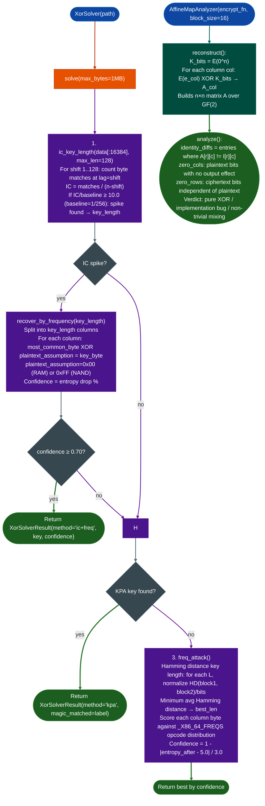

# Affine Mapping Analysis

Recover XOR encryption keys from firmware blobs using three attack modes: Known Plaintext Attack against a firmware magic-byte dictionary, Index of Coincidence spike detection for sparse flash images, and frequency analysis against an x86-64 opcode distribution: then verify the recovered cipher's linear structure using a white-box affine map reconstruction over GF(2).

---

## Why this exists

1. **Firmware XOR obfuscation uses static repeating keys that can be recovered in seconds.** Vendors apply a single repeating XOR key before flashing firmware to NAND Fortinet, HiSilicon, a range of industrial targets. The cipher is not cryptographic, it is obfuscation. Three well-known attacks break it: known-plaintext recovery from firmware magic bytes, Index of Coincidence spike detection on sparse images, and transposition frequency analysis. Without automated tooling, analysts perform these manually per engagement.

2. **NAND flash images have overwhelming sparsity: most bytes are 0xFF (erased) or 0x00 initialized.** This property makes the XOR key immediately recoverable from the most-common-byte-per-column statistic: the most frequent ciphertext byte in each of the key-length columns is `most_common_plaintext XOR key_byte`. The IC spike method identifies the key length first IC rises sharply at multiples of the true key length, then frequency analysis extracts each byte. Validated on FortiWiFi FWF_60E IC=0.753, 192× above random baseline, 256 MB NAND and a 512 MB x86-64 firmware image IC=0.953, 244× above baseline.

3. **`AffineMapAnalyzer` proves whether an unknown encryption function is pure XOR or has unexpected bit mixing.** When a firmware encryption routine is identified in a binary but its structure is unknown, `AffineMapAnalyzer` reconstructs the function's GF(2) affine map (A×P + K) by calling the function with unit-vector inputs. A pure XOR cipher produces A = Identity. Zero columns reveal plaintext bits that never affect output implementation bugs. Off-diagonal entries reveal accidental bit rotation or mixing beyond simple XOR.

---

## How it works



### KPA magic dictionary 14 entries

| Magic bytes | Label | File offset |
|---|---|---|
| `\x7fELF` | ELF binary | 0 |
| `hsqs` / `sqsh` | SquashFS (LE/BE) | 0 |
| `\x1f\x8b` | gzip | 0 |
| `\xfd7zXZ\x00` | XZ | 0 |
| `\x27\x05\x19\x56` | U-Boot image | 0 |
| `\x02\x53\xef` | ext4 superblock | `+0x438` |
| `070701` | cpio newc | 0 |
| `MPFW` / `FORTI` | Fortinet header | 0 |
| `\xed\xab\xee\xdb` | RPM | 0 |

### Plaintext assumption for `recover_by_frequency()`

| Target type | `plaintext_assumption` |
|---|---|
| NAND flash (erased cells = 0xFF) | `0xFF` |
| RAM dump / filesystem image | `0x00` (default) |

---

## Usage

```python
from ablation.analyzers.xor_solver import XorSolver, AffineMapAnalyzer

# Full auto — IC+freq is tried first, then KPA, then Hamming+freq
solver = XorSolver('/fw/fortinet/FWF_60E_7.2.4.bin')
result = solver.solve()
print(result.fmt())
# XorSolverResult
#   key        : deadbeef01020304...  (length=64)
#   method     : ic+freq
#   confidence : 0.91
#   notes      : key_length=64, entropy_before=6.539, entropy_after=1.537, drop=76.5%

if result.key:
    # Decrypt the full firmware image
    decrypted = solver.decrypt_file(result.key, output_path='/tmp/fw_decrypted.bin')
    print(f"Decrypted: {len(decrypted):,} bytes → /tmp/fw_decrypted.bin")

    # Verify plaintext by scanning for magic bytes in decrypted output
    elf_offsets = [i for i in range(0, len(decrypted)-4, 4)
                   if decrypted[i:i+4] == b'\x7fELF']
    print(f"ELF headers in decrypted: {elf_offsets[:5]}")

# Use KPA only when you know the content type
kpa = solver.kpa_attack(max_probe=64)
if kpa.key:
    print(f"KPA: {kpa.magic_matched} → key={kpa.key.hex()} (confidence={kpa.confidence:.2f})")

# IC key-length detection with explicit NAND assumption
ic_len = solver.ic_key_length(max_len=128)
if ic_len:
    result = solver.recover_by_frequency(ic_len, plaintext_assumption=0xFF)
    print(f"NAND recovery: key_length={ic_len} key={result.key.hex()}")

# White-box affine map analysis of an unknown encrypt function
def mystery_encrypt(plaintext: bytes) -> bytes:
    return bytes(b ^ 0xAA for b in plaintext)   # trivial example

analyzer = AffineMapAnalyzer(mystery_encrypt, block_size=16)
print(analyzer.analyze())
# AffineMapAnalyzer: block_size=16 (128 bits)
#   K (E(0^n)) : aaaa...aa
#   A vs I     : 0 differing entries
#   A == I     : True (pure P XOR K)
#   VERDICT    : Proper XOR cipher (A=I). Only key K protects confidentiality.
```

---

## Example output

```
XorSolverResult
  key        : deadbeef01020304deadbeef01020304 ... (length=64)
  method     : ic+freq
  confidence : 0.910
  magic      : N/A
  notes      : key_length=64, entropy_before=6.539, entropy_after=1.537, drop=76.5%

Decrypted: 268,435,456 bytes → /tmp/fw_decrypted.bin
ELF headers in decrypted: [2097152, 6291456, 10485760]

AffineMapAnalyzer: block_size=16 (128 bits)
  K (E(0^n)) : aaaaaaaaaaaaaaaaaaaaaaaaaaaaaaaaa
  A vs I     : 8 differing entries
  A == I     : False
  ZERO COLS  : [3, 11] (plaintext bits with no effect)
  VERDICT    : IMPLEMENTATION BUG: some bits not XOR'd or mixed incorrectly.
  Byte-level diagonal coverage:
    byte  0:  8/8 diagonal OK OK
    byte  1:  6/8 diagonal OK *** 2/8 diagonal entries wrong ***
```

---

## False positives

**IC spike at multiples of the true key length.** The IC method returns the first shift above the threshold, which may be a divisor of the true key length for example detecting length 16 when the actual key is 64 bytes with a repeating 16-byte sub-pattern. After `recover_by_frequency()`, check `_is_repeating(key)` to detect sub-period keys. When a sub-period is found, the derived key is still correct for decryption, it is a valid shorter representation of the same cipher.

**KPA entropy check false negative on structured plaintext.** The KPA validation check (`3.0 ≤ entropy ≤ 7.5`) rejects derived keys whose 256-byte decrypted sample has entropy outside that range. A boot sector or early flash with very low plaintext entropy for example all-zero padding at offset 0 passes a zero-entropy derived key silently. If `kpa_attack()` returns `key=None` but the firmware appears XOR'd, probe the magic dictionary entries directly and check each derived key manually.

**Frequency analysis fails on non-x86-64 plaintext.** `freq_attack()` scores columns against `_X86_64_FREQS`: an x86-64 opcode distribution. ARM/MIPS/PPC firmware has different opcode byte distributions. Use `ic_key_length()` + `recover_by_frequency()` instead: frequency analysis is not needed when plaintext sparsity is high, because the most-common-byte approach is architecture-independent.

---

## Pipeline position

**Before this module:** Identify that the firmware is XOR-obfuscated: `binwalk` finds no valid filesystem signatures, or `file` returns "data" with high entropy ~5.5–7.0 bits/byte.

**After this module:** Write the decrypted image to disk via `decrypt_file()`. Pass the decrypted file to `FirmwareContainer.from_path()` for partitioned containers or directly to `BinaryContext.load_or_build()` for bare ELF. If `AffineMapAnalyzer` reveals implementation bugs zero columns or rows, document the finding as a cipher integrity defect: the affected plaintext bits are unprotected regardless of key length.

---

## Reading findings

| Field | Content |
|:---|:---|
| `result.key` | Recovered XOR key bytes, or `None` if all methods failed |
| `result.key_length` | Length of the repeating key |
| `result.method` | `'ic+freq'` / `'kpa'` / `'hamming+freq'` / `'none'` |
| `result.magic_matched` | KPA-matched magic label for example `'SquashFS (little-endian'`) |
| `result.confidence` | 0.0–1.0: KPA=0.65–0.85, IC+freq=entropy-drop fraction |
| `result.notes` | Entropy before/after, drop %, key length detail |
| `analyze()` `A == I` | `True` = pure XOR; `False` = bit mixing or implementation bug |
| `zero_cols` / `zero_rows` | Lists of bit positions with no input effect or no output dependency |

---

## See also

- [Partition-Table Extraction](partition-table-extraction.md): parse decrypted firmware container after key recovery
- [Firmware Analysis](firmware-analysis.md): full firmware analysis pipeline
- [Shellcode Templates](shellcode-templates.md): `detect_bad_bytes()` for delivery constraint analysis on decrypted payloads
