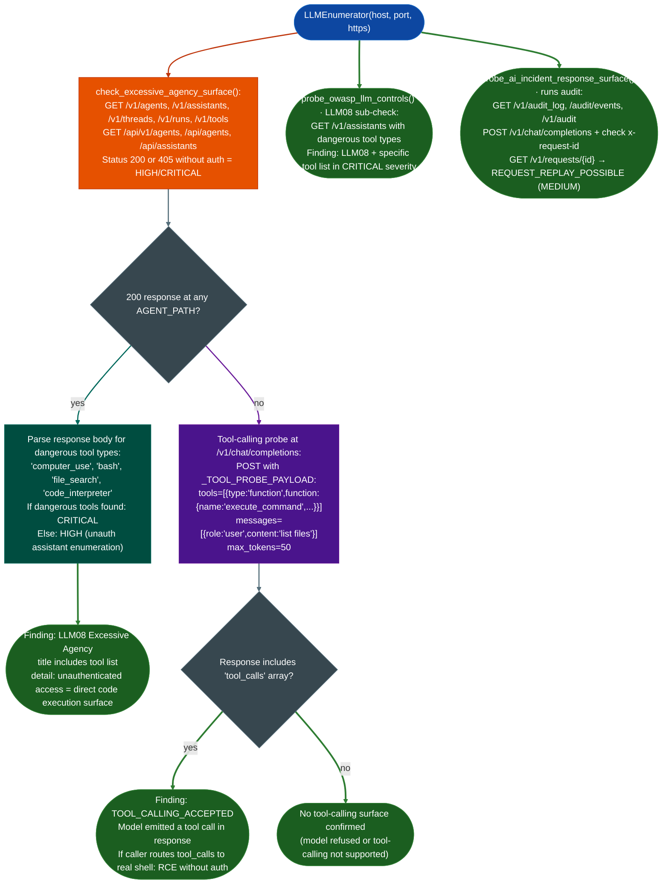

# Agent Protocol Exposure

Enumerate unauthenticated agentic API surfaces on exposed LLM inference endpoints: detecting `/v1/assistants`, `/v1/agents`, `/v1/threads`, `/v1/runs`, and `/v1/tools` endpoints accessible without authorization, identifying dangerous tool types `computer_use`, `bash`, `file_search`, `code_interpreter` loaded into active assistants, probing tool-calling acceptance at the inference layer, and confirming whether the assistants API requires authentication before exposing tool capability definitions.

---

## Why this exists

1. **LLM agent frameworks expose a control plane API alongside the inference API, and the two are rarely secured independently.** OpenAI Assistants API, LangChain LangServe, AutoGPT, and self-hosted agentic frameworks each add endpoints beyond `/v1/chat/completions`: `/v1/assistants` list assistants and their tool configurations, `/v1/threads` conversation session management, `/v1/runs` task execution tracking, and `/v1/agents` agent definitions with system prompts and tool bindings. When these endpoints return 200 without an `Authorization` header, an adversary reads the full tool capability map without executing a single inference request.

2. **Dangerous tool types in agent definitions are directly exploitable as unauthenticated code execution surfaces.** An assistant with `"tool_type": "bash"` can execute shell commands on the host; `"computer_use"` grants screen and input control; `"file_search"` grants filesystem read; `"code_interpreter"` executes Python in a sandboxed but often misconfigured container. When `/v1/assistants` is unauthenticated, the adversary reads which of these capabilities are active, identifies the assistant IDs, and issues a `/v1/threads` + `/v1/runs` sequence to invoke tool calls directly: without needing to construct a prompt injection chain.

3. **The tool-calling layer at `/v1/chat/completions` is a distinct attack surface from the assistants API.** Even when `/v1/assistants` requires auth, the inference endpoint itself may accept a `tools` array in the request body that defines functions for the model to call. A request with `tools=[{"type":"function","function":{"name":"execute_command","description":"Run shell command","parameters":{"type":"object","properties":{"command":{"type":"string"}},"required":["command"]}}}]` invites the model to emit a `tool_calls` response invoking `execute_command`. If the calling application routes these calls to a real shell without authorization, this is unauthenticated RCE via the inference API.

---

## How it works



### Dangerous tool type severity matrix

| Tool type | Capability on host | Severity |
|---|---|---|
| `computer_use` | Screen read, mouse/keyboard input, full desktop control | CRITICAL |
| `bash` | Shell command execution | CRITICAL |
| `code_interpreter` | Python execution in container often misconfigured | CRITICAL |
| `file_search` | Filesystem read access | CRITICAL |
| Any tool type | Assistant definition exposure | HIGH |

### Agentic endpoint paths probed

| Path | Finding type |
|---|---|
| `/v1/agents` | Agent definition enumeration |
| `/v1/assistants` | Assistant + tool config exposure |
| `/v1/threads` | Session/conversation replay surface |
| `/v1/runs` | Task execution history |
| `/v1/tools` | Tool registration listing |
| `/api/v1/agents`, `/api/agents` | Framework-specific variants |
| `/api/assistants` | Framework-specific variants |

---

## Usage

```python
from modules.llm_enum import LLMEnumerator

# Full enumeration — includes agentic surface checks
scanner = LLMEnumerator(host='target.internal', port=8080, https=False)
results = scanner.enumerate_all()

# Filter to agentic surface findings only
agent_findings = [
    f for f in results['findings']
    if 'LLM08' in f['title'] or 'AGENT' in f['title']
    or 'TOOL_CALL' in f['title'] or 'ASSIST' in f['title']
]
for f in agent_findings:
    print(f"[{f['severity']}] {f['title']}")
    print(f"  {f['evidence'][:120]}")

# Direct check — excessive agency surface only
scanner2 = LLMEnumerator(host='target.internal', port=8080, https=False)
agency_findings = scanner2.check_excessive_agency_surface()
for f in agency_findings:
    print(f"[{f['severity']}] {f['title']}")
    if 'bash' in f.get('evidence', '') or 'computer_use' in f.get('evidence', ''):
        print("  WARNING: dangerous tool types present — direct code execution possible")

# Tool-calling acceptance at inference layer
# (POST /v1/chat/completions with tools= array)
from modules.llm_enum import _http_post, _base_url, _TOOL_PROBE_PAYLOAD
base = _base_url('target.internal', 8080, https=False)
status, body, _ = _http_post(f'{base}/v1/chat/completions', _TOOL_PROBE_PAYLOAD)
if status == 200 and 'tool_calls' in body:
    print("TOOL_CALLING_ACCEPTED: model emitted tool_calls — RCE if caller routes to shell")
```

---

## Example output

```
[CRITICAL] LLM08 Excessive Agency — /v1/assistants accessible without auth (bash, file_search tools)
  evidence: HTTP 200 /v1/assistants dangerous_tools=['bash', 'file_search']
            body={"data":[{"id":"asst_ABC123","name":"DevAssistant","tools":
            [{"type":"bash"},{"type":"file_search"}],"model":"gpt-4","..."}]}

[HIGH    ] LLM08 Excessive Agency — /v1/runs accessible without auth
  evidence: HTTP 200 /v1/runs body={"object":"list","data":[{"id":"run_XYZ","status":"completed",...}]}

[CRITICAL] TOOL_CALLING_ACCEPTED — tool calls emitted by model
  evidence: /v1/chat/completions tools=[execute_command]
            response choices[0].message.tool_calls=[{"name":"execute_command","arguments":{"command":"ls"}}]

[HIGH    ] AI_AUDIT_LOG_EXPOSED
  evidence: HTTP 200 /v1/audit_log body=[{"timestamp":"2026-10-17T...","event":"inference",...}]
```

---

## False positives

**`/v1/assistants` returns 200 with an empty `data` array.** The finding fires on HTTP 200 regardless of whether any assistant definitions are present. An empty `{"data": []}` response confirms the endpoint is unauthenticated and enumerable but does not confirm active dangerous tools. Severity remains HIGH the endpoint should require auth; downgrade to MEDIUM if the array is empty and note the absence of active tool definitions.

**Tool-calling `tool_calls` in response does not confirm routing to real execution.** `_TOOL_PROBE_PAYLOAD` causes the model to emit a `tool_calls` JSON object in its response, but the calling application must separately route that object to an actual executor. Many production deployments emit `tool_calls` responses but never wire them to real functions. The finding is `TOOL_CALLING_ACCEPTED`: the model emitted the call. Confirm actual execution by checking whether the application has a tool router for example a `/v1/runs` endpoint that accepts `tool_outputs` submissions.

---

## Pipeline position

**Before this module:** Run `probe_openai_compatible_api()` first to confirm the inference endpoint is unauthenticated: agent surface checks require at minimum inference reachability to confirm the platform. 

**After this module:** For CRITICAL findings with `bash` or `computer_use` tool types: issue a `/v1/threads` POST to create a new thread, then POST `/v1/runs` referencing the dangerous assistant ID: the model will emit a tool call, and a misconfigured orchestrator will execute it. Document the full path: assistant ID → thread creation → run submission → tool invocation → command output.

---

## Reading findings

| Field | Content |
|:---|:---|
| `f['title']` contains `LLM08` | OWASP LLM08 Excessive Agency finding |
| `f['severity'] == 'CRITICAL'` with `bash` in evidence | Shell execution reachable without auth |
| `f['title'] == 'TOOL_CALLING_ACCEPTED'` | Model emitted `tool_calls` at inference layer |
| `f['title'] == 'AI_AUDIT_LOG_EXPOSED'` | Inference request history accessible unauthenticated |
| `f['title']` contains `/v1/runs` | Task execution history enumerable |

---

## See also

- [AI Control Indicators](ai-control-indicators.md): OWASP LLM, MITRE ATLAS, and IR posture checks from the same module
- [API Authentication and Token Checks](api-authentication-and-token-checks.md): JWT/OAuth2 checks for the auth layer protecting these endpoints
- [API Reverse Engineering](api-re.md): broader API assessment workflow for the HTTP layer surrounding the LLM surface
