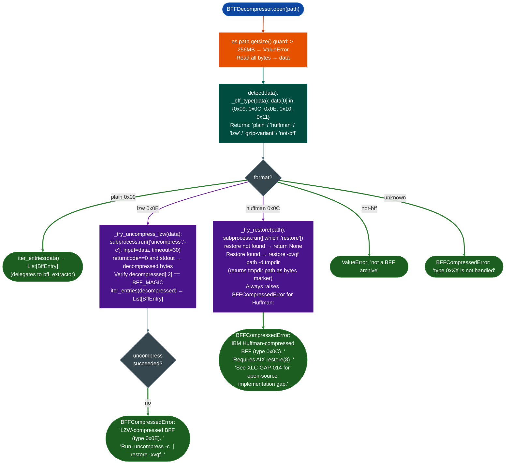

# AIX Big Archive Extraction

Detect and handle compressed AIX BFF archives LZW type `0x0E`, IBM Huffman type `0x0C`: routing plain archives to `bff_extractor.iter_entries()`, calling the system `uncompress` command for LZW archives, and raising `BFFCompressedError` with specific guidance when decompression requires an AIX `restore(8)` environment.

---

## Why this exists

1. **AIX 4.3.3 and 5.1 network daemon packages arrive as compressed BFF archives that the plain extractor cannot process.** `bff_extractor.iter_entries()` handles type `0x09` (plain) archives only. `imapd`, `named8`, `gated`, `telnetd`, and most kernel extension packages from AIX 4.3.3 ML11 ship as LZW-compressed (type `0x0E`) or Huffman-compressed (type `0x0C`) archives. Without compression detection, the plain extractor silently produces no entries the compressed data fails the name-sentinel check immediately: leaving the analyst with no binaries and no error message.

2. **LZW-compressed BFF archives use standard Unix `compress(1)` encoding on the entry data, accessible via the system `uncompress` command.** Type `0x0E` archives wrap each file's data in LZW format (`0x1F 0x9D` magic). The system `uncompress -c` command decompresses LZW correctly: `bff_decompressor` pipes the archive data through `uncompress` and re-parses the result as a plain BFF stream. This works on any Linux system with the `ncompress` package installed.

3. **IBM Huffman-compressed BFF (type `0x0C`) requires an AIX `restore(8)` environment, no open-source implementation exists.** The IBM pack/unpack algorithm used by AIX 4.x differs from standard Huffman coding and is not documented publicly. `BFFDecompressor` raises `BFFCompressedError` for these archives with the exact `restore -xvqf` command to run on an AIX system, and notes the gap reference for anyone who wants to implement support.

---

## How it works



### BFF volume header type codes

| Type byte LE uint16 low byte | Format | Decompression |
|---|---|---|
| `0x09` | Plain backup | `bff_extractor.iter_entries()` no decompression |
| `0x0C` | IBM pack / Huffman | Requires AIX `restore(8)`: raises `BFFCompressedError` |
| `0x0E` | `compress(1)` / LZW | System `uncompress -c` then `iter_entries()` |
| `0x10`, `0x11` | gzip variant AIX 5.2+ | Raises `BFFCompressedError` |

---

## Usage

```python
from pathlib import Path
from modules.bff_decompressor import (
    BFFDecompressor, BFFCompressedError, detect
)
from ablation.core.bff_extractor import BFF_MAGIC

bff_path = '/media/cowboy/research/AIX/bos.net.tcp.server.5.1.compressed.bff'

# Detect format before attempting extraction
with open(bff_path, 'rb') as f:
    header = f.read(2)
print(f"Format: {detect(header + b'\\x00' * 70)}")

# Attempt extraction (handles all supported formats)
try:
    entries = BFFDecompressor.open(bff_path)
    print(f"Extracted {len(entries)} entries")
    for entry in entries:
        if not entry.is_dir:
            print(f"  {entry.rel_path}  {len(entry.data):,} bytes")
except BFFCompressedError as e:
    print(f"[COMPRESSED — needs AIX]\n{e}")
except ValueError as e:
    print(f"[FORMAT ERROR]\n{e}")

# Programmatic format check before load
data = Path(bff_path).read_bytes()
fmt = detect(data)
if fmt == 'plain':
    from ablation.core.bff_extractor import iter_entries
    entries = list(iter_entries(data))
elif fmt == 'lzw':
    entries = BFFDecompressor.open(bff_path)   # uncompress via subprocess
else:
    raise BFFCompressedError(f"Cannot extract {fmt} BFF on this system — run on AIX")

# Find XCOFF binaries from LZW-decompressed archive
xcoff_entries = [
    e for e in entries
    if not e.is_dir and len(e.data) >= 2 and e.data[:2] in (b'\x01\xdf', b'\x01\xf7')
]
for entry in xcoff_entries:
    tmpfile = f'/tmp/{Path(entry.rel_path).name}'
    Path(tmpfile).write_bytes(entry.data)
    print(f"Wrote {tmpfile} ({len(entry.data):,} bytes) for BinaryContext")
```

---

## Example output

```
Format: lzw

Extracted 23 entries
  usr/sbin/telnetd    234,568 bytes
  usr/sbin/ftpd       189,432 bytes
  usr/sbin/in.rlogind  98,304 bytes
  usr/lib/libnet.a    304,128 bytes

# For a Huffman archive:
[COMPRESSED — needs AIX]
/path/bos.net.tcp.server.4.3.3.84.bff: IBM Huffman-compressed BFF (type 0x0C).
Decompression requires an AIX system with restore(8).
Run: restore -xvqf <file> -d <output_dir>
The Huffman algorithm used by AIX pack(1) is proprietary and differs from
standard Huffman / zlib.
To add support, byte-diff the output of pack/unpack against the raw compressed
stream on an AIX 4.3.3 system and open a module gap against XLC-GAP-014.
```

---

## False positives

**`detect()` returns `'not-bff'` for truncated downloads.** A BFF archive with a valid magic byte (`0x09`) but truncated body reports as plain. `detect()` only checks the first byte, it does not verify the volume header is complete. A truncated plain BFF will pass `detect()` but `iter_entries()` will yield zero entries (the first entry's ext_stat block will be incomplete). Verify archive integrity by checking file size against the IBM package manifest before attempting extraction.

**LZW decompression via `uncompress -c` requires the `ncompress` package.** On most modern Linux systems Ubuntu, Debian, CentOS, `uncompress` is not installed by default, it lives in the `ncompress` package. `_try_uncompress_lzw()` calls `subprocess.run(['uncompress', '-c'], ...)`: if `uncompress` is not found, the subprocess returns non-zero and `BFFCompressedError` is raised with the AIX-restore guidance. Install `ncompress` first: `apt install ncompress` or `yum install ncompress`.

**`_try_restore()` returns a temp directory path bytes, not entries.** The current `_try_restore()` implementation returns the temp directory path as bytes a marker rather than a list of `BffEntry` objects: the re-packing step from extracted files back to BffEntry objects is not implemented. For Huffman archives where `restore(8)` is available, `BFFDecompressor` still raises `BFFCompressedError`: the AIX restore path is detection only, not full extraction.

---

## Pipeline position

**Before this module:** Obtain the BFF archive path from the AIX software depot package listing. Call `detect(data)` to determine whether the archive requires `uncompress` or an AIX system before committing to extraction. Most BFF archives from AIX 4.3.3 ML11 and earlier are Huffman-compressed; AIX 5.1 network packages are commonly LZW.

**After this module:** For LZW extraction success: proceed as with plain BFF: write XCOFF binaries to temp files and load with `BinaryContext.load_or_build()`. For `BFFCompressedError` on Huffman archives: use the printed `restore -xvqf` command on an AIX 4.3.3 VM available as QEMU image in the IBM AIX eval program and copy the extracted directory tree back for analysis.

---

## Reading findings

| Field | Content |
|:---|:---|
| `BFFCompressedError` raised | Archive is compressed; check exception message for exact restore(8) command |
| `ValueError` raised | File is not a BFF archive or exceeds 256MB size limit |
| `detect(data)` → `'lzw'` | LZW compression: extractable via `uncompress` on Linux |
| `detect(data)` → `'huffman'` | IBM Huffman: requires AIX `restore(8)` |
| `detect(data)` → `'plain'` | No compression: use `bff_extractor.iter_entries()` directly |

---

## See also

- [AIX Plain BFF Extraction](aix-plain-bff-extraction.md): `iter_entries()` for plain (type 0x09) archives
- [XCOFF Analysis](aix-xcoff32-64-analysis.md): parse and analyze XCOFF binaries from extracted archives
- [Firmware Analysis](firmware-analysis.md): full pipeline when BFF archive is inside a larger firmware image
