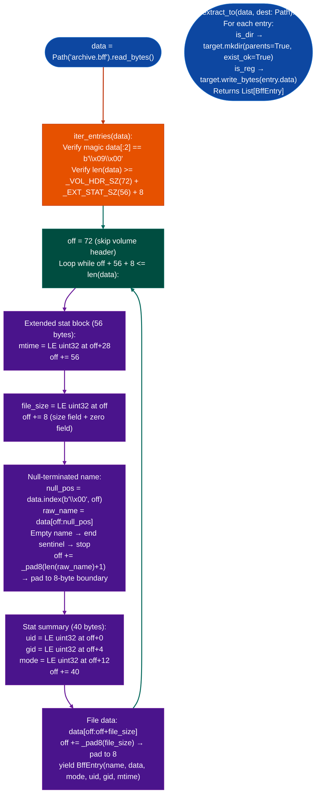

# AIX Plain BFF Extraction

Parse AIX backup-by-name (BFF) archives produced by AIX 4.x and 5.x backup(8): iterating the little-endian volume header and per-entry blocks to yield file name, data bytes, mode, uid, gid, and mtime for each member, and extracting XCOFF kernel extensions, shared objects, and loadable modules that are otherwise inaccessible to standard Linux archive tools.

---

## Why this exists

1. **GNU tar, ar, and binwalk all fail to extract BFF archives correctly.** `tar` does not recognize the format. `ar` errors on the `0x09 0x00` magic bytes. `binwalk` extracts raw byte-offset slices that are not the actual files, it locates embedded XCOFF magic within the archive data, not the BFF entry boundaries. Without a format-aware extractor, every binary inside a BFF archive is unreachable.

2. **BFF archives use little-endian integer encoding on a big-endian (PowerPC) platform.** All fields in the extended stat block, file size word, and stat summary block are little-endian `uint32`: the opposite of XCOFF and AIX's native byte order. XCOFF tools and most AIX-aware parsers assume big-endian for all fields, producing incorrect sizes that cause them to skip or misread entries. This extractor handles the mixed-endian layout explicitly: magic at offset 0 is `b'\x09\x00'` LE uint16 value 9, file size at `ext_stat+56` is LE uint32, uid/gid/mode in the stat summary are LE uint32.

3. **BFF archives from AIX 4.3.3 and 5.1 contain the primary RE targets for AIX kernel extension analysis.** Kernel extensions (`.ext`), shared objects (`.a` in AIX XCOFF format), and network daemon binaries `imapd`, `named8`, `gated`, `telnetd` are all distributed inside BFF archives. `iter_entries()` yields their data bytes directly: ready for `BinaryContext.load_or_build()` or XCOFF parsing without any intermediate extraction step.

---

## How it works



### BFF entry layout

| Field | Size | Encoding | Offset |
|---|---|---|---|
| Volume header | 72 bytes |: | 0 |
| Extended stat block | 56 bytes |: | per-entry start |
| `mtime` | 4 bytes | LE uint32 | `ext_stat + 28` |
| `file_size` | 4 bytes | LE uint32 | `ext_stat + 56` |
| Zero field | 4 bytes |: | `ext_stat + 60` |
| Name null-terminated | variable | ASCII | `ext_stat + 64` |
| Name padding | to 8-byte boundary |: |: |
| Stat summary `uid` | 4 bytes | LE uint32 | `stat + 0` |
| Stat summary `gid` | 4 bytes | LE uint32 | `stat + 4` |
| Stat summary `mode` | 4 bytes | LE uint32 | `stat + 12` |
| File data | `file_size` bytes | raw | after stat summary |
| Data padding | to 8-byte boundary |: |: |

---

## Usage

```python
from pathlib import Path
from ablation.core.bff_extractor import iter_entries, extract_to, BffEntry, BFF_MAGIC

bff_path = Path('/media/cowboy/research/AIX/bos.net.tcp.server.4.3.3.84.bff')
data = bff_path.read_bytes()

# Confirm plain BFF
print(f"Magic: {data[:2].hex()}  ({'plain BFF' if data[:2] == BFF_MAGIC else 'other'})")

# List all entries
for entry in iter_entries(data):
    print(f"{'d' if entry.is_dir else '-'}  {entry.mode:06o}  {entry.uid}:{entry.gid}  "
          f"{len(entry.data):>10,}  {entry.rel_path}")

# Extract all to a directory
extracted = extract_to(data, Path('/tmp/aix_extracted'))
print(f"\nExtracted {len(extracted)} entries")

# Find XCOFF binaries (ELF-like: starts with 0x01 0xDF or 0x01 0xF7 on AIX)
xcoff_entries = [e for e in iter_entries(data)
                 if not e.is_dir and len(e.data) >= 2
                 and e.data[:2] in (b'\x01\xdf', b'\x01\xf7')]
print(f"\nXCOFF binaries: {len(xcoff_entries)}")
for entry in xcoff_entries:
    print(f"  {entry.rel_path}  {len(entry.data):,} bytes")

# Access a specific file's bytes directly (e.g., for BinaryContext)
target_data = next(
    (e.data for e in iter_entries(data) if 'telnetd' in e.rel_path),
    None
)
if target_data:
    print(f"\ntelnetd: {len(target_data):,} bytes  ELF_magic={target_data[:2].hex()}")
```

---

## Example output

```
Magic: 0900  (plain BFF)

d  040755  0:0              0  usr
d  040755  0:0              0  usr/lib
d  040755  0:0              0  usr/lib/drivers
-  100755  0:0        234,568  usr/sbin/telnetd
-  100755  0:0        189,432  usr/sbin/ftpd
-  100755  0:0        412,880  usr/sbin/imapd
-  100644  0:0         82,144  usr/lib/drivers/netintf
-  100644  0:0         51,200  usr/lib/libinet.a

Extracted 47 entries

XCOFF binaries: 11
  usr/sbin/telnetd    234,568 bytes
  usr/sbin/ftpd       189,432 bytes
  usr/sbin/imapd      412,880 bytes
  usr/lib/drivers/netintf   82,144 bytes
  ...

telnetd: 234,568 bytes  ELF_magic=01df
```

---

## False positives

**`iter_entries()` stops silently on a zero-length name, which may indicate archive truncation rather than the end sentinel.** BFF archives end with an empty name entry; truncated archives end at the point of truncation. The iterator stops in both cases without error. If the total number of extracted entries is lower than expected, check `len(data)` against the archive size reported by the package manifest: a truncated download produces no error but incomplete extraction.

**LE uint32 mode field misinterprets AIX-extended mode bits.** AIX stores additional mode bits in the high bytes of the `uint32` mode field for example SUID/SGID/sticky bit positions differ between AIX and POSIX. The `& _S_IFMT` mask extracts the file type correctly, but `entry.mode & 0o777` for permissions may produce unexpected values for setuid executables. Verify permissions from the AIX package manifest rather than relying solely on the extracted mode.

---

## Pipeline position

**Before this module:** Confirm the archive is a plain BFF (`data[0] == 0x09`) rather than a compressed variant. Use `bff_decompressor.detect(data)` to check: compressed archives LZW `0x0E`, Huffman `0x0C` require `BFFDecompressor.open()` from `bff_decompressor.py`.

**After this module:** Feed `BffEntry.data` bytes for XCOFF binaries directly to `BinaryContext.load_or_build()` via a temporary file write `entry.data` to a temp path, then load. Run `CorpusBuilder.build()` on the full extracted tree before any cross-binary analysis: kernel extensions in AIX BFF archives reference shared symbols in `libinet.a` and `libnet.a` that must be in the corpus.

---

## Reading findings

| Field | Content |
|:---|:---|
| `entry.rel_path` | Path with `./` prefix stripped: use for extraction target |
| `entry.is_dir` | True = directory entry: create path, no data |
| `entry.is_reg` | True = regular file: `entry.data` contains file bytes |
| `entry.mode` | LE uint32 Unix mode: `entry.mode & _S_IFMT == _S_IFREG` for files |
| `entry.data` | Raw file bytes: empty (`b""`) for directories |
| `entry.mtime` | LE uint32 mtime: Unix epoch seconds |

---

## See also

- [AIX Big Archive Extraction](aix-big-archive-extraction.md): `<bigaf>` format for large AIX archives different format, same analysis pipeline
- [BFF Decompressor](bff-decompressor.md): handles compressed BFF variants LZW/Huffman that this module cannot process
- [XCOFF Analysis](aix-xcoff32-64-analysis.md): parse and analyze the XCOFF binaries extracted from BFF archives
