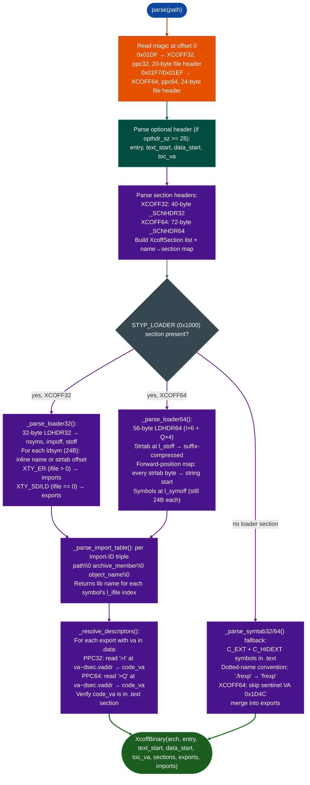

<a id="aix-xcoff3264-analysis"></a>
# IBM AIX Binary Analysis

Parse IBM AIX PowerPC executables in XCOFF32 magic `0x01DF`, PPC32 or XCOFF64 magic `0x01F7`/`0x01EF`, PPC64 format: extracting all sections, importing the `.loader` section's complete import/export symbol table with library attribution, resolving function-descriptor VAs to code VAs, and recovering internal function names from the symbol table when the loader section is absent or incomplete.

---

## Why this exists

1. **LIEF does not support XCOFF.** `lief.parse()` returns `None` on XCOFF input. `BinaryContext` then falls through to a default `x86_64` context with no sections, no symbols, and no function starts. Every AIX RE session using only the existing LIEF stack was silently broken: appearing to succeed but operating on an empty binary model. `xcoff_parser` is the XCOFF-specific replacement.

2. **The `.loader` section survives stripping and holds the complete import/export table.** AIX production builds routinely set `nsyms == 0` in the file header stripped. But the `.loader` section: identified by `s_flags == STYP_LOADER (0x1000)`: is not removed by `strip`. It contains every external reference and definition with name, library origin, virtual address, and storage mapping class. This is the primary RE surface for stripped AIX binaries.

3. **XCOFF uses a function-descriptor ABI: exported function VAs in the loader section point to `.data` descriptors, not code.** On PPC32/PPC64, each exported function has a descriptor in `.data` consisting of `{code_va(4), toc_va(4)}` (PPC32) or `{code_va(8), toc_va(8)}` (PPC64). The loader symbol's `l_value` points to the descriptor, not the code. `_resolve_descriptors()` reads the descriptor at `l_value - dsec.vaddr` and writes the true code VA into `sym.code_va`.

4. **XCOFF64 section headers are 72 bytes: XCOFF32 section headers are 40 bytes.** The same parser handles both variants by selecting the correct struct format at parse time, preventing the silent field misalignment that would occur from sharing a single format string.

---

## How it works



### XCOFF magic values

| Magic | Variant | Architecture |
|---|---|---|
| `0x01DF` | XCOFF32 | PPC32, big-endian AIX 4.x/5.x |
| `0x01F7` | XCOFF64 | PPC64, big-endian AIX 5.x/6.x |
| `0x01EF` | XCOFF64-alt | PPC64, AIX 3.x era (same struct as `0x01F7`) |

### Section flags

| Flag | Value | Meaning |
|---|---|---|
| `STYP_TEXT` | `0x0020` | Executable code |
| `STYP_DATA` | `0x0040` | Initialized data |
| `STYP_BSS` | `0x0080` | Uninitialized data |
| `STYP_LOADER` | `0x1000` | `.loader` section: survives strip |

### Loader symbol storage mapping classes (smclas)

| smclas | Value | Meaning |
|---|---|---|
| `XMC_PR` | 4 | Program code |
| `XMC_TC` | 3 | TOC entry |
| `XMC_DS` | 10 | Function descriptor |
| `XMC_GL` | 7 | Global linkage glue |
| `XMC_TC0` | 15 | TOC anchor |

---

## Usage

```python
from ablation.core.xcoff_parser import parse

binary = parse('/tmp/aix_target/libclcomd.so')

# Summary
print(f"arch: {binary.arch}  entry: {binary.entry:#010x}")
print(f"text: {binary.text_start:#010x}  data: {binary.data_start:#010x}  toc: {binary.toc_va:#010x}")
print(f"sections: {[s.name for s in binary.sections]}")
print(f"exports: {len(binary.exports)}  imports: {len(binary.imports)}")

# Exports — both descriptor VA and resolved code VA
for sym in binary.exports:
    if sym.code_va:
        print(f"  EXPORT  {sym.name:<40}  desc={sym.va:#010x}  code={sym.code_va:#010x}")
    else:
        print(f"  EXPORT  {sym.name:<40}  va={sym.va:#010x}  (no descriptor resolved)")

# Imports with library attribution
for sym in binary.imports:
    print(f"  IMPORT  {sym.name:<40}  from={sym.lib}")

# Look up a specific section
text = binary.text
if text:
    print(f".text: vaddr={text.vaddr:#010x}  size={text.size:,} bytes")
    # Feed to BinaryContext for disassembly
    # (write text.data to a tmp ELF wrapper if needed)

# Check for exports with descriptor resolution failures (va in .data, code_va == 0)
unresolved = [s for s in binary.exports if s.va != 0 and s.code_va == 0]
if unresolved:
    print(f"Unresolved descriptors ({len(unresolved)}):")
    for s in unresolved[:5]:
        print(f"  {s.name}  desc_va={s.va:#010x}")

# Section access
data_sec = binary.section('.data')
if data_sec:
    print(f".data at {data_sec.vaddr:#010x}, {data_sec.size} bytes")
```

---

## Example output

```
arch: ppc64  entry: 0x0000000100000000
text: 0x0000000100000000  data: 0x0000000110000000  toc: 0x0000000110040000
sections: ['.text', '.data', '.bss', '.loader', '.debug']
exports: 847  imports: 312

  EXPORT  clc_open                          desc=0x110000800  code=0x100001234
  EXPORT  clc_read                          desc=0x110000810  code=0x100003a40
  EXPORT  clc_write                         desc=0x110000820  code=0x100004b20
  EXPORT  _start                            va=0x110000000  (no descriptor resolved)

  IMPORT  read                              from=libc.a
  IMPORT  write                             from=libc.a
  IMPORT  pthread_mutex_lock                from=libpthreads.a
  IMPORT  clcmd_dispatch                    from=libclcomd.a

.text: vaddr=0x100000000  size=2,654,208 bytes
```

---

## False positives

**`_sym_N` export names in XCOFF64 shared libraries.** The XCOFF64 `.loader` symbol parser uses a validity regex (`_VALID_LDSYM_NAME = r'^[A-Za-z_.@$][A-Za-z0-9_.@$]*$'`) to reject garbage names produced when `l_noff` lands in VPD metadata bytes near the start of the string table. When a legitimate symbol name begins with a digit or contains non-ASCII characters, it is replaced with `_sym_N`. After parsing, call `_merge_symtab64()` to rename any `_sym_N` entries using names recovered from the main symbol table.

**Descriptor resolution fails when `.data` section is absent.** `_resolve_descriptors()` requires both the `.data` section descriptor storage and the `.text` section code boundary verification to be present in the parsed binary. Static `.o` files and archive members may be missing one or both sections. When `binary.data is None`, all exports have `code_va == 0`. Use the raw `sym.va` as the descriptor address and resolve manually when needed.

**XCOFF32 executables store absolute VAs in the symbol table: object files store section-relative offsets.** `_parse_symtab32()` handles relocatable `.o` files section-relative semantics; `_parse_symtab32_exe()` handles executables absolute VA semantics. The parser calls the correct function based on context. When processing an AIX static archive (`.a` file containing `.o` members), use `_parse_symtab32()`, not the exe variant, or the symbol VAs will be wrong.

---

## Pipeline position

**Before this module:** Confirm the file is XCOFF by checking `magic_raw` at offset 0 (`struct.unpack_from('>H', data, 0)[0]`). AIX `.a` archives contain XCOFF members but are Big Archive format (magic `\xc3\xd4\xc1\xd2`): extract the `.o` members first using `aix-big-archive-extraction.md` before passing to `parse()`.

**After this module:** Map `sym.code_va` values from `binary.exports` as confirmed function names via `ctx.set_name(va, name, source='confirmed')`. Feed `binary.text.data` to any byte-level scanner. Use `binary.imports` to identify the complete external dependency surface before planning taint analysis across library boundaries.

---

## Reading findings

| Field | Content |
|:---|:---|
| `binary.arch` | `'ppc32'` or `'ppc64'` |
| `binary.entry` | Entry point VA descriptor VA on PPC32; may be 0 for shared libs |
| `binary.toc_va` | Table of contents anchor critical for PPC64 call addressing |
| `binary.exports` | `List[XcoffSymbol]`: defined symbols, each with `name`, `va` descriptor, `code_va` resolved |
| `binary.imports` | `List[XcoffSymbol]`: external references with `lib` = archive member name |
| `sym.code_va` | True code entry point VA after descriptor resolution; 0 if resolution failed |
| `sym.smclas` | Storage mapping class see table above |
| `sec.is_text` / `sec.is_data` | Property-based section type check |

---

## See also

- [AIX Big Archive Extraction](aix-big-archive-extraction.md): extract XCOFF `.o` members from AIX `.a` archives before passing to this parser
- [AIX Plain BFF Extraction](aix-plain-bff-extraction.md): extract filesystem trees from AIX backup format before analysis
- [Binary Format and Platform Identification](binary-format-and-platform-identification.md): initial format detection to confirm XCOFF before calling `parse()`
- [Signature-Based Auto-Naming](signature-based-auto-naming.md): build cross-version corpus from XCOFF exports for identity matching
