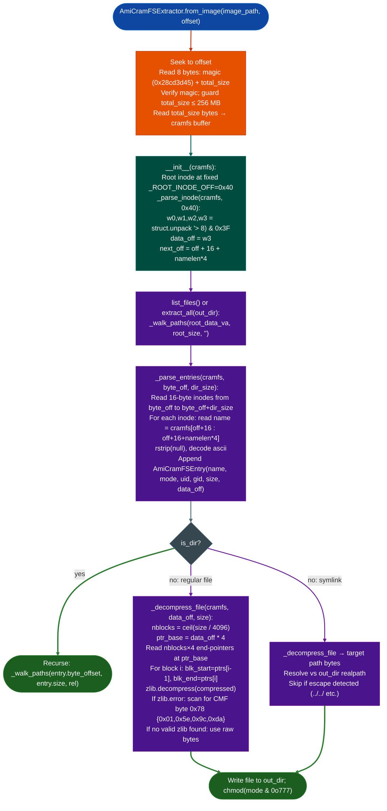

# AMI Modified CramFS

Parse and extract AMI-modified CramFS filesystem images from BMC firmware: handling the vendor-specific 16-byte inode extension that replaces the standard 12-byte layout, recovering `namelen` from bit-field position `[8:13]` of the third inode word, locating file data via the new fourth word (`data_off` in 4-byte units), decompressing zlib block streams with a CMF-scan fallback for GOT-prefixed blocks, and enforcing path-traversal safety on symlink extraction.

---

## Why this exists

1. **AMI extends the standard CramFS inode from 12 bytes to 16 bytes with incompatible field positions.** Standard CramFS packs `namelen` into bits `[0:5]` of word 2 and `data_offset` into bits `[6:31]` of the same word. AMI's variant moves `namelen` to bits `[8:13]` of word 2 and promotes `data_offset` to an entirely new fourth word (`w3`). A standard CramFS parser applied to an AMI image reads the wrong `namelen` value and attempts to dereference a garbage `data_offset`: producing silent extraction failures, not errors. No third-party CramFS tool handles this layout.

2. **AMI BMC firmware ASPEED AST2xxx, SPX Redfish ships the rootfs as an AMI CramFS partition inside a larger MTD image.** The rootfs partition begins at a fixed flash offset for example `0x160000` in the QTECH BMC G4DCL image and is not independently extractable via standard `unsquashfs`, `binwalk -e`, or `mount -o loop`: `binwalk` identifies it as CramFS but cannot extract it because the inode layout is incompatible. `AmiCramFSExtractor.from_imagepath, offset` handles the partition-inside-image case directly.

3. **BMC rootfs files are the primary analysis targets for Redfish authentication bypass and privilege escalation research.** The SPX Redfish service (`spx_restservice`), authentication credential stores, D-Bus service definitions, and system startup scripts all live in the CramFS rootfs. Extracting the rootfs is the mandatory first step before any static analysis of BMC software.

---

## How it works



### Inode layout comparison

| Field | Standard CramFS 12 bytes | AMI Extended 16 bytes |
|---|---|---|
| `mode` | `w0[0:16]` | `w0[0:16]` unchanged |
| `uid` | `w0[16:32]` | `w0[16:32]` unchanged |
| `size` | `w1[0:24]` | `w1[0:24]` unchanged |
| `gid` | `w1[24:32]` | `w1[24:32]` unchanged |
| `namelen` | `w2[0:6]`: bits 0–5 | `w2[8:14]`: bits 8–13 |
| `data_offset` | `w2[6:32]`: 26-bit in word 2 | `w3`: full 32-bit fourth word |
| Inode stride | `12 + namelen*4` | `16 + namelen*4` |

### `data_off` unit

All `data_off` values are in **4-byte units** from the start of the CramFS image. Convert to a byte offset with `data_off * 4`. The root inode is always at `0x40` in the CramFS superblock.

---

## Usage

```python
from modules.ami_cramfs_extractor import AmiCramFSExtractor

# Extract from a standalone CramFS partition file
ext = AmiCramFSExtractor.from_path('/tmp/rootfs.cramfs')

# Extract from an offset inside a larger MTD image
# (QTECH BMC G4DCL-UX: rootfs at 0x160000)
ext = AmiCramFSExtractor.from_image('/fw/qtech_bmc_g4dcl.ima', offset=0x160000)

# List all files
for path in ext.list_files():
    print(path)

# List a specific directory
for entry in ext.list_entries('usr/local/bin'):
    print(f"  {entry.name:40s}  {'d' if entry.is_dir else '-'}  size={entry.size}")

# Extract a specific file for analysis
service_bin = ext.extract_file('usr/local/bin/spx_restservice')
print(f"spx_restservice: {len(service_bin):,} bytes  ELF={service_bin[:4] == b'\\x7fELF'}")

# Extract all for BinaryContext loading and static analysis
ext.extract_all('/tmp/bmc_root/', progress=lambda p: print(f"  {p}"))

# Load extracted binary into ablation
from ablation.analyzers.binary_context import BinaryContext
ctx = BinaryContext.load_or_build('/tmp/bmc_root/usr/local/bin/spx_restservice')
print(ctx.summary())
```

---

## Example output

```
# list_files() (abbreviated)
etc/passwd
etc/shadow
etc/redfish/redfish.conf
usr/local/bin/spx_restservice
usr/local/bin/bmc_auth
usr/lib/libRESTful.so.1
var/redfish/db/AccountService.json

# list_entries('usr/local/bin')
  spx_restservice                          -  size=2674132
  bmc_auth                                 -  size=89456
  fwupdate                                 -  size=198240

# extract_file + ELF check
spx_restservice: 2,674,132 bytes  ELF=True

# extract_all progress
  etc/passwd
  etc/shadow
  usr/local/bin/spx_restservice
  usr/lib/libRESTful.so.1
  SKIP unsafe symlink var/run/redfish -> ../../../../tmp (path escape blocked)
```

---

## False positives

**`from_image()` raises `ValueError` at a valid partition when `total_size` in the superblock is wrong.** AMI occasionally sets `total_size` in the CramFS header to a smaller value than the actual filesystem data observed on images with appended metadata. The size guard (`total_size > _MAX_IMAGE_BYTES = 256 MB`) protects against allocation abuse, but if `total_size` is under-reported, `_decompress_file()` will fail on blocks whose end-pointers exceed `total_size`. Work around this by reading the full remaining image from `offset` to EOF rather than using `total_size` as the read length.

**Broken zlib blocks reported as raw bytes.** When `_decompress_file()` cannot find a valid zlib CMF byte in a block (`0x78 {0x01, 0x5e, 0x9c, 0xda}`), it returns the compressed block verbatim. This occurs legitimately for sparse blocks or uncompressed files AMI occasionally omits compression for small or pre-compressed content. Extracted files from these blocks are unprocessed compressed data: run `file` on each extraction to identify them. They are not corrupted: the parser preserved them correctly.

**Symlink skip messages for relative paths that appear to escape.** The symlink safety check uses `os.path.realpathos.path.join(link_parent, target)` and rejects any result that does not begin with `realpath(out_dir)`. Relative symlinks like `../../lib/libssl.so.1` inside a deeply nested directory may resolve to a valid path inside `out_dir` but fail the check if intermediate non-existent directories cause `realpath()` to collapse the path. Extract to a temp directory first and verify symlink targets manually for BMC images with complex library symlink trees.

---

## Pipeline position

**Before this module:** Locate the CramFS partition offset using `binwalk -A` or by scanning for the CramFS magic `\x45\x3d\xcd\x28` (little-endian `0x28cd3d45`) in the raw MTD image. Verify the magic at the identified offset before calling `from_image()`.

**After this module:** Run `BinaryContext.load_or_build()` on the extracted binaries, starting with the Redfish service (`spx_restservice` or equivalent). Run `CorpusBuilder.build()` on the full extracted tree before any sweep: all shared libraries must be in the corpus before cross-binary name resolution works correctly.

---

## Reading findings

| Field | Content |
|:---|:---|
| `entry.is_dir` | `True` = directory (recurse with `byte_offset` + `size`) |
| `entry.is_reg` | `True` = regular file (decompress with `_decompress_file`) |
| `entry.is_lnk` | `True` = symlink (decompressed content = target path bytes) |
| `entry.byte_offset` | `data_off * 4`: absolute byte offset in CramFS buffer |
| `entry.size` | Uncompressed file size in bytes |
| `entry.mode` | Standard Unix mode bits: `& 0o777` for permissions |

---

## See also

- [AMI CramFS Extractor](ami-cramfs-extractor.md): the `ami-cramfs-extractor.md` companion page with alternate constructors
- [Partition-Table Extraction](partition-table-extraction.md): higher-level firmware container parser (wraps multiple partition types including CramFS)
- [Firmware Analysis](firmware-analysis.md): full BMC/firmware analysis pipeline: extraction → corpus build → sweep
