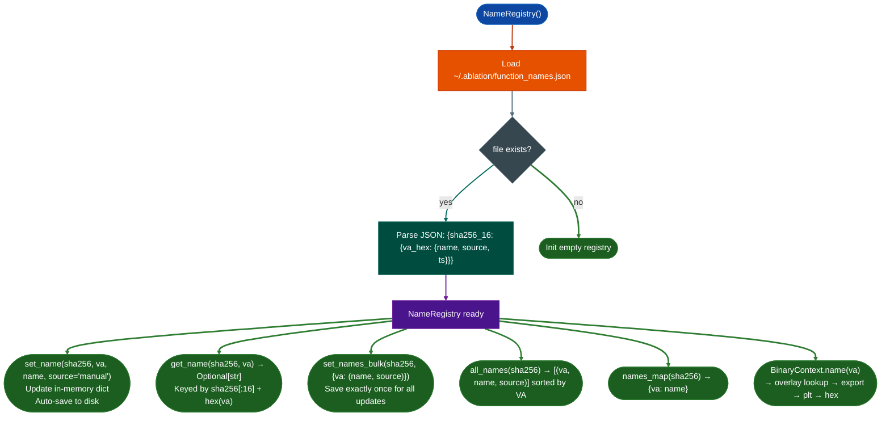

# Analyst Naming Registry

Persist analyst-assigned function names across RE sessions so that confirmed function identities survive binary reloads, context clears, and session restarts, and take precedence over all automated inference exports, PLT stubs, or string-derived names.

---

## Why this exists

1. **Stripped binaries have no symbol names: every session starts blind.** On the first pass, the analyst identifies `0x22ccc0` as `recv_handler` through semantic search and taint tracing. Without a persistent name store, the next session starts again from `0x22ccc0`: an address that means nothing until the same identification work is repeated. The registry stores that name and reloads it automatically, so every subsequent session starts from the analyst's accumulated knowledge rather than from zero.

2. **Naming confidence levels differ.** A name derived from a nearby string (`"/recv_handler"` in `.rodata`) carries less confidence than a name confirmed by following a taint path to a CVE-class vulnerability. The registry records the source of every name: `manual` analyst judgment, `string` auto-inferred from adjacent strings, or `confirmed` tied to a disclosed finding. Functions with `source=confirmed` represent the strongest analytical result; functions with `source=string` are working hypotheses. This distinction matters when constructing a call graph narrative for a disclosure report.

3. **The name overlay must take precedence over all other name sources.** `BinaryContext.name(va)` resolves through a four-level hierarchy: overlay (NameRegistry) → export symbols → PLT stubs → hex fallback. Analyst-confirmed names override everything, including export symbols that might carry misleading vendor-assigned names. This priority ensures confirmed names always appear in profiler output, taint traces, and call graph reports: regardless of what the binary's symbol table says.

---

## How it works



### Storage format

```json
{
  "3a4f8c1d2b9e7f5a": {
    "0x22ccc0": {"name": "recv_handler",     "source": "confirmed", "ts": "2026-10-16T09:00:00Z"},
    "0x22d200": {"name": "ssl_read_wrapper", "source": "manual",    "ts": "2026-10-16T09:05:00Z"},
    "0x22d800": {"name": "parse_cert_field", "source": "string",    "ts": "2026-10-16T09:10:00Z"}
  }
}
```

The SHA256 key truncates to 16 hex characters 64-bit prefix. Different builds of the same binary produce different SHA256 values and therefore different key namespaces, ensuring that names from one FortiOS 7.4.1 build never silently apply to a 7.6.0 build.

---

## Usage

```python
from ablation.analyzers.name_registry import NameRegistry
from ablation.analyzers.binary_context import BinaryContext

# Preferred: access via BinaryContext (shared context, no redundant loads)
ctx = BinaryContext.load_or_build('/fw/fortigate/httpsd')
ctx.set_name(0x22ccc0, "recv_handler", source="confirmed")
ctx.set_name(0x22d200, "ssl_read_wrapper", source="manual")

# Name resolves instantly at call sites
print(ctx.name(0x22ccc0))    # "recv_handler"
print(ctx.name(0x22d800))    # "0x22d800" (no name yet)

# Print all named functions
print(ctx.names_table())

# Bulk naming after a sweep confirmation pass
names = {
    0x22ccc0: ("recv_handler",     "confirmed"),
    0x22d200: ("ssl_read_wrapper", "manual"),
    0x22d800: ("parse_cert_field", "string"),
}
ctx.set_names_bulk(names)

# Direct registry access (when ctx not available)
reg = NameRegistry()
reg.set_name(ctx.sha256, 0x22ccc0, "recv_handler", source="confirmed")
print(reg.get_name(ctx.sha256, 0x22ccc0))   # "recv_handler"
print(reg.count(ctx.sha256))                # 1

# Export all names for the current binary
for va, name, source in reg.all_names(ctx.sha256):
    print(f"  0x{va:x}  {source:10s}  {name}")

# Delete an incorrect name
reg.delete_name(ctx.sha256, 0x22d200)

# Full {va: name} map for call graph labeling
names_dict = reg.names_map(ctx.sha256)
```

---

## Example output

```
ctx.names_table()

  Function Names: 3 confirmed  2 manual  5 string  (10 total)

  VA          Name                    Source     Timestamp
  0x22ccc0    recv_handler            confirmed  2026-10-16T09:00:00Z
  0x22d200    ssl_read_wrapper        manual     2026-10-16T09:05:00Z
  0x22d800    parse_cert_field        string     2026-10-16T09:10:00Z
  0x40b100    http_param_execute      confirmed  2026-10-16T09:15:00Z
  ...
```

---

## False positives

**Stale names after binary update.** When analyzing a new firmware version with the same base filename, the SHA256 prefix differs, so names registered for the previous version do not appear in the new binary's session. This prevents incorrect names from silently persisting across versions. However, if the analyst re-registers the same name for the new SHA256, it will immediately appear in all tools.

**`source=string` names from incorrect string associations.** Auto-inferred names derived from adjacent `.rodata` strings can produce misleading names when multiple unrelated functions share a nearby string region. These appear with `source=string` in `all_names()` output. Verify before treating them as confirmed; upgrade with `set_name(..., source="manual")` after verification.

---

## Pipeline position

**Before this module:** Any point after a function's identity is confirmed: after `TaintTracker` confirms exploitability, after `FuncProfiler` reveals a significant sink, or after a string cross-reference narrows identity.

**After this module:** Named functions appear automatically in `FuncProfiler.fmt()`, `BinaryContext.callers_of()`, `TaintTracker` sink reports, and call graph output. Export `names_map()` to build the function inventory for the RE module in `re/<vendor>/<target>_re.py`.

---

## Reading entries

| Field | Content |
|:---|:---|
| `sha256[:16]` | 64-bit SHA256 prefix used as the binary identifier |
| `va_hex` | Hex string of the function VA for example `"0x22ccc0"` |
| `name` | Analyst-assigned function name |
| `source` | `confirmed` / `manual` / `string`: confidence level |
| `ts` | ISO 8601 UTC timestamp of last update |

---

## See also

- [Binary Context](binary-context.md): primary interface for `set_name()` and `name()` calls
- [Function Profiler](function-profiler.md): uses `ctx.name(va)` for all call site labels
- [Finding Registry](finding-registry.md): store confirmed findings with `func_addr` matching named VAs
- [Call and String Cross-References](call-and-string-cross-references.md): string-based name inference source
