# Analyze All JNI

Run ARM32 symbolic execution across all 10 JNI functions in `libhijoyptt.so`: the HiJoy PTT Android shared library: to produce a complete JNI surface map: per-function argument-to-field write lists, protocol buffer read offsets, direct call counts, vtable dispatch counts, and function type classifications. Writes a Markdown surface report with call graph and attack surface summary.

---

## Why this exists

1. **JNI function VAs are not exported by name in stripped shared libraries: they can only be located through the JNI dispatch table in `JNI_OnLoad()` or through pattern matching.** The 10 functions in `libhijoyptt.so` were previously confirmed from `hijoy_ptt_re.py` analysis. `analyze_all_jni.py` codifies those VAs into `JNI_FUNCTIONS` and runs the full symbolic analysis pipeline against each one in a single script invocation: ensuring reproducibility and providing a complete surface summary without re-running the initial RE work.

2. **Symbolic execution on each JNI function reveals the argument write pattern: specifically which argument indices write to which field offsets in the channel struct.** This is the primary data needed to understand what untrusted data flows from the Android app layer (via JNI) into the C++ channel object. `FuncSummary.arg_field_writes` tracks `arg_idx, struct_offset` pairs emitted by the ARM32 symbolic executor; `FuncSummary.inputbuf_reads` tracks which protocol buffer byte offsets are read. Functions with both arg writes and input buffer reads are the highest-value targets for input validation analysis.

3. **The generated Markdown report (`JNI-SURFACE-ANALYSIS.md`) is the deliverable for JNI surface RE, not console output.** `generate_report()` writes a structured Markdown file with a JNI function table address, type, complexity, call count, arg writes, per-function symbolic effects, a call graph sample up to 20 edges, and an attack surface section that highlights COMPLEX functions >5 direct calls and functions with protocol buffer access. This file is the reference for all subsequent taint analysis on the library.

---

## How it works

```mermaid
flowchart TD
    A(["main(): sys.argv[1] = libhijoyptt.so path"]):::input --> B["os.path.getsize() guard:\nmax _MAX_LIB_BYTES = 256 MB\nOpen and read raw bytes"]:::primary
    B:::primary --> C["ARMSymbolicAnalyzer(data, base_addr=0)\nFor each name, addr in JNI_FUNCTIONS (sorted by VA):\nanalyzer.analyze_function(addr, max_insns=150)\n→ FuncSummary"]:::secondary
    C:::secondary --> D["FuncSummary fields used:\n.arg_field_writes: List[(arg_idx, struct_offset)]\n.inputbuf_reads: List[int]\n.calls: List[(target_va, symbolic_args)]\n.vcalls: List[vtable_call_info]"]:::tertiary
    D:::tertiary --> E["classify_function(name, summary):\nName prefix heuristic:\n'Create'→INIT, 'Delete'→CLEANUP\n'Start'/'Stop'→CONTROL, 'Set'→CONFIG, 'Send'→IO\nComplexity: len(calls)>5→COMPLEX, >0→MODERATE, else→SIMPLE"]:::tertiary
    E:::tertiary --> F["generate_report(results, output_path):\nJNI Function Surface table:\n| name | addr | type | complexity | calls | arg_writes |\nPer-function symbolic effects section\nCall graph sample (up to 20 edges)\nProtocol Surface Summary by type\nAttack Surface section: COMPLEX funcs + inputbuf_reads funcs"]:::tertiary
    F:::tertiary --> G(["Output: JNI-SURFACE-ANALYSIS.md\nat lib_path.parent.parent.parent / 'JNI-SURFACE-ANALYSIS.md'"]):::output
    classDef input     fill:#0d47a1,stroke:#1565c0,color:#fff
    classDef primary   fill:#e65100,stroke:#bf360c,color:#fff
    classDef secondary fill:#004d40,stroke:#00695c,color:#fff
    classDef tertiary  fill:#4a148c,stroke:#6a1b9a,color:#fff
    classDef neutral   fill:#37474f,stroke:#546e7a,color:#fff
    classDef output    fill:#1b5e20,stroke:#2e7d32,color:#fff
    linkStyle 0 stroke:#bf360c,stroke-width:2px
    linkStyle 1 stroke:#00695c,stroke-width:2px
    linkStyle 2 stroke:#6a1b9a,stroke-width:2px
    linkStyle 3 stroke:#6a1b9a,stroke-width:2px
    linkStyle 4 stroke:#6a1b9a,stroke-width:2px
    linkStyle 5 stroke:#2e7d32,stroke-width:3px
```



### JNI function table (`JNI_FUNCTIONS`)

| Function | VA | Type | Role |
|---|---|---|---|
| `CreateChannel` | `0x000239a4` | INIT | Channel/session initialization |
| `DeleteChannel` | `0x00023a78` | CLEANUP | Resource cleanup and teardown |
| `SetLocalReceiver` | `0x00023b10` | CONFIG | Configure session parameters |
| `SetSendDestination` | `0x00023ba4` | CONFIG | Configure session parameters |
| `StartListen` | `0x00023ca0` | CONTROL | Start PTT reception |
| `StartSend` | `0x00023d90` | CONTROL | Start PTT transmission |
| `StopListen` | `0x00023e08` | CONTROL | Stop PTT reception |
| `StopSend` | `0x00023ef8` | CONTROL | Stop PTT transmission |
| `SetSendCodec` | `0x00023fe8` | CONFIG | Configure codec parameters |
| `SendSignaling` | `0x0002511c` | IO | Protocol signaling/data transmission |

---

## Usage

```python
# Direct invocation (CLI mode)
# python3 analyze_all_jni.py <path-to-libhijoyptt.so>
#
# Output: JNI-SURFACE-ANALYSIS.md written to lib_path/../../../JNI-SURFACE-ANALYSIS.md

# Programmatic use
from pathlib import Path
import sys
sys.path.insert(0, '/home/cowboy/ablation/modules')
from analyze_all_jni import analyze_all_functions, generate_report, classify_function

lib_path = Path('/media/cowboy/research/HiJoy/libhijoyptt.so')
results = analyze_all_functions(lib_path)

# Inspect arg writes for each function
for name, data in sorted(results['functions'].items(), key=lambda x: x[1]['addr']):
    summary = data['summary']
    cls = data['classification']
    print(f"\n[{name}] @ {data['addr']}  type={cls['type']}  complexity={cls['complexity']}")
    if summary.arg_field_writes:
        for arg_idx, offset in sorted(set(summary.arg_field_writes)):
            print(f"  Arg({arg_idx}) → [struct+0x{offset:x}]")
    if summary.inputbuf_reads:
        print(f"  InputBuf reads: {sorted(set(summary.inputbuf_reads))}")

# Find highest-risk functions: COMPLEX + inputbuf_reads
high_risk = [
    name for name, data in results['functions'].items()
    if (data['classification']['complexity'] == 'COMPLEX'
        and data['summary'].inputbuf_reads)
]
print(f"\nHigh-risk (COMPLEX + proto buffer reads): {high_risk}")

# Write report
output_path = lib_path.parent.parent.parent / 'JNI-SURFACE-ANALYSIS.md'
generate_report(results, output_path)
print(f"Report written to {output_path}")
```

---

## Example output

```
Analyzing 10 JNI functions from libhijoyptt.so

================================================================================

[CreateChannel] @ 0x239a4
--------------------------------------------------------------------------------
Classification: INIT
Description: Channel/session initialization
Arg writes: 3
  - Arg(1) → [base + 0x0]
  - Arg(2) → [base + 0x4]
  - Arg(3) → [base + 0x8]
Direct calls: 2
Vtable calls: 0

[SendSignaling] @ 0x2511c
--------------------------------------------------------------------------------
Classification: IO
Description: Protocol signaling/data transmission
Arg writes: 1
  - Arg(1) → [base + 0x0]
Input reads: 4
  - InputBuf[0x0]
  - InputBuf[0x4]
  - InputBuf[0x8]
  - InputBuf[0xc]
Direct calls: 8
Vtable calls: 2

================================================================================
Functions analyzed: 10
Call graph edges: 31

Function breakdown:
  CLEANUP      : 1
  CONFIG       : 3
  CONTROL      : 4
  INIT         : 1
  IO           : 1

✓ Report written to /media/cowboy/research/HiJoy/JNI-SURFACE-ANALYSIS.md
```

---

## False positives

**Symbolic argument writes at `[base + 0x0]` for multiple functions indicate a shared channel struct base register.** The symbolic executor identifies writes to ARM registers that are themselves derived from function arguments. When the first argument in an INIT function points to a struct, all stores to `base + offset` where `base = arg(0)` appear as arg writes for `arg_idx=0`. This is expected and correct: the function initializes fields in the channel struct. It does not indicate that all three write targets are independently attacker-controlled; only that the struct pointer (arg 0) carries the write.

**COMPLEX classification >5 direct calls includes calls to internal helpers, not only security-sensitive calls.** `StartSend` and `SendSignaling` are typically COMPLEX because they call codec initialization, socket setup, and internal PTT state machine helpers, not because they have more dangerous sinks. COMPLEX is a prioritization heuristic for manual review, not a severity label.

**`max_insns=150` limit may terminate analysis before the full function body for long functions.** `ARMSymbolicAnalyzer.analyze_function(addr, max_insns=150)` stops symbolic execution after 150 instructions. Functions that exceed this limit (typically only `SendSignaling` in this binary) may have incomplete `inputbuf_reads` and `calls` lists. When a function's call count appears suspiciously low for its classification, increase `max_insns` to 300 and re-run.

---

## Pipeline position

**Before this module:** Confirm `libhijoyptt.so` is the correct binary by verifying the VAs in `JNI_FUNCTIONS` against the binary bytes: `data[0x239a4:0x239a8]` should be a valid ARM32 function prologue. Run `hijoy_ptt_re.py` first if the VAs have not been confirmed from that session.

**After this module:** Feed `SendSignaling` the IO-classified function with the most protocol buffer reads into `ARMSymbolicAnalyzer` with a longer `max_insns` budget and custom taint sources set to `InputBuf` base to confirm whether unsanitized buffer content reaches `sendto()` or `write()` sinks. Write confirmed findings to `re/hijoy/hijoy_ptt_re.py` via `FindingRegistry.register()`.

---

## Reading findings

| Field | Content |
|:---|:---|
| `results['functions'][name]['addr']` | String hex VA of the JNI function (`'0x239a4'`) |
| `results['functions'][name]['classification']['type']` | `INIT` / `CLEANUP` / `CONFIG` / `CONTROL` / `IO` |
| `results['functions'][name]['classification']['complexity']` | `SIMPLE` / `MODERATE` / `COMPLEX` |
| `summary.arg_field_writes` | `List[arg_idx, struct_offset]`: argument-derived field writes |
| `summary.inputbuf_reads` | `List[int]`: protocol buffer byte offsets read |
| `summary.calls` | `List[target_va, symbolic_args]`: direct call targets |
| `summary.vcalls` | `List[...]`: vtable virtual dispatch call sites |

---

## See also

- [ARM Symbolic Analysis](arm-symbolic.md): `ARMSymbolicAnalyzer` and `FuncSummary`: the symbolic execution engine used by this module
- HiJoy PTT RE: the private RE session that confirmed the JNI VAs in `JNI_FUNCTIONS`
- PTT Protocol RE: `PTTProtocolAnalyzer` imported but not yet used in the surface analysis phase
- [Finding Registry](finding-registry.md): register confirmed findings from `SendSignaling` taint analysis
