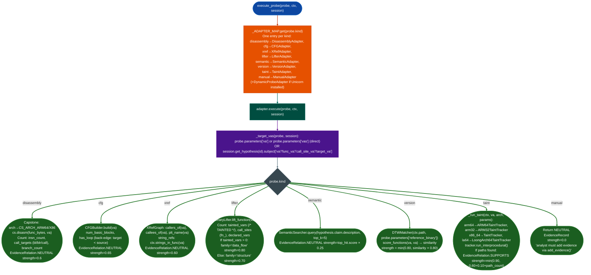

# Analyzer Probe Adapters

Bridge between the Hypothesis Engine's typed `ProbeRecord` requests and the concrete Ablation analyzers: dispatching `disassembly`, `cfg`, `xref`, `lifter`, `semantic`, `version`, `taint`, and `manual` probe kinds to their respective tools Capstone, CFGBuilder, XRefGraph, BinaryLifter, SemanticSearcher, DTWMatcher, arch-appropriate TaintTracker and returning `EvidenceRecord` objects that the engine feeds back into its hypothesis scoring loop.

---

## Why this exists

1. **The Hypothesis Engine operates on `ProbeRecord` objects with a `kind` field, it does not import analyzers directly.** Keeping the engine decoupled from analyzer implementations means new analysis capabilities integrate without modifying the engine's scoring or session management code. A `taint` probe dispatches to ARM64TaintTracker, ARM32TaintTracker, x86 TaintTracker, or LoongArch64TaintTracker based on `ctx.arch`: the engine never names a specific tracker.

2. **Probe execution must never raise.** The engine's scoring loop processes evidence in bulk across many hypotheses and many functions. A single failed analyzer call should not abort the session. Every adapter wraps its `execute()` body in a broad `try/except` and returns either an empty list no evidence or a low-strength NEUTRAL record describing the failure. This contract makes the engine resilient to missing analyzers, partial binary loads, and unsupported architectures.

3. **Evidence records carry both the observation and the relation/strength pair that the engine uses to update hypothesis scores.** A `DisassemblyAdapter` emitting a NEUTRAL record at strength 0.6 means "this is structural information: the engine should not yet treat it as confirmation." A `TaintAdapter` emitting a SUPPORTS record at strength 0.90 means "a confirmed source→sink path was found, this strongly supports the hypothesis." The adapter, not the engine, determines what relation and strength are appropriate for each observation type.

---

## How it works



### Adapter registry

| `probe.kind` | Adapter class | Primary tool | Evidence family |
|---|---|---|---|
| `disassembly` | `DisassemblyAdapter` | Capstone | `structure` |
| `cfg` | `CFGAdapter` | `CFGBuilder` | `structure` |
| `xref` | `XRefAdapter` | `XRefGraph` | `cross_reference` |
| `lifter` | `LifterAdapter` | `BinaryLifter` | `structure` / `data_flow` |
| `semantic` | `SemanticAdapter` | `SemanticSearcher` | `semantic` |
| `version` | `VersionAdapter` | `DTWMatcher` | `version` |
| `taint` | `TaintAdapter` | arch-appropriate TaintTracker | `data_flow` |
| `manual` | `ManualAdapter` | none | `manual` |
| `dynamic` | `DynamicProbeAdapter` | Unicorn | `dynamic` |

### EvidenceRelation values

| Value | Meaning |
|---|---|
| `NEUTRAL` | Observation is informational: does not yet confirm or contradict |
| `SUPPORTS` | Observation confirms the hypothesis for example a taint path found |
| `CONTRADICTS` | Observation contradicts the hypothesis |

---

## Usage

```python
from ablation.analyzers.probe_adapters import execute_probe, available_kinds
from ablation.analyzers.binary_context import BinaryContext
from ablation.analyzers.hypothesis_models import (
    ProbeRecord, HypothesisSession, EvidenceRecord
)

# List available probe kinds
print(available_kinds())
# ['disassembly', 'cfg', 'xref', 'lifter', 'semantic', 'version', 'taint', 'manual']

ctx = BinaryContext.load_or_build('/fw/target/libauth.so')
session = HypothesisSession.new()

# Disassembly probe — structural information about a candidate function
probe = ProbeRecord(
    kind='disassembly',
    parameters={'va': '0x1234a8'},
    target_hypothesis_ids=[],
)
evidence = execute_probe(probe, ctx, session)
for ev in evidence:
    print(f"[{ev.relation}] strength={ev.strength:.2f} {ev.observation}")

# Taint probe — confirm source→sink path from argv[1] to system()
taint_probe = ProbeRecord(
    kind='taint',
    parameters={
        'va': '0x1234a8',
        'custom_sinks': {'system': 'x0'}
    },
    target_hypothesis_ids=['hyp-001'],
)
taint_evidence = execute_probe(taint_probe, ctx, session)
for ev in taint_evidence:
    if ev.relation == 'SUPPORTS':
        print(f"TAINT CONFIRMED: {ev.observation['paths']}")

# Semantic probe — find functions matching a description
sem_probe = ProbeRecord(
    kind='semantic',
    parameters={'query': 'authentication token validation hmac'},
    target_hypothesis_ids=['hyp-002'],
)
sem_evidence = execute_probe(sem_probe, ctx, session)

# Version probe — compare to known vulnerable function in reference binary
ver_probe = ProbeRecord(
    kind='version',
    parameters={
        'va': '0x1234a8',
        'reference_binary': '/fw/reference/libauth_v1.2.so',
    },
    target_hypothesis_ids=[],
)
ver_evidence = execute_probe(ver_probe, ctx, session)
for ev in ver_evidence:
    print(f"DTW similarity={ev.observation['similarity']:.3f}")
```

---

## Example output

```
available_kinds: ['disassembly', 'cfg', 'xref', 'lifter', 'semantic', 'version', 'taint', 'manual']

[NEUTRAL] strength=0.60 {
  'va': '0x1234a8',
  'insn_count': 142,
  'func_bytes': 568,
  'call_count': 8,
  'branch_count': 21,
  'call_targets': ['0x10084c', '0x100a10', '0x100b34', ...]
}

TAINT CONFIRMED: [
  {'source': 'x0@0x1234a8', 'sink': 'system@0x100b34', 'depth': 4},
  {'source': 'x0@0x1234a8', 'sink': 'popen@0x100c20', 'depth': 6}
]

DTW similarity=0.891
```

---

## False positives

**`SemanticAdapter` returns NEUTRAL at low strength, not confirmation.** Semantic hits from `SemanticSearcher.query()` indicate that a function's embedding is near the query embedding. The strength is capped at `top_score × 0.25`: a 0.95 cosine similarity produces a strength of 0.24. This is intentional: semantic similarity is a candidate signal, not a finding. Semantic evidence alone never confirms a hypothesis; it narrows the candidate set for subsequent `disassembly`, `taint`, or `lifter` probes.

**`LifterAdapter` reports `tainted_vars > 0` from `/* TAINTED */` string counts.** The count is a substring match against `BinaryLifter`'s IR output annotations, it is not a per-variable taint flow. A function with 3 `/* TAINTED */` comments in its IR does not have 3 confirmed taint paths; it has 3 IR lines where the lifter annotated a potentially tainted value. Use `TaintAdapter` to confirm actual source→sink paths.

**`TaintAdapter` path count inflates strength beyond 0.90 ceiling.** The formula `min0.90, 0.60 + 0.10 × path_count` reaches the ceiling at 3 paths. A function with 10 source→sink paths does not have stronger confirmation than one with 3: both produce SUPPORTS at 0.90. The ceiling prevents strength from inflating to 1.0 on functions that are merely complex, not definitively vulnerable.

---

## Pipeline position

**Before this module:** The Hypothesis Engine issues `ProbeRecord` objects: adapters do not need to be called directly in a normal RE workflow. Direct use is appropriate when testing adapter behavior or when constructing custom hypothesis evaluation outside the engine.

**After this module:** All `EvidenceRecord` objects returned by adapters feed back into `HypothesisSession.add_evidence()`. When a hypothesis accumulates enough SUPPORTS evidence above the session's confirmation threshold, it advances to `CONFIRMED` state. At confirmation, write the finding to `re/<vendor>/<target>_re.py` using `FindingRegistry.register()`.

---

## Reading findings

| Field | Content |
|:---|:---|
| `ev.relation` | `NEUTRAL` / `SUPPORTS` / `CONTRADICTS`: engine scoring signal |
| `ev.strength` | 0.0–0.90: how strongly the observation affects the hypothesis score |
| `ev.reliability` | 0.8 default most adapters: confidence in the observation accuracy |
| `ev.family` | `structure` / `data_flow` / `cross_reference` / `semantic` / `version` / `manual` |
| `ev.observation` | Dict with adapter-specific fields see table above for per-adapter keys |
| `ev.analyzer` | Adapter class name for example `TaintAdapter`, `DisassemblyAdapter` |

---

## See also

- [Hypothesis Engine](hypothesis-engine.md): orchestrates ProbeRecord generation and EvidenceRecord scoring
- [Taint Analysis](taint-analysis.md): the TaintAdapter's underlying analysis; use directly for arch-specific configuration
- [Semantic Searching](semantic-code-search.md): SemanticSearcher used by SemanticAdapter
- [Cross-Version Patch Diffing](matrix-profile-patch-diff.md): DTWMatcher used by VersionAdapter
