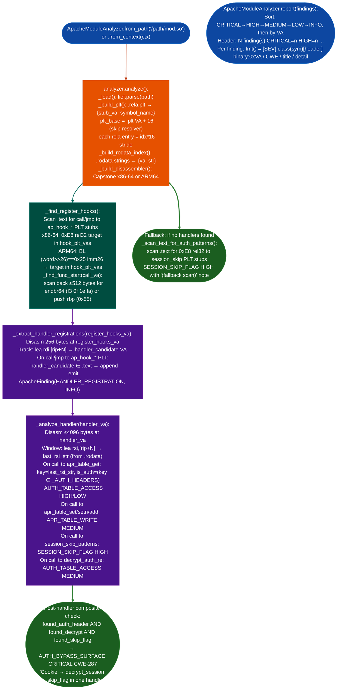

# Apache Module Analysis

Analyze Apache 2.x C module binaries (`.so`) for authentication bypass surfaces: reconstructing the `ap_hook_handler` call graph, tracing APR table access patterns Cookie/Authorization header reads, identifying session skip flag accessors, and emitting `AUTH_BYPASS_SURFACE` when a single handler function reads an auth header, decrypts a session, and checks a skip flag.

---

## Why this exists

1. **FortiAnalyzer ships custom Apache modules that bypass MFA via a session skip flag, and no ablation tool could reconstruct the handler call graph before this module existed.** `mod_extension.so` in FortiAnalyzer v7.6.3 contains a `register_hooks()` function that calls `ap_hook_handler()` to register a request handler. That handler reads the `Cookie` header, calls `session_from_string()` → `decrypt_and_auth()` → `session_get_adminuser_skip()`, and skips MFA if the flag is set. Without a tool that can trace `ap_hook_handler` registration → handler function → APR table reads → skip flag calls, this pattern requires full manual disassembly of the `.text` section.

2. **Standard binary analysis tools miss the Apache hook registration pattern because `register_hooks` is called from Apache's core, not from within the module.** `LIEF` can parse `.so` exports and `.rela.plt` relocations, but it does not know which function pointer is passed to `ap_hook_handler()`. `apache_module_analyzer` disassembles `register_hooks` specifically, tracks the `rdi` argument handler function pointer on x86-64 immediately before each call to an `ap_hook_*` PLT stub, and follows the identified handler VA into `_analyze_handler()`.

3. **The AUTH_BYPASS_SURFACE composite finding detects the FAZ-CVE22572 / CVE-2026-22572 pattern automatically.** The pattern requires three co-occurring conditions in the same handler function: (1) `apr_table_get(r->headers_in, "Cookie")`: auth header read; (2) `decrypt_and_auth()` or `session_from_string()`: session decrypt; (3) `session_get_adminuser_skip()` or equivalent skip flag accessor. None of these three individually indicates a vulnerability: their co-occurrence in one request handler does. `_analyze_handler()` sets three boolean flags during disassembly and emits `AUTH_BYPASS_SURFACE CRITICAL` if all three are true.

---

## How it works



### Symbol sets

| Set | Symbols |
|---|---|
| `_AP_HOOK_FUNCS` | `ap_hook_handler`, `ap_hook_post_read_request`, `ap_hook_fixups`, `ap_hook_check_user_id`, `ap_hook_auth_checker`, `ap_hook_access_checker`, `ap_hook_translate_name`, `ap_hook_log_transaction`, `ap_hook_type_checker`, `ap_hook_header_parser` |
| `_APR_TABLE_READ` | `apr_table_get`, `apr_table_getm`, `apr_table_merge` |
| `_APR_TABLE_WRITE` | `apr_table_set`, `apr_table_setn`, `apr_table_add`, `apr_table_addn`, `apr_table_unset` |
| `_SESSION_SKIP_PATTERNS` | `session_get_adminuser_skip`, `session_get_user_is_admin`, `session_get_admin_prof`, `session_skip`, `admin_skip`, `bypass_mfa`, `skip_auth`, `noauth` regex, case-insensitive |
| `_AUTH_HEADERS` | `Cookie`, `Authorization`, `X-Auth-Token`, `X-Session-Token`, `X-Forwarded-User`, `X-Remote-User`, `X-API-Key`, `CURRENT_SESSION`, `Session` |

### Finding classes

| Class | Severity | CWE | Description |
|---|---|---|---|
| `AUTH_BYPASS_SURFACE` | CRITICAL | CWE-287 | Cookie + decrypt + skip flag in one handler |
| `HANDLER_REGISTRATION` | INFO |: | `ap_hook_*` call + handler function VA |
| `AUTH_TABLE_ACCESS` | HIGH auth headers / MEDIUM (decrypt) | CWE-522 / CWE-287 | `apr_table_get` reading auth-relevant header |
| `SESSION_SKIP_FLAG` | HIGH | CWE-287 | Skip flag accessor called in handler |
| `APR_TABLE_WRITE` | MEDIUM | CWE-20 | Auth-relevant table write in handler |

---

## Usage

```python
from ablation.analyzers.apache_module_analyzer import ApacheModuleAnalyzer, ApacheFinding

# From path
analyzer = ApacheModuleAnalyzer.from_path('/media/cowboy/research/Fortinet/FAZ763/mod_extension.so')
findings = analyzer.analyze()
print(ApacheModuleAnalyzer.report(findings))

# From BinaryContext
from ablation.analyzers.binary_context import BinaryContext
ctx = BinaryContext.load_or_build('/path/to/mod_extension.so')
analyzer = ApacheModuleAnalyzer.from_context(ctx)
findings = analyzer.analyze()

# Filter by severity
from modules.apache_module_analyzer import ApacheModuleAnalyzer
critical = [f for f in findings if f.severity == 'CRITICAL']
high     = [f for f in findings if f.severity == 'HIGH']

# Inspect composite finding
for f in findings:
    if f.finding_class == 'AUTH_BYPASS_SURFACE':
        print(f"[CRITICAL] {f.title}")
        print(f"  VA:     0x{f.va:x}")
        print(f"  CWE:    {f.cwe}")
        print(f"  Detail: {f.detail}")

# CLI
# python3 -m ablation.analyzers.apache_module_analyzer /path/to/mod.so --severity HIGH
```

---

## Example output

```
[apache_module_analyzer] 7 finding(s)  CRITICAL=1  HIGH=2  INFO=1  LOW=1  MEDIUM=2

[CRITICAL] AUTH_BYPASS_SURFACE(decrypt_and_auth+session_skip_flag)  mod_extension.so:0x1234
  CWE: CWE-287
  Auth bypass surface: Cookie → decrypt_session → skip_flag all in one handler
  This handler reads a Cookie header, decrypts/parses it as a session, and then reads
  a session skip flag (e.g., adminuser_skip) to determine whether to bypass MFA/
  authentication. If the decrypted session is attacker-controlled (e.g., forged cookie,
  RC4 key exposure), the skip flag can be set to bypass auth entirely.
  Pattern: FAZ-CVE22572 / CVE-2026-22572.

[HIGH] AUTH_TABLE_ACCESS(apr_table_get)['Cookie']  mod_extension.so:0x1248
  CWE: CWE-522
  apr_table_get(r->headers_in, 'Cookie')
  Handler reads HTTP header 'Cookie' via apr_table_get. This is an authentication-
  relevant header — value flows into session/auth logic.

[HIGH] SESSION_SKIP_FLAG(session_get_adminuser_skip)  mod_extension.so:0x1290
  CWE: CWE-287
  Session skip flag accessor: session_get_adminuser_skip
  Handler calls session_get_adminuser_skip() — a session flag that controls whether
  auth/MFA is bypassed for this request.

[INFO] HANDLER_REGISTRATION(ap_hook_handler)  mod_extension.so:0x1180
  CWE: CWE-0
  ap_hook_handler registers handler at 0x1234
  register_hooks at 0x1100 calls ap_hook_handler(handler=0x1234, predecessor=NULL,
  successor=NULL, APR_HOOK_MIDDLE). Handler will receive every matching HTTP request.
```

---

## False positives

**`AUTH_BYPASS_SURFACE` fires when all three flags are set, but the skip flag call may be in a path that is only reached via a legitimate code flow.** The composite check does not verify that the skip flag read is reachable from the Cookie table read within the same control-flow path. A module that reads the Cookie header for logging one function path and checks a skip flag in a completely separate conditional another path will trigger `AUTH_BYPASS_SURFACE` because both are in the same 4096-byte disassembly window. Confirm with `PathSolver.solve_path()` from the Cookie read to the skip flag check before escalating.

**PLT reconstruction fails on modules with a non-standard `.plt` stride.** `_build_plt()` assumes each PLT entry is 16 bytes (`plt_base + i * 16`). Some compilers and linker versions produce 8-byte PLT entries for example ARM THUMB or use `.plt.sec` for IBT-enabled modules. If `_build_plt()` produces an empty or incorrect `_plt` dict, `_find_register_hooks()` finds no hook calls and falls through to `_scan_text_for_auth_patterns()`. Verify by checking whether the `.rela.plt` section and `.plt` section are both present: `lief.parse(path).get_section('.rela.plt')`.

**Handler disassembly stops at 4096 bytes: large handlers are truncated.** `_read_vahandler_va, 4096` limits disassembly to the first 4096 bytes of each handler. A handler longer than 4096 bytes will have its tail truncated: APR table calls or skip flag accessors after offset 4096 are missed. Check handler size with `FuncProfiler.profile()` before running `apache_module_analyzer`: handlers larger than 4096 bytes require manual capstone disassembly of the full function.

---

## Pipeline position

**Before this module:** Run `BinaryContext.load_or_build()` on the `.so` file to build the symbol index. Confirm that `lief` and `capstone` are installed `import lief; import capstone`: if either is missing, `analyze(` returns `[]` silently). Verify the binary is an Apache module by checking for `ap_hook_handler` or `register_hooks` in the dynamic symbol table: `[s.name for s in lief.parse(path).dynamic_symbols]`.

**After this module:** For `AUTH_BYPASS_SURFACE` findings: use `TaintTracker` to trace the Cookie header value through `session_from_string()` → `decrypt_and_auth()` to the skip flag write: confirming that attacker-controlled input from the Cookie header reaches the flag. Check whether the session key RC4, AES is retrievable from the binary or from a configuration file before reporting impact. Register the finding with `FindingRegistry.register()` and write to `re/<vendor>/<target>_re.py`.

---

## Reading findings

| Field | Content |
|:---|:---|
| `finding_class='AUTH_BYPASS_SURFACE'` | Cookie + decrypt + skip flag co-present in one handler: highest priority finding |
| `finding_class='HANDLER_REGISTRATION'` | Handler VA confirmed: use this VA as entry point for manual `TaintTracker` analysis |
| `finding_class='AUTH_TABLE_ACCESS'` | `apr_table_get` key is in `_AUTH_HEADERS`: auth header read confirmed in handler |
| `finding_class='SESSION_SKIP_FLAG'` | Skip flag accessor symbol matched `_SESSION_SKIP_PATTERNS` |
| `finding.va` | Virtual address of the call instruction: verify with `data[off:off+5]` byte check |
| `finding.symbol` | PLT symbol name: cross-reference with `ctx.name(va)` |
| `finding.header` | String key passed to `apr_table_get/set`: `None` if key not resolved from `.rodata` |

---

## See also

- [API Authorization Checks](api-authorization-checks.md): HTTP-level authorization probes for the same endpoints this module exposes
- [Taint Tracking](taint-analysis.md): trace Cookie header data through decrypt → skip flag write to confirm exploitability
- [Sink Arg Classifier](sink-arg-classifier.md): classify call sites in Apache handler functions before running TaintTracker
