# API Authorization Checks

Probe object-level, function-level, and property-level authorization failures: executing BOLA/IDOR ID substitution, BFLA admin path probing, mass assignment with 21 privileged field names, and excessive data exposure scanning against discovered API endpoints.

---

## Why this exists

1. **OWASP API1 (BOLA) and API5 (BFLA) are the two most commonly exploited API vulnerability classes, and both require active probing rather than passive analysis.** Broken Object Level Authorization is not detectable from a schema or a spec: the endpoint `GET /api/users/{id}` returns a 200 for every valid ID, and the question is whether the authenticated user is allowed to see ID 2 when they own ID 1. `probe_bola()` injects integer sequences, UUIDs, and common string IDs into path placeholders and trailing path segments, observing 200 responses with non-trivial response sizes as the authorization failure signal. BFLA requires probing admin paths `/admin`, `/internal`, `/management` and privileged operation suffixes `/promote`, `/export`, `/dump` without admin credentials.

2. **Mass assignment is invisible from the outside until a privileged field is reflected in a response.** `probe_mass_assignment()` sends 8 of the 21 `MASS_ASSIGNMENT_FIELDS` including `admin`, `is_admin`, `role`, `superuser`, `privileges`, `group`, `balance`, `id` in a POST body alongside the expected fields and checks whether any appear in the response body but not in the baseline response. A reflected `is_admin` field confirms OWASP API3 Broken Object Property Level Authorization.

3. **Excessive data exposure is a structural API defect: the API returns the full model object when only a subset of fields is needed.** `probe_excessive_data_exposure()` scans every API response for 9 PII/secret pattern types `PII_PATTERNS`: email, SSN, credit card, US phone, API key, bearer token, password-in-response, private key, AWS key, internal IPv4 and flags bulk responses >50,000 bytes and >100 records as unfiltered data dumps. These findings identify both misconfigured response filters and data governance failures.

---

## How it works

```mermaid
flowchart TD
    A(["probe_bola(base, endpoints[:8])"]):::input --> B(["For each endpoint with {placeholder} in path:\nIDOR_ID_TYPES: integer [1-5, 0, -1, 9999999]\nuuid [3 random UUIDs + all-zeros]\nalphanumeric ['abc','test','admin','user','root']\nre.sub(r'\\{[^}]+\\}', test_id, path)\nGET → 200 + len > 50 bytes = BOLA finding"]):::output
    A:::input --> C(["Append IDs to path: /1, /2, /admin,\n/00000000-0000-0000-0000-000000000001\nGET → 200 + len > 50 bytes"]):::output
    D(["probe_bfla(base, endpoints[:10])"]):::input --> E(["Direct admin path probe (ADMIN_PATHS: 20 paths):\n/admin, /admin/users, /management, /internal\n/superadmin, /root, /system, /debug, /api/admin...\nStatus not in (404, 401, 403) = BFLA_ADMIN_ACCESSIBLE"]):::output
    D:::input --> F(["Privileged operations on resource paths (PRIVILEGED_OPERATIONS):\nPOST /path/promote {role:'admin'}\nDELETE /path/delete\nGET /path/export, /path/backup, /path/dump\nPOST /path/grant {permission:'admin'}\nStatus not in (404, 405) = BFLA_PRIVILEGED_OP"]):::output
    G(["probe_mass_assignment(base, endpoints[:5])"]):::input --> H(["Baseline: POST {test:'value'}\nAugmented: POST {admin:true, is_admin:true, role:true,\nsuperuser:true, privileges:true, group:true, balance:true, id:true, test:'value'}\nField in augmented_response AND NOT in baseline → MASS_ASSIGN"]):::output
    I(["probe_excessive_data_exposure(base, endpoints)"]):::input --> J(["GET each endpoint\nPII_PATTERNS scan: email, ssn, credit_card, phone_us\napi_key, bearer_token, password_in_response\nprivate_key, aws_key (AKIA[0-9A-Z]{16}), ipv4_internal\nMatches → DATA_EXPOSE_{PII_TYPE}"]):::output
    I:::input --> K(["Response > 50,000 bytes AND list > 100 records\n→ DATA_BULK (unfiltered data dump)"]):::output
    classDef input     fill:#0d47a1,stroke:#1565c0,color:#fff
    classDef primary   fill:#e65100,stroke:#bf360c,color:#fff
    classDef secondary fill:#004d40,stroke:#00695c,color:#fff
    classDef tertiary  fill:#4a148c,stroke:#6a1b9a,color:#fff
    classDef neutral   fill:#37474f,stroke:#546e7a,color:#fff
    classDef output    fill:#1b5e20,stroke:#2e7d32,color:#fff
    linkStyle 0 stroke:#2e7d32,stroke-width:3px
    linkStyle 1 stroke:#2e7d32,stroke-width:3px
    linkStyle 2 stroke:#2e7d32,stroke-width:3px
    linkStyle 3 stroke:#2e7d32,stroke-width:3px
    linkStyle 4 stroke:#2e7d32,stroke-width:3px
    linkStyle 5 stroke:#2e7d32,stroke-width:3px
    linkStyle 6 stroke:#2e7d32,stroke-width:3px
```



### Mass assignment field list 21 fields, first 8 used per probe

`admin`, `is_admin`, `role`, `superuser`, `is_superuser`, `privilege`, `privileges`, `group`, `groups`, `verified`, `active`, `enabled`, `account_type`, `balance`, `credits`, `score`, `rank`, `permissions`, `access_level`, `tier`, `email_verified`, `phone_verified`, `id`, `user_id`, `account_id`

### BFLA admin path list 20 paths

`/admin`, `/admin/users`, `/admin/config`, `/admin/stats`, `/api/admin`, `/api/admin/users`, `/management`, `/internal`, `/internal/users`, `/internal/config`, `/api/management`, `/api/internal`, `/superadmin`, `/root`, `/system`, `/api/v1/admin`, `/api/v2/admin`, `/debug`, `/api/debug`

---

## Usage

```python
from modules.api_re import (
    probe_bola,
    probe_bfla,
    probe_mass_assignment,
    probe_excessive_data_exposure,
)

base = 'https://target.internal/api'

# Assume endpoints were discovered earlier via probe_api_surface()
# endpoints: List[APIEndpoint] with .path, .methods, .params

# BOLA (OWASP API1)
bola_findings = probe_bola(base, endpoints)
for f in bola_findings:
    print(f"[BOLA] {f['path']} id={f['id']} id_type={f.get('id_type')} size={f['size']}b")

# BFLA (OWASP API5)
bfla_findings = probe_bfla(base, endpoints)
for f in bfla_findings:
    if f['type'] == 'bfla_admin_accessible':
        print(f"[BFLA_ADMIN] {f['path']} status={f['status']} size={f['size']}b")
        print(f"  {f['sample'][:100]}")
    elif f['type'] == 'bfla_privileged_op':
        print(f"[BFLA_OP] {f['endpoint']} status={f['status']}")

# Mass assignment (OWASP API3)
mass_findings = probe_mass_assignment(base, endpoints)
for f in mass_findings:
    print(f"[MASS_ASSIGN] {f['endpoint']}: reflected field={f['reflected_field']!r}")
    print(f"  {f['sample'][:150]}")

# Excessive data exposure (OWASP API3)
exposure_findings = probe_excessive_data_exposure(base, endpoints)
for f in exposure_findings:
    if f['type'].startswith('excessive_data_'):
        print(f"[DATA_EXPOSE] {f['endpoint']}: {f['type']} count={f['count']}")
        print(f"  matches={f['matches'][:3]}")
    elif f['type'] == 'excessive_data_bulk':
        print(f"[DATA_BULK] {f['endpoint']}: {f['record_count']} records")

# Combined: run all auth checks via analyze_api()
from modules.api_re import analyze_api
results = analyze_api('https://target.internal')
auth_findings = [f for v in results.values() if isinstance(v, list)
                 for f in v if isinstance(f, dict)
                 and any(t in f.get('type','') for t in ('bola','bfla','mass','excessive'))]
print(f"Authorization findings: {len(auth_findings)}")
```

---

## Example output

```
[BOLA] /api/users/2 id=2 id_type=integer size=842b
[BOLA] /api/users/admin id=admin id_type=alphanumeric size=612b
[BOLA] /api/orders/00000000-0000-0000-0000-000000000001 id=uuid size=1204b

[BFLA_ADMIN] /admin/users status=200 size=4821b
  [{"id":1,"username":"admin","email":"admin@corp.internal","role":"superadmin"},...]

[BFLA_OP] DELETE /api/users/1/delete status=200
[BFLA_OP] GET /api/users/1/export status=200

[MASS_ASSIGN] POST /api/users: reflected field='is_admin'
  {"id":42,"username":"test","email":"test@x.com","is_admin":true,"role":"user"}

[DATA_EXPOSE] POST /api/search: excessive_data_email count=847
  matches=['alice@corp.internal', 'bob@corp.internal', 'charlie@corp.internal']
[DATA_BULK] GET /api/logs: 3421 records
```

---

## False positives

**BOLA finds `200` responses on public resources that require no authorization.** The detection checks HTTP 200 and response size > 50 bytes, it does not confirm that the resource is sensitive or that the requesting user has no business accessing it. A public product catalog endpoint (`/api/products/{id}`) correctly returns 200 for any valid ID. Before reporting a BOLA finding, confirm the resource contains user-specific or sensitive data user profiles, orders, private messages that should be access-controlled.

**BFLA `BFLA_ADMIN_ACCESSIBLE` fires on development health pages at `/debug`.** Many APIs expose a `/debug` or `/api/debug` endpoint that returns non-sensitive build or health information commit hash, environment name, uptime. The finding fires if the status is not 404/401/403. Check the response body before escalating: a debug endpoint returning `{"env":"prod","commit":"abc123"}` is an information disclosure issue, not BFLA.

**Mass assignment `MASS_ASSIGN` on fields that the API echoes back by design.** Some APIs return the full request body in their response for logging or confirmation purposes: including fields they do not process. A field like `balance` appearing in the response does not confirm mass assignment if the API returns all submitted fields verbatim regardless of whether it stored them. Confirm by checking whether a subsequent GET on the same resource shows the modified field value.

---

## Pipeline position

**Before this module:** Run `probe_api_surface()` to build the `endpoints` list: all authorization probes require discovered endpoints with known methods and path parameters. Run `analyze_tokens_in_response()` first to confirm the API is authenticated bearer/session token present before interpreting BOLA findings: unauthenticated APIs have no authorization layer to bypass.

**After this module:** For confirmed BOLA findings: attempt cross-user access: authenticate as user A, retrieve user B's resource ID from a BOLA probe, then confirm that user A can access user B's resource with user A's session token. For confirmed BFLA admin path findings: enumerate users, configuration, and secrets from the admin endpoint before reporting.

---

## Reading findings

| Finding type | Meaning |
|:---|:---|
| `bola` path + id | Object-level auth bypass: resource returned for foreign object ID |
| `bfla_admin_accessible` | Admin/management function accessible without admin credentials |
| `bfla_privileged_op` | Privileged operation export/delete/promote succeeded |
| `MASS_ASSIGN` | Privileged field reflected in response after POST: write accepted |
| `excessive_data_{type}` | PII or secret matched in response body |
| `excessive_data_bulk` | Unfiltered collection returned >100 records, >50KB |

---

## See also

- [API Authentication and Token Checks](api-authentication-and-token-checks.md): JWT/OAuth2 analysis of the auth layer protecting these endpoints
- [API Injection and Validation Checks](api-injection-and-validation-checks.md): parameter-level injection probes for discovered endpoints
- [API Reverse Engineering](api-re.md): full API RE workflow that calls these authorization probes as sub-phases
