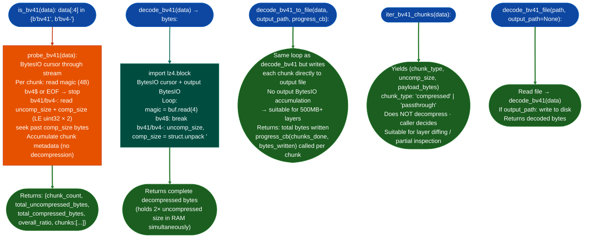

# Apple bv41 Decompression

Decode Apple Compression.framework's proprietary chunked LZ4 container format: parsing `bv41` / `bv4-` / `bv4$` chunk headers, decompressing raw LZ4 blocks per chunk, and streaming output to disk for large APFS snapshot layer files that exceed available RAM.

---

## Why this exists

1. **Standard LZ4 decoders, 7-Zip, and forensic suites BlackBag, Cellebrite, RECON LAB all reject bv41 streams at the magic byte check.** Every LZ4 implementation's first gate is the frame-format magic `0x184D2204`. bv41 streams have no such prefix: they start with `b'bv41'` or `b'bv4-'`. Any decoder that checks for the LZ4 frame magic before processing the block data fails immediately. Additionally, `binwalk` and entropy-based carvers miss bv41 because neither `bv41` nor `bv4-` appears in any public format registry.

2. **bv41 uses raw LZ4 blocks, not LZ4 frames: requiring `lz4.block.decompress()` with an explicit uncompressed size from the bv41 header.** The bv41 chunk header provides `uncompressed_size` uint32 LE and `compressed_size` uint32 LE. The payload is a raw LZ4 block, not an LZ4 frame. `lz4.block.decompresspayload, uncompressed_size=N` is the only correct call; passing the payload to any frame-format decoder fails because there is no frame header. Without the explicit `uncompressed_size` argument, `lz4.block.decompress` guesses the output buffer size and frequently returns corrupt data.

3. **APFS snapshot layer files and Orka VM images are distributed in bv41 format: making offline RE of macOS supply chain components impossible without this decoder.** `AppleArchive.ByteStream.decompressionStreamusing: .lz4` is the private framework call that produces bv41 streams. Without an offline decoder, analyzing the contents of APFS sealed-volume layer files requires running inside a live macOS process, not viable for supply-chain inspection, forensics, or layer diffing.

---

## How it works



### Chunk format

| Field | Size | Encoding | Value |
|---|---|---|---|
| Magic | 4 bytes | ASCII | `b'bv41'` = LZ4-compressed, `b'bv4-'` = passthrough, `b'bv4$'` = terminator |
| `uncompressed_size` | 4 bytes | LE uint32 | Required as `uncompressed_size=` argument to `lz4.block.decompress()` |
| `compressed_size` | 4 bytes | LE uint32 | Byte count of LZ4 block payload that follows |
| Payload | `compressed_size` bytes | raw LZ4 block | No LZ4 frame magic prefix |

The `bv4$` terminator has no size fields or payload: reading 4 bytes of magic and stopping is the complete handling.

---

## Usage

```python
from ablation.core.bv41_decoder import (
    is_bv41, probe_bv41, decode_bv41,
    decode_bv41_to_file, iter_bv41_chunks, decode_bv41_file
)
from pathlib import Path

layer_path = '/tmp/orka_vm_layer.bv41'
data = Path(layer_path).read_bytes()

# Step 1: confirm format
if not is_bv41(data):
    print("Not a bv41 stream")
    raise SystemExit

# Step 2: probe metadata without decompressing
info = probe_bv41(data)
print(f"Chunks: {info['chunk_count']}")
print(f"Uncompressed: {info['total_uncompressed_bytes'] / 1024**2:.1f} MB")
print(f"Compressed:   {info['total_compressed_bytes'] / 1024**2:.1f} MB")
print(f"Ratio:        {info['overall_ratio']}x")
for i, chunk in enumerate(info['chunks'][:5]):
    print(f"  chunk {i:3d}: {chunk['type']:12s} {chunk['uncomp_size']:>10,} → {chunk['comp_size']:>10,} ({chunk['ratio']}x)")

# Step 3a: full decode (small files only — 2x uncompressed size in RAM)
if info['total_uncompressed_bytes'] < 256 * 1024 * 1024:
    decoded = decode_bv41(data)
    print(f"\nDecoded: {len(decoded):,} bytes")
    # Feed to firmware analysis
    from ablation.analyzers.firmware_container import FirmwareContainer
    fc = FirmwareContainer.from_bytes(decoded)

# Step 3b: streaming decode for large layers
else:
    def progress(chunks_done, bytes_written):
        print(f"\r  {chunks_done} chunks, {bytes_written/1024**2:.1f} MB written", end='')
    n = decode_bv41_to_file(data, '/tmp/layer_decoded.bin', progress_cb=progress)
    print(f"\nStreamed {n:,} bytes to /tmp/layer_decoded.bin")

# Iterate chunks without decompressing (for diffing)
for chunk_type, uncomp_size, payload in iter_bv41_chunks(data):
    print(f"  {chunk_type}: {len(payload):,} compressed → {uncomp_size:,} uncompressed")

# Convenience: file in, file out
decode_bv41_file('/tmp/orka_vm_layer.bv41', '/tmp/layer_decoded.bin')
```

---

## Example output

```
Chunks: 47
Uncompressed: 284.3 MB
Compressed:   118.7 MB
Ratio:        2.39x

  chunk   0: compressed       6,291,456 →   6,144,000 (1.02x)
  chunk   1: compressed      13,107,200 →   5,431,808 (2.41x)
  chunk   2: compressed      13,107,200 →   4,982,784 (2.63x)
  chunk   3: passthrough         32,768 →      32,768 (0x)
  chunk   4: compressed      13,107,200 →   5,242,880 (2.5x)

Decoded: 298,061,824 bytes

# Streaming for large layer:
  47 chunks, 284.3 MB written
Streamed 298,061,824 bytes to /tmp/layer_decoded.bin
```

---

## False positives

**`is_bv41()` returns True for any file whose first 4 bytes happen to be `bv41` or `bv4-`.** The check is magic-only, it does not verify the chunk structure. A binary that coincidentally begins with `0x62763431` (ASCII `bv41`) will pass the check and then fail at the first `struct.unpack('<II', ...)` call if the following bytes are not a valid chunk header. Confirm with `probe_bv41()` before attempting a full decode: a malformed stream raises `ValueError` from `probe_bv41()` on the first bad chunk.

**`decode_bv41()` raises `RuntimeError` when `lz4` is not installed, not `ImportError`.** The lz4 import is deferred to function call time (inside `decode_bv41()`) to allow `probe_bv41()`, `iter_bv41_chunks()`, and `is_bv41()` to work without the `lz4` package. If `lz4` is missing, `decode_bv41()` raises `RuntimeError("lz4 required: pip install lz4")`. Callers that catch only `ImportError` will see an uncaught `RuntimeError`.

**`bv4-` passthrough chunks use `payload[:uncomp_size]`, not `payload`: the two values differ when padding is present.** The bv41 format stores the full potentially padded payload in `compressed_size` bytes but the actual data is only the first `uncomp_size` bytes. `decode_bv41()` writes `payload[:uncomp_size]`: callers using `iter_bv41_chunks()` directly must also slice to `uncomp_size` when processing passthrough chunks; writing the full `payload` bytes produces corrupt output with trailing garbage.

---

## Pipeline position

**Before this module:** Confirm the layer file is bv41 with `is_bv41(data)`. For APFS snapshot files, confirm extraction from the APFS container was successful (the layer file should be at the path indicated by the snapshot's `AEARecipientHKDF` entry). Check available disk space: the decoded output is typically 2–3× the compressed input.

**After this module:** For macOS firmware layers: pass decoded bytes to `FirmwareContainer.from_bytes()` for format detection Mach-O, DMG, APFS nested. For Orka VM images: the decoded stream is typically a raw APFS volume: mount with `hdiutil` or pass to `apfs-fuse` for file extraction. For supply-chain RE: feed the decoded binary tree to `CorpusBuilder.build()` before any cross-binary analysis.

---

## Reading findings

| Field | Content |
|:---|:---|
| `probe_bv41()['chunk_count']` | Number of chunks: zero means corrupt stream or not bv41 |
| `probe_bv41()['overall_ratio']` | Compression ratio: very low (< 1.1x) with many `bv4-` chunks suggests the payload was pre-compressed |
| `probe_bv41()['chunks'][i]['type']` | `'compressed'` raw LZ4 block or `'passthrough'` verbatim |
| `ValueError` from `decode_bv41()` | Truncated payload: `compressed_size` declared in header exceeds remaining data |
| `RuntimeError` from `decode_bv41()` | `lz4` package not installed: run `pip install lz4` |

---

## See also

- [Firmware Container](firmware-containers.md): format dispatch for decoded bv41 payloads Mach-O, DMG, APFS nested
- [Apple Binary Analysis](macho-analyzer.md): Mach-O analysis for binaries extracted from decoded layers
- [AppleDouble Resource Forks](appledouble-resource-forks.md): parse AppleDouble wrappers around Mac Classic resource forks
