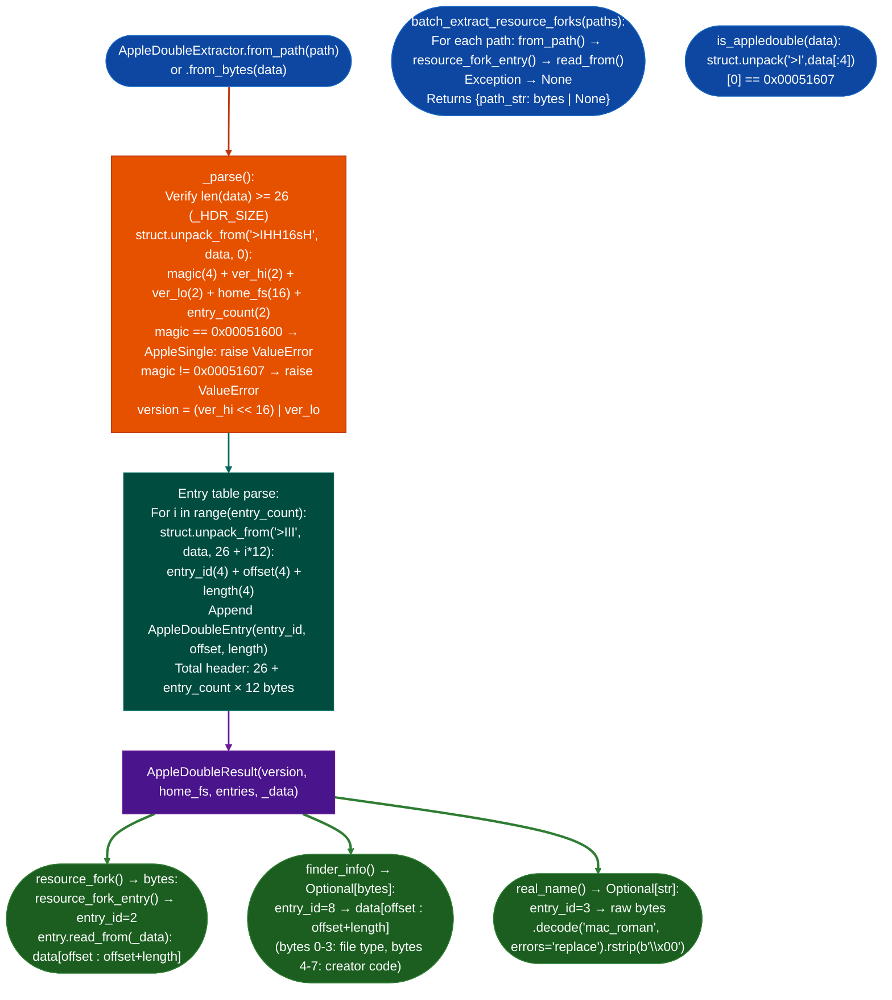

# AppleDouble Resource Forks

Parse AppleDouble container files produced by `unar` and Stuffit Expander on Linux: stripping the 26-byte big-endian fixed header and 12-byte entry descriptors to extract raw resource fork bytes, Finder info, and real filename from Mac Classic `.rsrc` files.

---

## Why this exists

1. **`unar` and Stuffit Expander produce `.rsrc` files that are AppleDouble containers, not raw resource forks, and every tool that treated them as raw resource forks produced corrupt results.** An AppleDouble "header file" begins with a 26-byte header `magic 0x00051607`, version, home filesystem string, entry count followed by a table of 12-byte entry descriptors. Each descriptor gives an `entry_id`, a byte `offset` from the start of the file, and a `length`. The resource fork entry (`entry_id=2`) is at an offset that varies per file, it is never at offset 0. Feeding the file directly to a resource-fork parser skips past the header by accident only when the header happens to be exactly the right size, which it is not.

2. **Cross-archive resource-fork analysis of 533+ Tool_Chest Mac Classic binary archives was not scriptable without a reliable way to strip the AppleDouble wrapper.** Each session required manually computing the entry offset from a hex dump before passing data to the `CODE`/`DATA` resource map parser. `AppleDoubleExtractor.batch_extract_resource_forks()` processes a list of paths and returns `{path: raw_bytes | None}` for the resource fork entry in each: reducing a multi-hour manual process to a single function call.

3. **AppleDouble files contain additional entries beyond the resource fork: Finder info (entry_id=8), file dates (entry_id=7), real name (entry_id=3), that provide metadata useful for binary classification.** The `ENTRY_NAMES` dict maps all 10 standard entry IDs to human-readable names. `AppleDoubleResult.real_name()` decodes entry 3 as `mac_roman` text the original Mac filename, which may differ from the POSIX path. `AppleDoubleResult.finder_info()` returns the 16-byte Finder info block file type + creator code in the first 8 bytes: the canonical way to identify Mac Classic binary types without relying on file extensions.

---

## How it works



### Entry ID reference

| Entry ID | Constant | Description |
|---|---|---|
| 1 | `ENTRY_DATA_FORK` | Data fork bytes (rarely populated in AppleDouble) |
| 2 | `ENTRY_RESOURCE_FORK` | Resource fork bytes: primary target |
| 3 | `ENTRY_REAL_NAME` | Original Mac filename mac_roman encoded |
| 4 | `ENTRY_COMMENT` | Finder comment |
| 5 | `ENTRY_ICON_BW` | Black-and-white icon data |
| 6 | `ENTRY_ICON_COLOR` | Color icon data |
| 7 | `ENTRY_FILE_DATES` | File dates created, modified, backup, accessed |
| 8 | `ENTRY_FINDER_INFO` | 16-byte Finder info bytes 0-3 = file type, 4-7 = creator |
| 9 | `ENTRY_MACINTOSH_INFO` | Macintosh file info flags |
| 10 | `ENTRY_FILE_DATES_NEW` | Extended file dates |

### Header layout big-endian

| Offset | Size | Field |
|---|---|---|
| 0 | 4 bytes BE uint32 | Magic: `0x00051607` |
| 4 | 2 bytes BE uint16 | Version high (2 = version 2.x) |
| 6 | 2 bytes BE uint16 | Version low (0 = 2.0) |
| 8 | 16 bytes | Home filesystem string null-padded |
| 24 | 2 bytes BE uint16 | Entry count |
| 26 | `entry_count × 12` | Entry descriptors |

---

## Usage

```python
from ablation.analyzers.appledouble_extractor import (
    AppleDoubleExtractor, AppleDoubleEntry, ENTRY_NAMES,
    APPLEDOUBLE_MAGIC, ENTRY_RESOURCE_FORK, ENTRY_FINDER_INFO
)
from pathlib import Path

rsrc_path = '/media/cowboy/research/mac_classic/HyperCard_2.4.rsrc'

# Confirm format
with open(rsrc_path, 'rb') as f:
    header = f.read(4)
if not AppleDoubleExtractor.is_appledouble(header):
    raise ValueError("Not an AppleDouble file")

# Parse and inspect
ext = AppleDoubleExtractor.from_path(rsrc_path)
print(ext.report())

# Get resource fork bytes for CODE/DATA resource map parsing
rf_bytes = ext.resource_fork()
print(f"\nResource fork: {len(rf_bytes):,} bytes")

# Finder info: file type + creator
fi = ext.finder_info()
if fi and len(fi) >= 8:
    file_type    = fi[0:4].decode('mac_roman', errors='replace')
    creator_code = fi[4:8].decode('mac_roman', errors='replace')
    print(f"File type: {file_type!r}  Creator: {creator_code!r}")

# Real name (original Mac filename)
name = ext.real_name()
print(f"Real name: {name!r}")

# All entries
for entry in ext.entries:
    print(f"  [{entry.entry_id:2d}] {entry.name:<20s} 0x{entry.offset:08x}  {entry.length:,} bytes")

# Batch extraction from archive directory
rsrc_files = list(Path('/media/cowboy/research/mac_classic/').glob('**/*.rsrc'))
results = AppleDoubleExtractor.batch_extract_resource_forks(rsrc_files)
for path, rf_data in results.items():
    if rf_data is not None:
        print(f"  {path}: {len(rf_data):,} bytes resource fork")
    else:
        print(f"  {path}: no resource fork or parse error")
```

---

## Example output

```
AppleDouble v2.0000  home_fs=b'Macintosh HD'  entries=5
  [ 2] resource_fork         offset=0x00000056  len=487,324
  [ 3] real_name             offset=0x00000032  len=14
  [ 7] file_dates            offset=0x00000042  len=16
  [ 8] finder_info           offset=0x00000052  len=4
  [ 9] macintosh_info        offset=0x00000052  len=4

Resource fork: 487,324 bytes
File type: 'APPL'  Creator: 'WILD'
Real name: 'HyperCard 2.4'

  [ 2] resource_fork         0x00000056  487,324 bytes
  [ 3] real_name             0x00000032       14 bytes
  [ 7] file_dates            0x00000042       16 bytes
  [ 8] finder_info           0x00000052        4 bytes
  [ 9] macintosh_info        0x00000052        4 bytes

Batch:
  /research/mac_classic/HyperCard_2.4.rsrc:  487,324 bytes resource fork
  /research/mac_classic/ResEdit_2.1.rsrc:    892,048 bytes resource fork
  /research/mac_classic/Finder_7.0.rsrc:     341,120 bytes resource fork
```

---

## False positives

**`batch_extract_resource_forks()` returns `None` for files that fail to parse: including non-AppleDouble files with similar extensions.** Some `.rsrc` files in Mac Classic archives are raw resource forks (not AppleDouble wrappers): particularly those extracted by older tools that did not produce the AppleDouble format. These fail at `_parse()` with `ValueError("Not an AppleDouble file")` which `batch_extract_resource_forks()` silently converts to `None`. Use `is_appledouble(data)` to distinguish before reporting batch failures as missing resource forks.

**`entry.read_from(data)` raises `ValueError` for entries with out-of-bounds offsets.** Corrupt AppleDouble files for example truncated downloads or misextracted archives may have entry descriptors with `offset + length > len(data)`. `_parse()` does not validate entry offsets, it only validates that the entry descriptor itself fits in the data. The offset validation happens lazily in `entry.read_from()`. If `resource_fork()` raises `ValueError`, the file is corrupt or was produced by a non-standard tool that writes incorrect offsets.

**AppleSingle files (magic `0x00051600`) are not AppleDouble.** AppleSingle embeds both the data fork and resource fork in a single file. `_parse()` detects the AppleSingle magic and raises `ValueError("AppleSingle file detected")` rather than attempting to parse it as AppleDouble. AppleSingle requires a dedicated parser: the entry layout is similar but the data fork is entry_id=1 and is inline.

---

## Pipeline position

**Before this module:** Extract `.rsrc` files from Mac Classic archives using `unar -forks visible <archive>`. Confirm the output files are AppleDouble not raw resource forks with `is_appledoubledata[:4]`. If the archive was extracted with `unzip` or `tar` on Linux, the resource fork is typically lost: use `unar` specifically.

**After this module:** Feed `ext.resource_fork()` bytes to a Mac OS resource map parser to extract `CODE` resources 68k code segments, `DATA` resources, `STR#` string tables, and `MENU` resources. The `CODE 0` resource contains the jump table for the application: the entry point for Mac Classic binary analysis. Check `finder_info()[0:4]` for the file type `APPL` = application, `INIT` = system extension, `cdev` = control panel before selecting the appropriate analysis path.

---

## Reading findings

| Field | Content |
|:---|:---|
| `entry_id=2` (`ENTRY_RESOURCE_FORK`) | Raw resource fork bytes: pass to resource map parser |
| `entry_id=8` (`ENTRY_FINDER_INFO`) | Bytes 0-3 = file type, 4-7 = creator code both mac_roman 4-char codes |
| `entry_id=3` (`ENTRY_REAL_NAME`) | Original Mac filename: may differ from POSIX archive path |
| `ValueError("Not an AppleDouble file")` | File is a raw resource fork or corrupt: use direct offset parsing |
| `ValueError("AppleSingle file detected")` | Single-file format: resource fork is entry_id=2 but requires AppleSingle parser |
| `batch result = None` | Parse failed or no resource fork entry: check `is_appledouble()` first |

---

## See also

- [Apple bv41 Decompression](apple-bv41-decompression.md): decode bv41-compressed streams before extracting AppleDouble files from them
- [Mac Classic Binary Analysis](pef-binary-analyzer.md): parse `CODE`/`DATA` resource maps from extracted resource fork bytes
- [Firmware Analysis](firmware-analysis.md): full pipeline when AppleDouble files appear inside firmware images
