# Architectural Risk Detection Source RE

Build an authentication surface map of a source code repository in under five seconds: classifying every HTTP route handler by its authentication level so the analyst knows exactly which endpoints accept unauthenticated requests before reading a single line of handler code.

---

## Why this exists

1. **Reading every route file to find unprotected endpoints does not scale.** A mature SaaS platform can have 200–400 route files across multiple Next.js apps, Express microservices, and Python API servers. Reading them in order means the analyst reaches the most dangerous unprotected route at an unpredictable point in the engagement. `SourceEntryClassifier` maps all 400 routes in one pass and surfaces every `NONE`-level route at the top of the output, making the highest-risk entry points the first ones the analyst reads.

2. **Authentication signals are not uniform across frameworks.** A Next.js route that uses `getServerSession()` looks nothing like a Django REST Framework view that sets `permission_classes = [IsAuthenticated]`, and neither resembles an Express route that calls `verifyAuthHeaderAndReturnScope()`. Without a framework-aware classifier, every route needs manual interpretation. The classifier carries 25+ patterns covering Next.js, tRPC, Express, FastAPI, Django, DRF, Axum, and vendor auth middleware, converting framework-specific idioms to a single five-level scale: `NONE`, `API_KEY`, `SESSION`, `INTERNAL`, `ADMIN`.

3. **DRF `AllowAny` creates silent auth bypasses inside authenticated ViewSets.** A Django ViewSet that inherits from `ModelViewSet` classifies as `SESSION` by default because DRF applies `DEFAULT_AUTHENTICATION_CLASSES`. But when a single `@action` decorator inside that ViewSet sets `permission_classes=[AllowAny]`, one route in the file accepts unauthenticated requests while all others require a session. A naive auth scanner sees `IsAuthenticated` and marks the file SESSION, missing the bypass. The classifier detects this pattern explicitly and downgrades the entire file to `NONE` so it surfaces for review.

---

## How it works

```mermaid
flowchart TD
    A(["SourceContext.from_path(repo_root)"]):::input --> B["_walk_source_files: rglob all files\nskip: node_modules .git .next __pycache__ dist build .turbo coverage target\nkeep: .ts .tsx .js .mjs .cjs .py .rs .go .java .rb .php"]:::primary
    B:::primary --> C["Build lang_map: {language: [Path, ...]}"]:::secondary
    C:::secondary --> D["_is_route_file(path): check 8 content signals\nNext.js pages/app, Express/Fastify, Flask/FastAPI/DRF, Django CBV, Axum/Actix\nRoute files added to ctx.route_files"]:::tertiary
    D:::tertiary --> E["_detect_package_roots: find monorepo package.json roots"]:::tertiary
    E:::tertiary --> F["SourceContext ready"]:::tertiary
    F:::tertiary --> G["SourceEntryClassifier.from_context(ctx)"]:::tertiary
    G:::tertiary --> H["classify() · iterates ctx.route_files"]:::tertiary
    H:::tertiary --> I["_classify_file(path): read text → _classify_text()"]:::tertiary
    I:::tertiary --> J["_classify_text: scan _AUTH_PATTERNS (25+)\nFirst match at highest rank wins\nOrder: ADMIN → INTERNAL → SESSION → API_KEY → NONE"]:::tertiary
    J:::tertiary --> K{"auth_level == NONE?"}:::neutral
    K:::neutral -->|yes| L["Follow one import level:\n_IMPORT_FROM regex finds import statements\n_resolve_import(): resolve relative or @/-aliased imports\nRe-classify imported file; upgrade if auth found"]:::tertiary
    K:::neutral -->|no| M["M"]:::tertiary
    L:::tertiary --> M:::tertiary
    M:::tertiary -->|"permission_classes=[AllowAny] found\nOR @action(permission_classes=[AllowAny]) found"| N["Downgrade SESSION → NONE"]:::tertiary
    M:::tertiary -->|no AllowAny| O(["O"]):::output
    N:::tertiary --> P["is_low_value: health/ready/ping/version/openapi/swagger signals"]:::tertiary
    P:::tertiary --> Q["RouteClassification: path, rel_path, auth_level, matched_signal, is_low_value"]:::tertiary
    Q:::tertiary --> H:::tertiary
    H:::tertiary --> R["Sort: weakest-auth-first (NONE before API_KEY before SESSION …)"]:::tertiary
    R:::tertiary --> S(["report() → Route Auth Surface Map"]):::output
    classDef input     fill:#0d47a1,stroke:#1565c0,color:#fff
    classDef primary   fill:#e65100,stroke:#bf360c,color:#fff
    classDef secondary fill:#004d40,stroke:#00695c,color:#fff
    classDef tertiary  fill:#4a148c,stroke:#6a1b9a,color:#fff
    classDef neutral   fill:#37474f,stroke:#546e7a,color:#fff
    classDef output    fill:#1b5e20,stroke:#2e7d32,color:#fff
    linkStyle 0 stroke:#bf360c,stroke-width:2px
    linkStyle 1 stroke:#00695c,stroke-width:2px
    linkStyle 2 stroke:#6a1b9a,stroke-width:2px
    linkStyle 3 stroke:#6a1b9a,stroke-width:2px
    linkStyle 4 stroke:#6a1b9a,stroke-width:2px
    linkStyle 5 stroke:#6a1b9a,stroke-width:2px
    linkStyle 6 stroke:#6a1b9a,stroke-width:2px
    linkStyle 7 stroke:#6a1b9a,stroke-width:2px
    linkStyle 8 stroke:#6a1b9a,stroke-width:2px
    linkStyle 9 stroke:#546e7a,stroke-width:2px
    linkStyle 10 stroke:#6a1b9a,stroke-width:2px
    linkStyle 11 stroke:#6a1b9a,stroke-width:2px
    linkStyle 12 stroke:#6a1b9a,stroke-width:2px
    linkStyle 13 stroke:#6a1b9a,stroke-width:2px
    linkStyle 14 stroke:#2e7d32,stroke-width:3px
    linkStyle 15 stroke:#6a1b9a,stroke-width:2px
    linkStyle 16 stroke:#6a1b9a,stroke-width:2px
    linkStyle 17 stroke:#6a1b9a,stroke-width:2px
    linkStyle 18 stroke:#6a1b9a,stroke-width:2px
    linkStyle 19 stroke:#2e7d32,stroke-width:3px
```



### Authentication levels

| Level | Rank | Semantics | Common pattern |
|---|---|---|---|
| `NONE` | 0 | No auth gate found | No auth signal, or `AllowAny` override |
| `API_KEY` | 1 | API key or webhook secret required | `verifyAuthHeaderAndReturnScope`, `ApiAuthService`, `timingSafeEqual` |
| `SESSION` | 2 | User session or JWT required | `getServerSession`, `protectedProcedure`, `@login_required`, DRF `IsAuthenticated` |
| `INTERNAL` | 3 | Service-to-service HMAC or internal token required | `withGatewaySignatureVerification`, `STRIPE_WEBHOOK_SECRET`, AWS proxy token |
| `ADMIN` | 4 | Global admin credential required | `ADMIN_API_KEY`, `IsAdminUser`, `@superuser_required` |

---

## Usage

```python
from ablation.analyzers.source_ingestion import SourceContext

# From local clone
ctx = SourceContext.from_path("/tmp/langfuse")
print(ctx.summary())
print(f"Route files: {len(ctx.route_files)}")
print(f"Languages:   {list(ctx.lang_map.keys())}")
print(f"Workspaces:  {[str(r.relative_to(ctx.repo_root)) for r in ctx.package_roots]}")

# Shallow clone from remote
ctx = SourceContext.from_git("https://github.com/langfuse/langfuse", "/tmp/langfuse")

# Grep across source files
hits = ctx.grep(r"exec\s*\(", lang="typescript")
for path, lineno, text in hits:
    print(f"  {ctx.rel(path)}:{lineno}  {text.strip()}")
```

---

## SourceEntryClassifier

```python
from ablation.analyzers.source_ingestion import SourceContext
from ablation.analyzers.source_entry_classifier import SourceEntryClassifier

ctx = SourceContext.from_path("/tmp/langfuse")
clf = SourceEntryClassifier.from_context(ctx)

# Classify all detected route files
results = clf.classify()
print(clf.report(results))

# Filter to only unauthenticated routes
print(clf.report(results, filter_level="NONE"))

# Classify every source file (broader sweep)
all_results = clf.classify_all_source()

# Work with results programmatically
none_routes = [r for r in results if r.auth_level == "NONE" and not r.is_low_value]
print(f"\n{len(none_routes)} unauthenticated non-trivial routes:")
for r in none_routes:
    print(f"  {r.rel_path}  [{r.matched_signal}]")
```

---

## Example output

```
Route Auth Surface Map
============================================================
Level          Count
------------------
NONE               8
API_KEY           47
SESSION          112
INTERNAL           9
ADMIN              3

── NONE ──────────────────────────────
  app/api/public/models/route.ts                             [no auth signal found]
  app/api/public/events/route.ts                             [no auth signal found]
  app/api/public/scores/route.ts                             [no auth signal found]
  pages/api/auth/[...nextauth].ts                            [no auth signal found] [low-value]
  src/api/health.ts                                          [no auth signal found] [low-value]
  src/api/v1/public/metrics.ts                               [no auth signal found]
  packages/ee/src/api/admin/override.ts                      [AllowAny override (unauthenticated DRF view)]
  worker/api/internal/process.ts                             [no auth signal found]

── API_KEY ──────────────────────────────
  app/api/public/ingestion/route.ts                          [verifyAuthHeader (via @/src/server/auth/api.ts)]
  app/api/public/traces/route.ts                             [verifyAuthHeader (via @/src/server/auth/api.ts)]
  ...
```

---

## False positives

**Custom auth middleware not in the pattern list.** If a Next.js project wraps all routes with a custom `withAuth()` higher-order function, and that function name appears nowhere in `_AUTH_PATTERNS`, all wrapped routes classify as `NONE`. Add the project-specific pattern to `_AUTH_PATTERNS` or run `ctx.grep(r"withAuth\(")` to find usage before concluding those routes are unprotected.

**DRF import-chain auth not followed.** Import resolution follows only one hop. When authentication logic lives two files deep route → handler → auth module, the classifier sees `NONE` and marks the route as unprotected. Check `is_low_value=False` NONE results manually before treating them as confirmed findings.

**`is_low_value` on non-trivial health checks.** The `is_low_value` classifier uses `health`, `ready`, `ping`, `version`, `info`, and `status` as signals. A route named `status.ts` that also handles webhook events classifies as low-value. Do not skip `is_low_value=True` routes entirely: review them before dismissal.

---

## Pipeline position

**Before this module:** `SourceContext.from_path()` or `SourceContext.from_git()`. No other dependency.

**After this module:** Read the handler code of every `NONE`-level, non-low-value route in order. For each route that accepts user-controlled data, check for injection sinks: template evaluation, `eval()`, shell exec, ORM `RawQuery`, or LLM prompt construction from unvalidated input. See [Source Audit](source-audit.md) for the follow-on deep-scan tool.

---

## Reading the surface map

| Field | Content |
|:---|:---|
| `auth_level` | `NONE` / `API_KEY` / `SESSION` / `INTERNAL` / `ADMIN` |
| `matched_signal` | The specific pattern that triggered classification, or "no auth signal found" |
| `is_low_value` | `True` when the route path or content matches a health/docs/status signal |
| `rel_path` | Repo-relative path to the route file |

---

## See also

- [Source Audit](source-audit.md): deep scan of individual route handlers for injection sinks
- [Agent Protocol Exposure](agent-protocol-exposure.md): detection of LLM prompt injection in route handlers
- [API Authentication and Token Checks](api-authentication-and-token-checks.md): binary RE analog for auth bypass in compiled APIs
