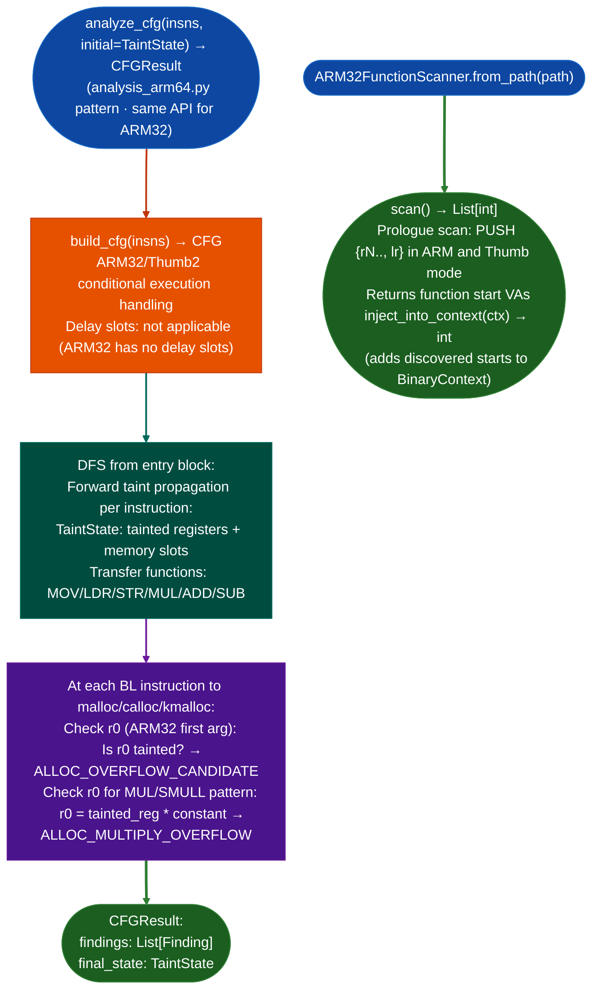

# ARM32 Allocation Arithmetic Overflow

Detect integer overflow in allocation size arithmetic on ARM32/Thumb2: finding patterns where a user-controlled multiplication or addition overflows a 32-bit register before being passed as the size argument to `malloc`/`calloc`/`kmalloc`, enabling heap-based size confusion vulnerabilities.

---

## Why this exists

1. **ARM32 network equipment firmware Cisco routers, IoT gateways, embedded web servers uses `malloc(n * sizeof(T))` extensively in packet parsers: if `n` is attacker-controlled and the multiplication is computed in a 32-bit register without an overflow check, `n * sizeof(T)` wraps around and `malloc` allocates a smaller-than-expected buffer.** `analysis_arm32.py` scans for the `MUL`/`ADD` → `BL malloc` pattern with taint tracking from network sources, identifying these overflows without requiring manual inspection of each allocation site.

2. **ARM32 `MUL` stores only the lower 32 bits of the product: overflow is silent and produces a small wrapped value.** The overflow condition is: `n > UINT32_MAX / sizeof(T)`. Most ARM32 parsers do not check this condition before passing the product to `malloc`. `analyze_cfg()` identifies these sites by looking for multiplication instructions whose operands include an ARM32/Thumb register last written by a tainted source network input, followed by a `BL malloc` where the product register is passed as `r0`.

3. **ARM32 uses a different calling convention from x86-64**: r0-r3 are the first four arguments. `analyze_cfg()` tracks r0 specifically as the `malloc` size argument, and `TaintState.taint_reg("r0", "user")` seeds taint at network input call sites to trace user-controlled data from `recv`/`read` through arithmetic operations to allocation sites.

---

## How it works



---

## Usage

```python
from ablation.analyzers.analysis_arm64 import analyze_cfg   # same API for ARM32
from ablation.analyzers.taint_tracker_arm32 import TaintState
from ablation.analyzers.insn_arm32 import from_listing
from ablation.analyzers.arm32_function_scanner import ARM32FunctionScanner
from ablation.analyzers.binary_context import BinaryContext

ctx = BinaryContext.load_or_build('/path/to/arm32_firmware.elf')

# Discover function starts (needed for stripped ARM32 binaries)
scanner = ARM32FunctionScanner.from_context(ctx)
n_added = scanner.inject_into_context(ctx)
print(f"Added {n_added} function starts from prologue scan")

# Taint-seed and analyze a specific function
init = TaintState()
init.taint_reg("r0", "user")   # r0 = recv return (tainted network data)

# Get instructions via insn_arm32 directly from binary bytes
import lief, capstone
binary = lief.parse('/path/to/arm32_firmware.elf')
text_sec = binary.get_section('.text')
text_data = bytes(text_sec.content)
text_va = text_sec.virtual_address
func_va = 0x12340
func_data = text_data[func_va - text_va: func_va - text_va + 4096]
from ablation.analyzers.insn_arm32 import from_capstone, Mode
insns = list(from_capstone(func_data, mode=Mode.ARM, base=func_va))
result = analyze_cfg(insns, initial=init)

for f in result.findings:
    print(f)
```

---

## Example output

The following illustrates the finding format. Actual addresses and register values are binary-specific.

```
ALLOC_MULTIPLY_OVERFLOW at <va>:
  r0 = <tainted-reg> * <sizeof-T>
  bl malloc  ; r0 wraps if <tainted-reg> > 0xFFFFFFFF / <sizeof-T>
  Taint source: user (recv at <source-va>)

ALLOC_OVERFLOW_CANDIDATE at <va>:
  r0 is user-tainted at malloc call site
  No bounds check detected on multiply path
```

---

## False positives

**`ALLOC_MULTIPLY_OVERFLOW` fires when the multiplier is tainted, even if there is an upstream bounds check.** `analyze_cfg()` is path-insensitive: a `CMP r0, #0x100 / BGT error_path` bounds check on a different path is not tracked. Confirm with `ConstPropAnalysis` or manual inspection that no bounds check precedes the arithmetic.

**ARM32 Thumb mode uses 2-byte and 4-byte instructions interleaved: `ARM32FunctionScanner` prologue scan correctly handles both modes, but function starts at odd addresses Thumb entry points encoded with LSB set may appear without the LSB in the raw scan output.** When using scan results as function entry points for capstone disassembly, check whether the binary uses Thumb or ARM mode at each discovered start.

---

## Pipeline position

Run `ARM32FunctionScanner.inject_into_context()` before any ARM32 taint or CFG analysis on stripped binaries: the prologue scan fills in function boundaries that `BinaryContext` alone cannot recover without symbols. Then use `analyze_cfg()` with tainted initial state seeded from network input call sites to find allocation arithmetic overflows.

---

## Reading findings

`analyze_cfg()` returns a list of finding dicts:

| Field | Content |
|:---|:---|
| `type` | `ALLOC_MULTIPLY_OVERFLOW` or `ALLOC_OVERFLOW_CANDIDATE` |
| `va` | Virtual address of the `bl malloc`/`bl calloc` call site |
| `register` | Argument register carrying the tainted allocation size for example `r0` |
| `taint_source` | Label of the taint source for example `user` |
| `source_va` | VA of the function that introduced the taint |
| `detail` | Human-readable description of the arithmetic path |

---

## See also

- [RISC-V](risc-v.md): similar pattern TaintState.join, analyze_cfg for RISC-V targets
- [CFG Fixpoint Dataflow](cfg-fixpoint-dataflow.md): full fixpoint dataflow for path-sensitive ARM32 analysis
- [Taint Analysis](taint-analysis.md): general taint model
- [ARM64 Symbolic Slicing](arm64-symbolic-slicing.md): ARM64 slice from allocation sites to sources
