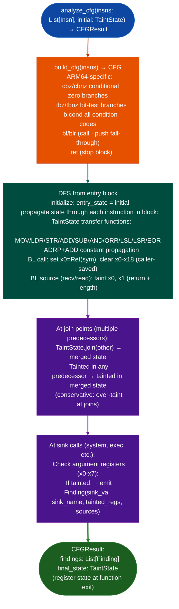

# ARM64 Symbolic Slicing

Path-insensitive, flow-sensitive dataflow analysis over an AArch64 CFG: propagating `TaintState` from user-controlled sources through instruction-level transfer functions across all CFG paths, producing findings at dangerous sink sites with the complete register state at the point of the finding.

---

## Why this exists <sup>[↑](#arm64-symbolic-slicing)</sup>

1. **ARM64 is the dominant architecture for modern network appliance firmware: Fortinet ARM64 builds, Cisco IOS-XE ARM64, and ARM-based firewall appliances all run on AArch64.** `analyze_cfg()` from `analysis_arm64.py` provides the flow-sensitive dataflow backbone for the ARM64 taint pipeline. Unlike `taint_tracker_arm64.py`'s intraprocedural linear scan, `analyze_cfg()` propagates taint state across basic-block boundaries using CFG DFS, tracking join-point state merges correctly.

2. **"Symbolic slicing" on ARM64 means following `TaintState` across the full CFG, including through loop back-edges and conditional branches, while maintaining the register state at every basic-block boundary.** `CFGResult.final_state` gives the taint state at function exit; intermediate states at each block boundary can be read from the CFG's `dfs()` traversal. This enables backward slicing from a finding back to its origin: given a finding at a specific `BLR` call site, the taint state at that point identifies exactly which registers carry user-controlled data and which instructions produced their current values.

3. `analyze_cfg()` implements the same API as the RISC-V and MIPS labeled-taint `analyze_cfg()` variants: the `insns, initial_state` → `CFGResult` signature is consistent across ISAs, allowing the same driver code to analyze ARM64, RISC-V, and MIPS targets by swapping only the `TaintState` import and `from_listing()` decoder.

---

## How it works <sup>[↑](#arm64-symbolic-slicing)</sup>



---

## Usage <sup>[↑](#arm64-symbolic-slicing)</sup>

```python
from ablation.analyzers.analysis_arm64 import analyze_cfg
from ablation.analyzers.taint_tracker_arm64 import TaintState
from ablation.analyzers.insn_arm64 import from_listing
from ablation.analyzers.binary_context import BinaryContext

ctx = BinaryContext.load_or_build('/path/to/arm64_firmware.elf')

# Seed taint at network input
init = TaintState()
init.taint_reg("x0", "user")   # x0 = recv() return value

# Get instructions via insn_arm64 from raw binary bytes
import lief
binary = lief.parse('/path/to/arm64_firmware.elf')
text_sec = binary.get_section('.text')
text_data = bytes(text_sec.content)
text_va = text_sec.virtual_address
func_va = 0x12340
func_data = text_data[func_va - text_va: func_va - text_va + 4096]
from ablation.analyzers.insn_arm64 import from_capstone
insns = list(from_capstone(func_data, base=func_va))

# Run flow-sensitive analysis
result = analyze_cfg(insns, initial=init)

# Print findings
for f in result.findings:
    print(f)

# Inspect exit state
for reg in ['x0', 'x1', 'x2']:
    taint = result.final_state.get(reg)
    print(f"  {reg}: tainted={taint is not None}")
```

---

## Example output <sup>[↑](#arm64-symbolic-slicing)</sup>

The following illustrates the finding output format. Actual addresses and registers are binary-specific.

```
Finding at <va>:
  sink: system
  tainted args: x0
  sources: ['user']
  taint path: x0←x19←x0(recv)
```

---

## False positives <sup>[↑](#arm64-symbolic-slicing)</sup>

**`analyze_cfg()` is path-insensitive: taint merged at join points is conservative.** A finding may fire on a path where sanitization occurs on the other branch. Confirm with manual CFG inspection whether there exists a path from the taint source to the sink without traversing a sanitizing branch. Use `SanitizerDetector` to identify likely sanitizing functions on the path.

**`TaintState.join()` is additive: once a register is tainted in any predecessor path, it remains tainted at the join.** This is correct for reachability-based taint analysis but can produce false positives for analyses where only one specific path is exploitable. For high-precision confirmation, use `SCCPAnalysis` to identify executable edges before running `analyze_cfg()`.

---

## Pipeline position <sup>[↑](#arm64-symbolic-slicing)</sup>

Run `analyze_cfg()` after `SemanticSearcher` identifies handler candidates and before `PathSolver` confirms feasibility. The `findings` output feeds `FindingRegistry` and the `final_state` enables call-chain seeding: the exit state from function A becomes the initial state for the function that calls A.

---

## Reading findings <sup>[↑](#arm64-symbolic-slicing)</sup>

`ARM64TaintTracker.from_path(path).run()` returns `List[TaintFindingARM64]`:

| Attribute | Content |
|:---|:---|
| `func_va` | VA of the function containing the sink call |
| `func_name` | Name of the function (from `ctx`) |
| `sink_va` | VA of the sink call instruction |
| `sink_name` | Sink function name for example `system`, `popen`, `execv` |
| `tainted_args` | List of tainted argument registers at the call for example `['x0']` |
| `source_name` | Taint source label that propagated to the sink |
| `severity` | `'HIGH'` (default) |

---

## See also <sup>[↑](#arm64-symbolic-slicing)</sup>

- [RISC-V](risc-v.md): same `analyze_cfg()` API for RISC-V 32/64 targets
- [MIPS](mips.md): MIPS-32/64 labeled-taint with delay-slot awareness
- [CFG Fixpoint Dataflow](cfg-fixpoint-dataflow.md): fixpoint-based CP/RDA as a complement to flow-sensitive DFS
- [ARM64 Virtual Call Resolution](arm64-virtual-call-resolution.md): resolves BLR sites before `analyze_cfg()` follows them
