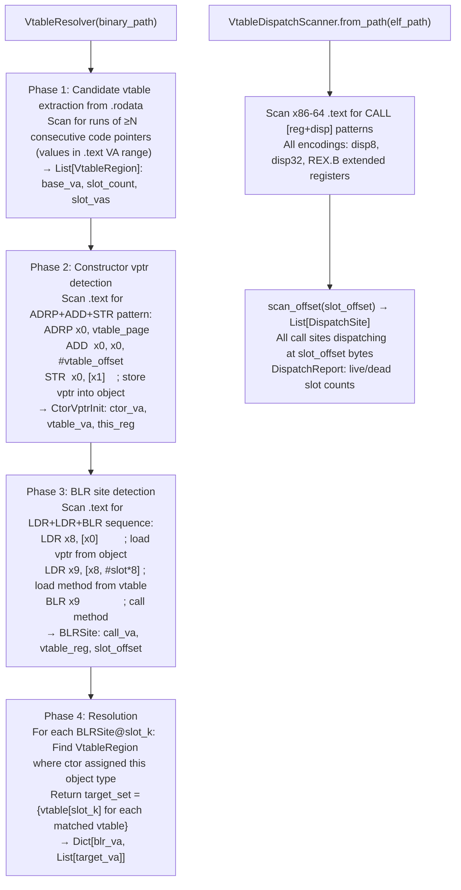

# ARM64 Virtual Call Resolution

Reconstruct virtual dispatch tables in stripped ARM64 binaries and resolve `BLR` (branch-to-register) indirect call sites to target function sets — using iResolveX-style candidate vtable extraction, constructor `vptr` detection, and slot-based BLR resolution.

---

## Why this exists

1. **Stripped C++ ARM64 binaries contain `BLR xN` instructions at virtual method call sites — capstone decodes these as indirect branches with no static target, making them invisible to all sink-argument and taint analysis.** `VtableResolver` resolves each `BLR` to a set of possible target VAs by: finding vtable regions in `.rodata` (runs of ≥N code pointers), locating constructor `ADRP+ADD+STR` patterns that assign vtable pointers to object instances, and matching each `BLR` at slot offset k to the target set of all vtable entries at position k.

2. **`VtableDispatchScanner` provides the complementary x86-64 analysis — finding all `CALL [reg+disp]` dispatch sites in `.text` and determining which vtable slot offsets are live (dispatched at least once) vs dead (never called).** This allows pruning the virtual call surface: a virtual method that is never dispatched in the binary cannot be a sink reachable via virtual dispatch, reducing false positives in downstream analysis.

3. **Virtual call resolution closes the gap that makes C++ network appliance firmware analysis incomplete.** FortiOS `httpsd`, Cisco IOS-XE management processes, and most modern embedded web servers are written in C++ with virtual dispatch at the core of their plugin architectures. Without resolution, these binaries appear to have no call graph — every virtual dispatch is a dead end.

---

## How it works



---

## Usage

```python
from ablation.analyzers.vtable_resolver import VtableResolver
from ablation.analyzers.vtable_dispatch_scanner import VtableDispatchScanner

# ── ARM64 vtable resolution ───────────────────────────────────────────────────
resolver = VtableResolver('/path/to/arm64_binary')

vtables = resolver.find_vtable_regions()
print(f"Found {len(vtables)} vtable regions")

ctors = resolver.find_ctor_vptrInits()
print(f"Found {len(ctors)} constructor vptr assignments")

blr_sites = resolver.find_blr_sites()
resolution = resolver.resolve_all()
for blr_va, targets in resolution.items():
    print(f"  BLR@{blr_va:#x} → {[f'{t:#x}' for t in targets]}")

# ── x86-64 dispatch scanner ───────────────────────────────────────────────────
scanner = VtableDispatchScanner.from_path('/path/to/x86_64_binary')

# Scan all virtual dispatch sites
report = scanner.scan()
print(f"Live slots: {len(report.live())}")
print(f"Dead slots: {len(report.dead())}")

# Find all sites dispatching at offset 0x28 (slot 5)
sites = scanner.scan_offset(slot_offset=0x28)
for site in sites:
    print(f"  {site.call_va:#x}  [{site.register}+{site.slot_offset:#x}]  {site.encoding}")
```

---

## Example output

The following illustrates the resolution output format. Actual addresses and slot counts are binary-specific.

```
VtableResolver:
  Vtable regions: <N>  (runs of code pointers in .rodata)
  Constructor vptr assignments: <M>
  BLR sites: <K>

  Resolution:
    BLR@<va>  slot=<N>  → [<target-1-va>, <target-2-va>]
    BLR@<va>  slot=<N>  → [<target-va>]  (single implementation)
```

---

## False positives

**VtableResolver Phase 1 extracts all `.rodata` runs of code pointers — function pointer tables that are not vtables (dispatch tables, jump tables for protocol handlers) may be incorrectly included.** Filter by minimum vtable size (≥3 slots) and cross-reference against Phase 2 constructor assignments before treating a candidate as a class vtable.

**BLR resolution to a target set includes all objects of matching vtable shape — if multiple classes share the same vtable structure (same slot count, same type hierarchy), the resolution may include targets from unrelated classes.** Use the `CtorVptrInit` assignments to narrow down which class a specific BLR is dispatching on before treating the full target set as reachable.

---

## Pipeline position

Run `VtableResolver` after `XRefGraph` and before `TaintTracker` on C++ ARM64 binaries. Inject the resolution map into `BinaryContext` so that BLR sites appear as call edges in the call graph, enabling `TaintTracker.run_interprocedural()` to follow taint through virtual dispatch. On x86-64 C++ binaries, use `VtableDispatchScanner` to identify live virtual dispatch sites before running sink classification.

---

## See also

- [ARM64 Symbolic Slicing](arm64-symbolic-slicing.md) — slice from BLR sites to find argument sources
- [Control-Flow Graph Construction](control-flow-graph-construction.md) — CFG that includes resolved BLR edges
- [Taint Analysis](taint-analysis.md) — downstream consumer of virtual call resolution results
- [x86 64-bit Relocation-Based Vtables](x86-64-relocation-based-vtables.md) — x86-64 vtable recovery from relocation entries
