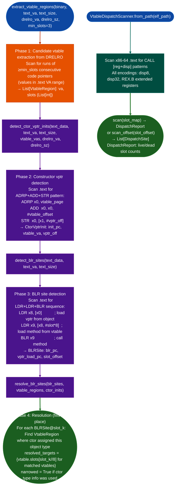

# ARM64 Virtual Call Resolution

Reconstruct virtual dispatch tables in stripped ARM64 binaries and resolve `BLR` branch-to-register indirect call sites to target function sets: using iResolveX-style candidate vtable extraction, constructor `vptr` detection, and slot-based BLR resolution.

---

## Why this exists

1. **Stripped C++ ARM64 binaries contain `BLR xN` instructions at virtual method call sites: capstone decodes these as indirect branches with no static target, making them invisible to all sink-argument and taint analysis.** `vtable_resolver.py` resolves each `BLR` to a set of possible target VAs by: finding vtable regions in DRELRO runs of ≥N code pointers, locating constructor `ADRP+ADD+STR` patterns that assign vtable pointers to object instances, and matching each `BLR` at slot offset k to the target set of all vtable entries at position k.

2. **`VtableDispatchScanner` provides the complementary x86-64 analysis: finding all `CALL [reg+disp]` dispatch sites in `.text` and determining which vtable slot offsets are live dispatched at least once vs dead never called.** This allows pruning the virtual call surface: a virtual method that is never dispatched in the binary cannot be a sink reachable via virtual dispatch, reducing false positives in downstream analysis.

3. **Virtual call resolution closes the gap that makes C++ network appliance firmware analysis incomplete.** FortiOS `httpsd`, Cisco IOS-XE management processes, and most modern embedded web servers are written in C++ with virtual dispatch at the core of their plugin architectures. Without resolution, these binaries appear to have no call graph: every virtual dispatch is a dead end.

---

## How it works



---

## Usage

```python
import lief
from ablation.analyzers.vtable_resolver import (
    extract_vtable_regions, detect_ctor_vptr_inits,
    detect_blr_sites, resolve_blr_sites,
)
from ablation.analyzers.vtable_dispatch_scanner import VtableDispatchScanner

# ── ARM64 vtable resolution ───────────────────────────────────────────────────
binary = lief.parse('/path/to/arm64_binary')
text   = binary.get_section('.text')
drelro = binary.get_section('.data.rel.ro')

text_va   = text.virtual_address
text_size = text.size
text_data = bytes(text.content)
drelro_va   = drelro.virtual_address if drelro else 0
drelro_sz   = drelro.size if drelro else 0

vtable_regions = extract_vtable_regions(
    binary, text_va, text_size, drelro_va, drelro_sz, min_slots=3)
print(f"Found {len(vtable_regions)} vtable regions")

vtable_vas = {vt.va for vt in vtable_regions}
ctor_inits = detect_ctor_vptr_inits(
    text_data, text_va, text_size, vtable_vas, drelro_va, drelro_sz)
print(f"Found {len(ctor_inits)} constructor vptr assignments")

blr_sites = detect_blr_sites(text_data, text_va, text_size)
resolve_blr_sites(blr_sites, vtable_regions, ctor_inits)  # fills in-place
for site in blr_sites:
    print(f"  BLR@{site.blr_pc:#x} slot=+{site.slot_offset:#x} → "
          f"{[f'{t:#x}' for t in site.resolved_targets]}")

# ── x86-64 dispatch scanner ───────────────────────────────────────────────────
scanner = VtableDispatchScanner.from_path('/path/to/x86_64_binary')

# Scan with a slot map (name → byte offset)
report = scanner.scan({'getUserByName': 0x4b0, 'destroy': 0x0})
print(f"Live slots: {len(report.live())}")

# Find all sites dispatching at offset 0x28 (slot 5 in 64-bit vtable)
sites = scanner.scan_offset(0x28)
for site in sites:
    print(f"  {site.call_va:#x}  slot+{site.slot_offset:#x}")
```

---

## Example output

The following illustrates the resolution output format. Actual addresses and slot counts are binary-specific.

```
VtableResolver:
  Vtable regions: <N>  (runs of code pointers in .rodata)
  Constructor vptr assignments: <M>
  BLR sites: <K>

  Resolution:
    BLR@<va>  slot=<N>  → [<target-1-va>, <target-2-va>]
    BLR@<va>  slot=<N>  → [<target-va>]  (single implementation)
```

---

## False positives

**`extract_vtable_regions` extracts all DRELRO runs of code pointers: function pointer tables that are not vtables dispatch tables, jump tables for protocol handlers may be incorrectly included.** Filter by minimum vtable size `min_slots=3`, the default and cross-reference against constructor assignments from `detect_ctor_vptr_inits` before treating a candidate as a class vtable.

**BLR resolution to a target set includes all objects of matching vtable shape: if multiple classes share the same vtable structure same slot count, same type hierarchy, the resolution may include targets from unrelated classes.** Use `CtorVptrInit.init_pc` and `vtable_va` to narrow down which class a specific BLR is dispatching on: `BLRSite.narrowed == True` means the ctor type info was used.

---

## Pipeline position

Run `extract_vtable_regions` → `detect_ctor_vptr_inits` → `detect_blr_sites` → `resolve_blr_sites` after `XRefGraph` and before `TaintTracker` on C++ ARM64 binaries. Inject the resolved `blr_pc → resolved_targets` map into `BinaryContext` so that BLR sites appear as call edges in the call graph, enabling `TaintTracker.run_interprocedural()` to follow taint through virtual dispatch. On x86-64 C++ binaries, use `VtableDispatchScanner` to identify live virtual dispatch sites before running sink classification.

---

## Reading output

`resolve_blr_sitesblr_sites, vtable_regions, ctor_inits` populates `BLRSite.resolved_targets` in-place and returns the updated list.

`detect_blr_sitestext_data, text_va, text_size` returns `List[BLRSite]`:

| Attribute | Content |
|:---|:---|
| `blr_pc` | VA of the `BLR xN` instruction |
| `vptr_load_pc` | VA of the preceding `LDR xN, [xM, #k]` that loads the slot |
| `slot_offset` | Byte offset `k` into the vtable |
| `resolved_targets` | `List[int]`: resolved target VAs (empty until `resolve_blr_sites` runs) |
| `narrowed` | `True` if narrowed by constructor type information |

`extract_vtable_regionsbinary, text_va, text_size` returns `List[VtableRegion]`:

| Attribute | Content |
|:---|:---|
| `va` | VA of the vtable in `.rodata` |
| `slots` | `List[int]`: code VAs at each slot index |

---

## See also

- [ARM64 Symbolic Slicing](arm64-symbolic-slicing.md): slice from BLR sites to find argument sources
- [Control-Flow Graph Construction](control-flow-graph-construction.md): CFG that includes resolved BLR edges
- [Taint Analysis](taint-analysis.md): downstream consumer of virtual call resolution results
- [x86 64-bit Relocation-Based Vtables](x86-64-relocation-based-vtables.md): x86-64 vtable recovery from relocation entries
