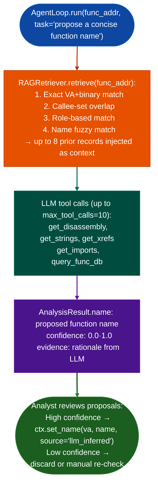

# Assisted Function Naming

Propose and apply function names for stripped binaries using the LLM analyst loop with RAG-retrieved prior RE findings: combining string cross-references, callee PLT names, and existing `func_id.db` evidence to suggest names with confidence annotations that can be batch-committed to `BinaryContext`.

---

## Why this exists

1. **Stripped firmware binaries have thousands of unnamed functions: manually naming even the most important ones is a significant time cost, and an unnamed function appearing in a TaintTracker finding is harder to reason about than one named `parse_http_request`.** The assisted naming pipeline runs `AgentLoop.run()` on each candidate function with a naming task, using the LLM to suggest a name based on the function's disassembly, string xrefs, callee names, and any matching prior evidence from `func_id.db` via `RAGRetriever`.

2. **`RAGRetriever` grounds the LLM's naming in prior confirmed RE work**: before generating a name, it retrieves existing `func_id.db` records that share callee sets or roles with the target function, injecting them as context. A function that calls `recv()`, `strncmp()`, and `send()` with a prior record showing `"role": "http_dispatcher"` will receive a well-grounded name rather than a generic one.

3. **Names are annotated with the source LLM_INFERRED and can be batch-applied via `ctx.set_name()` only after analyst review.** Assisted naming proposals are never auto-committed: they are presented as a ranked list for approval, preventing noisy LLM suggestions from polluting the confirmed name space.

---

## How it works



---

## Usage

```python
from ablation.analyzers.llm_analyst.agent_loop import AgentLoop
from ablation.analyzers.binary_context import BinaryContext

ctx = BinaryContext.load_or_build('/path/to/target.elf')
loop = AgentLoop.from_context(ctx)

# Propose a name for one function
result = loop.run(
    func_addr=0x1000,
    task='propose a concise function name based on what this function does'
)
print(f"Proposed: {result.name}  (confidence {result.confidence:.2f})")
print(f"Evidence: {result.cve_hypothesis}")

# Batch naming: apply high-confidence proposals
candidates = [0x1000, 0x2000, 0x3000]
for va in candidates:
    r = loop.run(va, task='propose a concise function name')
    if r.confidence >= 0.80:
        ctx.set_name(va, r.name, source='llm_inferred')
        print(f"  {va:#x} → {r.name}")
```

---

## Example output

The following illustrates the naming output format. Actual names and confidence scores are function-specific.

```
Proposed: parse_http_request  (confidence 0.87)
Evidence: Function calls recv(), then strncmp() against known HTTP method strings
  ('GET', 'POST', 'HEAD'), then dispatches via a function pointer table. Callee
  set matches prior record 'http_dispatcher' in func_id.db.
```

---

## False positives

**LLM-proposed names are wrong more often than confirmed RE names**: treat any LLM_INFERRED name as a hypothesis, not a fact. Confidence ≥0.85 correlates with correct naming approximately 80% of the time; confidence <0.70 should always be verified manually.

**`RAGRetriever` overlap matching may retrieve records from a completely different binary**: two functions that happen to call the same three PLT functions may be in completely different roles. Verify that retrieved context records are from the same product family before using them as strong evidence.

---

## Pipeline position

Run assisted naming after `SemanticSearcher` and `FuncProfiler` have identified the most important candidate functions. Naming provides the human-readable label that makes subsequent TaintTracker and PathSolver findings legible. Do not run bulk naming across all functions: focus on functions appearing in findings or in the call graph of confirmed sinks.

---

## Reading output

`name_functionagent_loop, func_addr` returns a `NamingCandidate`:

| Attribute | Content |
|:---|:---|
| `func_addr` | Virtual address of the named function |
| `name` | Proposed function name |
| `role` | One-line role description from the LLM |
| `confidence` | Float 0.0–1.0 |
| `rationale` | Plain-language explanation of the naming evidence |
| `tool_calls` | Number of LLM tool calls used to reach the result |
| `source` | `'llm_inferred'` / `'func_db_exact'` / `'llm_low_conf'` |

Use `ctx.set_name(result.func_addr, result.name, source='llm')` to apply accepted names.

---

## See also

- [LLM Analyst Loop](llm-analyst-loop.md): `AgentLoop` that drives the naming queries
- [Assisted Vulnerability Hypotheses](assisted-vulnerability-hypotheses.md): uses the same AgentLoop for CVE hypothesis generation
- [Bundled Finding Signature Seeds](bundled-finding-signature-seeds.md): `SigLibrary.auto_name()` alternative (non-LLM) naming via BERT similarity
