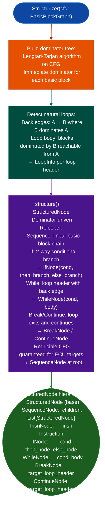

# Structured CFG Reconstruction

Convert a basic-block CFG into a tree of structured nodes: `SequenceNode`, `IfNode`, `WhileNode`, `BreakNode`, `ContinueNode`: using dominator-tree and natural-loop analysis, producing output equivalent to the source-level control flow of the original C code without the `goto` statements a naive lifter produces.

---

## Why this exists

1. **All compiled automotive firmware AUTOSAR classic, plain-C ECU code produces reducible CFGs**: every loop is a natural loop with a single entry. A dominator-driven Relooper variant correctly reconstructs the structured control flow for all such binaries without the arbitrary `goto` insertion that makes naive liftings unreadable to human analysts.

2. **`IfNode`, `WhileNode`, `BreakNode`, and `ContinueNode` each carry the controlling condition and the branch targets**: enabling an analyst to read the reconstructed tree as a structured program trace rather than a flat basic-block graph. This is the output consumed by `FuncProfiler.profile()` when generating human-readable function summaries for session documentation.

3. **`Structurizer` operates on the same CFG representation used by `TaintTracker`**: basic blocks with predecessor/successor edges. Any binary that can be analyzed with `TaintTracker` can have its control flow structured by `Structurizer` without additional preprocessing, using the same `BinaryContext` data.

---

## How it works



---

## Usage

```python
from ablation.analyzers.structurizer import Structurizer

# cfg is a BasicBlockGraph from BinaryContext or FuncProfiler
structurizer = Structurizer(cfg)
root = structurizer.structure()

def print_tree(node, indent=0):
    pad = '  ' * indent
    print(f"{pad}{type(node).__name__}")
    for child in getattr(node, 'children', []):
        print_tree(child, indent + 1)
    for attr in ('then_node', 'else_node', 'body'):
        if hasattr(node, attr) and getattr(node, attr) is not None:
            print_tree(getattr(node, attr), indent + 1)

print_tree(root)
```

---

## Example output

The following illustrates structured CFG reconstruction output format. Actual nodes reflect the target function's control flow.

```
Structurizer: func at <va>

SequenceNode
  InsnNode    ; prologue
  InsnNode    ; argument load
  WhileNode   (cond: r3 != 0)
    SequenceNode
      IfNode  (cond: r4 > 0x10)
        SequenceNode   (then: bounds exceeded)
          InsnNode
          BreakNode
        SequenceNode   (else: normal path)
          InsnNode
  InsnNode    ; epilogue
```

---

## False positives

**Irreducible CFGs for example `goto` into the middle of a loop from outside are not handled**: compiled ECU targets produce only reducible CFGs, but hand-patched binaries or obfuscated code may not. `Structurizer` will raise `IrreducibleCFGError` for irreducible graphs rather than producing incorrect output.

**`WhileNode` condition extraction requires the loop header's terminal branch**: if the loop condition is spread across multiple basic blocks for example computed via a multi-block expression, `Structurizer` may emit a `WhileNode` with an `UnknownCond` condition. The structural grouping is still correct; only the textual condition label is missing.

---

## Pipeline position

Run `Structurizer` on the CFG produced by `FuncProfiler.profile()` after taint analysis confirms a candidate function is worth deep-reading. Use the structured output for session documentation of confirmed findings.

---

## Reading output

`Structurizer.structure()` returns a `StructuredNode` root. All concrete node types:

| Node Type | Key Attributes |
|:---|:---|
| `SequenceNode` | `children: List[StructuredNode]`: sequential code blocks |
| `IfNode` | `cond_block`, `then_body`, `else_body` optional, `join_block` |
| `WhileNode` | `header_block`, `body: StructuredNode`, `exit_block` |
| `BreakNode` | No attributes: unconditional loop exit |
| `ContinueNode` | No attributes: unconditional loop continue |
| `ReturnNode` | `block_start`, `insns`: leaf with return instructions |
| `InsnNode` | `block_start`, `insns`, `is_loop_header`: leaf instruction block |

`Structurizer.emitinsn_emitter` walks the node tree and returns a pseudocode string. `insn_emitter` is a callable that formats a single instruction; use `lambda insn: str(insn)` for the default rendering.

---

## See also

- [Single-Function Profiling](single-function-profiling.md): `FuncProfiler` that produces the CFG input for `Structurizer`
- [Persistent Analysis Context](persistent-analysis-context.md): `BinaryContext` whose basic-block graph feeds `Structurizer`
