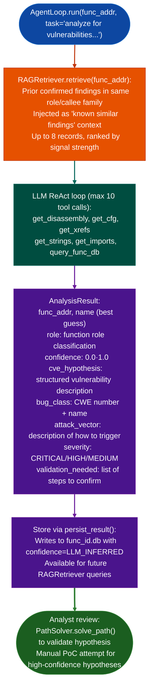

# Assisted Vulnerability Hypotheses

Generate candidate CVE explanations for suspicious function behavior using the LLM analyst loop: producing structured hypotheses with CWE classification, attack vector description, and confidence annotations, for later validation by `PathSolver` and manual PoC development.

---

## Why this exists

1. **When `TaintTracker` or `SinkArgClassifier` identifies a suspicious function, the analyst must formulate a hypothesis: what is the bug class, what is the attack vector, and is this exploitable?** Manually formulating this hypothesis requires reading the function's disassembly, understanding the protocol context, and cross-referencing with known CVE patterns: often 30–60 minutes per candidate. `AgentLoop.run(func_addr, task='analyze for vulnerabilities and propose a CVE hypothesis')` produces a structured initial hypothesis in under a minute using the LLM's knowledge of common firmware vulnerability patterns.

2. **`AnalysisResult.cve_hypothesis` is the output field for LLM vulnerability analysis**, it contains the LLM's assessment of the function's likely vulnerability class, the attack scenario, and a confidence score. Unlike naming which has a binary right/wrong answer, CVE hypotheses are starting points for validation, not final conclusions.

3. **`RAGRetriever` grounds hypotheses in prior confirmed findings**: a function with the same callee pattern as a previously-confirmed command injection site will receive a hypothesis grounded in that confirmed finding, increasing precision and reducing generic boilerplate output. Prior findings from `func_id.db` are injected as context before the LLM analyzes the function.

---

## How it works



---

## Usage

```python
from ablation.analyzers.llm_analyst.agent_loop import AgentLoop
from ablation.analyzers.binary_context import BinaryContext

ctx = BinaryContext.load_or_build('/path/to/target.elf')
loop = AgentLoop.from_context(ctx)

# Generate vulnerability hypothesis for a specific function
result = loop.run(
    func_addr=0x1000,
    task='analyze this function for security vulnerabilities and propose a CVE hypothesis'
)
print(f"Name: {result.name}")
print(f"Role: {result.role}")
print(f"Confidence: {result.confidence:.2f}")
print(f"Hypothesis: {result.cve_hypothesis}")

# Store result for later RAG retrieval
loop.persist_result(result)

# run_patch() — analyze a patched function to explain what was fixed
patch_result = loop.run_patch(func_addr=0x1000)
print(patch_result.cve_hypothesis)
```

---

## Example output

The following illustrates the hypothesis output format. Actual analysis is function-specific.

```
Name: process_multipart_body  (confidence 0.83)
Role: http_request_parser

Hypothesis:
  bug_class: CWE-122 (Heap-Based Buffer Overflow)
  attack_vector: Content-Length header value not validated before malloc(length)
    call at <va>. If length < sizeof(header) after subtraction, uint16 truncation
    wraps to large value → OOB write. Similar to confirmed finding in func_id.db:
    'parse_chunk_header' (product: <prior product>).
  severity: HIGH
  validation_needed:
    1. Confirm Content-Length is user-controlled (TaintTracker from recv())
    2. Verify no bounds check between recv() and malloc()
    3. PathSolver: is there a feasible path with length < 16?
```

---

## False positives

**LLM hypotheses may hallucinate vulnerability details not present in the actual disassembly.** The LLM has knowledge of common firmware CVE patterns and may apply them to a function that superficially resembles a known vulnerable function but is not actually vulnerable. Always validate with `PathSolver.solve_path()` and byte-verify at each asserted VA `ctx.bytes_at(va, n`).

**High `AnalysisResult.confidence` reflects the LLM's certainty about its analysis, not the probability that the function is exploitable.** Confidence 0.90 means the LLM is confident in its interpretation of the disassembly, it does not mean the vulnerability is confirmed. Treat confidence scores as hypothesis quality, not finding severity.

---

## Pipeline position

Run after `TaintTracker` or `SinkArgClassifier` identifies a suspicious function. The LLM hypothesis provides a structured starting point for `PathSolver` validation and manual PoC development, reducing the time from "suspicious function" to "confirmed finding" by pre-identifying the most likely bug class and attack vector.

---

## Reading output

`hypothesizeagent_loop, func_addr` returns a `VulnHypothesis`:

| Attribute | Content |
|:---|:---|
| `func_addr` | Virtual address of the analyzed function |
| `pre_screened` | `True` if dangerous callees were found in the pre-screen pass |
| `dangerous_sigs` | `list[str]`: callee names that triggered pre-screening |
| `vuln_notes` | Free-text vulnerability analysis from the LLM |
| `confidence` | Float 0.0–1.0: confidence of the hypothesis |
| `tool_calls` | Number of LLM tool calls used to reach the result |
| `finished` | `True` if the analysis completed without hitting the tool-call limit |

---

## See also

- [LLM Analyst Loop](llm-analyst-loop.md): `AgentLoop` internals: tool registry, budget governor, loop detector
- [Assisted Function Naming](assisted-function-naming.md): same loop for function naming tasks
- [Taint Analysis](taint-analysis.md): produces findings that feed into hypothesis generation
