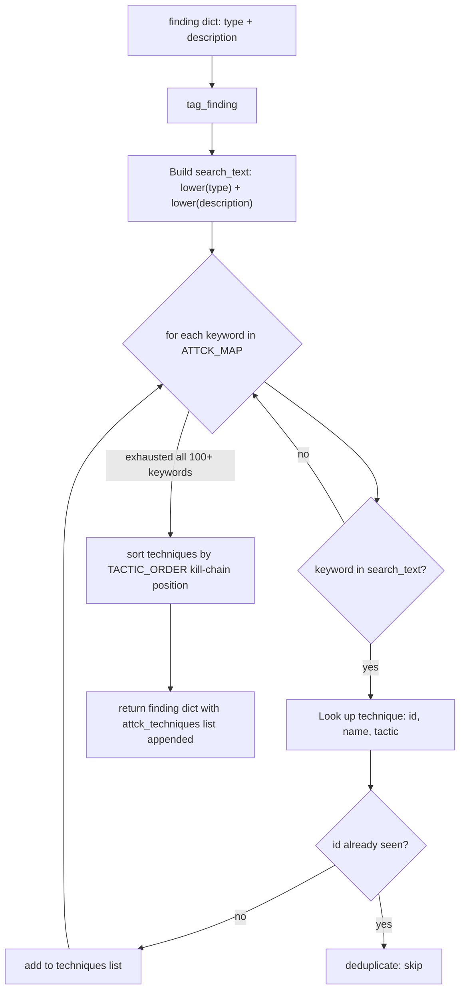

# ATT&CK Labeling

Automatically annotate Ablation findings with MITRE ATT&CK technique IDs and tactic labels by matching the finding's type and description text against a curated keyword-to-technique map ordered by the ATT&CK kill chain.

---

## Why this exists

1. **Findings without ATT&CK context are difficult to prioritize in threat-model terms.** A report that says "buffer overflow in SSL handler" is a technical finding. A report that additionally says "T1190 Exploit Public-Facing Application: Initial Access" tells the reader exactly where in the kill chain this vulnerability sits and what class of threat actor would use it. Without automatic tagging, this mapping must be done manually for every finding: a labor-intensive step that is typically skipped under time pressure.

2. **Security practitioners and leadership consume findings in ATT&CK vocabulary.** CISO presentations, threat-hunt playbooks, and red team reports all use ATT&CK technique IDs as the lingua franca for cross-team communication. Generating those IDs from Ablation's raw findings automatically bridges the gap between low-level RE output and high-level threat intelligence reporting.

3. **The mapping must respect kill-chain ordering for report readability.** ATT&CK defines 14 tactics in a logical sequence from Reconnaissance to Impact. When a finding maps to multiple techniques for example an unauthenticated RCE could be both T1190 Initial Access and T1059 Execution, the output sorted by tactic order communicates the attack progression clearly.

---

## How it works



### Keyword-to-technique mapping

The `ATTCK_MAP` dict maps lowercased keyword fragments to `{id, name, tactic}` dicts. Keywords are matched as substrings, not exact words, so `'unauthenticated'` matches `"unauthenticated RCE in login endpoint"`. 12 of 14 ATT&CK tactics are covered. Reconnaissance (TA0043) and Resource Development (TA0042) are excluded because firmware vulnerability findings do not map to pre-attack preparation activities.

| Tactic | Example mappings |
|---|---|
| Initial Access | `'unauthenticated'` → T1190, `'vpn'` → T1133, `'default cred'` → T1078 |
| Execution | `'rce'` → T1059, `'native api'` → T1106, `'scheduled task'` → T1053 |
| Persistence | `'dll hijack'` → T1574, `'run key'` → T1547.001, `'windows service'` → T1543.003 |
| Privilege Escalation | `'privesc'` → T1068, `'suid'` → T1548.001, `'process inject'` → T1055 |
| Defense Evasion | `'obfuscat'` → T1027, `'aslr disabled'` → T1562, `'lotl'` → T1218 |
| Credential Access | `'credential dump'` → T1003, `'jwt forge'` → T1134.001, `'brute force'` → T1110 |
| Discovery | `'port scan'` → T1046, `'directory traversal'` → T1083, `'snmp'` → T1082 |
| Lateral Movement | `'pass-the-hash'` → T1550.002, `'ntlm relay'` → T1187, `'smb'` → T1021.002 |
| Collection | `'mailbox'` → T1114, `'clipboard'` → T1115, `'nfs export'` → T1039 |
| Command and Control | `'beacon'` → T1071.001, `'web shell'` → T1505.003, `'dns c2'` → T1071.004 |
| Exfiltration | `'exfiltration'` → T1041, `'graph api'` → T1048 |
| Impact | `'ransomware'` → T1486, `'wiper'` → T1485, `'service stop'` → T1489 |

Deduplication: when multiple keywords match the same technique ID, only one entry appears in the output. This prevents a finding like "credential dump: shadow file dump" from producing two T1003 entries.

---

## Usage

```python
from ablation.core.attck_tagger import tag_finding, tag_findings_list

# Single finding
finding = {
    'type': 'STACK_OVERFLOW',
    'severity': 'HIGH',
    'description': 'unauthenticated buffer overflow in httpsd SSL handler — RCE possible',
}
tagged = tag_finding(finding)
for t in tagged['attck_techniques']:
    print(f"  {t['id']}  {t['name']}  ({t['tactic']})")
# T1190  Exploit Public-Facing Application  (Initial Access)
# T1059  Command and Scripting Interpreter  (Execution)

# Full findings list
from ablation.analyzers.heap_vuln_scanner import HeapVulnScanner
from ablation.analyzers.binary_context import BinaryContext

ctx = BinaryContext.load_or_build('/fw/fortigate/httpsd')
scanner = HeapVulnScanner.from_context(ctx)
raw_findings = scanner.scan()

# Convert to dict format and tag
finding_dicts = [
    {
        'type': f.kind,
        'severity': f.severity,
        'description': f.description,
    }
    for f in raw_findings
]
tagged_findings = tag_findings_list(finding_dicts)

# Display with ATT&CK context
for f in tagged_findings:
    print(f"[{f['severity']}] {f['type']}: {f['description']}")
    for t in f.get('attck_techniques', []):
        print(f"      {t['id']}  {t['name']}  [{t['tactic']}]")
```

---

## Example output

```json
[
  {
    "type": "int_overflow_before_alloc",
    "severity": "HIGH",
    "description": "IMUL result fed to malloc without overflow check",
    "attck_techniques": [
      {"id": "T1190", "name": "Exploit Public-Facing Application", "tactic": "Initial Access"}
    ]
  },
  {
    "type": "ASLR Disabled",
    "severity": "HIGH",
    "description": "Address Space Layout Randomization is disabled — ROP/heap spray facilitated",
    "attck_techniques": [
      {"id": "T1562", "name": "Impair Defenses", "tactic": "Defense Evasion"}
    ]
  },
  {
    "type": "SSH private key exposed",
    "severity": "HIGH",
    "description": "/root/.ssh/id_rsa — SSH lateral movement to any host in known_hosts",
    "attck_techniques": [
      {"id": "T1552.004", "name": "Private Keys", "tactic": "Credential Access"},
      {"id": "T1021.004", "name": "SSH", "tactic": "Lateral Movement"}
    ]
  }
]
```

---

## False positives

**Keyword collisions in short descriptions.** The keyword `'smb'` matches anything containing that substring: including a finding description mentioning "assembly SMB-like framing pattern" when the analyst meant something unrelated to SMB lateral movement. Add specific context to finding descriptions when generating them programmatically to avoid spurious matches.

**Over-tagging on multi-topic descriptions.** A long finding description that mentions multiple techniques in context "this overflow enables RCE from unauthenticated WAN, then lateral movement via pass-the-hash" will generate all matching techniques. This is correct behavior but the output can look alarming. Review the full finding context before presenting to stakeholders.

**Missing techniques.** The `ATTCK_MAP` covers the most common vulnerability-to-technique mappings but is not exhaustive. Firmware-specific techniques for example T1601 Modify System Image are not in the default map. To add a mapping: add a new keyword → technique entry to `ATTCK_MAP` in `ablation/core/attck_tagger.py`.

---

## Pipeline position

**Before this module:** Any Ablation scanner that produces finding dicts with `type` and `description` fields. There are no prerequisites beyond a populated finding.

**After this module:** The enriched findings with `attck_techniques` are ready for output to `FindingRegistry`, markdown report generation, or SKILLS-`<ip>`.md files.

---

## Reading findings

| Field | Content |
|:---|:---|
| `attck_techniques` | List of `{id, name, tactic}` dicts, sorted by ATT&CK kill-chain tactic order |
| `id` | ATT&CK technique ID for example `T1190`, `T1059.001` |
| `name` | Human-readable technique name |
| `tactic` | ATT&CK tactic name for example `Initial Access`, `Execution` |

---

## See also

- [Finding Registry](finding-registry.md): persistent storage for enriched findings
- [YARA Rule Generation](yara-generator.md): generate detection rules from confirmed findings
- [Named Taint Sources and Bounds](named-taint-sources-and-bounds.md): labeled taint tracking that preserves source identifiers through propagation
