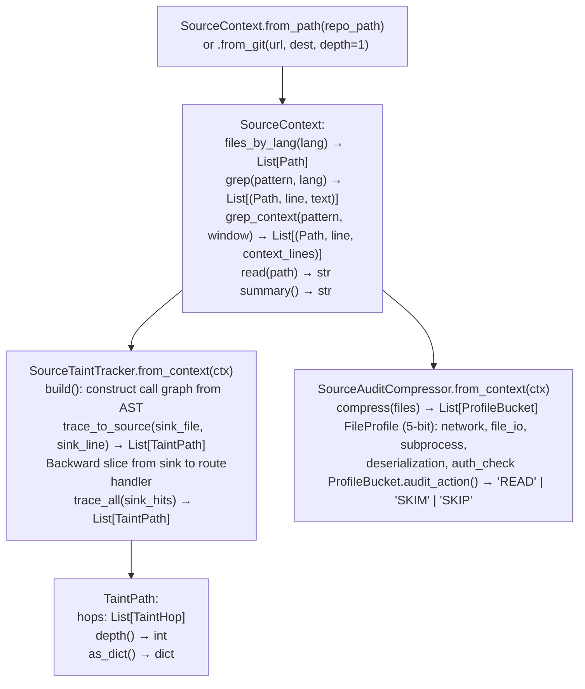

# Source Code Analysis Pipeline

Build a `SourceContext` index over a local or remote git repository — the source-code analog of `BinaryContext` — then run inter-procedural taint path tracing from dangerous sinks back to HTTP route handler trust boundaries, and compress large codebases into profiled audit buckets for systematic coverage.

---

## Why this exists

1. **Source RE requires the same systematic approach as binary RE: build a cached surface once, query it many times.** `SourceContext` is that surface — a fast, indexed view of a codebase that downstream source analyzers (`SourceSinkScanner`, `SourceTaintTracker`, `SourceAuditCompressor`) consume without re-scanning the file tree on every query. `SourceContext.grep()` and `grep_context()` provide pattern search across the full codebase with language filtering and context window output.

2. **`SourceTaintTracker.trace_to_source()` follows `SinkHit` findings backward through the call graph to HTTP route handler trust boundaries** — the source analog of binary `TaintTracker.run_interprocedural()`. Each `TaintPath` is a chain of `(file, line, function)` hops from the route handler down to the dangerous sink, providing the complete attack path without manual call graph traversal.

3. **`SourceAuditCompressor` addresses the coverage problem in large codebases** — it assigns each source file a 5-bit security profile (network access, file I/O, subprocess, deserialization, auth), buckets files with identical profiles, and returns one representative per bucket with an `audit_action` directive. This ensures systematic coverage: every security-relevant file pattern is reviewed at least once without reading identical-profile files multiple times.

---

## How it works



---

## Usage

```python
from ablation.analyzers.source_ingestion import SourceContext
from ablation.analyzers.source_taint_tracker import SourceTaintTracker
from ablation.analyzers.source_audit_compressor import SourceAuditCompressor
from ablation.analyzers.source_sink_scanner import SourceSinkScanner

ctx = SourceContext.from_path('/path/to/target_repo')
print(ctx.summary())

# Find dangerous sinks
scanner = SourceSinkScanner.from_context(ctx)
sink_hits = scanner.scan()

# Trace taint paths
tracker = SourceTaintTracker.from_context(ctx)
tracker.build()
paths = tracker.trace_all(sink_hits)
print(SourceTaintTracker.report(paths, ctx))

# Audit coverage planning
compressor = SourceAuditCompressor.from_context(ctx)
all_files = list(ctx.files_by_lang('python')) + list(ctx.files_by_lang('javascript'))
buckets = compressor.compress(all_files)
for bucket in buckets:
    rep = bucket.files[0]
    print(f"  {bucket.audit_action():5}  {bucket.profile_str()}  ({len(bucket.files)} files)  e.g. {rep.name}")
```

---

## Example output

The following illustrates source pipeline output format. Actual paths and line numbers are codebase-specific.

```
SourceContext: /path/to/target_repo
  Python: <N> files  JavaScript: <M> files  ...

SourceTaintTracker: <K> taint paths found

  Path 1 (depth=3):
    route_handler.py:<line>  handle_request()   [trust boundary]
    → utils.py:<line>        run_command()
    → utils.py:<line>        subprocess.call()  [SINK: CWE-78]

SourceAuditCompressor: <N> files → <K> buckets
  READ   [N_F_S_D_A]  (12 files) e.g. session_manager.py
  SKIM   [N_F___A]    (34 files) e.g. config_loader.py
  SKIP   [_____]      (98 files) e.g. constants.py
```

---

## False positives

**`SourceTaintTracker.build()` constructs the call graph from AST parsing** — dynamic dispatch through decorators, dependency injection, or framework routing (Django URL patterns, Flask route decorators) may not be fully captured. Verify `TaintPath` starting points by checking that the route handler is actually reachable from the attacker's perspective.

**`SourceAuditCompressor` profile bits are assigned by pattern matching** — a file that imports `subprocess` but never calls it may be assigned the `subprocess` profile bit, resulting in a `READ` action that is unnecessary. The profile errs toward inclusion to prevent missed coverage.

---

## Pipeline position

`SourceContext` is the entry point for all source RE analysis, equivalent to `BinaryContext` in binary RE. Build it first, then run `SourceSinkScanner`, `SourceTaintTracker`, and `SourceAuditCompressor` against it. `SourceAuditCompressor` should run before manual review to prioritize which files get full attention.

---

## See also

- [Source Dangerous Sink Detection](source-dangerous-sink-detection.md) — `SourceSinkScanner` that produces `SinkHit` inputs to `SourceTaintTracker`
- [Persistent Analysis Context](persistent-analysis-context.md) — `BinaryContext` binary analog of `SourceContext`
- [Assisted Vulnerability Hypotheses](assisted-vulnerability-hypotheses.md) — LLM hypothesis generation for source-level `TaintPath` findings
