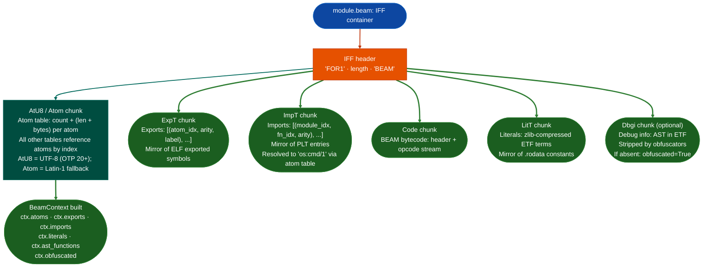

# BeamContext

**File:** `ablation/analyzers/beam_context.py`

`BeamContext` extracts the attack surface from a compiled Erlang `.beam` file. The model mirrors ELF binary RE: exports approximate ELF exported symbols, imports approximate PLT entries, atoms approximate the string table, literals approximate `.rodata`. Once the surface is mapped, dangerous import patterns and atom signals drive the same triage flow as binary RE.

---

## What this is <sup>[↑](#beamcontext)</sup>

Erlang applications compile to `.beam` files, one per module, using the IFF container format. Standard RE tools built for ELF or PE cannot read this format, so Erlang services are opaque to the normal Ablation pipeline. `BeamContext` maps BEAM structure to ELF-equivalent concepts: exports become symbols, imports become PLT entries, atoms become the string table. The same triage workflow then applies to OTP applications, Elixir services, and any BEAM-platform infrastructure.

---

## Where it's used <sup>[↑](#beamcontext)</sup>

- **OTP applications**: `ebin/` directories from compiled Erlang/OTP releases
- **Elixir Mix releases**: precompiled BEAM files in Mix release directories
- **BEAM-platform services**: RabbitMQ, ejabberd, Riak, and similar infrastructure
- Any file starting with the `FOR1` IFF magic where the form type is `BEAM`

---

## Safe usage <sup>[↑](#beamcontext)</sup>

**Check `ctx.obfuscated` before relying on function names.** An obfuscated BEAM file has its `Dbgi` chunk stripped so `ast_functions` is empty and export/import analysis is the only available path. Reporting zero dangerous imports on an obfuscated module without flagging the obfuscation is a false negative.

**Filter `erlang:apply` separately from code-execution findings.** `erlang:apply` DISPATCH severity appears in almost every OTP application as a routing mechanism. Mixing DISPATCH findings with CODE_EXEC findings hides the actual high-risk imports.

**Use `sweep_beam_dir()` for OTP applications.** An OTP release has dozens of `.beam` files. Analyzing one module in isolation misses import chains that cross module boundaries.

**Verify magic bytes before constructing.** `BeamContext.from_path()` raises `ValueError` for non-BEAM files. Filter a sweep directory for `b'FOR1'` at offset 0 before passing paths so the error does not terminate the sweep.

---

## Why this exists <sup>[↑](#beamcontext)</sup>

Two things blocked BEAM security analysis before this module:

**1. No Erlang-native equivalent of PLT scanning.**
In ELF binaries, the PLT is the authoritative list of external function calls. Finding `system` or `popen` in a C binary means scanning the import table. In BEAM, the equivalent is the ImpT Import Table chunk, but it encodes calls as `{Module, Function, Arity}` tuples in Erlang's External Term Format (ETF), not as symbol table entries. No tool exposed this as a queryable Python API. `BeamContext.imports` provides `dangerous_imports(min_severity=...)` with the same interface as a PLT scan.

**2. Obfuscation detection required manual chunk inspection.**
Erlang obfuscators strip or corrupt the `Dbgi` debug chunk and the `AtU8` atom table. Without these chunks, a BEAM file has no readable function names or source locations. `BeamContext.obfuscated` and `ctx.obfuscation_indicators` expose this as a flag rather than requiring the analyst to read the IFF chunk headers manually.

---

## How BEAM files are structured <sup>[↑](#beamcontext)</sup>

A BEAM file is an IFF Interchange File Format container. IFF was designed for structured binary data exchange. The BEAM format uses it to pack all module information into one file with self-describing chunk types.

```
  IFF header (12 bytes):
    "FOR1"   4 bytes: IFF form marker
    length   4 bytes BE: total file size minus 8
    "BEAM"   4 bytes: form type identifier

  Each chunk that follows:
    chunk_id  4 bytes ASCII tag (e.g. "AtU8", "Code")
    length    4 bytes BE: payload size
    payload   length bytes, padded to 4-byte alignment
```



The atom table is the foundation of all other tables. Exports, imports, and literals all reference atoms by index. `AtU8` is the UTF-8 atom table (OTP 20+). `Atom` is the Latin-1 predecessor. `BeamContext` tries `AtU8` first and falls back to `Atom`.

The ImpT entries encode calls as three atom indices: `module_atom_idx, function_atom_idx, arity`. `BeamContext` resolves these to readable `"os:cmd/1"` strings using the atom table.

---

## BeamContext <sup>[↑](#beamcontext)</sup>

### Build and load <sup>[↑](#beamcontext)</sup>

```python
from ablation.analyzers.beam_context import BeamContext

ctx = BeamContext.from_path('/path/to/module.beam')
print(ctx.summary())
# BeamContext
# BeamContext
# BeamContext
```

### What gets extracted <sup>[↑](#beamcontext)</sup>

| Chunk | Field | Analog in ELF |
|---|---|---|
| ExpT | `exports` | ELF exported symbols |
| ImpT | `imports` | PLT entries |
| AtU8 / Atom | `atoms` | String table |
| LitT | `literals` | `.rodata` constants ETF-decoded |
| StrT | `strings` | Raw string table segments |
| Dbgi | `ast_functions` | DWARF debug info: source file, function names, line numbers |

### Atom and string search <sup>[↑](#beamcontext)</sup>

```python
for atom in ctx.atoms:
    if any(kw in atom for kw in ('password', 'secret', 'token', 'key', 'admin')):
        print(f"[atom] {atom}")

for s in ctx.strings:
    if 'sql' in s.lower() or 'exec' in s.lower():
        print(f"[str]  {s}")
```

### Dangerous import detection <sup>[↑](#beamcontext)</sup>

```python
from ablation.analyzers.beam_context import BeamContext, SEVERITY_CODE_EVAL

ctx = BeamContext.from_path('/path/to/module.beam')
dangerous = ctx.dangerous_imports(min_severity=SEVERITY_CODE_EVAL)
for imp in dangerous:
    print(f"[{imp.severity}] {imp.module}:{imp.function}/{imp.arity}")
```

### Severity tiers <sup>[↑](#beamcontext)</sup>

| Constant | Meaning |
|---|---|
| `SEVERITY_DISPATCH` | Dynamic dispatch (`erlang:apply`); very common in OTP |
| `SEVERITY_NETWORK` | Outbound connections `ssl:connect`, `gen_tcp:connect`, `httpc:request` |
| `SEVERITY_INFO` | Local system enumeration (`inet:getifaddrs`) |
| `SEVERITY_CODE_EVAL` | Runtime code loading or ETF AST evaluation `erl_eval:exprs`, `code:load_binary` |
| `SEVERITY_CODE_EXEC` | OS-level process execution or port driver spawn `os:cmd`, `erlang:open_port` |

### High-risk import signatures <sup>[↑](#beamcontext)</sup>

| Module | Function | Severity | What it does |
|---|---|---|---|
| `os` | `cmd` | CODE_EXEC | Execute OS shell command |
| `erlang` | `open_port` | CODE_EXEC | Spawn OS subprocess or port driver |
| `erl_eval` | `exprs` | CODE_EVAL | Evaluate Erlang AST at runtime |
| `code` | `load_binary` | CODE_EVAL | Hot-load module from binary blob |
| `ssl` | `connect` | NETWORK | Outbound TLS connection |
| `gen_tcp` | `connect` | NETWORK | Outbound TCP connection |
| `erlang` | `apply` | DISPATCH | Dynamic dispatch high volume |

### Why `erlang:open_port` is dangerous <sup>[↑](#beamcontext)</sup>

`erlang:open_port({spawn, "ls -la"}, [])` executes an OS command in a subprocess and returns its output. It is Erlang's equivalent of `popen`. Unlike `os:cmd` (which shells through `/bin/sh`), `open_port` with `{spawn_executable, "/bin/sh"}` passes arguments directly. Both patterns are CODE_EXEC severity.

### Obfuscation detection <sup>[↑](#beamcontext)</sup>

```python
if ctx.obfuscated:
    print(f"Obfuscation indicators: {ctx.obfuscation_indicators}")
    # e.g. ['missing Dbgi chunk', 'stripped atom table']
```

Missing or stripped chunks indicate deliberate obfuscation. A missing Dbgi chunk means no source-level function names or line numbers. Triage falls back to export/import analysis only.

### Source-level function list <sup>[↑](#beamcontext)</sup>

When the Dbgi chunk is present, `ast_functions` gives AST-level function definitions:

```python
for fn in ctx.ast_functions:
    print(fn)   # "handle_call/3  line 142"
```

---

## Sweeping a release directory <sup>[↑](#beamcontext)</sup>

OTP applications compile to a directory of `.beam` files under `ebin/`. Sweep the whole directory at once:

```python
from ablation.analyzers.beam_context import sweep_beam_dir, fmt_sweep, SEVERITY_CODE_EXEC

results = sweep_beam_dir('/path/to/app/ebin/')
print(fmt_sweep(results, min_severity=SEVERITY_CODE_EXEC))
```

### Diffing releases <sup>[↑](#beamcontext)</sup>

```python
from ablation.analyzers.beam_context import sweep_beam_diff, fmt_sweep_diff

diff = sweep_beam_diff(
    '/path/to/app-1.0/ebin/',
    '/path/to/app-1.1/ebin/',
)
print(fmt_sweep_diff(diff))
# BeamContext
```

---

## CLI <sup>[↑](#beamcontext)</sup>

```bash
# BeamContext
python3 -m ablation.analyzers.beam_context /path/to/module.beam

# BeamContext
python3 -m ablation.analyzers.beam_context --dir /path/to/ebin/

# BeamContext
python3 -m ablation.analyzers.beam_context --diff /path/v1/ebin/ /path/v2/ebin/

# BeamContext
python3 -m ablation.analyzers.beam_context --dir /path/to/ebin/ --min-severity CODE_EXEC
```

---

## How it works <sup>[↑](#beamcontext)</sup>

Parses the runtime-specific binary format APK, DEX, `.mpy`, BEAM, Go ELF to extract the class/function/module structure, import graph, and callable inventory. Dangerous API calls are identified by matching against a curated sink list for the runtime. For runtimes that support decompilation, a pseudo-code representation is generated for each dangerous call site to assist manual review.

---

## Usage <sup>[↑](#beamcontext)</sup>

```python
from ablation.analyzers.beam_context import BeamContext, SEVERITY_CODE_EXEC

ctx = BeamContext.from_path('/path/to/target.beam')
print(ctx.summary())

dangerous = ctx.dangerous_imports(min_severity=SEVERITY_CODE_EXEC)
for imp in dangerous:
    print(f"[{imp.severity}] {imp.module}:{imp.function}/{imp.arity}")
```

---

## Example output <sup>[↑](#beamcontext)</sup>

```
[HIGH] DANGEROUS_CALL   Runtime.exec() in com.example.CommandHandler:42
  detail: argument constructed from user-supplied intent extra
  evidence: exec(getIntent().getStringExtra("cmd"))

[MEDIUM] UNTRUSTED_INPUT   eval() in main.js:118
  detail: JSON.parse result passed directly to eval
```

---

## False positives <sup>[↑](#beamcontext)</sup>

Standard library calls that resemble dangerous patterns for example `exec` used for shell completions, `eval` used for template rendering with static input are not findings. Confirm that the argument reaching the dangerous call is user-controlled before escalating. Obfuscated code Garble-compiled Go, ProGuard-stripped Android produces incomplete call graphs: findings from incomplete graphs carry lower confidence.

---

## Pipeline position <sup>[↑](#beamcontext)</sup>

**Before this module:** Confirm the target binary format APK, `.mpy`, BEAM, Go ELF before loading. `BinaryContext` is not required for all runtime analyzers.

**After this module:** Feed dangerous call findings to `TaintTracker` or `FindingRegistry` for confirmed findings.

---

## Reading output <sup>[↑](#beamcontext)</sup>

`BeamContext.from_path(path)` returns a `BeamContext` object, this is the parsed module surface, not a list of findings:

| Attribute | Content |
|:---|:---|
| `path` | Path to the `.beam` file |
| `module_name` | Erlang module name string |
| `atoms` | `List[str]`: all atom strings in the module |
| `exports` | `List[BeamExport]`: exported functions as `function/arity` |
| `imports` | `List[BeamImport]`: imported functions; dangerous ones have `dangerous=True` and a `severity` string |
| `literals` | `List[str]`: ETF-decoded literal representations |
| `strings` | `List[str]`: raw StrT byte segments |
| `source_file` | Original `.erl` filename only when debug info is present |
| `ast_functions` | `List[BeamAstFunction]`: function names with source line numbers |

Dangerous imports are identified inline: `import.dangerous == True` and `import.severity` in `('CRITICAL'/'HIGH'/'MEDIUM')`.

---

## See also <sup>[↑](#beamcontext)</sup>

- [BinaryContext](binary-context.md): native binary context when the runtime wraps a native library
- [TaintAnalysis](taint-analysis.md): trace dangerous calls found in the runtime layer
- [FindingRegistry](registry.md): record confirmed findings
