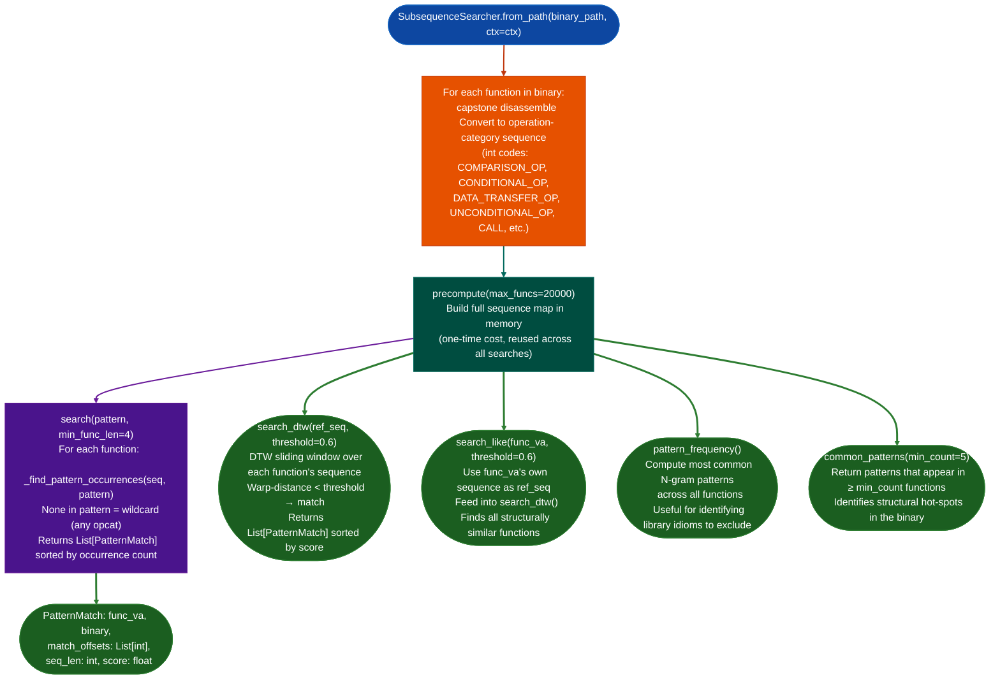

# Behavioral Subsequence Search

Find all functions in a binary that contain a specified behavioral operation-category subsequence: using exact pattern matching with wildcards, DTW approximate matching, or "find all functions that look like this one": without requiring symbols or source.

---

## Why this exists

1. **Semantic search finds functions by name similarity; behavioral subsequence search finds functions by control-flow and operation pattern: the two are complementary.** A stripped binary where every handler is named `sub_XXXXXXXX` may have functions that look structurally identical to a known-vulnerable handler from a different target. `SubsequenceSearcher.search_like()` uses an existing confirmed function's operation-category sequence as the query and finds all structurally similar functions, even across architectures.

2. **Exact subsequence patterns answer questions like "find all functions that contain a COMPARISON_OP followed by a CONDITIONAL_OP followed by a CALL": a pattern that identifies bounds-checked call sites, or its absence identifies unchecked sinks.** The `None` wildcard matches any operation category, allowing patterns like `[COMPARISON_OP, None, None, CALL]` that tolerate two intervening operations between the comparison and the call.

3. **DTW approximate search (`search_dtw()`) finds structural matches even when the implementation uses slightly different instruction sequences: for example, a function that inlines one extra register move before the syscall.** DTW Dynamic Time Warping warp-distance matching handles small insertions within the target sequence. The `threshold` and `window_scale` parameters control how much structural variation is tolerated.

---

## How it works



---

## Usage

```python
from ablation.analyzers.subsequence_searcher import SubsequenceSearcher
from ablation.analyzers.binary_context import BinaryContext

ctx = BinaryContext.load_or_build('/path/to/binary')
ss = SubsequenceSearcher.from_path('/path/to/binary', ctx=ctx)
ss.precompute()   # builds full sequence map

# Exact pattern: comparison → conditional → call (with wildcards)
from ablation.analyzers.subsequence_searcher import SubsequenceSearcher
pattern = SubsequenceSearcher.pattern('COMPARISON_OP:CONDITIONAL_OP:None:None:CALL')
matches = ss.search(pattern)
for m in matches[:10]:
    print(f"  {m.func_va:#x}  occurrences={len(m.match_offsets)}")

# "Find all functions that look like this one"
confirmed_va = 0x401200   # confirmed vulnerable handler
similar = ss.search_like(confirmed_va, threshold=0.5)
for m in similar:
    print(f"  {m.func_va:#x}  score={m.score:.2f}")

# DTW approximate search from an explicit sequence
ref = [3, 3, 2, 5, 4]   # op-category sequence from a reference function
dtw_matches = ss.search_dtw(ref, threshold=0.6, max_funcs=20000)

# Common patterns (library idiom identification)
common = ss.common_patterns(min_count=10)
```

---

## Example output

The following illustrates the search result format. Actual addresses and patterns are binary-specific.

```
Exact pattern [COMPARISON_OP, CONDITIONAL_OP, None, CALL]:
  <func-va>  occurrences=3  seq_len=47
  <func-va>  occurrences=1  seq_len=22
  <func-va>  occurrences=2  seq_len=31

search_like(<va>, threshold=0.5):
  <func-va>  score=1.00   (self)
  <func-va>  score=0.82
  <func-va>  score=0.71
```

---

## False positives

**`search_like()` uses DTW on operation-category sequences, not instruction semantics: structurally similar functions may be entirely different in intent.** A match score of 0.8 means the sequence of operation categories is 80% similar, not that the function computes the same thing. Always disassemble top matches manually before confirming.

**`precompute(max_funcs=20000)` caps the function count: binaries with more than 20,000 detected functions silently stop at the cap.** Increase `max_funcs` on large binaries for example statically linked Go or C++ STL binaries. Missing functions are not reported; they simply don't appear in search results.

---

## Pipeline position

Run `SubsequenceSearcher` after `SemanticSearcher` has identified the top candidates for a vulnerability class. Use `search_like()` with a confirmed candidate to find structural relatives in the same binary: catching alternative handlers that semantic search missed because their string content differs. The search operates on pre-computed operation-category sequences and is fast ~1-2 seconds for 10,000 functions after `precompute(`).

---

## Reading output

`SubsequenceSearcher.search(pattern)` returns a list of match dicts:

| Field | Content |
|:---|:---|
| `func_va` | Virtual address of the matching function |
| `occurrences` | Count of times the pattern occurs within the function |
| `seq_len` | Total instruction count of the function |

`SubsequenceSearcher.search_likeva, threshold` returns matches ranked by DTW similarity score:

| Field | Content |
|:---|:---|
| `func_va` | Virtual address of the similar function |
| `score` | DTW similarity score (0.0–1.0; 1.0 = identical) |

---

## See also

- [Semantic Search](semantic-search.md): name/description similarity; complementary to behavioral subsequence search
- [FuncProfiler](func-profiler.md): per-function profile with operation-category distribution
- [DTW Matcher](dtw-matcher.md): underlying DTW engine also used by patch analysis
- [Taint Analysis](taint-analysis.md): next step after behavioral matches identify candidate sinks
