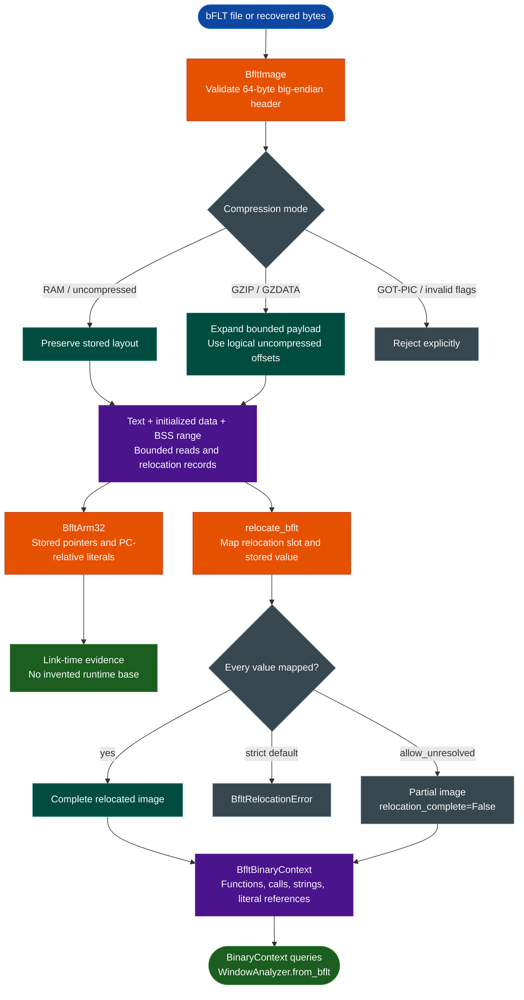

<a id="bflt-binary-flat-format"></a>
# bFLT (Binary Flat Format)

`BfltImage`, `BfltArm32`, and `BfltBinaryContext` provide one bounded workflow for **binary Flat (`bFLT`)** executables: validate the container, recover text/data/BSS and link-time references, apply supported Linux RAM relocations, and build an analysis context with functions, calls, strings, and literal references.

**bFLT means binary Flat. It does not mean binary Floating Point and is not bfloat16.** It is an executable container used mainly by uClinux and other embedded or no-MMU Linux environments. It is unrelated to IBM Granite foundation models, IBM Storage Scale, NVIDIA BlueField, floating-point data types, or machine-learning precision formats.

---

## Why this exists

1. **Flat executables still have structure.** Headers, entry points, text, initialized data, BSS, pointers, and relocation records must be separated before disassembly. Treating every byte as an instruction produces invalid analysis.

2. **The format and the ISA are different layers.** bFLT v4 stores header fields in big-endian order even when the target contains little-endian ARM instructions. Pointer and relocation endianness must be established independently rather than inferred from instruction decoding.

3. **File addresses are not necessarily runtime addresses.** A self-relocating program can adjust stored pointers for a selected load base. Link-time references remain useful evidence, but a relocated context is required when the analysis question concerns runtime values.

4. **One workflow needs explicit boundaries.** Parsing, link-time reference recovery, and relocation-aware context construction have different responsibilities and uncertainty. Keeping those boundaries visible prevents a partial or wrongly mapped image from looking authoritative.

---

## How it works



The three APIs remain separate so callers can choose the appropriate evidence level. They are documented as one capability because they form one analysis path rather than three unrelated format readers.

---

## Container and address model

### What “flat” means

Flat addresses in `BfltImage` are offsets in an image whose first byte is the 64-byte bFLT header. They are not automatically physical addresses, ELF virtual addresses, or an operating system's chosen runtime base.

```text
0x00               64-byte header
0x40               text (entry normally points here)
entry..data_start   executable bytes
data_start..data_end initialized data
data_end..bss_end    zero-initialized BSS, not stored in memory_image
reloc_start         physical relocation table in the input file
```

Text and initialized data have stored bytes. BSS describes memory that should be zero-initialized and therefore has a range but no file payload. The relocation table belongs to the file layout, not to `data_bytes`.

This prevents reading BSS as stored data, disassembling the relocation table, or assuming that a flat offset is a proven hardware address.

### Supported flags

| Flag | Meaning | Handling |
|---|---|---|
| `RAM` (`0x01`) | Contiguous RAM layout | Supported |
| `GOTPIC` (`0x02`) | Position-independent GOT layout | Rejected until that relocation model is implemented |
| `GZIP` (`0x04`) | Everything after the header is compressed, including relocation data | Supported with bounded expansion |
| `GZDATA` (`0x08`) | Header and text are stored; data and relocation data are compressed | Supported with bounded expansion |
| `KTRACE` (`0x10`) | Loader tracing request | Preserved as metadata; no execution or tracing |

Simultaneous compression modes are rejected. For compressed images, `reloc_start` is a logical uncompressed offset and must equal `data_end`; it is not an offset into the compressed file.

The parser enforces revision, reserved fields, coherent ranges, input limits, output limits, relocation bounds, and decompression sizes. Defaults limit input and constructed memory to 64 MiB. Invalid gzip streams, unsupported flags, truncated relocations, and output-size mismatches raise `BfltError`.

---

## Parse an executable

```python
from ablation.parsers.bflt import BfltImage

image = BfltImage.from_path('/path/to/tinyws')
print(image.metadata())

code = image.text_bytes
constants = image.data_bytes
entry_word = image.read_memory(image.entry, 4)
assert code == image.memory_image[0x40:image.data_start]
```

`from_bytes()` accepts a program recovered from a filesystem. `metadata()` reports ranges, entry, BSS end, flags, compression, relocation count, and trailing bytes. `read_memory()` rejects reads beyond initialized memory.

The parser does not infer an ISA or apply relocations. Confirm the processor independently; bFLT revision 4 is a container version, not an architecture identifier. The same container parser can serve different ISAs when their analysis models are implemented.

---

## Recover ARM32 link-time references

`BfltArm32` resolves aligned stored pointers and supported PC-relative ARM32 literal-pool references in an already validated image. The caller must establish little-endian ARM state and explicitly select pointer byte order.

Consider:

```text
0x40: ldr r0, [pc, #4]
0x44: ...
0x48: ...
0x4c: 00 02 00 00
```

In ARM state, the instruction's PC is `0x48`, so the load reads the word at `0x4c`. If that word is big-endian, its stored value is `0x00020000`:

```text
instruction at 0x40 → literal at 0x4c → stored value 0x20000
```

There are two separate hops. Decoding the literal as another instruction loses the reference, using native byte order can produce the wrong value, and treating the stored value as a final runtime address can be wrong after self-relocation.

```python
from ablation.analyzers.bflt_arm32 import BfltArm32
from ablation.parsers.bflt import BfltImage

image = BfltImage.from_path('/path/to/program')
context = BfltArm32(image, pointer_byteorder='big')

print(hex(context.read_pointer(0x4C)))  # 0x20000
for reference in context.literal_references(0x20000):
    print(hex(reference.instruction_address),
          hex(reference.literal_address),
          hex(reference.value))
```

Available operations include:

- `instructions(start=0x40, end=None)`: bounded, four-byte-aligned instruction decoding inside text.
- `read_pointer(address)`: one explicitly endian 32-bit stored-pointer read.
- `pointer_references(target, start=0x40, end=None)`: aligned candidate words in initialized memory.
- `literal_references(target)`: supported PC-relative loads whose stored pointer equals `target`.
- `literal_references(target, dereference=False)`: loads whose literal-pool slot itself equals `target`; the returned value is `None`.
- `literal_address(insn)`: the supported ARM-state PC-relative calculation.

An aligned pointer is only a candidate. A two-level literal reference is stronger instruction-level evidence, but it remains link-time evidence until relocation is applied. Thumb, big-endian ARM, register-relative constructions, and unsupported load forms are outside this reader's coverage.

---

## Build a relocation-aware BinaryContext

`BfltBinaryContext` applies supported Linux RAM relocations, creates zero-filled BSS, and exposes functions, direct calls, strings, literal references, and caller/callee indexes through the shared context interface.

For a contiguous RAM layout, if `base_va` is the runtime address of the 64-byte header, an image-relative value `r` maps as:

```text
runtime_address = base_va + 0x40 + r
```

The valid relative range is `0 .. bss_end - 0x40`. Each relocation entry requires two mappings:

```text
entry offset → mapped relocation slot → stored pointer value → relocated value
```

The slot and the value have different meanings and both must be mapped. Zero-valued pointers remain zero. Out-of-range slots fail even when unresolved values are allowed. Relocated pointers in this ARM32 model are written in little-endian runtime order, independently of stored file order.

The implementation follows the [Linux bFLT loader](https://github.com/torvalds/linux/blob/master/fs/binfmt_flat.c) and the [elf2flt producer](https://github.com/uclinux-dev/elf2flt), without executing the program or emulating a complete process.

### Strict and partial outcomes

The default is strict: an unmapped stored value raises `BfltRelocationError` with its entry index and slot. This prevents a plausible but incorrect runtime image from silently driving later analysis.

With `allow_unresolved=True`, unresolved words are preserved and recorded:

- `UNRESOLVED_OUT_OF_RANGE`: no main-image mapping exists.
- `UNRESOLVED_SHARED_LIBRARY`: a nonzero library identifier has no supplied library mapping.

`relocation_complete` is then false and `unresolved_relocations` contains the evidence. **A partial model is not a guaranteed runtime image.**

### Usage

```python
from ablation.analyzers.bflt_context import BfltBinaryContext

ctx = BfltBinaryContext.from_path(
    '/path/to/program',
    base_va=0,
    pointer_byteorder='big',
    allow_unresolved=False,
)

print(ctx.summary())
print(ctx.metadata())
for record in ctx.relocations[:4]:
    print(record)
```

`from_bytes()` accepts a complete stored file. `from_image()` accepts a previously parsed `BfltImage`. Complete original bytes determine the context SHA-256 when available; otherwise the parsed image and relocation table are hashed rather than pretending to identify the original file.

The context exposes:

- `memory_image`: relocated header, text, initialized data, and zero-filled BSS.
- `relocations` and `unresolved_relocations`: entry index, offset, slot, stored/relocated values, and status.
- `relocation_complete`: whether every entry was applied.
- `read_memory(address, size)`: bounded reads in the selected address model.
- `func_starts`: entry, direct-call targets, and ARM prologue candidates.
- `call_edges`: direct `BL`/`BLX` edges inside text.
- `strings`: printable strings in initialized data.
- `literal_references(target)`: supported PC-relative references to a relocated pointer.
- `string_xrefs()`, `strings_in_func()`, `funcs_referencing_string()`, `callers_of()`, and `callees_of()`: shared context queries.

`BfltBinaryContext` subclasses `BinaryContext`; it does not need an ELF parser or fabricated ELF section table.

---

## Window analysis

`WindowAnalyzer.from_bflt(ctx)` uses the relocated image and text bounds rather than reparsing the file as ELF.

```python
from ablation.analyzers.window_analyzer import WindowAnalyzer

wa = WindowAnalyzer.from_bflt(ctx)
print(wa.dump_text(0x1518, window=256))
print(wa.calls_in_window(0x1518, window=0x300))
```

This is the appropriate path for relocated function windows, direct-call inspection, and string references. Other analyzers that reparse `ctx.path` as ELF still need their own bFLT-aware path.

---

## What this provides

The unified workflow turns a recovered flat executable into bounded, reviewable analysis without requiring its original operating system:

- A reusable bFLT v4 parser with compression and resource checks.
- Explicit pointer-endian link-time reference recovery.
- Relocation records with strict or explicitly partial outcomes.
- A shared context for function, call, string, and literal-reference analysis.
- A window-analysis path that respects the relocated address model.

It is not a bFLT decompiler, operating-system emulator, complete function-boundary proof, or vulnerability verdict. The value is making container, link-time, relocation, and analysis evidence available without hiding their differences.

---

## Limitations and review checklist

1. Preserve the original file hash and confirm the ISA independently.
2. Disassemble from `image.entry`, not an assumed ELF virtual base.
3. Select pointer and relocation byte orders from target evidence, not instruction endianness alone.
4. Do not mistake link-time pointers for final runtime addresses after self-relocation.
5. Account for zero-filled BSS; it is not stored in the parser's `memory_image`.
6. GOT-PIC and simultaneous compression modes fail explicitly. Shared-library values need corresponding library mappings.
7. Function entries and prologues are candidates, not complete boundaries or a complete CFG. Indirect calls are not resolved automatically.
8. Empty `plt` and `exports` do not prove the absence of library calls; this model has no dynamic symbol table.
9. Valid layout, decoded instructions, and relocated pointers do not establish reachability, authentication, complete firmware, or a vulnerability.

Run related tests with:

```bash
python3 -m pytest -q tests/test_bflt.py tests/test_bflt_context.py
```

---

## Related workflows

- [BinaryContext](binary-context.md) documents the shared context interface and its limits.
- [WindowAnalyzer](window-analyzer.md) documents bounded function and disassembly windows.
- [JFFS2 Filesystem Recovery](jffs2.md) covers filesystem images from which bFLT programs can be recovered.
- [CAEN ASCII-Hex Firmware Containers](caen-ascii-hex.md) covers the separate CAEN transport format.
- [Firmware Parsing: From Artifacts to Analysis](firmware-parsing.md) places this workflow in the broader firmware pipeline.

### API map

| API | Responsibility |
|---|---|
| `ablation.parsers.bflt.BfltImage` | Bounded bFLT v4 parsing, decompression, regions, and stored reads |
| `ablation.analyzers.bflt_arm32.BfltArm32` | Explicit-endian stored pointers and PC-relative literal references |
| `ablation.analyzers.bflt_context.relocate_bflt` | Relocation-slot/value mapping and explicit unresolved outcomes |
| `ablation.analyzers.bflt_context.BfltBinaryContext` | Relocated memory, functions, calls, strings, and context queries |
| `ablation.analyzers.window_analyzer.WindowAnalyzer` | Relocated bFLT window analysis |
