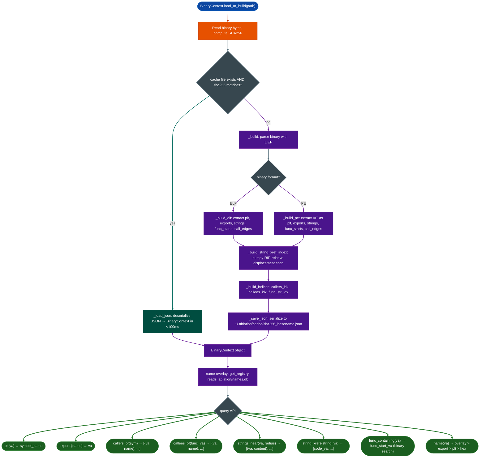

# Binary Context

Pre-compute and cache the complete working context for a stripped binary: PLT symbol map, export table, `.rodata` strings, function entry-point list, and full call graph: then expose it as a persistent, session-start-ready object that every downstream Ablation tool consumes.

---

## Why this exists

1. **ELF parsing from scratch takes 2–5 seconds per binary.** In a real RE session, the analyst restarts Claude Code multiple times, switches between tools, and re-runs analyses with different parameters. Without a cache layer, every session start re-parses a 10MB firmware image: paying the LIEF overhead repeatedly. `BinaryContext` builds the context once, serializes it to `~/.ablation/cache/`, and reloads in under 100ms on all subsequent sessions. The binary's SHA256 is the cache key; if the binary changes, the cache automatically invalidates.

2. **Every Ablation analysis tool needs the same foundational data.** `TaintTracker` needs `func_starts` and the PLT allocator set. `SemanticSearcher` needs named functions and call targets. `HeapVulnScanner` needs `func_starts` and PLT free/malloc symbols. `FormatStringScanner` needs the PLT format-function map and `.rodata` VA ranges. Rather than each tool re-parsing the binary independently, all tools share one `BinaryContext` object built by `load_or_build()`. This eliminates redundant parsing and ensures consistent symbol resolution across tools.

3. **Discovered function names must persist across sessions.** When an analyst confirms a function's identity (`ctx.set_name(0x22ccc0, "recv_handler")`), that name must be available in the next session without re-analysis. The name overlay registry writes to disk immediately and is read back on every `name()` call. The overlay takes precedence over export symbols and PLT stubs, so manually confirmed names are never overridden by automated inference.

4. **Multi-architecture firmware requires a single consistent interface.** Ablation targets span ELF on x86_64, ARM64, ARM32, MIPS32, MIPS64, LoongArch64, RISC-V, PowerPC, and Windows PE on x86_64/x86_32. Every downstream tool would otherwise need format-specific code paths. `BinaryContext` abstracts these away: the same `ctx.func_starts`, `ctx.plt`, `ctx.call_edges` are populated regardless of whether the binary is a Fortinet ARM64 ELF or a Cisco x86_64 PE.

---

## How it works



### Context fields

| Field | Type | Content |
|---|---|---|
| `plt` | `Dict[int, str]` | VA → symbol name for all PLT stubs and dynamic imports |
| `exports` | `Dict[str, int]` | Symbol name → VA for all globally exported functions |
| `strings` | `Dict[int, str]` | VA → printable ASCII string length ≥ 4 from `.rodata` |
| `func_starts` | `List[int]` | Sorted list of function entry VAs from `.eh_frame` + callee augmentation |
| `call_edges` | `List[Tuple[int, int, str]]` | `from_va, to_va, label` flat call graph |
| `thumb_funcs` | `Set[int]` | VAs of ARM Thumb-encoded functions |
| `arch` | `str` | Architecture string: `x86_64`, `arm64`, `arm32`, `mips32`, `loongarch64`, etc. |
| `sha256` | `str` | SHA256 hex digest of the binary cache invalidation key |
| `base_va` | `int` | Load base VA 0 for PIE, non-zero for fixed-load binaries |

### Supported architectures

| Architecture | Binary format | Notes |
|---|---|---|
| x86_64 | ELF, PE | Full support; primary development target |
| x86_32 | ELF, PE | Full support |
| ARM64 (AArch64) | ELF | Full support |
| ARM32 Thumb/ARM | ELF | Thumb function tracking via `thumb_funcs` |
| MIPS32 / MIPS64 | ELF | Function start recovery from `.eh_frame` |
| LoongArch64 | ELF | Full support |
| PowerPC32 / PowerPC64 | ELF XCOFF32 via separate extractor | |
| RISC-V 32 / 64 | ELF | |
| ARM32 | bFLT via `BfltBinaryContext` | Explicit load base, stored pointer endianness, and strict or explicitly unresolved relocation |

`BfltBinaryContext.from_path()` and `from_image()` construct the bFLT variant directly; it is not inferred by generic `BinaryContext.load_or_build()`. It exposes the same core context fields and query methods, but does not make ELF-only reparsers understand bFLT. See [bFLT (Binary Flat Format)](bflt.md#build-a-relocation-aware-binarycontext) for its evidence model and limitations.

### String cross-reference index

The `_build_string_xref_index()` pass uses a numpy displacement scan to find all RIP-relative references to `.rodata` strings in the code section. This index answers:
- `ctx.string_xrefsstring_va` → which instructions reference this string
- `ctx.funcs_referencing_stringstring_va` → which functions reference this string
- `ctx.strings_in_func(func_va)` → which strings does this function reference

This is the fast path to identifying a function by its log messages or error strings without disassembling it first.

### Name overlay

The name overlay is a persistent SQLite registry (`~/.ablation/names.db`) keyed on `sha256, va`. `ctx.name(va)` checks the overlay first, then exports, then PLT, then falls back to `"0x{va:x}"`. `ctx.set_name()` writes to disk immediately; `ctx.set_names_bulk()` batches writes for performance when registering more than ~10 names at once.

---

## Usage

```python
from ablation.analyzers.binary_context import BinaryContext

# Session start — always begin here
ctx = BinaryContext.load_or_build('/fw/fortigate/httpsd')
print(ctx.summary())

# Explore PLT imports
for va, name in sorted(ctx.plt.items()):
    print(f"  0x{va:x}  {name}")

# Explore exports / named functions
for name, va in sorted(ctx.exports.items()):
    print(f"  0x{va:x}  {name}")

# Call graph navigation
callers = ctx.callers_of('malloc')          # who calls malloc?
callees = ctx.callees_of(0x22ccc0)          # what does this function call?

# String cross-references
xrefs = ctx.string_xrefs(0x4038a0)         # which instructions reference this string?
funcs = ctx.funcs_referencing_string(0x4038a0)  # which functions use it?

# Find function containing an arbitrary VA
func_va = ctx.func_containing(0x22d440)    # binary search → nearest func start

# Naming workflow
ctx.set_name(0x22ccc0, "recv_handler", source="confirmed")
print(ctx.name(0x22ccc0))                  # → "recv_handler"
print(ctx.names_table())                   # formatted table of all named functions

# Force rebuild (after new binary version)
ctx = BinaryContext.load_or_build('/fw/fortigate/httpsd', force_rebuild=True)

# Share context across multiple tools (avoid re-parsing)
from ablation.analyzers.heap_vuln_scanner import HeapVulnScanner
from ablation.analyzers.format_string_scanner import FormatStringScanner
from ablation.analyzers.taint_tracker import TaintTracker

heap = HeapVulnScanner.from_context(ctx)
fmt  = FormatStringScanner.from_context(ctx)
# TaintTracker takes path only (no from_context yet)
tt   = TaintTracker(ctx.path)
```

---

## Example output (ctx.summary())

```
BinaryContext: httpsd
  sha256     : 3a4f8c1d2b9e7f5a...
  arch       : x86_64
  base_va    : 0x400000
  func_starts: 1402
  exports    : 0
  plt entries: 847
  strings    : 12483
  call_edges : 9241
  str_xrefs  : 43218 pairs indexed
  named funcs: 37 (overlay)

  imports via PLT (first 20):
    0x402018  malloc
    0x402020  free
    0x402028  printf
    0x402030  strcpy
    ...
```

---

## False positives

**Non-ELF files passed to load_or_build.** When a Mach-O fat binary, ZIP/APK, or BEAM bytecode file is passed, `load_or_build()` emits a warning and returns an empty context. All downstream tools will return empty results. Check `ctx.func_starts` after loading: an empty list indicates a format detection failure.

**Go binaries with no `.eh_frame`.** Stripped Go binaries often lack the `.eh_frame` section that provides function start information. `func_starts` may be populated only from the export table or pclntab recovery. For Go binaries, call `patch_context()` with the `GoGoRetriever` result to populate `func_starts` from the pclntab before running any scanner.

**Kernel-space VAs and numpy overflow.** VAs above `2^63 - 1` kernel addresses on x86_64 cannot be stored as signed `int64`. The context uses `ctypes.c_int64()` bit-casting in `_va_to_i64()` to handle this correctly. Old cache entries built before this fix may have truncated kernel VAs; force-rebuild to correct them.

---

## Pipeline position

**Before this module:** File acquisition and verification. No other Ablation module is required.

**After this module:** Every analysis tool in Ablation. The canonical session start sequence is:

```python
ctx = BinaryContext.load_or_build(path)
print(ctx.summary())
if ctx.names_count():
    print(ctx.names_table())
```

---

## Reading summary fields

| Field | Content |
|:---|:---|
| `sha256` | First 16 characters of the binary's SHA256 full hash stored internally |
| `arch` | Detected architecture string |
| `base_va` | Preferred load address 0 for PIE |
| `func_starts` | Count of function entry VAs (from `.eh_frame` + callee augmentation) |
| `exports` | Count of named exported functions |
| `plt entries` | Count of resolved dynamic import symbols |
| `strings` | Count of printable ASCII strings in `.rodata` length ≥ 4 |
| `call_edges` | Count of directed call graph edges |
| `str_xrefs` | Count of string_va, code_va RIP-relative reference pairs indexed |
| `named funcs` | Count of analyst-confirmed names in the overlay registry |

---

## See also

- [ELF Internals and Hardening](elf-internals-and-hardening.md): underlying ELF parser
- [PE Internals and Indicators](pe-internals-and-indicators.md): underlying PE parser
- [Mach-O Internals](mach-o-internals.md): underlying Mach-O parser
- [Analyst Naming Registry](analyst-naming-registry.md): persistent name overlay (`names.db`)
- [Semantic Code Search](semantic-code-search.md): uses `BinaryContext.names_map()` for corpus ingestion
- [Heap Vulnerability Scanner](heap-vulnerability-scanner.md): consumes `plt`, `func_starts`
- [Taint Analysis](taint-analysis.md): consumes `plt` for allocator/copy resolution
- [Format String Scanner](format-string-scanner.md): consumes `plt`, `func_starts`, rodata ranges
