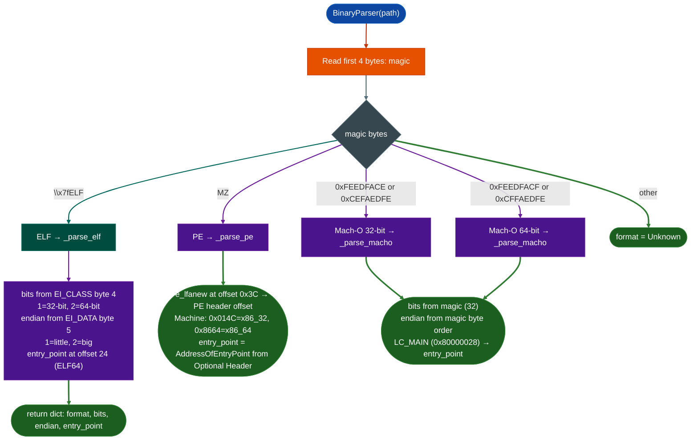

<a id="binary-format-and-platform-identification"></a>
# Binary Parsing & Hardening

Identify a binary's format ELF, PE, Mach-O, architecture 32/64-bit, endianness, and entry point from raw magic bytes and header fields: without external dependencies: before any analysis begins.

---

## Why this exists <sup>[↑](#binary-format-and-platform-identification)</sup>

1. **Every analysis tool must know what it is analyzing before it begins.** Whether to disassemble as x86, ARM, or MIPS; whether to read `.eh_frame` or iterate load commands; whether the PLT is at a fixed offset or in a DataDirectory: all of this depends on knowing the binary's format and architecture. Format identification is the mandatory first step in the pipeline.

2. **Identification must work in environments without LIEF or other libraries.** Deployment contexts for Ablation include CI pipelines, air-gapped analysis hosts, and minimal embedded Python environments. `BinaryParser` uses only Python standard library `struct`, `pathlib` to detect format and extract header metadata. LIEF is only required for the deeper parsing done by `BinaryContext`.

3. **Mach-O, ELF, and PE detection must be definitive from 4 bytes.** The magic number at byte offset 0 unambiguously identifies the format: `\x7fELF` → ELF, `MZ` → PE, and the four Mach-O magic constants identify 32/64-bit and endianness simultaneously. This 4-byte dispatch defines the correct architecture for a format detection layer.

---

## How it works <sup>[↑](#binary-format-and-platform-identification)</sup>



### Magic byte constants <sup>[↑](#binary-format-and-platform-identification)</sup>

| Magic | Constant | Format |
|---|---|---|
| `7F 45 4C 46` | `\x7fELF` | ELF 32 or 64-bit |
| `4D 5A` | `MZ` | Windows PE |
| `CE FA ED FE` | `0xFEEDFACE` (LE) | Mach-O 32-bit little-endian |
| `FE ED FA CE` | `0xCEFAEDFE` (BE) | Mach-O 32-bit big-endian |
| `CF FA ED FE` | `0xFEEDFACF` (LE) | Mach-O 64-bit little-endian |
| `FF FA ED CF` | `0xCFFAEDFE` (BE) | Mach-O 64-bit big-endian |

### Architecture detection per format <sup>[↑](#binary-format-and-platform-identification)</sup>

**ELF:** `EI_CLASS` at byte 4 `0x01` = 32-bit, `0x02` = 64-bit; `EI_DATA` at byte 5 `0x01` = little-endian, `0x02` = big-endian. Entry point at byte offset 24 (ELF64) or 24 ELF32, 4 bytes vs 8 bytes.

**PE:** Entry point is `AddressOfEntryPoint` from the Optional Header. Architecture from `Machine` field: `0x014C` = x86-32, `0x8664` = x86-64.

**Mach-O:** Bitness and endianness are encoded in the magic constant itself. Entry point via `LC_MAIN` load command (`cmd = 0x80000028`), `entryoff` field.

---

## BinaryParser <sup>[↑](#binary-format-and-platform-identification)</sup>

```python
from ablation.core.binary_parser import BinaryParser

parser = BinaryParser('/path/to/binary')

# Quick format detection (reads only 4 bytes)
fmt = parser.detect_format()  # 'ELF', 'PE', 'Mach-O', or 'Unknown'

# Full header parse
info = parser.parse()
# {
#   'format': 'ELF',
#   'bits': 64,
#   'endian': 'little',
#   'entry_point': '0x402340',
#   'sections': 31   # ELF only
# }

print(parser.report())
```

### ELF metadata and hardening

`ELFParser` provides deeper ELF inspection, including architecture, dependencies, sections, program headers, and security properties. Call `parse()` before requesting derived results.

```python
from ablation.core.elf_parser import ELFParser

elf = ELFParser('/path/to/target.elf')
elf.parse()

print(elf.machine())
print(elf.needed_libs())
print(elf.detect_security())
```

`detect_security()` returns `pie`, `nx_stack`, `relro`, `stack_canary`, `stripped`, and `fortify`. RELRO is reported as `full`, `partial`, or `none`. When `PT_GNU_STACK` is absent, `nx_stack` assumes a modern kernel default and includes `nx_stack_note`; treat that result as an assumption rather than direct binary evidence.

---

## Usage <sup>[↑](#binary-format-and-platform-identification)</sup>

```python
from ablation.core.binary_parser import BinaryParser

# Batch triage across a firmware extraction directory
import os
for filename in os.listdir('/fw/extracted/'):
    path = os.path.join('/fw/extracted/', filename)
    p = BinaryParser(path)
    fmt = p.detect_format()
    if fmt == 'Unknown':
        continue
    info = p.parse()
    print(f"{filename:40s}  {fmt:6s}  {info.get('bits', '?')}-bit  {info.get('endian', '')}")

# Gate analysis on architecture before running x86-specific tools
p = BinaryParser('/fw/target/httpd')
info = p.parse()
if info['format'] == 'ELF' and info['bits'] == 64:
    from ablation.analyzers.binary_context import BinaryContext
    ctx = BinaryContext.load_or_build('/fw/target/httpd')
    # proceed with x86-64 taint/heap analysis
elif info['format'] == 'ELF' and info['bits'] == 32:
    from ablation.analyzers.arm32_function_scanner import ARM32FunctionScanner
    # proceed with ARM32 prologue scan
```

---

## Example output <sup>[↑](#binary-format-and-platform-identification)</sup>

```
Binary: httpsd
Format: ELF
Architecture: 64 bit
Endianness: little
Entry Point: 0x402340
Sections: 31
```

---

## False positives <sup>[↑](#binary-format-and-platform-identification)</sup>

**Packed PE files.** Packers often preserve the DOS `MZ` signature at the start of the file, so the binary correctly identifies as PE. However, the internal structure may be partially overwritten by the packer stub. The entry point parsed from the Optional Header will point to the packer's stub, not the original OEP.

**Mach-O fat binaries.** The fat binary magic `0xCAFEBABE` is not in the detection table. `detect_format()` returns `'Unknown'` for fat binaries. Extract the appropriate architecture slice with `lipo -extract <arch>` before passing to `BinaryParser`.

---

## Pipeline position <sup>[↑](#binary-format-and-platform-identification)</sup>

**Before this module:** File acquisition only.

**After this module:** `BinaryContext.load_or_build()` uses the parsed format to select ELF, PE, or Mach-O parsing paths. `ARM32FunctionScanner.from_path()` requires that the binary is confirmed as ELF 32-bit ARM.

---

## Reading findings <sup>[↑](#binary-format-and-platform-identification)</sup>

| Field | Content |
|:---|:---|
| `format` | `'ELF'`, `'PE'`, `'Mach-O'`, or `'Unknown'` |
| `bits` | `32` or `64` (or `None` for Unknown) |
| `endian` | `'little'` or `'big'` ELF/Mach-O only |
| `entry_point` | Hex string of the entry point VA, or `None` if absent |
| `sections` | Section header count ELF only |

---

## See also <sup>[↑](#binary-format-and-platform-identification)</sup>

- [Binary Context](binary-context.md): full analysis context built on top of this parser
- [ELF Internals and Hardening](elf-internals-and-hardening.md): detailed ELF header anatomy
- [PE Internals and Indicators](pe-internals-and-indicators.md): PE COFF and Optional header detail
- [Mach-O Internals](mach-o-internals.md): Mach-O load command iteration and magic constants
