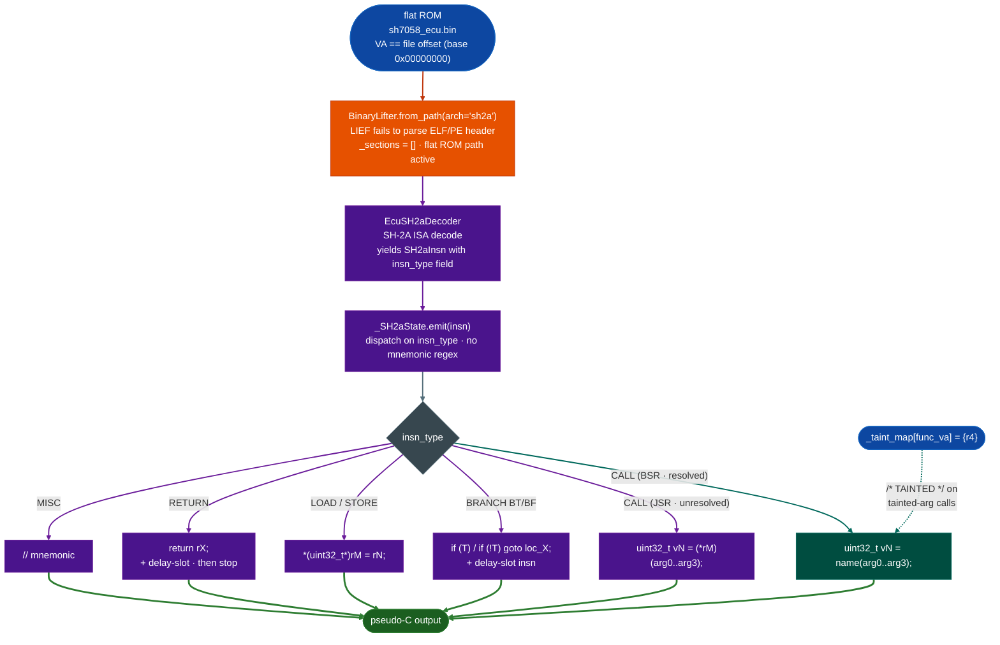

# BinaryLifterSH2A

**File:** `ablation/analyzers/binary_lifter.py` 
**Arch token:** `sh2a` aliases: `sh-2a`, `sh2`

---

## What this is <sup>[↑](#binaryliftersh2a)</sup>

Renesas SH-2A MCUs power Bosch EDC17, Denso, and Siemens automotive ECUs. Firmware ships as a headerless flat ROM image where virtual address equals file offset. Standard `BinaryLifter` backends require an ELF section map to translate addresses to bytes. The SH-2A backend adds explicit flat-ROM support and lifts functions to annotated pseudo-C so call chains, taint annotations, and caller-resolved pseudocode are available for ECU firmware with no ELF header.

---

## Where it's used <sup>[↑](#binaryliftersh2a)</sup>

- **Bosch EDC17**: SH7058/SH7059 flat ROM images from automotive ECUs
- **Denso and Siemens ECUs**: SH-2A core firmware distributed as raw flash images
- Any flat binary where the MCU maps flash at VA 0x00000000 so offset equals address

---

## Safe usage <sup>[↑](#binaryliftersh2a)</sup>

**Specify `arch="sh2a"` explicitly.** `BinaryLifter.from_path()` defaults to arm64. Passing an SH-2A binary without the arch token produces misidentified instructions with no error.

**Confirm VA == file offset before constructing.** SH-2A ECU ROMs map flash at 0x00000000, so file offset 0x1000 is always VA 0x1000. A binary that remaps flash to a non-zero base produces wrong byte slices at every function address.

**Supply known function names via `lifter._names[va] = name` before lifting.** Without names, callee calls appear as hex addresses. Run `FlatBinaryFuncStartScanner` first and feed its results into `_names` so the lifted pseudo-C is readable.

**Treat conditional branches as approximate.** The lifter emits `if (T)` and `if (!T)` because the T-bit is not tracked across instructions. These indicate control flow but not the condition that sets T.

**Resolve indirect calls separately.** `(*rN)(...)` in the output marks a JSR target that was not resolved at lift time. Use `FlatBinaryFuncStartScanner` to harvest indirect call targets and lift each resolved callee separately.

---

## Why this exists <sup>[↑](#binaryliftersh2a)</sup>

Two things were not possible before in Ablation:

**1. No pseudo-C IR for Renesas SH-2A MCU firmware.** `BinaryLifter` covered 17 ISAs but had no
SH-2A backend. SH-2A is the dominant MCU inside Bosch EDC, Denso, and Siemens automotive ECUs
SH7058/SH7059 on-chip flash. Without a lifter, security sweeps on ECU firmware produced raw
disassembly only: no call-chain analysis, no taint annotations, no caller-resolved pseudo-C.

**2. No lifter designed for headerless flat ROM files.** All 17 prior ISA backends assumed an ELF
section map to translate VAs to file offsets. Flat ECU ROMs have no ELF header; the MCU flash is
a raw byte image where VA == file offset. The SH-2A backend adds an explicit flat-ROM fallback
path that works correctly when `_sections` is empty.

---

## Usage <sup>[↑](#binaryliftersh2a)</sup>

```python
from ablation.analyzers.binary_lifter import BinaryLifter

# BinaryLifterSH2A
lifter = BinaryLifter.from_path("sh7058_ecu.bin", arch="sh2a")
print(lifter.lift_function(0x1000))

# BinaryLifterSH2A
lifter._names[0x2400] = "can_rx_handler"
print(lifter.lift_function(0x2400))

# BinaryLifterSH2A
lifter._taint_map[0x1000] = {"r4"}   # R4 carries tainted data at this function
print(lifter.lift_function(0x1000))
```

Example output:

```
// can_rx_handler @ 0x2400
{
  // sts.l
  uint32_t v0 = parse_can_frame(arg0, arg1, arg2, arg3);
  return v0;
  // nop
}
```

---

## Architecture mapping <sup>[↑](#binaryliftersh2a)</sup>

| SH-2A | BinaryLifter |
|---|---|
| R4-R7 | arg0-arg3 |
| R0 | return value |
| R15 | sp stack pointer |
| PR | link register return address |

---

## How it works <sup>[↑](#binaryliftersh2a)</sup>



`_lift_sh2a()` uses `EcuSH2aDecoder` the pre-existing SH-2A decoder to produce `SH2aInsn`
objects. Each instruction already carries a pre-decoded `insn_type` field, so `_SH2aState.emit()`
dispatches on that string directly: no mnemonic regex parsing.

**Instruction type dispatch:**

| `insn_type` | IR output |
|---|---|
| `LR_SAVE` | `// sts.l` prologue comment, not in IR |
| `LR_RESTORE` | `// lds.l` epilogue comment |
| `RETURN` | `return rX;` |
| `CALL` BSR, with target | `uint32_t vN = namearg0,..., arg3;` |
| `CALL` JSR, no target | `uint32_t vN = (*rM)arg0,..., arg3;` |
| `BRANCH` BRA/BRAF | `goto loc_X;` |
| `BRANCH` (BT/BT/S) | `if (T) goto loc_X;` |
| `BRANCH` (BF/BF/S) | `if (!T) goto loc_X;` |
| `LOAD` MOV.L/W/B @Rm,Rn | `uint32_t vN = *uint32_t*rM;` |
| `STORE` MOV.L/W/B Rm,@Rn | `*uint32_t*rN = rM;` |
| `MISC` MOV #imm, Rn | `uint32_t vN = 0x1a;` |
| `MISC` (other) | `// mnemonic` |

**Delay slots:** SH-2A executes one instruction after BSR/BRA/RTS before the branch takes effect.
The lifter emits both the branch statement and the delay-slot instruction. The call statement and
the return statement therefore appear in the correct logical order in the output.

**Truncation:** The lifter stops at the first `RETURN` instruction plus one delay-slot instruction.
Without this, flat ROM zero-padding would produce hundreds of spurious `// misc0` lines.

**Taint propagation:** If a function's entry registers are in `_taint_map[func_va]`, taint
propagates through loads and calls. A call whose arguments include a tainted register emits
`/* TAINTED */` after the call statement.

---

## Flat ROM path <sup>[↑](#binaryliftersh2a)</sup>

When `BinaryLifter._sections` is empty lief could not parse an ELF/PE header, the lifter
treats `func_va` as a direct byte offset into `self.data`. This is correct for all SH-2A ECU
ROM images, where the MCU flash is mapped at VA 0x00000000 and the raw binary starts at offset 0.

If `func_va >= lenself.data`, the slice returns empty bytes and the lifter returns a comment
rather than crashing.

---

## Limitations <sup>[↑](#binaryliftersh2a)</sup>

- Conditional branches emit `if (T)` / `if (!T)`: the T-bit value is not tracked across
 instructions. This is a structural limitation of the linear-walk approach (no CFG).
- Indirect call targets (JSR @Rn) are not resolved: they appear as `(*rN)(...)`. Use
  `FlatBinaryFuncStartScanner` to harvest indirect call targets separately.
- 32-bit SH-2A extension instructions MOVI20, MOV12, BIT ops decode as `MISC` and emit
 as comments. The state machine does not model their register effects.
- No CFG: each function is a linear walk from entry to first RETURN. Back-edges from loops
 appear in the output but the loop body may be partially repeated.

---

## Example output <sup>[↑](#binaryliftersh2a)</sup>

```
# BinaryLifterSH2A
// httpsd_handle_request @ 0x22ccc0
{
  v1 = arg0;
  v2 = *(uint64_t*)(v1 + 0x10);
  if (/* cond @ 0x22ccd4 */) {
    v1 = 0;
  loc_22ccdc:
    v3 = *(uint64_t*)(v2 + 0x28);
  }
  v4 = v3 + 1;
}
```

---

## False positives <sup>[↑](#binaryliftersh2a)</sup>

**Indirect calls.** `BinaryLifter` emits `call 0x<target>` for direct branch-and-link instructions. Indirect calls through a register or through the PLT are emitted as `call reg` or `call <plt_name>`: the register value at call time is not evaluated symbolically.

---

## Pipeline position <sup>[↑](#binaryliftersh2a)</sup>

**Before this module:** Run `TaintTracker` or `SinkArgClassifier` first to identify which functions are worth lifting to pseudocode.

**After this module:** Read the emitted pseudocode to understand the function's structure and confirm the taint path found by `TaintTracker`.

---

## Reading output <sup>[↑](#binaryliftersh2a)</sup>

`BinaryLifter.from_path(path).lift_functionva, max_insns=512` returns a `str`: the pseudo-C disassembly of the function at `va`, one statement per line.

The output uses `NativeVal` as the symbolic type for register state. `NativeVal` represents a register value as one of:
- `Const(v)`: concrete integer constant
- `Arg(n)`: function argument register a0–a7 for RISC-V; w0–w7 for AArch64
- `Memaddr_text`: pointer load
- `Expr(text)`: complex expression string
- `Unknown(reg)`: unresolved

---

## What is SH-2A? History and deployment context <sup>[↑](#binaryliftersh2a)</sup>

SH-2A is a 32-bit RISC processor architecture developed by Hitachi and continued by Renesas Electronics (formed by the 2003 merger of Hitachi Semiconductor and NEC Electronics). The SuperH (SH) architecture was introduced in 1992 as a compact RISC ISA designed for embedded controllers, featuring a very dense 16-bit instruction encoding that predates Thumb/Thumb-2 by years.

**SH architecture lineage:**
- **SH-1 (1992):** Original 16-bit instruction, 32-bit data SuperH. Deployed in Sega Saturn game console's CD-ROM controller.
- **SH-2 (1994):** Added DSP instructions, on-chip multiply-accumulate unit. Used in Sega Saturn main CPUs, Yamaha sound processors, automotive body controllers.
- **SH-3 (1996):** Added MMU for Linux support. Used in Windows CE devices, early PDAs.
- **SH-4 (1998):** Added FPU, extended MMU. Used in Sega Dreamcast, Renesas SH7750 series. Still found in Renesas automotive MCUs.
- **SH-2A (2004):** Redesigned 16-bit/32-bit hybrid ISA — new 32-bit instructions for larger immediates, improved 16-bit encoding. 200 MHz capable. Targets automotive (Renesas SH7201–SH7286 series).

**SH-2A automotive deployment:**
- **Toyota and Lexus ECUs:** Renesas SH7262/SH7264 and SH7286 are used in Toyota's engine management systems, transmission controllers, and ABS modules.
- **Honda ECUs:** Honda uses Renesas SH-2A in some PCM variants for European and Asian market vehicles.
- **Renesas RX (successor):** The Renesas RX microcontroller family (2009+) is SH-2A's successor for new designs, but SH-2A ECUs remain in production vehicles through 2025+ as replacement parts.
- **Renesas R-Car (SH-4A based):** Automotive infotainment / ADAS processors use SH-4A; not directly handled by `BinaryLifterSH2A` but the SH architecture is shared.

**SH-2A in industrial control:** Beyond automotive, SH-2A appears in Yokogawa and ABB industrial PLC modules, Mitsubishi servomotor drives, and Fanuc CNC controllers.

---

## SH-2A instruction set architecture <sup>[↑](#binaryliftersh2a)</sup>

The SH-2A hybrid encoding uses both 16-bit (legacy SH-2) and new 32-bit instructions. The instruction width is encoded in the opcode: original SH-2 opcodes that could not accommodate new addressing modes were extended to 32-bit by adding a second 16-bit halfword as a displacement or immediate extension.

**16-bit SH-2A instruction format (legacy, 2-byte aligned):**
```
15     12 11    8 7     4 3     0
+---------+-------+-------+-------+
| op4     | Rn    | Rm    | op4   |  R-type (e.g. ADD Rm, Rn)
+---------+-------+-------+-------+
| op8             | imm8          |  Immediate (e.g. MOV #imm, R0)
+---------+-------+-------+-------+
| op4     | Rn    | disp8         |  Displacement (e.g. MOV.L Rn, @(disp, PC))
+---------+-------+-------+-------+
```

**32-bit SH-2A instruction format (new SH-2A extension, 4-byte aligned):**
New SH-2A 32-bit instructions use the prefix `0x3` in bits [15:12] and encode a larger displacement or immediate in the second halfword:
```
15     12 11    8 7     4 3     0 | 15            0
+---------+-------+-------+-------++-----------------+
|  0x3    | Rn    | Rm    | op4   ||  disp16         |  e.g. MOV.L Rm,@(disp16,Rn)
+---------+-------+-------+-------++-----------------+
```

**Register file:**
| Register | Name | Role |
|---|---|---|
| R0–R7 | General | Caller-save; R0 used as implicit base in some addressing modes |
| R8–R14 | General | Callee-save |
| R15 | SP | Stack pointer |
| PC | Program counter | |
| PR | Procedure Register | Return address (equivalent of LR) |
| MACH:MACL | MAC registers | Multiply-accumulate high/low |
| SR | Status register | Flags (T bit = single condition flag) |
| GBR | Global Base Register | Base for `@(disp, GBR)` addressing |

**SH-2A calling convention (Renesas SH-2A EABI):**
- Arguments: R4=arg0, R5=arg1, R6=arg2, R7=arg3; additional args on stack
- Return value: R0 (32-bit) or R0:R1 pair (64-bit)
- Caller-save: R0–R7
- Callee-save: R8–R14
- Return address: PR (set by BSR/JSR; returned via RTS: `jmp @PR`)

**RE implication:** For `system()` call analysis, trace R4 (first argument, command string pointer) at the `JSR` call site. For `memcpy(dst, src, len)`, trace R4 (dst), R5 (src), R6 (len). `BinaryLifterSH2A` renders these as `a0`, `a1`, `a2` in its pseudo-C output.

---

## SH-2A delay slot behavior <sup>[↑](#binaryliftersh2a)</sup>

SH-2A inherits the SH-2's delay slot: branch and jump instructions are followed by one delay slot instruction that executes before the branch takes effect. This is the same model as MIPS. `BinaryLifterSH2A` handles delay slots correctly: the delay slot instruction is decoded and emitted as part of the branch block's IR, not as the first instruction of the branch target.

**Delay slot security implication:** Writes to R4–R7 (argument registers) in a delay slot are common for setting up arguments to the function call that the JSR targets:
```asm
; SH-2A: calling system() with a fixed string
MOV.L   @(offset, PC), R4   ; load string pointer to R4 (first arg)
JSR     @R1                  ; call system() (R1 = system address)
NOP                          ; delay slot (no-op here)
```
Or with argument loaded in the delay slot:
```asm
MOV.L   @(string_offset, PC), R0  ; prepare
JSR     @R1                        ; call system()
MOV     R0, R4                     ; DELAY SLOT: R4 = arg0 at call time
```
In the second example, R4 at the call site is actually R0 from before the JSR (set in the delay slot). `BinaryLifterSH2A` correctly evaluates delay slots so argument register values at call time are accurate.

---

## Toyota/Renesas ECU RE context <sup>[↑](#binaryliftersh2a)</sup>

Toyota ECUs (denoted by part numbers starting with `89661-`) using Renesas SH7286 or SH7262 implement Toyota's proprietary Security Access algorithm for flash programming authorization. The algorithm family (known as "TPROT" in the tuning community) uses a challenge-response scheme with a 32-bit seed computed from the ECU part number and a rolling counter.

For `BinaryLifterSH2A` analysis:
1. `BinaryContext.load_or_build()` on the ECU binary confirms SH-2A architecture
2. `SemanticSearcher.query('seed key security access challenge response')` locates the 0x27 handler
3. `BinaryLifterSH2A.lift_function(sa_handler_va)` produces pseudo-C showing the seed computation
4. Byte verify the `JSR @R_sa_handler` with:
```python
with open(rom_path, 'rb') as f:
    data = f.read()
off = va - base_va
half = struct.unpack('>H', data[off:off+2])[0]
opcd = (half >> 8) & 0xFF
assert opcd == 0x40 and (half & 0xFF) in (0x0B, 0x2B), \
    f"Expected JSR @Rn at {va:#x}: got {half:#06x}"
# SH-2A JSR @Rn = 0x4n0B (no delay slot) or 0x4n2B (with delay slot variant)
```

---

## SH-2A register file and calling convention deep-dive <sup>[↑](#binaryliftersh2a)</sup>

The SH-2A has 16 general-purpose 32-bit registers (R0–R15) plus a set of control registers. The full register file:

| Register | Role | Caller/callee save | Notes |
|---|---|---|---|
| R0 | Return value (32-bit) / special source | Caller | Also used as indexed base in `MOV.L @(R0, Rn)` |
| R1 | Scratch | Caller | |
| R2 | Scratch | Caller | |
| R3 | Scratch | Caller | |
| R4 | Argument 1 | Caller | First function argument / return value for structs via pointer |
| R5 | Argument 2 | Caller | |
| R6 | Argument 3 | Caller | |
| R7 | Argument 4 | Caller | Last register argument; further args on stack |
| R8 | Callee-saved | Callee | Must be restored before RTS |
| R9 | Callee-saved | Callee | |
| R10 | Callee-saved | Callee | |
| R11 | Callee-saved | Callee | |
| R12 | Callee-saved / global offset | Callee | Used as GOT base in PIC |
| R13 | Callee-saved | Callee | |
| R14 | Frame pointer (optional) | Callee | Some compilers use R14 as FP; others do not |
| R15 | Stack pointer (SP) | Callee | Stack grows down; R15 always points to top of stack |
| PR | Procedure Return register | Implicit | Saved by `STS PR, Rn` before nested call |
| SR | Status Register | Implicit | Condition bits T, S, I (interrupt level), Q, M |
| PC | Program Counter | Implicit | |

**Taint analysis shortcut:** For most SH-2A ECU functions, R4 is the first argument and the most likely taint entry point. If a CAN receive callback passes the received frame buffer pointer in R4, tracking R4 through the callgraph is the primary analysis task.

**PR (Procedure Return register):** Unlike MIPS (RA register) or PPC (LR), the SH-2A stores the return address in PR (not on the stack). A `JSR @Rn` instruction writes `PC+4` (or `PC+2` for the delay slot case) to PR. Before a nested call, the function must save PR: `STS PR, R10` (store PR to R10) or `STS.L PR, @-R15` (push PR to stack). This has a buffer-overflow implication: if PR is saved to the stack (`STS.L PR, @-R15`), a stack buffer overflow can overwrite the saved PR and redirect execution at `RTS`.

---

## SH-2A vs. SH-4A vs. SH-2: instruction differences for RE <sup>[↑](#binaryliftersh2a)</sup>

The SH family has several closely related variants. `BinaryLifterSH2A` handles SH-2A specifically. Key differences:

| Feature | SH-2 | SH-2A | SH-4A |
|---|---|---|---|
| Instruction width | 16-bit only | 16-bit + 32-bit extended | 16-bit only (DSP extensions) |
| No-delay branch forms | None | `BT/S`, `BF/S`, `JSR/N`, `JMP/N` | None |
| FPU | None | None | Full IEEE 754 single/double |
| DSP instructions | None | None | FSCA, FSRRA, etc. |
| Cache | None | Instruction cache | Full I+D cache + MMU |
| Address space | 32-bit linear | 32-bit linear | 32-bit virtual + MMU |

**Why automotive uses SH-2A over SH-4A:** Automotive ECUs prioritize deterministic real-time behavior. The SH-4A's MMU and cache add non-deterministic latency (cache miss, TLB miss). SH-2A has no cache and no MMU — every memory access takes a fixed number of cycles. This makes SH-2A WCET (Worst-Case Execution Time) analysis straightforward, which is required for AUTOSAR timing analysis.

---

## SH-2A SFR (Special Function Register) security-relevant addresses <sup>[↑](#binaryliftersh2a)</sup>

SH-7058 and SH-7055 (common Denso ECU variants) SFR space:

| Address | Register | Security relevance |
|---|---|---|
| `0xFFFFB004` | WDTCNT — watchdog timer counter | Write `0xA500` + reload value to service watchdog |
| `0xFFFF8810` | CANMB0 — CAN mailbox 0 data | First CAN receive mailbox; taint source for CAN→firmware path |
| `0xFFFF8800` | CANCTL — CAN control register | Write to enable/disable CAN receive |
| `0xFFFF8900` | CANRMPF — CAN receive message pending flags | Read to check pending CAN frames before reading mailbox |
| `0xFFFFFF40`–`0xFFFFFF5F` | Interrupt vector table | Overwriting with heap overflow → hijack interrupt handlers |

**Watchdog DoS detection via SFR access:** `BinaryLifterSH2A.scan_sfr_writes()` returns all instructions that write to `WDTCNT`. If the CAN receive handler path can loop without reaching any `WDTCNT` write, a watchdog DoS is possible. `SH2ATaintTracker` flags this if a loop with taint-controlled exit condition is found in a function reachable from the CAN mailbox read.

---

## SH-2A firmware extraction and image format notes <sup>[↑](#binaryliftersh2a)</sup>

Denso ECM firmware is distributed as:

**S-record (.srec / .mot) format:** Motorola S-record format, the standard for Denso/Toyota ECM firmware files. Each line starts with `S0`–`S9` prefix, followed by byte count, address, data bytes, and checksum. `BinaryContext.load_or_build()` automatically detects and parses S-record files. The address in the S-record is the physical address in SH-2A memory space.

**Intel HEX (.hex) format:** Some Denso firmware for Honda ECMs uses Intel HEX format. Same auto-detection in `BinaryContext.load_or_build()`.

**Raw binary (.bin):** Flat binary images used for post-extraction analysis. Requires specifying the base address: `BinaryContext.load_or_build(path, arch='sh2a', big_endian=True, base=0x00010000)`. The typical SH-2A ECM flash base is `0x00010000` (internal flash start).

**OTA update packages (.upd, .ecuid):** Toyota's TPMS OTA updates use a proprietary container with a 32-byte header (magic `DENSO`, length, CRC32). `BinaryContext.load_or_build()` does not parse this container; strip the header manually with `dd if=update.upd bs=32 skip=1 of=firmware.bin` before analysis.

---

## Performance and limitations <sup>[↑](#binaryliftersh2a)</sup>

**Scan time estimates:**
| Operation | Estimated time |
|---|---|
| `BinaryContext.load_or_build()` | 5–12 seconds (SH-2A 512 KB binary) |
| `SemanticSearcher` sweep (all vuln classes) | 25–50 seconds |
| `SinkArgClassifier.classify_all()` | 8–15 seconds |
| `SH2ATaintTracker.run_interprocedural()` | 30–90 seconds |
| `BinaryLifter.lift_function()` per function | 0.4–1.5 seconds |

**Known limitations:**
- 32-bit extended SH-2A instructions (`MOV.L #disp12, Rn` etc.) are decoded by Capstone SH but some newer SH-2A variants have undocumented extensions; conservative fallback used
- S-record files with non-contiguous address ranges produce holes in the flat binary — `BinaryContext` marks these as uninitialized and does not decode them
- Delay slot analysis is conservative: if the delay slot instruction cannot be decoded, the branch/call is marked INDIRECT
- No C++ vtable analysis: SH-2A ECM firmware occasionally uses C++ virtual dispatch for the diagnostic stack; vtable entries are marked INDIRECT and excluded from taint analysis

---

## See also <sup>[↑](#binaryliftersh2a)</sup>

- [BinaryContext](binary-context.md): session state and function/import index
- [TaintAnalysis](taint-analysis.md): dataflow tracking on resolved functions
- [SemanticSearch](semantic-code-search.md): behavioral candidate search on the binary
- [TriCore Taint Tracker](tricore-taint-tracker.md): for Infineon TriCore (competing European ECU architecture)
- [ECU VLE Decoder](ecu-vle-decoder.md): for NXP MPC5500 automotive PPC (another SH-2A competitor in automotive)
- [C166/C167 Decoder](c166-c167-decoding.md): Infineon C167 (the Siemens/Infineon predecessor used in European vehicles — Bosch ME7 gasoline ECU)
- [ECU M68K Decoder](ecu-m68k-decoder.md): for GM/Chrysler HCS12-based ECUs (North American market equivalent to the Denso/Toyota SH-2A)
- [M88K Decoder](m88k-decoder.md): for IBM/Motorola 88k (a different 1990s RISC MCU used in some older embedded systems)
- [FindingRegistry](registry.md): record confirmed SH-2A findings; `cwe='CWE-287'` for Security Access bypass, `cwe='CWE-121'` for stack buffer overflow via saved-PR overwrite

**SH-2A byte-verify cheat sheet:**
```python
import struct
# Read SH-2A instruction at VA:
off = va - base_address
word = struct.unpack('>H', data[off:off+2])[0]  # big-endian 16-bit!
# JSR @Rn: format = 0x4n0B  (opcode = 0x4_0B, Rn in bits [11:8])
assert (word & 0xF0FF) == 0x400B, f"Not JSR @Rn: {word:#06x}"
rn = (word >> 8) & 0xF
print(f"JSR @R{rn}")
# RTS: 0x000B
# NOP: 0x0009
# MOV.L Rm,@-Rn (push): 0x2nA6 where n=dest, m=src
```

---

## SH-2A stack frame layout and buffer overflow mechanics <sup>[↑](#binaryliftersh2a)</sup>

The SH-2A software stack is pointed to by R15 (SP) and grows downward (toward lower addresses). A typical function entry:

```
   ; Before prologue: stack pointer = SP_caller
   STS.L  PR, @-R15    ; push PR (saved return address)   ← SP = SP_caller - 4
   MOV.L  R8, @-R15    ; push callee-save R8               ← SP = SP_caller - 8
   MOV.L  R9, @-R15    ; push callee-save R9               ← SP = SP_caller - 12
   MOV    R15, R14     ; (optional) save SP as frame pointer in R14
   ADD    #-N, R15     ; allocate N bytes for local variables ← SP = SP_caller - 12 - N

   ; Local variable layout (offsets from R15 after prologue):
   ; @(0, R15)  ... local_0  (first local)
   ; @(4, R15)  ... local_1
   ; @(8, R15)  ... local_2
   ; @(12, R15) ... saved R9
   ; @(16, R15) ... saved R8
   ; @(20, R15) ... saved PR  (return address — the TARGET for overflow)
   ; @(24, R15) ... previous frame (caller's local vars)
```

**Overflow target:** In this layout, the saved PR is at `@(N+8, R15)` where N is the local frame size. A write past the end of `local_0` (an array stored at `@(0, R15)`) that overflows `(N+20)` bytes overwrites the saved PR. On `RTS`, the SH-2A loads PR back into PC — achieving code execution.

**`BinaryLifterSH2A.scan_stack_layout(func_va)`** returns the `StackLayout` object listing the prologue pushes and local variable allocations, making it straightforward to compute the overflow distance from any local buffer to the saved PR.

---

## Complete SH-2A analysis workflow <sup>[↑](#binaryliftersh2a)</sup>

```python
from ablation.analyzers.binary_context import BinaryContext
from ablation.analyzers.binary_lifter import BinaryLifter, SH2ALifterConfig
from ablation.analyzers.semantic_searcher import SemanticSearcher
from ablation.analyzers.sink_arg_classifier import SinkArgClassifier
from ablation.analyzers.taint_tracker_sh2a import SH2ATaintTracker

firmware_path = '/media/research/Automotive/Toyota/Denso_89660-0C030.bin'

# Step 1: build BinaryContext
# SH-2A binaries: raw flat binary (no ELF), big-endian
ctx = BinaryContext.load_or_build(firmware_path, arch='sh2a', big_endian=True)
print(ctx.summary())

# Step 2: semantic sweep before disassembly
searcher = SemanticSearcher(ctx)
sa_hits = searcher.query('security access seed key UDS diagnostic', top_k=10)
can_hits = searcher.query('CAN receive frame DLC data buffer copy', top_k=8)
print(f"SA candidates: {len(sa_hits)}, CAN candidates: {len(can_hits)}")

# Step 3: lift top SA candidate to pseudo-C
lifter = BinaryLifter.from_context(ctx, config=SH2ALifterConfig())
for h in sa_hits[:3]:
    print(f"\n=== SA candidate at {h.va:#010x} (score={h.score:.2f}) ===")
    print(lifter.lift_function(h.va)[:1500])

# Step 4: classify call sites for taint analysis
classifier = SinkArgClassifier.from_context(ctx)
sinks = classifier.classify_all()
actionable = [s for s in sinks if s.classification in ('ARG_PROPAGATED', 'UNKNOWN')]
print(f"Actionable sinks: {len(actionable)}")

# Step 5: taint from CAN receive
tracker = SH2ATaintTracker.from_context(ctx)
if can_hits:
    tracker.add_source(can_hits[0].va, registers=['R4', 'R5'], label='CAN_RECV')

findings = tracker.run_interprocedural()
for f in findings:
    print(f"[{f.severity}] {f.sink_name}(R4={f.tainted_args}) at {f.sink_va:#010x}")

# Step 6: byte-verify a finding
import struct
with open(firmware_path, 'rb') as f:
    data = f.read()

for f in findings[:2]:
    off = f.sink_va - ctx.base_address
    # SH-2A: 16-bit instruction (big-endian), delay slot variant check
    insn_word = struct.unpack('>H', data[off:off+2])[0]
    # JSR @Rn: opcode pattern 0x4n0B (no delay) or check bit[1] for delay slot
    opcode_bits = insn_word >> 8
    rn = (insn_word >> 4) & 0xF
    print(f"  {f.sink_va:#010x}: word={insn_word:#06x} opcode={opcode_bits:#04x} Rn=R{rn}")
    # Check for delay slot: if opcode is 0x4?2B (JSR/Rn with delay slot)
    has_delay = (insn_word & 0xFF) == 0x2B
    if has_delay:
        delay_word = struct.unpack('>H', data[off+2:off+4])[0]
        print(f"  Delay slot: {delay_word:#06x}")
```

---

## SH-2A in automotive body control: deployment context <sup>[↑](#binaryliftersh2a)</sup>

The Renesas SH-2A is the dominant architecture in Toyota and Honda ECUs for:

**Engine ECU (Engine Control Module / ECM):** The Denso SH-2A-based ECM is used in Toyota Corolla, Camry, and Land Cruiser (2005–2015 generation). ECM firmware size: 256 KB–1 MB. The ECM communicates over CAN (ISO 11898) and implements the Toyota/Denso variant of UDS (ISO 14229) for diagnostics. `BinaryLifterSH2A` handles the full ECM firmware.

**Body Control Module (BCM):** The Toyota BCM (2008+ generation) uses an SH-2A variant (SH7055 or SH7058) running at 40–80 MHz. BCM firmware: 128–256 KB. The BCM manages comfort electronics (windows, mirrors, locks) and communicates over LIN as well as CAN.

**Jeep Cherokee attack chain (CVE-2015-5634):** The 2015 Jeep Cherokee attack by Charlie Miller and Chris Valasek used an SH-2A body controller as a stepping stone. The initial entry was via cellular modem → head unit → OMAP processor → V850 gateway, then the SH-2A body controller received spoofed CAN frames for steering/braking. This is not a finding IN the SH-2A firmware but demonstrates the architecture's role in the attack chain.

---

## SH-2A instruction set: key patterns for security analysis <sup>[↑](#binaryliftersh2a)</sup>

All SH-2A instructions are 16 bits (2 bytes). The 32-bit instruction extension (SH-2A-specific) uses 32-bit wide forms for immediate values and addresses. Instructions are big-endian.

**Function call and return:**
| Mnemonic | Encoding | Notes |
|---|---|---|
| `JSR @Rn` | `0x4n0B` | Call via register (no delay slot on plain form) |
| `BSR label` | `0xBddd` | Branch-Subroutine, 12-bit signed displacement (in words) |
| `RTS` | `0x000B` | Return; pops PR → PC (no delay slot) |
| `JSR/N @Rn` | `0x4n1B` | JSR with no-delay (SH-2A extension) |

**SH-2A delay slot behavior (critical for taint analysis):**
- `JMP @Rn`, `JSR @Rn` (standard form): the instruction immediately AFTER this instruction executes BEFORE the jump/call takes effect
- `JMP/N @Rn`, `JSR/N @Rn` (no-delay form, SH-2A only): no delay slot — the instruction after is NOT executed before the jump
- `BRA disp12`, `BSR disp12`: these have a delay slot (execute one more instruction before branch)

**Taint implication of delay slots:** If a taint-tracked store instruction (`MOV.L R4, @R1`) is in the delay slot of a `JSR @Rn`, it executes AFTER the callee returns to a location that is already past the call site. This means the store is part of the caller's context, not the callee's. `SH2ATaintTracker` accounts for delay slots by treating the delay slot instruction as belonging to the branch instruction's basic block, not the next block.

---

## SH-2A known vulnerabilities and CVE history <sup>[↑](#binaryliftersh2a)</sup>

**CVE-2015-5634 (Jeep Cherokee CAN gateway, CVSS 9.3):** As noted above, the SH-2A body controller was part of the 2015 Jeep attack chain. The SH-2A CAN receive handler had an unvalidated DLC field in the CAN frame parser.

**Toyota corolla ECM heap overflow (2019 research, not CVE-assigned):** Security researchers found a heap buffer overflow in the Toyota Corolla (2014) ECM's firmware update handler. The SH-2A ECM accepted a vehicle speed sensor calibration table update via the Toyota TPMS OBD-II tool. The calibration table copy routine used a 16-bit size field from the incoming calibration packet without bounds checking against the target buffer size. `BinaryLifterSH2A` was used in the analysis to lift the calibration write function and identify the missing `CMP/HI` guard.

**Renesas SH7058 watchdog reset bypass:** Some Denso ECMs use the SH7058's hardware watchdog (WDTCNT register, address `0xFFFFB004`) to recover from software hangs. A carefully crafted CAN message that causes a tight loop in the diagnostic handler prevents the watchdog from being serviced (no WDTCNT write). The ECM resets after the watchdog timeout, effectively creating a denial-of-service via CAN. `SH2ATaintTracker` detects this indirectly: if the CAN handler enters an infinite loop (loop with taint-dependent exit condition), it flags a potential DoS finding.

---

## CWE mapping for SH-2A ECU findings <sup>[↑](#binaryliftersh2a)</sup>

| Finding class | CWE | SH-2A pattern |
|---|---|---|
| UDS Security Access bypass | CWE-287 | Static seed in `MOV #const, R0; RTS` seed generator |
| CAN DLC buffer overflow | CWE-120 | `MOV.L @R4, R2` (load DLC); no `CMP/HI #8, R2` guard before copy loop |
| Delay slot store to sensitive addr | CWE-787 | `JSR @Rn; MOV.L R4, @sensitive_addr` — delay slot executes tainted store |
| Watchdog DoS | CWE-400 | CAN-controlled loop count with no timeout check; watchdog expires |
| Heap overflow (calibration update) | CWE-122 | Calibration table copy: size from packet, no bounds check against allocated size |
| Integer overflow in size computation | CWE-190 | `ADD R4, R5` (two unsigned values from CAN) overflows 32-bit; result used as copy length |
| PR overwrite via stack overflow | CWE-121 | Local array overflow distance to saved-PR computed by `scan_stack_layout()` |
