# BinaryLifter: SH-2A backend

**File:** `ablation/analyzers/binary_lifter.py` 
**Arch token:** `sh2a` aliases: `sh-2a`, `sh2`

---

## What this is

Renesas SH-2A MCUs power Bosch EDC17, Denso, and Siemens automotive ECUs. Firmware ships as a headerless flat ROM image where virtual address equals file offset. Standard `BinaryLifter` backends require an ELF section map to translate addresses to bytes. The SH-2A backend adds explicit flat-ROM support and lifts functions to annotated pseudo-C so call chains, taint annotations, and caller-resolved pseudocode are available for ECU firmware with no ELF header.

---

## Where it's used

- **Bosch EDC17**: SH7058/SH7059 flat ROM images from automotive ECUs
- **Denso and Siemens ECUs**: SH-2A core firmware distributed as raw flash images
- Any flat binary where the MCU maps flash at VA 0x00000000 so offset equals address

---

## Safe usage

**Specify `arch="sh2a"` explicitly.** `BinaryLifter.from_path()` defaults to arm64. Passing an SH-2A binary without the arch token produces misidentified instructions with no error.

**Confirm VA == file offset before constructing.** SH-2A ECU ROMs map flash at 0x00000000, so file offset 0x1000 is always VA 0x1000. A binary that remaps flash to a non-zero base produces wrong byte slices at every function address.

**Supply known function names via `lifter._names[va] = name` before lifting.** Without names, callee calls appear as hex addresses. Run `FlatBinaryFuncStartScanner` first and feed its results into `_names` so the lifted pseudo-C is readable.

**Treat conditional branches as approximate.** The lifter emits `if (T)` and `if (!T)` because the T-bit is not tracked across instructions. These indicate control flow but not the condition that sets T.

**Resolve indirect calls separately.** `(*rN)(...)` in the output marks a JSR target that was not resolved at lift time. Use `FlatBinaryFuncStartScanner` to harvest indirect call targets and lift each resolved callee separately.

---

## Why this exists

Two things were not possible before in Ablation:

**1. No pseudo-C IR for Renesas SH-2A MCU firmware.** `BinaryLifter` covered 17 ISAs but had no
SH-2A backend. SH-2A is the dominant MCU inside Bosch EDC, Denso, and Siemens automotive ECUs
SH7058/SH7059 on-chip flash. Without a lifter, security sweeps on ECU firmware produced raw
disassembly only: no call-chain analysis, no taint annotations, no caller-resolved pseudo-C.

**2. No lifter designed for headerless flat ROM files.** All 17 prior ISA backends assumed an ELF
section map to translate VAs to file offsets. Flat ECU ROMs have no ELF header; the MCU flash is
a raw byte image where VA == file offset. The SH-2A backend adds an explicit flat-ROM fallback
path that works correctly when `_sections` is empty.

---

## Usage

```python
from ablation.analyzers.binary_lifter import BinaryLifter

# Flat ECU ROM (base_va=0, VA==file_offset)
lifter = BinaryLifter.from_path("sh7058_ecu.bin", arch="sh2a")
print(lifter.lift_function(0x1000))

# With confirmed function names
lifter._names[0x2400] = "can_rx_handler"
print(lifter.lift_function(0x2400))

# With taint from a prior analysis
lifter._taint_map[0x1000] = {"r4"}   # R4 carries tainted data at this function
print(lifter.lift_function(0x1000))
```

Example output:

```
// can_rx_handler @ 0x2400
{
  // sts.l
  uint32_t v0 = parse_can_frame(arg0, arg1, arg2, arg3);
  return v0;
  // nop
}
```

---

## Architecture mapping

| SH-2A | BinaryLifter |
|---|---|
| R4-R7 | arg0-arg3 |
| R0 | return value |
| R15 | sp stack pointer |
| PR | link register return address |

---

## How it works

```mermaid
flowchart TD
    A(["flat ROM\nsh7058_ecu.bin\nVA == file offset (base 0x00000000)"]):::input --> B["BinaryLifter.from_path(arch='sh2a')\nLIEF fails to parse ELF/PE header\n_sections = [] · flat ROM path active"]:::primary
    B:::primary --> C["EcuSH2aDecoder\nSH-2A ISA decode\nyields SH2aInsn with insn_type field"]:::tertiary
    C:::tertiary --> D["_SH2aState.emit(insn)\ndispatch on insn_type · no mnemonic regex"]:::tertiary
    D:::tertiary --> E{"insn_type"}:::neutral
    E:::neutral -->|"CALL (BSR · resolved)"| F["uint32_t vN = name(arg0..arg3);"]:::secondary
    E:::neutral -->|"CALL (JSR · unresolved)"| G["uint32_t vN = (*rM)(arg0..arg3);"]:::tertiary
    E:::neutral -->|"BRANCH BT/BF"| H["if (T) / if (!T) goto loc_X;\n+ delay-slot insn"]:::tertiary
    E:::neutral -->|"LOAD / STORE"| I["*(uint32_t*)rM = rN;"]:::tertiary
    E:::neutral -->|"RETURN"| J["return rX;\n+ delay-slot · then stop"]:::tertiary
    E:::neutral -->|"MISC"| K["// mnemonic"]:::tertiary
    F:::secondary --> L(["pseudo-C output"]):::output
    G:::tertiary --> L:::output
    H:::tertiary --> L:::output
    I:::tertiary --> L:::output
    J:::tertiary --> L:::output
    K:::tertiary --> L:::output
    M(["_taint_map[func_va] = {r4}"]):::input -.->|"/* TAINTED */ on\ntainted-arg calls"| F:::secondary
    classDef input     fill:#0d47a1,stroke:#1565c0,color:#fff
    classDef primary   fill:#e65100,stroke:#bf360c,color:#fff
    classDef secondary fill:#004d40,stroke:#00695c,color:#fff
    classDef tertiary  fill:#4a148c,stroke:#6a1b9a,color:#fff
    classDef neutral   fill:#37474f,stroke:#546e7a,color:#fff
    classDef output    fill:#1b5e20,stroke:#2e7d32,color:#fff
    linkStyle 0 stroke:#bf360c,stroke-width:2px
    linkStyle 1 stroke:#6a1b9a,stroke-width:2px
    linkStyle 2 stroke:#6a1b9a,stroke-width:2px
    linkStyle 3 stroke:#546e7a,stroke-width:2px
    linkStyle 4 stroke:#00695c,stroke-width:2px
    linkStyle 5 stroke:#6a1b9a,stroke-width:2px
    linkStyle 6 stroke:#6a1b9a,stroke-width:2px
    linkStyle 7 stroke:#6a1b9a,stroke-width:2px
    linkStyle 8 stroke:#6a1b9a,stroke-width:2px
    linkStyle 9 stroke:#6a1b9a,stroke-width:2px
    linkStyle 10 stroke:#2e7d32,stroke-width:3px
    linkStyle 11 stroke:#2e7d32,stroke-width:3px
    linkStyle 12 stroke:#2e7d32,stroke-width:3px
    linkStyle 13 stroke:#2e7d32,stroke-width:3px
    linkStyle 14 stroke:#2e7d32,stroke-width:3px
    linkStyle 15 stroke:#2e7d32,stroke-width:3px
    linkStyle 16 stroke:#00695c,stroke-width:2px
```



`_lift_sh2a()` uses `EcuSH2aDecoder` the pre-existing SH-2A decoder to produce `SH2aInsn`
objects. Each instruction already carries a pre-decoded `insn_type` field, so `_SH2aState.emit()`
dispatches on that string directly: no mnemonic regex parsing.

**Instruction type dispatch:**

| `insn_type` | IR output |
|---|---|
| `LR_SAVE` | `// sts.l` prologue comment, not in IR |
| `LR_RESTORE` | `// lds.l` epilogue comment |
| `RETURN` | `return rX;` |
| `CALL` BSR, with target | `uint32_t vN = namearg0,..., arg3;` |
| `CALL` JSR, no target | `uint32_t vN = (*rM)arg0,..., arg3;` |
| `BRANCH` BRA/BRAF | `goto loc_X;` |
| `BRANCH` (BT/BT/S) | `if (T) goto loc_X;` |
| `BRANCH` (BF/BF/S) | `if (!T) goto loc_X;` |
| `LOAD` MOV.L/W/B @Rm,Rn | `uint32_t vN = *uint32_t*rM;` |
| `STORE` MOV.L/W/B Rm,@Rn | `*uint32_t*rN = rM;` |
| `MISC` MOV #imm, Rn | `uint32_t vN = 0x1a;` |
| `MISC` (other) | `// mnemonic` |

**Delay slots:** SH-2A executes one instruction after BSR/BRA/RTS before the branch takes effect.
The lifter emits both the branch statement and the delay-slot instruction. The call statement and
the return statement therefore appear in the correct logical order in the output.

**Truncation:** The lifter stops at the first `RETURN` instruction plus one delay-slot instruction.
Without this, flat ROM zero-padding would produce hundreds of spurious `// misc0` lines.

**Taint propagation:** If a function's entry registers are in `_taint_map[func_va]`, taint
propagates through loads and calls. A call whose arguments include a tainted register emits
`/* TAINTED */` after the call statement.

---

## Flat ROM path

When `BinaryLifter._sections` is empty lief could not parse an ELF/PE header, the lifter
treats `func_va` as a direct byte offset into `self.data`. This is correct for all SH-2A ECU
ROM images, where the MCU flash is mapped at VA 0x00000000 and the raw binary starts at offset 0.

If `func_va >= lenself.data`, the slice returns empty bytes and the lifter returns a comment
rather than crashing.

---

## Limitations

- Conditional branches emit `if (T)` / `if (!T)`: the T-bit value is not tracked across
 instructions. This is a structural limitation of the linear-walk approach (no CFG).
- Indirect call targets (JSR @Rn) are not resolved: they appear as `(*rN)(...)`. Use
  `FlatBinaryFuncStartScanner` to harvest indirect call targets separately.
- 32-bit SH-2A extension instructions MOVI20, MOV12, BIT ops decode as `MISC` and emit
 as comments. The state machine does not model their register effects.
- No CFG: each function is a linear walk from entry to first RETURN. Back-edges from loops
 appear in the output but the loop body may be partially repeated.

---

## Example output

```
# BinaryLifter.lift_function(0x22ccc0) output (ARM64):
// httpsd_handle_request @ 0x22ccc0
{
  v1 = arg0;
  v2 = *(uint64_t*)(v1 + 0x10);
  if (/* cond @ 0x22ccd4 */) {
    v1 = 0;
  loc_22ccdc:
    v3 = *(uint64_t*)(v2 + 0x28);
  }
  v4 = v3 + 1;
}
```

---

## False positives

**Indirect calls.** `BinaryLifter` emits `call 0x<target>` for direct branch-and-link instructions. Indirect calls through a register or through the PLT are emitted as `call reg` or `call <plt_name>`: the register value at call time is not evaluated symbolically.

---

## Pipeline position

**Before this module:** Run `TaintTracker` or `SinkArgClassifier` first to identify which functions are worth lifting to pseudocode.

**After this module:** Read the emitted pseudocode to understand the function's structure and confirm the taint path found by `TaintTracker`.

---

## Reading output

`BinaryLifter.from_path(path).lift_functionva, max_insns=512` returns a `str`: the pseudo-C disassembly of the function at `va`, one statement per line.

The output uses `NativeVal` as the symbolic type for register state. `NativeVal` represents a register value as one of:
- `Const(v)`: concrete integer constant
- `Arg(n)`: function argument register a0–a7 for RISC-V; w0–w7 for AArch64
- `Memaddr_text`: pointer load
- `Expr(text)`: complex expression string
- `Unknown(reg)`: unresolved

---

## See also

- [BinaryContext](binary-context.md): session state and function/import index
- [TaintAnalysis](taint-analysis.md): dataflow tracking on resolved functions
- [SemanticSearch](semantic-search.md): behavioral candidate search on the binary
