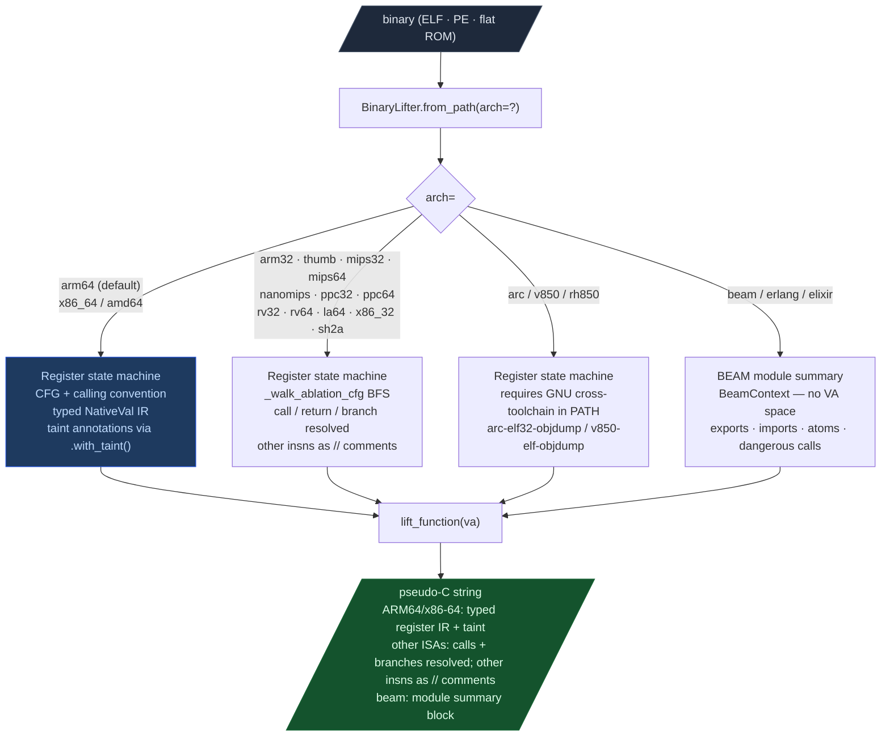

# BinaryLifter

Lift native binary functions to annotated C pseudocode.

**Module:** `ablation.analyzers.binary_lifter` 
**Exports:** `BinaryLifter`, `NativeVal`

---

## What this is

BinaryLifter is the single lift entry point for all 17 ISAs in Ablation. It accepts any supported binary, an arch token, and a function VA and returns annotated pseudo-C. All ISA backends use per-register state machines and calling-convention-aware call signatures; output completeness varies by ISA (CFG depth, loop structuring, type recovery). BEAM files lift to module summaries through the same interface.

---

## Where it's used

After `SemanticSearcher` and `TaintTracker` identify candidates, BinaryLifter makes a flagged function readable. Use it to understand what a function does before writing a finding.

---

## Safe usage

**Specify `arch=` for non-ARM64 binaries.** The default is `arm64`. An SH-2A, MIPS, or RISC-V binary passed without `arch=` produces misidentified instructions with no error.

**Use `from_context()` when a `BinaryContext` already exists.** `from_path()` re-parses the ELF. `from_context()` reuses the section map already in memory and avoids a redundant file read.

**Call `with_taint(findings)` after a TaintTracker run.** Without taint annotations, the lifted output shows call structure but not which paths carry attacker-controlled data. Taint annotations mark the calls worth tracing.

**Check ISA backend completeness before relying on data-flow output.** All backends track register state; completeness varies, higher-completeness backends resolve CFG edges, emit typed expressions, and annotate taint. Lower-completeness backends resolve calls/returns/branches and emit remaining instructions as `// mnemonic ops`. For full decompiler output on PPC476, use `Ppc476Decompiler` directly.

---

## Why this exists

Three things were not possible before in Ablation:

1. **A single lifting entry point for 17 ISA variants**: the ISA infrastructure existed for MIPS, PPC, RISC-V, LoongArch64, ARC, V850, nanoMIPS, and BEAM, but there was no way to get readable pseudocode from any of them. Reviewing a PPC32 function required manual Capstone loops and ad-hoc register tracking per engagement. Now `BinaryLifter.from_path(binary, arch='ppc32').lift_function(va)` produces a structural skeleton for any of the 17 supported ISAs in one call.

2. **Structural pseudocode for all ablation-native decoders**: the CFG walk infrastructure (block-level BFS over `cfg_*.blocks`) was identical across ISAs but had never been connected to an IR emitter. `_walk_ablation_cfg` closes that gap: one shared BFS walker, ISA-specific emit closures, no code duplication.

3. **BEAM module analysis via the BinaryLifter interface**: `BeamContext` existed but required a separate invocation outside the `BinaryLifter` API. Now `BinaryLifter.from_path(beam_file, arch='beam').lift_function(0)` returns a module-level summary (exports, dangerous imports, atom inventory) through the same interface as native ISA lifting.

---

## Architecture support

| Arch | `arch=` strings | Status |
|---|---|---|
| Arch | `arch=` strings | Backend / completeness |
|---|---|---|
| ARM64 | `arm64` | CFG + register state machine + calling convention + taint |
| x86-64 | `x86_64`, `x86-64`, `amd64` | Linear disasm + register tracking + taint; PE + ELF |
| x86-32 | `x86_32`, `i386`, `i686` | Register state machine (_X86_32State); CDECL; eax return |
| ARM32 | `arm32`, `arm` | insn_arm32 + cfg_arm32; AAPCS r0-r3 |
| Thumb/Thumb-2 | `thumb`, `thumb2` | insn_arm32 Thumb mode |
| MIPS-32 | `mips32`, `mips`, `mips32el` | insn_mips + cfg_mips; o32 $a0-$a3 |
| MIPS-64 | `mips64`, `mips64el` | insn_mips + cfg_mips; n64 $a0-$a7 |
| nanoMIPS | `nanomips` | NanoMIPSDecoder linear walk; o32 ABI |
| PPC-32 | `ppc32`, `ppc`, `powerpc` | insn_ppc + cfg_ppc; SysV32 r3-r10 |
| PPC-64 | `ppc64`, `powerpc64` | insn_ppc + cfg_ppc; ELFv2 r3-r10 |
| RISC-V 32 | `rv32`, `riscv32` | insn_riscv + cfg_riscv; psABI a0-a7 |
| RISC-V 64 | `rv64`, `riscv64` | insn_riscv + cfg_riscv; psABI a0-a7 |
| ARC EM/HS | `arc`, `arcem`, `archs` | requires `arc-elf32-objdump` in PATH |
| V850/RH850 | `v850`, `rh850`, `v850e2` | requires `v850-elf-objdump` in PATH |
| LoongArch64 | `la64`, `loongarch64` | LoongArchDecoder + cfg_loongarch64; lp64 $a0-$a7 |
| BEAM (Erlang/Elixir) | `beam`, `erlang`, `elixir` | Module summary: BeamContext; no VA space |

All ISA backends track register state via per-ISA state machines seeded from calling conventions. Completeness varies: ARM64 and x86-64 include taint annotations and full CFG traversal; others resolve calls/returns/branches and emit remaining instructions as `// mnemonic ops`. For PPC476 with full loop structuring and type recovery, use `Ppc476Decompiler`. ARC and V850 require a GNU cross-toolchain in PATH; they return a comment explaining the requirement if the toolchain is absent.



---

## Usage

```python
from ablation.analyzers.binary_lifter import BinaryLifter

# ARM64 (full)
lifter = BinaryLifter.from_path('/path/to/arm64.elf')
print(lifter.lift_function(0x12340))

# PPC32 (structural)
lifter = BinaryLifter.from_path('/path/to/ppc32.elf', arch='ppc32')
print(lifter.lift_function(0x10430))

# BEAM module summary (pass va=0)
lifter = BinaryLifter.from_path('/path/to/module.beam', arch='beam')
print(lifter.lift_function(0))
```

### With a BinaryContext (recommended for ARM64/x86-64)

```python
from ablation.analyzers.binary_context import BinaryContext
from ablation.analyzers.binary_lifter import BinaryLifter

ctx = BinaryContext.load_or_build('/path/to/binary')
lifter = BinaryLifter.from_context(ctx)
print(lifter.lift_function(0x12340))
```

### With taint annotations

```python
from ablation.analyzers.taint_tracker_arm64 import ARM64TaintTracker
from ablation.analyzers.binary_lifter import BinaryLifter

findings = ARM64TaintTracker.from_path_full(elf).run_interprocedural()
lifter = BinaryLifter.from_path(elf).with_taint(findings)
print(lifter.lift_function(0x12340))
```

### Convenience one-liner

```python
BinaryLifter.report('/path/to/binary', 0x12340, arch='mips32')
```

---

## API

### `BinaryLifter.from_path(binary_path, arch='arm64') → BinaryLifter`

Construct from a binary path. `arch` selects the ISA backend; see the architecture support table above for valid strings.

### `BinaryLifter.from_context(ctx, arch='arm64') → BinaryLifter`

Construct from a `BinaryContext`. Inherits PLT symbol names and confirmed function names from the context's name overlay.

### `.with_taint(findings) → BinaryLifter`

Accept a list of `TaintFindingARM64` objects (ARM64 only). Returns a new `BinaryLifter` whose `lift_function` output annotates tainted registers with `/* TAINTED */`. Does not mutate the original instance.

### `.lift_function(va, max_insns=512) → str`

Lift the function at virtual address `va` to pseudo-C IR. Returns a multi-line string. `max_insns` bounds how many instructions are disassembled before the CFG walk begins.

For `arch='beam'`: `va` is ignored; the full module summary is returned.

### `BinaryLifter.report(binary_path, va, arch='arm64') → None`

Convenience: construct, lift, and print.

---

## Output format

**Full backend (ARM64):**
```c
// fn_12340 @ 0x12340
{
  uint64_t v0 = arg0 + 0x10;
  uint64_t v1 = *(uint64_t *)(v0);   /* TAINTED */
  uint64_t v2 = fn_5678(arg0, arg1, arg2);
  if (arg0 == arg1) goto loc_12380;
  return v2;
  loc_12380:
  return 0;
}
```

**Structural backend (MIPS32):**
```c
// fn_10430 @ 0x10430
{
  // addiu $sp, $sp, -0x18
  // sw $ra, 0x14($sp)
  uint32_t v0 = printf($a0, $a1, $a2, $a3);
  // lw $ra, 0x14($sp)
  // addiu $sp, $sp, 0x18
  return $v0;
}
```

**BEAM module summary:**
```
// BEAM module: my_module
// OTP: False
{
  // exports:
  //   start/0
  //   handle_call/3
  // dangerous imports:
  //   erlang:open_port/2  /* TAINTED */
  // atoms (first 16 of 128):
  //   'ok'
  ...
}
```

---

## NativeVal

```python
@dataclass
class NativeVal:
    ctype:   str    # "uint64_t", "uint32_t", "uint8_t", "int32_t", "void *", ...
    expr:    str    # expression: "arg0", "v3", "0x1234", "*(uint64_t*)v1 + 8"
    is_ptr:  bool   # True when expression is known to be a pointer
    tainted: bool   # True when sourced from a tainted register
    uses:    int    # incremented on each read
```

`NativeVal` is populated by backends that emit typed IR expressions. ARM64 and x86-64 produce the most complete `NativeVal` population (type-annotated per-register state). Other ISA backends track register state via calling convention seeds and state machines; their output completeness varies and `NativeVal` coverage is shallower.

---

## Design

**Higher-completeness backends (ARM64, x86-64):** read bytes at VA → `insn_*.from_capstone` → `cfg_*.build_cfg` → per-register state machine (`_ARM64State`, `_X86_64State`) walks blocks and emits typed C expressions with taint annotations.

**Other ISA backends:** read bytes at VA → ISA-specific decoder (Capstone, ablation native decoder, or objdump) → per-register state machine (`_X86_32State`, `_PPC32State`, etc.) seeded with ABI → `_walk_ablation_cfg` BFS walks blocks → `_make_*_emit` closure emits: calls with resolved PLT names, returns with ABI return register, branches as `if (/* cond */) goto label;`, other instructions as `// mnemonic ops`.

**BEAM:** `BeamContext.from_path` parses the BEAM module chunk format → module name, exports, imports, atoms extracted → formatted as a comment block.

See `active-hypothesis-engine-plan.md` for Phase 2/3 context.

---

## How it works

Reads the binary image and resolves the target-specific data structures (PLT, GOT, `.eh_frame`, symbol tables) to build a function and import index. Architecture-specific calling conventions and instruction encodings are applied to recover call edges, argument registers, and return value locations. Results are stored in the session `BinaryContext` so downstream tools can use resolved names and edges.

---

## Example output

```
Resolved 847 PLT entries
Recovered 312 function starts from .eh_frame
Named 28 functions from DWARF remnants

va=0x401200  name=verify_admin_token  confidence=HIGH
va=0x4015C0  name=process_http_request  confidence=HIGH
va=0x403A00  name=''  confidence=MEDIUM  (stripped)
```

---

## False positives

Symbol resolution errors produce phantom function boundaries. Verify any candidate VA against `ctx.func_starts` before analysis. Compiler-synthesized stubs (PLT entries, thunks) appear as functions in some loaders — `BinaryContext` filters known stub patterns but custom thunks may slip through.

---

## Pipeline position

**Before this module:** `BinaryContext.load_or_build()` for symbol and import resolution. For stripped binaries, run `SemanticSearcher` first to identify candidate function VAs.

**After this module:** Pass resolved call edges and function VAs to `TaintTracker` or `SinkArgClassifier`.

---

## Reading findings

| Field | Content |
|:---|:---|
| `va` | Virtual address of the resolved symbol, function, or instruction |
| `name` | Recovered name if available, empty string if stripped |
| `detail` | What was resolved or decoded |
| `confidence` | `HIGH` / `MEDIUM` / `LOW` — how certain the resolution is |

---

## See also

- [BinaryContext](binary-context.md) — session state and function/import index
- [TaintAnalysis](taint-analysis.md) — dataflow tracking on resolved functions
- [SemanticSearch](semantic-search.md) — behavioral candidate search on the binary
