# Binary Lifter

Lift native binary functions to annotated C pseudocode across 18 ISA variants, from full typed register-tracking IR on ARM64/x86-64 to structural pseudocode on all other ablation-native decoders.

---

## Why this exists

1. **Before BinaryLifter there was no single entry point that produced readable pseudocode for all 18 ISA variants in Ablation: each new engagement required hand-crafted Capstone loops and ad-hoc register tracking for MIPS, PPC, RISC-V, LoongArch64, ARC, V850, nanoMIPS, and SH-2A.** `BinaryLifter.from_pathbinary, arch='ppc32'.lift_function(va)` produces a structural skeleton for any of the 18 supported ISAs in a single call. The per-ISA state machines `_ARM64State`, `_MIPSState`, `_PPCState`, `_RISCVState`, etc. each seed register slots from their ABI calling convention so that argument and return registers have named `arg0`/`arg1` expressions without manual setup.

2. **The CFG walk infrastructure was identical across ISAs: block-level BFS over `cfg_*.blocks`, but had never been connected to a shared IR emitter, forcing copy-paste per ISA.** `_walk_ablation_cfg` closes that gap: one BFS walker, per-ISA `_make_*_emit` closures, no duplication. Calls are emitted with resolved PLT symbol names, returns use the ABI return register, and branches emit `if /* cond */ goto label;`. Arithmetic instructions that are not yet modeled emit as `// mnemonic ops` rather than silently dropping information.

3. **`BeamContext` existed for Erlang/Elixir BEAM module analysis but required a separate invocation outside any consistent RE interface.** `BinaryLifter.from_pathbeam_file, arch='beam'.lift_function(0)` returns a module-level summary exports, dangerous imports, atom inventory through the same `lift_function` interface as native ISA lifting, allowing BEAM modules to appear in the same pipeline position as any other binary target.

---

## How it works

```mermaid
flowchart TD
    A(["binary\n(ELF · PE · flat ROM · .beam)"]):::input --> B["BinaryLifter.from_path(binary, arch='arm64')\nor from_context(ctx)"]:::primary
    B:::primary --> C["_build_section_map(binary_path)\n→ [(va_start, size, file_offset), ...]"]:::secondary
    C:::secondary --> D["lift_function(va, max_insns=512)\n→ arch string dispatch"]:::tertiary
    D:::tertiary --> E{"arch"}:::neutral

    E:::neutral -->|"arm64 (default)"| F["_lift_arm64:\nfrom_capstone → build_cfg\n_ARM64State(tainted_params)\nper-insn state.emit(insn)\ntyped NativeVal IR + taint annotation"]:::tertiary
    E:::neutral -->|"x86_64 · amd64 · x86"| G["_lift_x86_64:\nCapstone CS_ARCH_X86 CS_MODE_64\n_X86_64State register tracking\ntyped NativeVal IR + taint annotation"]:::tertiary
    E:::neutral -->|"x86_32 · i386 · i686"| H["_lift_x86_32:\nCapstone CS_MODE_32\n_X86_32State CDECL (eax return, stack args)"]:::tertiary
    E:::neutral -->|"arm32 · arm · arm-32\nthumb · thumb2"| I["_lift_arm32(thumb=False/True):\ninsn_arm32 + cfg_arm32\n_walk_ablation_cfg + _make_arm32_emit\nAAPCS r0-r3 args"]:::tertiary
    E:::neutral -->|"mips32 · mips · mipsbe\nmips32el · mips64 · mips64el"| J["_lift_mips(bits=32/64, little=True/False):\ninsn_mips + cfg_mips\n_walk_ablation_cfg + _make_mips_emit\no32 $a0-$a3 / n64 $a0-$a7"]:::tertiary
    E:::neutral -->|"nanomips"| K["_lift_nanomips:\nNanoMIPSDecoder linear walk\n_walk_ablation_cfg + _make_nanomips_emit\no32 ABI $a0-$a3"]:::tertiary
    E:::neutral -->|"ppc32 · ppc · powerpc\nppc64 · powerpc64"| L["_lift_ppc(bits=32/64):\ninsn_ppc + cfg_ppc\n_walk_ablation_cfg + _make_ppc_emit\nSysV32 r3-r10 / ELFv2 r3-r10"]:::tertiary
    E:::neutral -->|"rv32 · riscv32\nrv64 · riscv64"| M["_lift_riscv(bits=32/64):\ninsn_riscv + cfg_riscv\n_walk_ablation_cfg + _make_riscv_emit\npsABI a0-a7"]:::tertiary
    E:::neutral -->|"la64 · loongarch64"| N["_lift_loongarch64:\nLoongArchDecoder + cfg_loongarch64\n_walk_ablation_cfg + _make_la64_emit\nlp64 $a0-$a7"]:::tertiary
    E:::neutral -->|"sh2a · sh-2a · sh2"| O["_lift_sh2a:\nEcuSH2aDecoder linear walk\n_walk_ablation_cfg + _make_sh2a_emit\nRenesas SuperH ABI R4-R7 args"]:::tertiary
    E:::neutral -->|"arc · archs · arcem"| P["_lift_arc:\nrequires arc-elf32-objdump in PATH\n_walk_ablation_cfg + _make_arc_emit"]:::tertiary
    E:::neutral -->|"v850 · rh850 · v850e2"| Q["_lift_v850:\nrequires v850-elf-objdump in PATH\n_walk_ablation_cfg + _make_v850_emit"]:::tertiary
    E:::neutral -->|"beam · erlang · elixir"| R["_lift_beam:\nBeamContext.from_path\nno VA space · module summary\nexports · dangerous imports · atoms"]:::tertiary

    F:::tertiary --> S(["pseudo-C string\n(ARM64/x86-64: typed register IR + taint)\n(other ISAs: calls+branches resolved;\n arithmetic as // comments)\n(beam: module summary block)"]):::output
    G:::tertiary --> S:::output
    H:::tertiary --> S:::output
    I:::tertiary --> S:::output
    J:::tertiary --> S:::output
    K:::tertiary --> S:::output
    L:::tertiary --> S:::output
    M:::tertiary --> S:::output
    N:::tertiary --> S:::output
    O:::tertiary --> S:::output
    P:::tertiary --> S:::output
    Q:::tertiary --> S:::output
    R:::tertiary --> S:::output
    classDef input     fill:#0d47a1,stroke:#1565c0,color:#fff
    classDef primary   fill:#e65100,stroke:#bf360c,color:#fff
    classDef secondary fill:#004d40,stroke:#00695c,color:#fff
    classDef tertiary  fill:#4a148c,stroke:#6a1b9a,color:#fff
    classDef neutral   fill:#37474f,stroke:#546e7a,color:#fff
    classDef output    fill:#1b5e20,stroke:#2e7d32,color:#fff
    linkStyle 0 stroke:#bf360c,stroke-width:2px
    linkStyle 1 stroke:#00695c,stroke-width:2px
    linkStyle 2 stroke:#6a1b9a,stroke-width:2px
    linkStyle 3 stroke:#546e7a,stroke-width:2px
    linkStyle 4 stroke:#6a1b9a,stroke-width:2px
    linkStyle 5 stroke:#6a1b9a,stroke-width:2px
    linkStyle 6 stroke:#6a1b9a,stroke-width:2px
    linkStyle 7 stroke:#6a1b9a,stroke-width:2px
    linkStyle 8 stroke:#6a1b9a,stroke-width:2px
    linkStyle 9 stroke:#6a1b9a,stroke-width:2px
    linkStyle 10 stroke:#6a1b9a,stroke-width:2px
    linkStyle 11 stroke:#6a1b9a,stroke-width:2px
    linkStyle 12 stroke:#6a1b9a,stroke-width:2px
    linkStyle 13 stroke:#6a1b9a,stroke-width:2px
    linkStyle 14 stroke:#6a1b9a,stroke-width:2px
    linkStyle 15 stroke:#6a1b9a,stroke-width:2px
    linkStyle 16 stroke:#6a1b9a,stroke-width:2px
    linkStyle 17 stroke:#2e7d32,stroke-width:3px
    linkStyle 18 stroke:#2e7d32,stroke-width:3px
    linkStyle 19 stroke:#2e7d32,stroke-width:3px
    linkStyle 20 stroke:#2e7d32,stroke-width:3px
    linkStyle 21 stroke:#2e7d32,stroke-width:3px
    linkStyle 22 stroke:#2e7d32,stroke-width:3px
    linkStyle 23 stroke:#2e7d32,stroke-width:3px
    linkStyle 24 stroke:#2e7d32,stroke-width:3px
    linkStyle 25 stroke:#2e7d32,stroke-width:3px
    linkStyle 26 stroke:#2e7d32,stroke-width:3px
    linkStyle 27 stroke:#2e7d32,stroke-width:3px
    linkStyle 28 stroke:#2e7d32,stroke-width:3px
    linkStyle 29 stroke:#2e7d32,stroke-width:3px
```



### Architecture support

| ISA | `arch=` strings | Completeness |
|:---|:---|:---|
| ARM64 | `arm64` | Full: CFG + register state machine + typed NativeVal IR + taint annotation |
| x86-64 | `x86_64`, `x86-64`, `amd64`, `x86` | Full: linear disasm + `_X86_64State` register tracking + taint; PE + ELF |
| x86-32 | `x86_32`, `x86-32`, `i386`, `i686` | Structural: `_X86_32State` CDECL; eax return, stack args |
| ARM32 | `arm32`, `arm`, `arm-32` | Structural: `insn_arm32` + `cfg_arm32`; AAPCS r0-r3 |
| Thumb/Thumb-2 | `thumb`, `thumb2`, `arm-thumb` | Structural: `insn_arm32` Thumb mode |
| MIPS-32 (BE) | `mips32`, `mips`, `mips-32`, `mipsbe` | Structural: `insn_mips` + `cfg_mips`; o32 $a0-$a3 |
| MIPS-32 (LE) | `mips32el`, `mipsel`, `mips-32-el` | Structural: same as MIPS-32 BE; little-endian byte swap |
| MIPS-64 (BE) | `mips64`, `mips-64`, `mipsn64` | Structural: `insn_mips` + `cfg_mips`; n64 $a0-$a7 |
| MIPS-64 (LE) | `mips64el` | Structural: same as MIPS-64 BE; little-endian |
| nanoMIPS | `nanomips` | Structural: `NanoMIPSDecoder` linear walk; o32 ABI |
| PPC-32 | `ppc32`, `ppc`, `powerpc`, `ppc-32` | Structural: `insn_ppc` + `cfg_ppc`; SysV32 r3-r10 |
| PPC-64 | `ppc64`, `powerpc64`, `ppc-64` | Structural: `insn_ppc` + `cfg_ppc`; ELFv2 r3-r10 |
| RISC-V 32 | `rv32`, `riscv32`, `riscv-32` | Structural: `insn_riscv` + `cfg_riscv`; psABI a0-a7 |
| RISC-V 64 | `rv64`, `riscv64`, `riscv-64` | Structural: `insn_riscv` + `cfg_riscv`; psABI a0-a7 |
| LoongArch64 | `la64`, `loongarch64`, `loongarch_64`, `loongarch-64` | Structural: `LoongArchDecoder` + `cfg_loongarch64`; lp64 $a0-$a7 |
| SH-2A | `sh2a`, `sh-2a`, `sh2` | Structural: `EcuSH2aDecoder` linear walk; Renesas SuperH ABI R4-R7 |
| ARC EM/HS | `arc`, `archs`, `arcem`, `arc-32` | Structural: requires `arc-elf32-objdump` in PATH |
| V850/RH850 | `v850`, `rh850`, `v850e2` | Structural: requires `v850-elf-objdump` in PATH |
| BEAM | `beam`, `erlang`, `elixir` | Module summary: `BeamContext`; no VA space: pass `va=0` |

---

## Usage

```python
from ablation.analyzers.binary_lifter import BinaryLifter

# Default ARM64 (full register-tracking + taint-ready)
lifter = BinaryLifter.from_path('/path/to/arm64.elf')
print(lifter.lift_function(0x12340))

# Structural backend — PPC32
lifter = BinaryLifter.from_path('/path/to/ppc32.elf', arch='ppc32')
print(lifter.lift_function(0x10430))

# BEAM module summary (va=0, arch string triggers BeamContext)
lifter = BinaryLifter.from_path('/path/to/module.beam', arch='beam')
print(lifter.lift_function(0))

# MIPS-32 little-endian
lifter = BinaryLifter.from_path('/path/to/mipsel.elf', arch='mips32el')
print(lifter.lift_function(0x400a00))

# ARC EM (requires arc-elf32-objdump in PATH)
lifter = BinaryLifter.from_path('/path/to/arc.elf', arch='arc')
print(lifter.lift_function(0x1000))
```

### With a BinaryContext recommended: avoids re-parsing

```python
from ablation.analyzers.binary_context import BinaryContext
from ablation.analyzers.binary_lifter import BinaryLifter

ctx = BinaryContext.load_or_build('/path/to/binary')
lifter = BinaryLifter.from_context(ctx)
print(lifter.lift_function(0x12340))
```

### With taint annotations from ARM64TaintTracker

```python
from ablation.analyzers.taint_tracker_arm64 import ARM64TaintTracker
from ablation.analyzers.binary_lifter import BinaryLifter

findings = ARM64TaintTracker.from_path_full(elf).run_interprocedural()
lifter = BinaryLifter.from_path(elf).with_taint(findings)
print(lifter.lift_function(0x12340))
# Tainted registers appear as /* TAINTED */ in output
```

### Convenience one-liner

```python
BinaryLifter.report('/path/to/binary', 0x12340, arch='mips32')
```

---

## Example output

The following illustrates the output format for the three completeness tiers. Actual function names, virtual addresses, and IR expressions will reflect the specific binary.

**Full backend (ARM64) with taint annotations:**
```c
// <function-name> @ <va>
{
  uint64_t v0 = arg0 + 0x10;
  uint64_t v1 = *(uint64_t *)(v0);   /* TAINTED */
  uint64_t v2 = <callee-name>(arg0, arg1, arg2);
  if (arg0 == arg1) goto loc_<label-va>;
  return v2;
  loc_<label-va>:
  return 0;
}
```

**Structural backend (MIPS-32): calls resolved, arithmetic as comments:**
```c
// fn_<va> @ <va>
{
  // addiu $sp, $sp, -0x18
  // sw $ra, 0x14($sp)
  uint32_t v0 = printf($a0, $a1, $a2, $a3);
  // lw $ra, 0x14($sp)
  // addiu $sp, $sp, 0x18
  return $v0;
}
```

**BEAM module summary `arch='beam'`, `va=0`:**
```
// BEAM module: <module-name>
// OTP: <True|False>
{
  // exports:
  //   <function>/<arity>
  //   <function>/<arity>
  // dangerous imports:
  //   erlang:<dangerous-call>/<arity>  /* TAINTED */
  // atoms (first 16 of <n>):
  //   '<atom>'
  ...
}
```

---

## False positives

**Compiler-synthesized stubs appear as functions in some loaders.** PLT entries and thunks are short sequences that `BinaryContext` filters using known stub patterns, but custom thunks built from non-standard sequences may pass the filter. Validate any candidate VA against `ctx.func_starts` before investing in full lift output: a thunk will show only 1-3 instructions with a single tail-call.

**Structural backends emit `// mnemonic ops` for arithmetic instructions that are not yet modeled.** These comment lines indicate the instruction was decoded but the state machine has no emit closure for it. They are not errors: the function skeleton is still correct for calls, returns, and branches. If arithmetic in the comment lines is relevant to the finding, read the raw instruction bytes directly using `ctx.disasm_func(va)` and trace the values manually.

**`arch=` default is `arm64`: passing a non-ARM64 binary without specifying `arch=` produces misidentified instructions with no error.** There is no arch detection from the binary's ELF `e_machine` field; the lifter uses whatever `arch=` string the caller provides. Always specify `arch=` for any ISA other than ARM64.

---

## Pipeline position

**Before this module:** `BinaryContext.load_or_build()` for symbol and import resolution, PLT index, and confirmed function names via `ctx.set_name()`. For stripped binaries, run `SemanticSearcher.query()` first to identify candidate function VAs: lifting unrelated functions at arbitrary addresses wastes time on prologue/epilogue sequences.

**After this module:** Pass lifted pseudo-C output to `TaintTracker` for data-flow confirmation on ARM64/x86-64 targets. For structural backends, use the resolved call graph from lifted output to identify which callee functions to lift next. For `arch='beam'` targets, feed dangerous-import findings into `modules/java_re.py` OTP patterns for cross-runtime analysis.

---

## Reading findings

| Field | Content |
|:---|:---|
| `va` | Virtual address of the lifted function entry point |
| `arch` | ISA backend used for example `arm64`, `ppc32`, `mips32el` |
| Lifted output | Multi-line pseudo-C string: `/* TAINTED */` marks tainted registers ARM64/x86-64 only; `// mnemonic ops` marks unmodeled arithmetic structural ISAs |
| `NativeVal.ctype` | C type string for a register slot: `uint64_t`, `uint32_t`, `void*`, `int32_t`, etc. |
| `NativeVal.expr` | Expression string: `arg0`, `v3`, `0x1234`, `*uint64_t*v1 + 8` |
| `NativeVal.tainted` | `True` when the register was seeded from a tainted parameter ARM64/x86-64 only |

---

## See also

- [BinaryContext](binary-context.md): session state, function/import index, confirmed name overlay
- [TaintAnalysis](taint-analysis.md): dataflow tracking; feed `findings` into `.with_taint()` for annotation
- [SemanticSearch](semantic-search.md): behavioral candidate search to identify VAs worth lifting
- [BinaryLifterSH2A](binary-lifter-sh2a.md): SH-2A specific lifting details and ECU function patterns

---

## Ppc476Lifter: specialized IBM PPC476 BE lifter

**File:** `ablation/analyzers/ppc476_lifter.py`

Standalone IBM PPC476 BE pseudo-C lifter. Fills gap PPC476-GAP-003: no Python-native PPC32 BE lifter existed before this module. Lifts a function linearly: tracks register state across straight-line instruction sequences and annotates branches as `// if/else` comments; does **not** perform cross-branch data-flow analysis. Uses Capstone `CS_ARCH_PPC + CS_MODE_32 | CS_MODE_BIG_ENDIAN`. Architecture: PPC32 BE IBM PPC476, glibc 2.15.

**Usage:**
```python
from ablation.analyzers.ppc476_lifter import Ppc476Lifter
lifter = Ppc476Lifter.from_context(ctx)
pseudo = lifter.lift(func_va, n_insn=200)
print(pseudo)
```

**Output format**: C-like pseudo-code lines tagged with VA:
```
[0x10002754] r1 -= 0x80;           // frame alloc
[0x10002760] r9 = r3;              // arg copy
[0x100027a4] fork();               // PLT call
[0x10002838] execv(r3, r4);        // PLT call
```

**ABI:** `r3`–`r10` args and return; `r14`–`r31` callee-saved; `r1` stack pointer; `r2` TOC; `r13` SDA pointer; `LR` link register; `CTR` indirect-call register.
