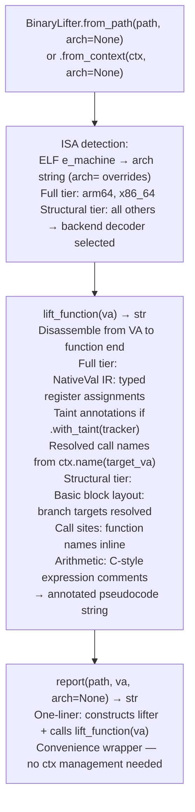

# Binary Lifting

Lift native binary instructions from 18 ISA variants — ARM64, x86-64, x86-32, ARM32/Thumb, MIPS-32/64, nanoMIPS, PPC-32/64, RISC-V 32/64, LoongArch64, SH-2A, ARC EM/HS, V850/RH850, BEAM — to annotated C pseudocode with resolved calls, typed register state, and optional taint annotations, via `ablation/analyzers/binary_lifter.py` `BinaryLifter`.

---

## Why this exists

1. **Firmware targets span dozens of ISA variants that Ghidra and Binary Ninja do not support or support poorly** — nanoMIPS (MediaTek), BEAM (Erlang/OTP embedded nodes), SH-2A (Renesas automotive), ARC EM/HS (DesignWare embedded), and V850/RH850 (automotive ECUs) are second-tier targets in commercial tools. `BinaryLifter` provides a single dispatch interface across all 18 ISAs so that ablation analysis scripts do not branch on architecture.

2. **Two completeness tiers reflect the analysis depth available per architecture** — ARM64 and x86-64 implement full pseudocode lifting: typed `NativeVal` IR, register state machine, and taint propagation annotations. All other ISAs implement structural lifting: basic-block structure, call site resolution, and arithmetic as comments. This tier distinction is surfaced explicitly in the output so a reviewer knows at a glance how complete the pseudocode is.

3. **`BinaryLifter.lift_function(va)` takes a function VA and produces a complete pseudocode listing without requiring manual disassembly** — the caller does not select a decoder, manage register file state, or handle platform-specific calling conventions. `BinaryLifter.from_path()` reads the ELF header to dispatch the correct ISA backend automatically; `arch=` overrides the detection for unusual or stripped targets.

---

## How it works



---

## Usage

```python
from ablation.analyzers.binary_lifter import BinaryLifter

# ARM64 (full — register state machine + taint-ready)
lifter = BinaryLifter.from_path('/path/to/arm64.elf')
print(lifter.lift_function(0x12340))

# MIPS-32 (structural — calls resolved, arithmetic as comments)
lifter = BinaryLifter.from_path('/path/to/mips32.elf', arch='mips32')
print(lifter.lift_function(0x10430))

# Convenience one-liner
BinaryLifter.report('/path/to/binary', 0x12340, arch='ppc32')
```

**ISA → `arch=` string reference**

| ISA | `arch=` |
|:---|:---|
| ARM64 | `arm64` (default on AArch64 ELF) |
| x86-64 | `x86_64`, `amd64` |
| x86-32 | `x86_32`, `i386` |
| ARM32/Thumb | `arm32`, `thumb`, `thumb2` |
| MIPS-32 | `mips32`, `mips`, `mips32el` |
| MIPS-64 | `mips64`, `mips64el` |
| nanoMIPS | `nanomips` |
| PPC-32 | `ppc32`, `ppc`, `powerpc` |
| PPC-64 | `ppc64`, `powerpc64` |
| RISC-V 32/64 | `rv32`, `rv64`, `riscv32`, `riscv64` |
| LoongArch64 | `la64`, `loongarch64` |
| SH-2A | `sh2a`, `sh2` |
| ARC EM/HS | `arc`, `archs`, `arcem` |
| V850/RH850 | `v850`, `rh850`, `v850e2` |
| BEAM | `beam`, `erlang`, `elixir` |

---

## Example output

The following is a schematic example showing output structure and field names. Values are illustrative.

```
lift_function(0x22ccc0)   [arm64 — full tier]

  // <func_name>
  NativeVal x0 = recv(sockfd, buf, len, flags);   // tainted: x0
  NativeVal x1 = x0 + 0x10;
  if (x1 > x8) goto loc_22cd48;
  NativeVal x2 = memcpy(dest, x0, x1);
  system(x0);   // ★ TAINT: x0 reaches sink from recv()

lift_function(0x10430)   [mips32 — structural tier]

  // <func_name>
  /* a0 = recv(...) */
  /* a0 += 0x10 */
  if a0 > t0: goto 0x10458
  /* memcpy(a1, a0, a0) */
  /* system(a0) */   // sink
```

---

## False positives

**Structural tier pseudocode has incomplete register provenance** — on non-ARM64/x86-64 ISAs, `BinaryLifter` does not maintain a full typed register state machine. A call to `system(a0)` in MIPS structural pseudocode indicates `a0` is the first argument, but the lifter does not trace where `a0` was last written. Combine structural output with `SinkArgClassifier` and `TaintTracker` for ISAs that support them.

**ELF `e_machine` detection fails on firmware blobs without ELF headers** — raw binary blobs extracted from flash images may lack an ELF header. `BinaryLifter.from_path()` raises `ValueError` if ISA detection fails and no `arch=` override is provided. Always pass `arch=` explicitly for non-ELF firmware images.

---

## Pipeline position

Use `BinaryLifter.lift_function(va)` after `FuncProfiler` identifies a candidate function and `SinkArgClassifier` classifies the sink as `ARG_PROPAGATED` or `UNKNOWN`. The pseudocode output serves as human-readable confirmation of the taint path before writing the finding to `re/<vendor>/<target>_re.py`.

---

## See also

- [Binary Lifter](binary-lifter.md) — complete `BinaryLifter` API, `NativeVal` dataclass, taint annotation integration
- [BinaryContext](binary-context.md) — session state container; use `from_context()` to avoid re-parsing
- [Function Profiler](function-profiler.md) — identify candidate functions before lifting
