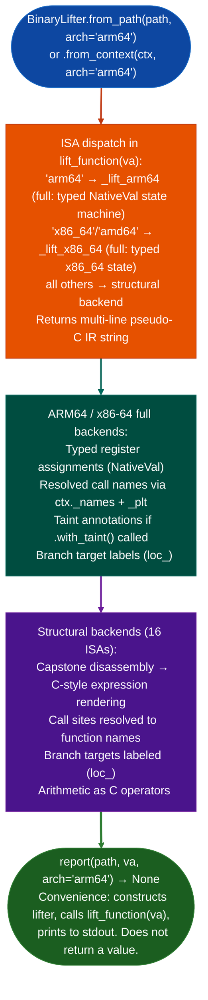

# Binary Lifting

Lift native binary instructions from 18 ISA variants: ARM64, x86-64, x86-32, ARM32/Thumb, MIPS-32/64, nanoMIPS, PPC-32/64, RISC-V 32/64, LoongArch64, SH-2A, ARC EM/HS, V850/RH850, BEAM: to annotated C pseudocode with resolved calls, typed register state, and optional taint annotations, via `ablation/analyzers/binary_lifter.py` `BinaryLifter`.

---

## Why this exists

1. **Firmware targets span dozens of ISA variants that commercial tools support poorly**: nanoMIPS (MediaTek), BEAM Erlang/OTP embedded nodes, SH-2A Renesas automotive, ARC EM/HS (DesignWare embedded), and V850/RH850 automotive ECUs are second-tier targets in commercial disassemblers. `BinaryLifter` provides a single dispatch interface across all 18 ISAs so that ablation analysis scripts do not branch on architecture.

2. **ARM64 and x86-64 have full typed-register-state lifters; all other ISAs produce structured pseudocode**: the ARM64 backend (`_lift_arm64`) and x86-64 backend (`_lift_x86_64`) both maintain a typed register state machine: each instruction's output is modeled as a `NativeVal` with a C type, and taint annotations are propagated register-by-register. All other backends produce structured pseudocode: call sites are resolved to names, branch targets are labeled, and arithmetic appears as C-style expressions, but without a register state machine.

3. **`with_taintfindings` integrates TaintTracker output directly into lifted pseudocode**: `BinaryLifter.with_taintfindings` accepts a list of `TaintFindingARM64` or any object with `func_va`, `source_reg`, `sink_reg`, or `tainted_regs` attributes and returns a new `BinaryLifter` instance that annotates affected instructions in the lifted output with taint markers. This connects the automated taint analysis to the human-readable pseudocode.

---

## How it works



---

## Usage

```python
from ablation.analyzers.binary_lifter import BinaryLifter

# ARM64 — full typed register state machine
lifter = BinaryLifter.from_path('/path/to/arm64.elf')
print(lifter.lift_function(0x12340))

# MIPS-32 — structural pseudocode (calls resolved, arithmetic as C)
lifter = BinaryLifter.from_path('/path/to/mips32.elf', arch='mips32')
print(lifter.lift_function(0x10430))

# With taint annotations from a prior TaintTracker run
from ablation.analyzers.taint_tracker_arm64 import ARM64TaintTracker
tracker = ARM64TaintTracker.from_context(ctx)
findings = tracker.run()
annotated_lifter = BinaryLifter.from_context(ctx).with_taint(findings)
print(annotated_lifter.lift_function(0x12340))

# Convenience one-liner: prints to stdout, returns None
BinaryLifter.report('/path/to/binary', 0x12340, arch='ppc32')
```

**ISA → `arch=` string reference**

| ISA | `arch=` strings |
|:---|:---|
| ARM64 | `arm64` (default) |
| x86-64 | `x86_64`, `x86-64`, `amd64`, `x86` |
| x86-32 | `x86_32`, `x86-32`, `i386`, `i686` |
| ARM32 | `arm32`, `arm`, `arm-32` |
| Thumb/Thumb2 | `thumb`, `thumb2`, `arm-thumb` |
| MIPS-32 BE | `mips32`, `mips`, `mips-32`, `mipsbe` |
| MIPS-32 LE | `mips32el`, `mipsel`, `mips-32-el` |
| MIPS-64 BE | `mips64`, `mips-64`, `mipsn64` |
| MIPS-64 LE | `mips64el` |
| nanoMIPS | `nanomips` |
| PPC-32 | `ppc32`, `ppc`, `powerpc`, `ppc-32` |
| PPC-64 | `ppc64`, `powerpc64`, `ppc-64` |
| RISC-V 32 | `rv32`, `riscv32`, `riscv-32` |
| RISC-V 64 | `rv64`, `riscv64`, `riscv-64` |
| ARC EM/HS | `arc`, `archs`, `arcem`, `arc-32` |
| V850/RH850 | `v850`, `rh850`, `v850e2` |
| LoongArch64 | `la64`, `loongarch64`, `loongarch_64`, `loongarch-64` |
| SH-2A | `sh2a`, `sh-2a`, `sh2` |
| BEAM | `beam`, `erlang`, `elixir` |

---

## Example output

The following is a schematic example showing output structure. Values are illustrative.

```
lift_function(0x22ccc0)   [arch=arm64, full backend]

// fn_22ccc0 @ 0x22ccc0
{
  uint64_t x0 = recv(x0, x1, x2, x3);   // tainted: x0
  uint64_t x1 = x0 + 0x10;
  if (x1 > x8) goto loc_22cd48;
  memcpy(x0, x1, x1);
  system(x0);   // ★ TAINT x0 (source: recv)
  loc_22cd48:
}

lift_function(0x10430)   [arch=mips32, structural backend]

// fn_10430 @ 0x10430
{
  /* a0 = recv(a0, a1, a2, a3) */
  /* a1 = a0 + 0x10 */
  if (a1 > t0) goto loc_10458;
  /* memcpy(a1, a0, a1) */
  system(a0);
  loc_10458:
}
```

---

## False positives

**Structural backend pseudocode has no register provenance**: on non-ARM64/x86-64 ISAs, `BinaryLifter` does not maintain a typed register state machine. A call to `system(a0)` in MIPS structural pseudocode confirms `a0` is the first argument, but the lifter does not trace where `a0` was last written. Combine structural output with `SinkArgClassifier` and the relevant `TaintTracker` for ISAs that have one.

**`report()` writes to stdout and returns `None`**: `BinaryLifter.report()` is a convenience printer, not a function that returns a string. Capturing its output requires redirecting stdout or calling `lift_function()` directly and formatting the result yourself.

**ELF `e_machine` detection requires an ELF header**: raw binary blobs extracted from flash images may lack an ELF header. `BinaryLifter.from_path()` with no `arch=` defaults to `arm64`. Always pass `arch=` explicitly for non-ELF firmware images or when auto-detection may pick the wrong ISA.

---

## Pipeline position

Use `BinaryLifter.lift_function(va)` after `FuncProfiler` identifies a candidate function and `SinkArgClassifier` classifies the sink as `ARG_PROPAGATED` or `UNKNOWN`. The pseudocode output serves as human-readable confirmation of the taint path before writing the finding to `re/<vendor>/<target>_re.py`. For ARM64 and x86-64 targets, chain `.with_taintfindings` from a prior `TaintTracker` run to annotate taint flow directly in the pseudocode.

---

## Reading output

`BinaryLifter.lift_function(va)` returns a pseudocode string: multi-line annotated C-like IR with taint labels inline. The return type is `str`; no structured IR object is exposed.

---

## See also

- [Binary Lifter](binary-lifter.md): complete `BinaryLifter` API, `NativeVal` dataclass, `_X86_64State` detail
- [BinaryContext](binary-context.md): session state container; use `from_context()` to inherit PLT and name overlay
- [Function Profiler](function-profiler.md): identify candidate functions before lifting
