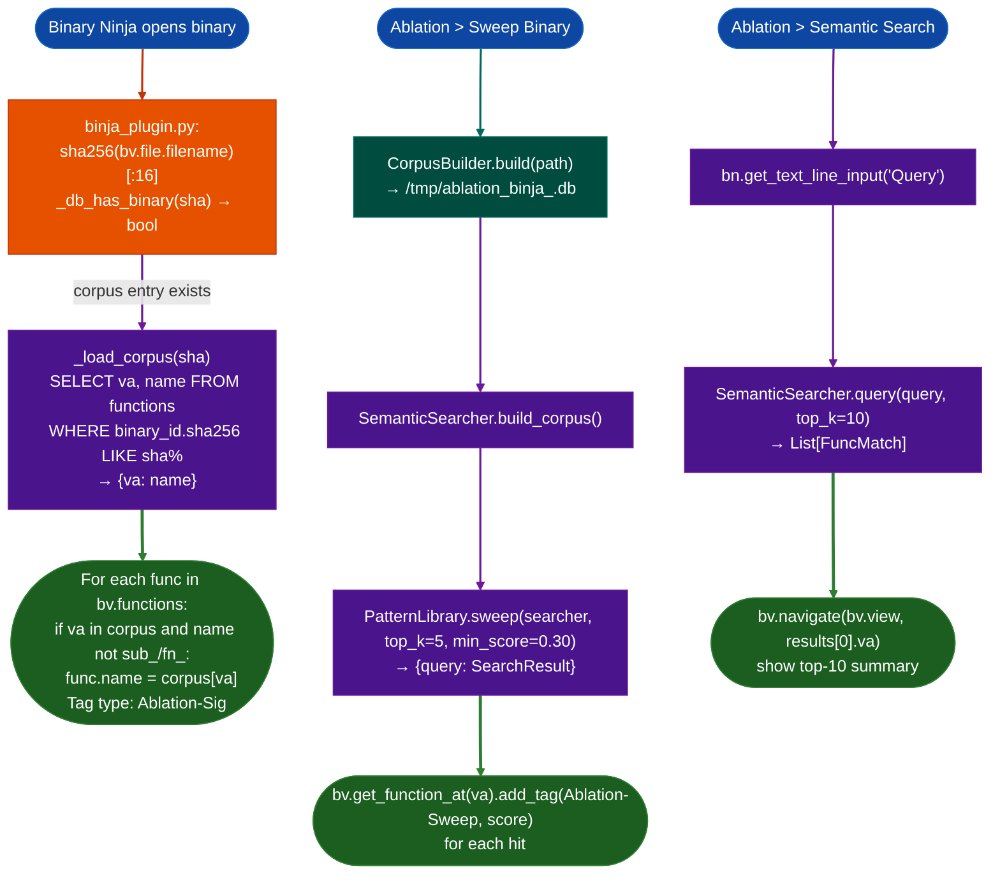

<a id="binary-ninja-plugin"></a>
# Binary Ninja Plugin

The Binary Ninja plugin reads the ablation session cache and applies function names, sweep hits, and semantic search results to the disassembly view. Names set with `ctx.set_name()` appear in the function list immediately because Binary Ninja re-renders on rename.

---

## Why this exists

1. **Names recovered by ablation (`ctx.set_name()`) are invisible in Binary Ninja until manually re-entered.** The plugin reads `~/.ablation/func_id.db` on binary open and applies every confirmed name to the matching function address, so the function list and cross-reference graph update immediately with no re-analysis required.

2. **Pattern sweeps and semantic queries run from the CLI; the Binary Ninja view stays out of sync.** `Ablation > Sweep Binary` builds a corpus, runs the pattern library sweep inline, and bookmarks every hit with a score annotation so sweep candidates are visible in the disassembly without a separate terminal session.

3. **Navigating to a semantically described function requires knowing its address.** `Ablation > Semantic Search` takes a plain-English query and navigates the Binary Ninja view to the highest-scoring function. The top 10 results and their scores appear in the result panel.

---

## How it works



---

## Installation

Copy `ablation/integrations/binja_plugin.py` to the Binary Ninja plugins directory and restart Binary Ninja:

```
macOS:   ~/Library/Application Support/Binary Ninja/plugins/
Linux:   ~/.binaryninja/plugins/
Windows: %APPDATA%\Binary Ninja\plugins\
```

The `ablation` package must be installed in the same Python environment Binary Ninja uses:

```bash
pip install ablation
# verify from Binary Ninja's Python console:
# >>> import ablation
```

---

## Commands

| Command | Action |
|:---|:---|
| `Ablation > Annotate from Corpus` | Load confirmed names from `~/.ablation/func_id.db` into the function list |
| `Ablation > Sweep Binary` | Run pattern sweep; bookmark hits with score tags |
| `Ablation > Semantic Search` | Query by description; navigate to top result |

---

## Usage

**Load names after a CLI session:**

```python
# In a CLI session, confirm names as usual:
ctx.set_name(0xdeadbeef, "parse_http_request", source="confirmed")
# Then in Binary Ninja: Ablation > Annotate from Corpus
# All set_name() entries for this binary appear in the function list immediately.
```

**Sweep from Binary Ninja:**

Open the binary, then run `Ablation > Sweep Binary`. On the first run, `CorpusBuilder` takes ~30s to build the function corpus; subsequent runs read from the cached `.db` at `/tmp/ablation_binja_<stem>.db`.

**Semantic search:**

Run `Ablation > Semantic Search`, type a description such as `"HTTP chunked transfer decoder"`, and Binary Ninja navigates to the highest-confidence match. The top-10 results with addresses and scores appear in the result dialog.

---

## Notes

- The corpus DB at `~/.ablation/func_id.db` is matched by SHA-256 prefix: the same DB used across CLI sessions. Re-open the binary after a CLI session to pick up new names without reinstalling the plugin.
- `Ablation-Sweep` tags appear as `!` markers in the Binary Ninja function list. `Ablation-Sig` tags mark corpus-named functions.
- The plugin imports `ablation` lazily inside each command handler: Binary Ninja will start cleanly even if `ablation` is not installed, and will show an install prompt on first use.

---

## See also

- [BinaryContext](binary-context.md): the session cache and `ctx.set_name()` API
- [Semantic Search](semantic-search.md): `SemanticSearcher.query()` — the same engine the plugin calls
- [Pattern Library](pattern-library.md): `PatternLibrary.sweep()` — sweep patterns behind `Ablation > Sweep Binary`
