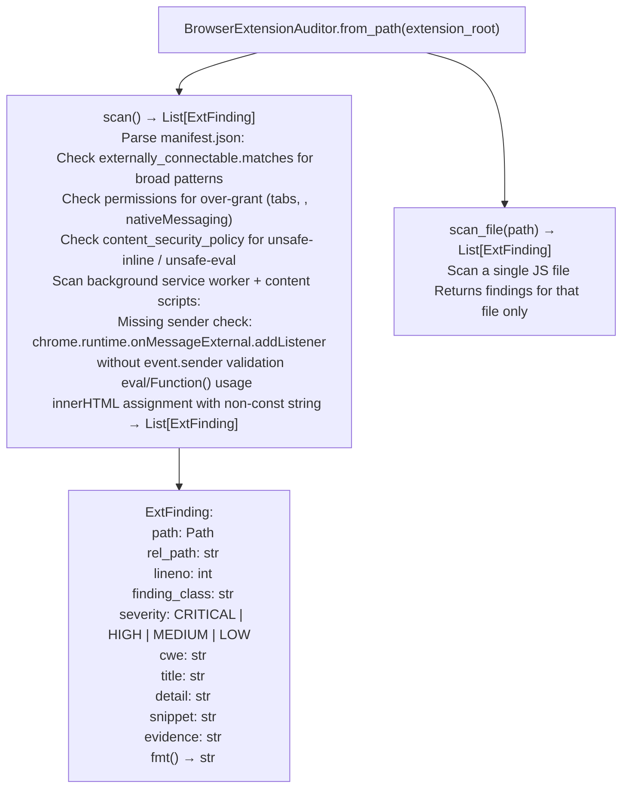

# Browser Extension Auditing

Audit Chrome/Edge/Firefox extension security: detecting broadly-wildcarded `externally_connectable` host patterns, privileged Chrome messaging bus exposure, unsafe `eval()` usage, CSP policy weaknesses, and host permission over-grants: with findings mapped to CWE and severity for systematic extension security review.

---

## Why this exists

1. **FortiClient EMS ships a browser extension (FPAM) that exposes a privileged Chrome messaging bus to web pages via `externally_connectable`.** Manual analysis of `manifest.json` and the background service worker confirmed FPAM-EXT-1: the `externally_connectable` host pattern included broad wildcards, enabling any page matching the pattern to send privileged messages to the extension: a cross-origin privilege escalation vector. `BrowserExtensionAuditor` automates detection of this pattern class across all browser extension targets.

2. **`externally_connectable` with `*://*/ ` or `<all_urls>` gives every web page access to the extension's `chrome.runtime.sendMessage` bus**: if the background service worker does not validate the sender identity, any malicious page can invoke extension APIs that have access to browser storage, native messaging, or cross-domain network requests. `BrowserExtensionAuditor` detects both the broad pattern and the missing sender-check pattern simultaneously.

3. **`BrowserExtensionAuditor.scan_file()` processes individual JS files**: enabling targeted analysis of a specific service worker or content script alongside the full extension scan. `ExtFinding.finding_class` categorizes findings into `externally_connectable_broad`, `missing_sender_check`, `eval_usage`, `csp_unsafe`, and `overgrant_permission` for triage prioritization.

---

## How it works



---

## Usage

```python
from ablation.analyzers.browser_extension_auditor import BrowserExtensionAuditor

# Full extension scan (extracted or unpacked .crx / .xpi)
auditor = BrowserExtensionAuditor.from_path('/tmp/fpam_extension_extracted/')
findings = auditor.scan()
print(BrowserExtensionAuditor.report(findings))

# Filter by finding class
ec_findings = [f for f in findings if f.finding_class == 'externally_connectable_broad']
for f in ec_findings:
    print(f.fmt())

# Single file scan
single = BrowserExtensionAuditor.scan_file('/tmp/fpam_extension_extracted/background.js')
for f in single:
    print(f.fmt())
```

To unpack a `.crx` before scanning:
```bash
# Chrome CRX3 is a protobuf wrapper around a zip
unzip -q extension.crx -d /tmp/extension_extracted/ 2>/dev/null || \
  python3 -c "import zipfile; zipfile.ZipFile('extension.crx').extractall('/tmp/extension_extracted/')"
```

---

## Example output

The following illustrates the browser extension audit output format. Actual findings are extension-specific.

```
BrowserExtensionAuditor: fpam_extension_extracted/

[CRITICAL] externally_connectable_broad: Broad externally_connectable host pattern
  File: manifest.json:1
  CWE: CWE-284
  externally_connectable.matches includes '*://*/' — all web pages can message this extension
  Evidence: "*://*/"

[HIGH] missing_sender_check: onMessageExternal listener without sender validation
  File: background.js:<line>
  CWE: CWE-284
  chrome.runtime.onMessageExternal.addListener without event.sender check

Total: <N> findings  (<C> critical, <H> high)
```

---

## False positives

**`externally_connectable_broad` fires on `https://*.example.com/*` patterns**: subdomain-wildcarded patterns are flagged as broad because they cover all subdomains including attacker-controlled ones if the root domain allows user subdomains. Validate whether the wildcarded domain is single-vendor or user-extensible before treating as critical.

**Missing sender check pattern uses regex matching**: an `onMessageExternal` listener that performs sender validation in a called helper function will be flagged as missing the check if the helper is not inlined. Inspect the listener body for indirect validation before reporting.

---

## Pipeline position

Run `BrowserExtensionAuditor` on any Chrome/Edge/Firefox extension extracted from a firmware package or client software installer. Pair with `ElectronSecurityScanner` for Electron-based desktop apps that include embedded browser extensions.

---

## Reading findings

`BrowserExtensionAuditor.audit()` returns a list of finding dicts:

| Field | Content |
|:---|:---|
| `severity` | `CRITICAL` / `HIGH` / `MEDIUM` / `LOW` |
| `code` | Finding code slug for example `externally_connectable_broad`, `missing_sender_check` |
| `file` | Source file path and line number for example `manifest.json:1` |
| `cwe` | CWE identifier for example `CWE-284` |
| `detail` | Human-readable explanation of the vulnerability |
| `evidence` | Code snippet or JSON fragment confirming the finding |

---

## See also

- [Electron Application Auditing](electron-application-auditing.md): Electron app security scanning similar pattern class
- [Source Dangerous Sink Detection](source-dangerous-sink-detection.md): `SourceSinkScanner` for source-level JavaScript dangerous sinks
