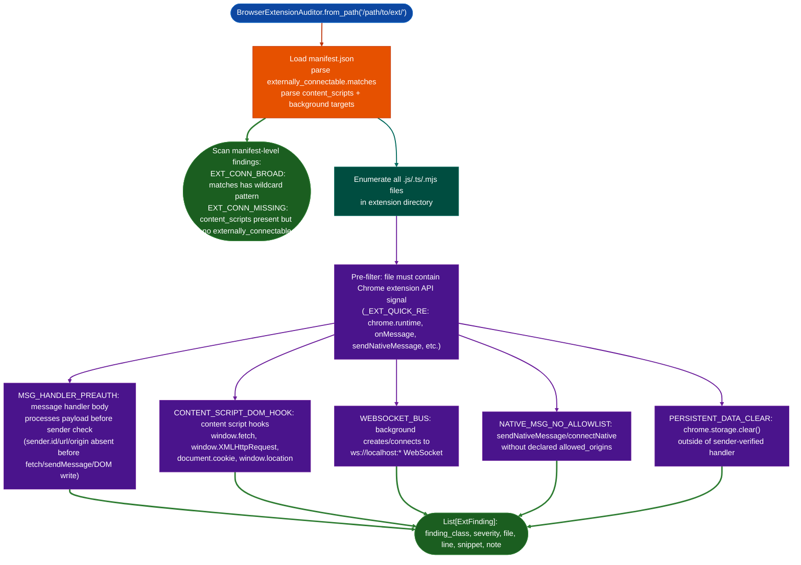

<a id="browser-extension-auditing"></a>
# Browser Extension Security

Chrome/Edge/Firefox extension security auditor: scanning manifest.json and JavaScript sources for externally-reachable message handlers, overly-broad `externally_connectable` grants, native messaging without allowlists, and confused-deputy attack surfaces.

---

## Why this exists

1. **FortiClient EMS and related Fortinet browser-resident agents FSSO, FIDO2, VPN ship Chrome extensions with `externally_connectable` patterns broad enough to allow any HTTPS page to call `chrome.runtime.sendMessage` into a privileged service worker.** `BrowserExtensionAuditor` was built to find `FPAM-EXT-1` CWE-346, HIGH: `externally_connectable` matches `https://*/*`: a pattern that allows any HTTPS origin to use the extension as a confused-deputy port-scan oracle against `127.0.0.1`. Without automation, each extension audit required reading the Chrome extension security model from scratch.

2. **`MSG_HANDLER_PREAUTH` is the most commonly missed finding in manual extension review: the background service worker destructures the request object or calls `fetch`/`XMLHttpRequest` before checking `sender.id`, `sender.url`, or `sender.origin`.** `BrowserExtensionAuditor` statically matches the JavaScript source for message handler bodies that perform payload processing before a sender check, using regex patterns for all three Chrome extension API surfaces `chrome.runtime.onMessage`, `chrome.runtime.onMessageExternal`, `browser.runtime.onMessage`.

3. **`WEBSOCKET_BUS` detects background service workers that create or connect to a WebSocket server on localhost: bypassing Chrome's extension message API entirely.** A `ws://localhost:<port>` bus has no sender validation and no `externally_connectable` restriction. Any web page that can reach the same loopback port can drive the extension's privileged behavior. This pattern has appeared in enterprise VPN and endpoint security extensions.

---

## How it works



### Finding reference

| Code | CWE | Severity | Description |
|:---|:---|:---|:---|
| `EXT_CONN_BROAD` | CWE-346 | HIGH | `externally_connectable.matches` too broad: allows any matched-origin HTTPS page to call `sendMessage` |
| `EXT_CONN_MISSING` | CWE-346 | MEDIUM | `content_scripts` declared without `externally_connectable`: postMessage relay risk |
| `MSG_HANDLER_PREAUTH` | CWE-285 | HIGH | Message handler processes payload before `sender.id`/`sender.url`/`sender.origin` check |
| `CONTENT_SCRIPT_DOM_HOOK` | CWE-200 | MEDIUM | Content script hooks `fetch`, `XMLHttpRequest`, `document.cookie`, or `location` |
| `WEBSOCKET_BUS` | CWE-284 | HIGH | Background creates/connects to `ws://` localhost WebSocket: no Chrome sender validation |
| `NATIVE_MSG_NO_ALLOWLIST` | CWE-284 | HIGH | Native messaging used without `allowed_origins` guard |
| `PERSISTENT_DATA_CLEAR` | CWE-362 | LOW | `chrome.storage.clear()` in message handler without sender check |

---

## Usage

```python
from ablation.analyzers.browser_extension_auditor import BrowserExtensionAuditor

# Scan unpacked extension directory
findings = BrowserExtensionAuditor.from_path('/tmp/fpam-ext/').scan()
print(BrowserExtensionAuditor.report(findings))

# Filter to HIGH only
high = BrowserExtensionAuditor.report(findings, min_severity='HIGH')

# Scan a single JavaScript file
file_findings = BrowserExtensionAuditor.scan_file('/tmp/ext/background.js')

# CLI usage
# python3 -m ablation.analyzers.browser_extension_auditor /path/to/ext/
# python3 -m ablation.analyzers.browser_extension_auditor /path/to/ext/ --severity HIGH
```

---

## Example output

The following illustrates the finding format. Actual file paths, line numbers, and code snippets are extension-specific.

```
[HIGH] EXT_CONN_BROAD (CWE-346)
  File: manifest.json
  externally_connectable.matches: ["https://*/*"]
  Any HTTPS page can call chrome.runtime.sendMessage into the privileged service worker.

[HIGH] MSG_HANDLER_PREAUTH (CWE-285)
  File: <background-script>.js  line <N>
  Message handler processes request.<field> before sender check.
  Snippet: <handler body excerpt>
```

---

## False positives

**`MSG_HANDLER_PREAUTH` fires when a sender check is present but appears after payload destructuring.** Some extensions destructure the message type for example `const { type, payload } = request` before checking `sender.url`, but the type check itself is a guard. Review the full handler body before confirming: a false positive fires when the destructuring is not followed by privileged action.

**`EXT_CONN_BROAD` fires for `*://*/*` even when the extension is intended for intranet deployment with an allowlisted set of internal origins.** Enterprise extensions may intentionally use `*://*/*` for a managed deployment. Verify whether `externally_connectable` is narrowed via enterprise policy before escalating.

---

## Pipeline position

Run `BrowserExtensionAuditor` as a standalone step during assessment of any vendor-shipped browser extension or endpoint security product with a browser component. No binary analysis required: the scanner operates entirely on the unpacked extension source. Pair with `JWTAnalysis` for extensions that handle authentication tokens and manual WebSocket port enumeration when `WEBSOCKET_BUS` fires.

---

## Reading findings

`BrowserExtensionAuditor.scan_dir(path)` returns `List[ExtFinding]`:

| Attribute | Content |
|:---|:---|
| `rel_path` | Source file path relative to the extension root |
| `lineno` | Line number of the finding |
| `finding_class` | Finding code for example `EXT_CONN_BROAD`, `MSG_HANDLER_PREAUTH`, `NATIVE_MSG_NO_ALLOWLIST` |
| `severity` | `HIGH` / `MEDIUM` |
| `cwe` | CWE identifier for example `CWE-346`, `CWE-285` |
| `title` | Short description of the vulnerability |
| `detail` | Detailed explanation of the attack vector |
| `snippet` | Code excerpt at the finding location if available |

`ExtFinding.fmt()` returns a formatted multi-line string for direct display.

---

## See also

- [Source Code Auditing](source-code-auditing.md): companion static analysis for broader JavaScript/TypeScript source
- [JWT Analysis and Weak Secret Testing](jwt-analysis-and-weak-secret-testing.md): browser extensions often handle JWTs
- [Credential Token Key Discovery](credential-token-key-discovery.md): hardcoded credentials in extension source
