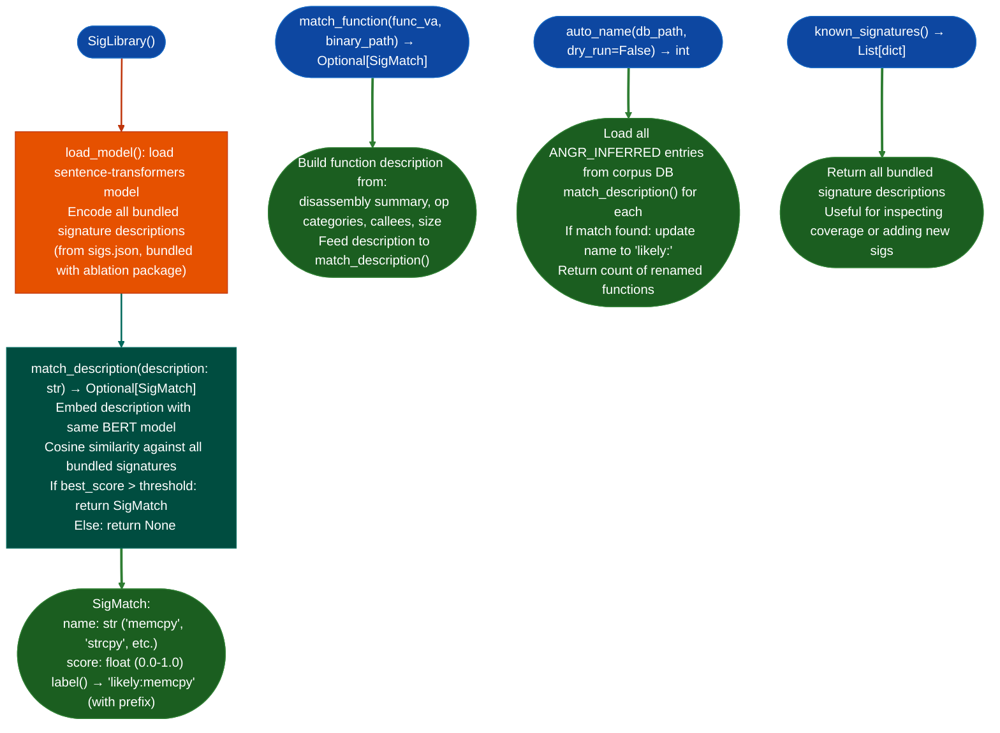

# Bundled Finding Signature Seeds

Pre-bundled behavioral signature library for stripped function identification: matching unknown functions against a curated set of known-dangerous and known-safe function profiles using `SigLibrary`, auto-naming BERT-inferred functions in the corpus with `likely:` prefixes.

---

## Why this exists

1. **BERT-based semantic search produces embedding-space nearest neighbors, but `SigLibrary` adds a structured behavioral profile layer: each signature has an explicit description, category, and confidence threshold calibrated against known-good and known-bad examples.** `SigLibrary.match_description()` returns a `SigMatch` with a `likely:` prefixed name and a confidence score, providing a more actionable label than raw embedding similarity for common library functions `memcpy`, `strcpy`, `strlen`, and `malloc`.

2. **`SigLibrary.auto_name()` renames all `ANGR_INFERRED` placeholder functions in a corpus database in a single pass**: functions that were auto-named by angr's decompiler such as `sub_0x1d700` but not yet confirmed by a human analyst. The `likely:` prefix distinguishes machine-inferred names from human-confirmed names, preventing accidental trust of inferred labels in downstream RE work.

3. **The bundled `sigs.json` ships with Ablation and covers the functions most commonly mistaken in binary RE: `memcpy`/`memmove` confusion, `strcpy`/`strncpy` misidentification, `malloc`/`calloc`/`realloc` distinction, and dangerous one-shot functions `gets` and `sprintf` with fixed dest.** The confidence thresholds are set conservatively: a function must score >0.85 against a profile to receive the `likely:` label, reducing false positive auto-naming.

---

## How it works



---

## Usage

```python
from ablation.analyzers.sig_library import SigLibrary

lib = SigLibrary()
lib.load_model()   # loads sentence-transformers model; ~2-5 seconds first call

# Match a function description
match = lib.match_description(
    "copies bytes from src to dst buffer; no bounds check; uses rep movsb"
)
if match:
    print(f"{match.label()}  confidence={match.score:.3f}")
    # → "likely:memcpy  confidence=0.91"

# Match by function VA
match2 = lib.match_function(func_va=0x1d700, binary_path='/path/to/target.elf')
if match2:
    print(match2.label())

# Auto-name all ANGR_INFERRED functions in corpus
n_renamed = lib.auto_name('/path/to/corpus.db', dry_run=False)
print(f"Renamed {n_renamed} functions to likely:* labels")

# Inspect bundled signatures
for sig in lib.known_signatures():
    print(f"  {sig['name']:20s}  {sig['description'][:60]}")
```

---

## Example output

The following illustrates the matching output format. Actual names and scores are description-dependent.

```
likely:memcpy        confidence=0.91
likely:strcpy        confidence=0.88
likely:malloc        confidence=0.87

auto_name() report:
  Renamed <N> functions from ANGR_INFERRED to likely:* labels
  Top matches: likely:memcpy (<M>), likely:strlen (<K>), likely:sprintf (<J>)
```

---

## False positives

**`likely:` prefixed names are inferred labels, not confirmed names.** A function labeled `likely:memcpy` might be a similar but different memory operation. Never treat `likely:` labels as confirmed for security-critical analysis sink identification, taint source seeding. Confirm with disassembly before escalating.

**`auto_name()` renames `ANGR_INFERRED` entries in the corpus DB in-place when `dry_run=False`.** This modifies the persistent database. Run `auto_name(dry_run=True)` first to preview renames before committing.

---

## Pipeline position

Run `SigLibrary.auto_name()` after building the initial corpus but before running `SemanticSearcher`: the `likely:*` labels improve embedding search quality by replacing generic `sub_XXXXXXXX` names with descriptive labels. `SigLibrary.match_function()` can be called alongside `SemanticSearcher` to add structured signature matches alongside embedding similarity results.

---

## Reading output

`SigLibrary.match(va)` returns a list of match dicts ranked by confidence:

| Field | Content |
|:---|:---|
| `name` | Matched library function name such as `likely:memcpy` |
| `confidence` | Float 0.0–1.0: profile similarity score |
| `seed_profile` | Profile bitmask from the seed library |
| `target_profile` | Profile bitmask from the target function |

`SigLibrary.auto_name()` applies `ctx.set_nameva, name` for matches above the `MIN_CONFIDENCE` threshold and returns a summary dict:

| Field | Content |
|:---|:---|
| `renamed` | Count of functions renamed |
| `top_matches` | List of `name, count` for the most frequent matched names |

---

## See also

- [Semantic Search](semantic-search.md): embedding-based similarity; complementary to SigLibrary profile matching
- [Function Identity Database](function-identity-database.md): persistent corpus; `auto_name()` modifies it
- [Pattern Library](prior-finding-retrieval.md): confirmed finding patterns across sessions; distinct from SigLibrary
