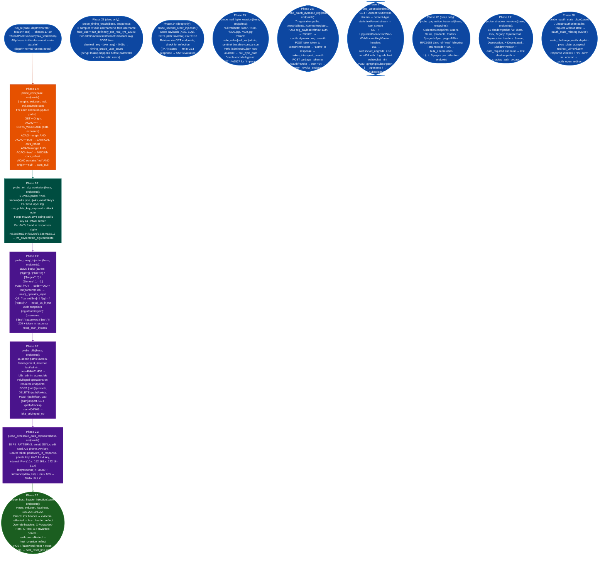

# Business Logic and Version Exposure

Run the parallel phase batch phases 17-30 of the API RE pipeline against a mapped API: covering CORS misconfiguration, JWT algorithm confusion RS256→HS256, NoSQL injection, Broken Function Level Authorization (BFLA), excessive data exposure and PII scanning, host header injection, timing-oracle user enumeration, second-order injection, null byte/WAF evasion, OAuth2 dynamic client registration, WebSocket/SSE enumeration, pagination traversal, shadow/deprecated API version detection, and OAuth2 state parameter / PKCE downgrade attacks.

---

## Why this exists

1. **CORS misconfiguration with `Access-Control-Allow-Credentials: true` and origin reflection allows cross-origin cookie and token theft, but most API scanners report all CORS issues at the same severity regardless of whether credentials are enabled.** `probe_cors()` distinguishes between three levels: `*` wildcard data exposure only, no credentials risk, reflected origin without credentials MEDIUM: cross-origin read allowed, and reflected origin with `Access-Control-Allow-Credentials: true` CRITICAL: cross-origin token/cookie exfiltration. Only the third combination produces an actionable finding.

2. **Shadow and deprecated API versions skip hardening applied to current versions: authentication enforcement, validation, and rate limiting added in `/v2` or `/v3` are frequently absent from `/v0`, `/beta`, `/dev`, and `/api/legacy` paths that are never sunset.** `probe_shadow_versions()` probes 16 shadow path patterns and, for each that returns a non-404, checks whether endpoints marked `auth_required` on the current version return 200 on the shadow version: directly confirming authentication bypass via version downgrade OWASP API9: Improper Inventory Management.

3. **Business logic attacks: negative prices, integer overflow in quantities, privilege escalation via status field injection, and sequence skipping: do not trigger any injection signal and are invisible to automated scanners that only check for error conditions.** `probe_business_logic()` probes numeric parameters `price`, `amount`, `cost`, `qty`, `balance` with boundary values 0, -1, 99999999, `NaN`, `Infinity` and status/role parameters `status`, `role`, `tier`, `plan` with privileged strings `admin`, `approved`, `verified`, `premium`. A sentinel baseline comparison (`__sentinel_xyz_12345__`) ensures that endpoints that accept any value don't generate noise.

---

## How it works



### Phase execution control

| Phase | Depth required | Focus gates (in addition to `None`) |
|---|---|---|
| 17 CORS | normal | `auth`, `cors` |
| 18 JWT alg confusion | normal | `jwt`, `auth` |
| 19 NoSQL injection | normal | `injection`, `nosql` |
| 20 BFLA | normal | `bola`, `auth`, `bfla` |
| 21 Data exposure/PII | normal | `schema`, `pii` |
| 22 Host header injection | normal | `injection`, `ssrf` |
| 23 Timing oracle | **deep only** | `auth`, `creds`, `timing` |
| 24 Second-order injection | **deep only** | `injection` |
| 25 Null byte/WAF evasion | normal | `injection`, `evasion` |
| 26 OAuth dynamic registration | normal | `oauth2`, `auth` |
| 27 WebSocket/SSE | normal | `graphql`, `schema`, `websocket` |
| 28 Pagination traversal | **deep only** | `bola`, `schema` |
| 29 Shadow/deprecated versions | normal | `schema`, `shadow` |
| 30 OAuth state/PKCE | normal | `oauth2`, `auth` |

---

## Usage

```python
from modules.api_re import (
    probe_cors, probe_jwt_alg_confusion, probe_nosql_injection,
    probe_bfla, probe_excessive_data_exposure, probe_host_header_injection,
    probe_timing_oracle, probe_second_order_injection, probe_null_byte_evasion,
    probe_oauth_dynamic_reg, probe_websocket, probe_pagination_traversal,
    probe_shadow_versions, probe_oauth_state_pkce, probe_business_logic,
    run_re, APIMap, Endpoint,
)

BASE = 'http://192.168.1.100:5000'

# Run full pipeline including all phases
api = run_re(BASE, depth='deep')  # depth='deep' enables phases 23, 24, 28
print(f"Findings: {len(api.findings)}")

# Run auth-focused subset (phases 8, 16, 17, 18, 20, 26, 30)
api_auth = run_re(BASE, depth='normal', focus='auth')

# Targeted individual probes against a pre-mapped endpoint list
endpoints = api.endpoints  # from prior run_re call

# CORS
cors = probe_cors(BASE, endpoints)
for f in cors:
    print(f"[{f['severity']}] {f['type']}: {f['origin']} creds={f['credentials']}")

# BFLA
bfla = probe_bfla(BASE, endpoints)
for f in bfla:
    print(f"[BFLA] {f['type']}: {f.get('path') or f.get('endpoint')}")

# PII scanner
pii = probe_excessive_data_exposure(BASE, endpoints)
for f in pii:
    print(f"[PII] {f['type']}: {f['endpoint']} matches={f['matches']}")

# Shadow version detection
shadow = probe_shadow_versions(BASE, endpoints)
for f in shadow:
    if f['type'] == 'shadow_auth_bypass':
        print(f"[CRITICAL] Shadow auth bypass: {f['shadow']}{f['endpoint']} returns 200")

# OAuth state and PKCE
oauth_state = probe_oauth_state_pkce(BASE)
for f in oauth_state:
    print(f"[OAuth] {f['type']}: {f.get('path')} status={f.get('status')}")

# Business logic probes
biz = probe_business_logic(BASE, endpoints)
for f in biz:
    print(f"[BIZ] {f['type']}: {f['endpoint']} param={f['param']} value={f['value']}")

# Timing oracle (slow — 8 samples × 3 usernames × 3 auth paths)
timing = probe_timing_oracle(BASE, endpoints, samples=8)
for f in timing:
    print(f"[TIMING] {f['username']}: {f['delta_ms']:.0f}ms delta at {f['path']}")
```

---

## Example output

The following illustrates the `evidence` field format for representative findings. Actual values: email addresses, API keys, JWT tokens, timing deltas, endpoint paths: will reflect the specific target.

```
[CRITICAL] cors_reflect: origin='https://evil.com' creds='true'
  access-control-allow-origin: https://evil.com
  access-control-allow-credentials: true
  → Cross-origin token/cookie theft via authenticated XHR from evil.com

[bfla_admin_accessible] /api/admin: HTTP 200 (<n>b) — admin path accessible without privilege check
  sample: {"<admin-data-fields>":...}

[excessive_data_email] GET /api/v1/users: ['<email>','<email>',...] (<n> matches)
[excessive_data_api_key] GET /api/v1/config: '<api-key-pattern>: <key-value>...'

[shadow_auth_bypass] <shadow-path>/admin: returns 200 while <current-path>/admin requires auth
  (NOTE: requires ep.auth_required=True — see False positives section)

[nosql_auth_bypass] /api/login: {"$ne":""} bypass
  → HTTP 200 body={"token":"<jwt-token>","user":{"id":"<id>","role":"<role>"},...}

[timing_oracle_user_enum] <username> SLOWER by <n>ms vs fake at <auth-path>
  (bcrypt lookup triggered for valid username — user enumeration confirmed)
```

---

## False positives

**`probe_cors()` flags `cors_reflect MEDIUM` when an API reflects the `Origin` header for same-site requests, this is expected CORS behavior for single-page applications.** An SPA at `https://app.target.com` sending XHR to `https://api.target.com` correctly gets its origin reflected in `Access-Control-Allow-Origin`. Without `Access-Control-Allow-Credentials: true`, there is no credential theft risk. Only escalate `cors_reflect` findings where `acac == "true"` AND the reflected origin is a non-allowlisted domain.

**`probe_shadow_versions()` `shadow_auth_bypass` requires `ep.auth_required == True`, but `auth_required` is never set by the pipeline.** `ep.auth_required` defaults to `False` on every `Endpoint` object and is never updated by any phase. The `shadow_auth_bypass` check (`if r2.status_code == 200` on shadow version for `auth_required` endpoints) never fires because no endpoint is ever marked `auth_required`. The finding depends on the caller setting `ep.auth_required = True` after manual auth confirmation. Shadow versions are still discovered and reported via `shadow_version` findings.

**`probe_timing_oracle()` requires a stable network environment: latency jitter > 50ms masks timing differences.** The 50ms significance threshold (`abs(delta) > 0.05`) filters out jitter in most stable local-network environments, but VPN tunnels, cloud endpoints, and load-balanced targets add 50-200ms of jitter that overwhelms the bcrypt timing signal. Increase `samples` from 8 to 20+ to reduce noise, or run from a host on the same network segment as the target.

---

## Pipeline position

**Before this module:** Run phases 1-16 via `run_re(base, depth='normal')` to build `api.endpoints`. Phases 17-30 consume `endpoints` for path selection: running them against an empty endpoint list limits discovery to fixed path lists in each probe function and misses endpoint-specific findings CORS on discovered paths, NoSQL on discovered parameters, PII on discovered collection endpoints.

**After this module:** For `cors_reflect CRITICAL`: demonstrate token exfiltration with `fetch('https://api.target.com/api/v1/me', {credentials:'include'})` from `evil.com` to confirm. For `bfla_admin_accessible`: enumerate `/api/admin/users`, `/api/admin/config`, and `/api/admin/export` to assess full admin surface. For `shadow_version` paths: rerun `run_re(<shadow_base>, depth='normal', focus='auth')` with the shadow version as base URL to assess its auth posture independently. Write confirmed findings to `~/VDT/VULNERABILITIES-<ip>.md`.

---

## Reading findings

| Field | Content |
|:---|:---|
| `f['type']` | Finding type: `cors_reflect`, `bfla_admin_accessible`, `nosql_auth_bypass`, `shadow_auth_bypass`, `timing_oracle_user_enum`, `excessive_data_<pii_type>`, `oauth_dynamic_reg_unauth`, `pkce_plain_accepted`, etc. |
| `f['severity']` CORS only | `CRITICAL` (reflect + credentials=true), `MEDIUM` reflect only, or absent (other phases use `type` as severity signal) |
| `f['path']` or `f['endpoint']` | The API path where the finding was observed |
| `f['sample']` | Body excerpt first 100-300 bytes for BFLA and BOLA findings |
| `f['matches']` | PII regex match list for data exposure findings |

---

## See also

- [Unknown HTTP API Mapping](unknown-http-api-mapping.md): phases 1-16: framework detection, OpenAPI harvest, path fuzzing, injection probing, JWT extraction, OAuth metadata, gRPC, SOAP, JSON-RPC
- [Nginx Configuration Probes](nginx-configuration-probes.md): auth bypass, rate-limit bypass, and LFI probes specific to nginx-fronted APIs
